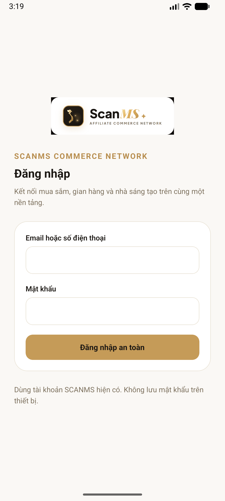
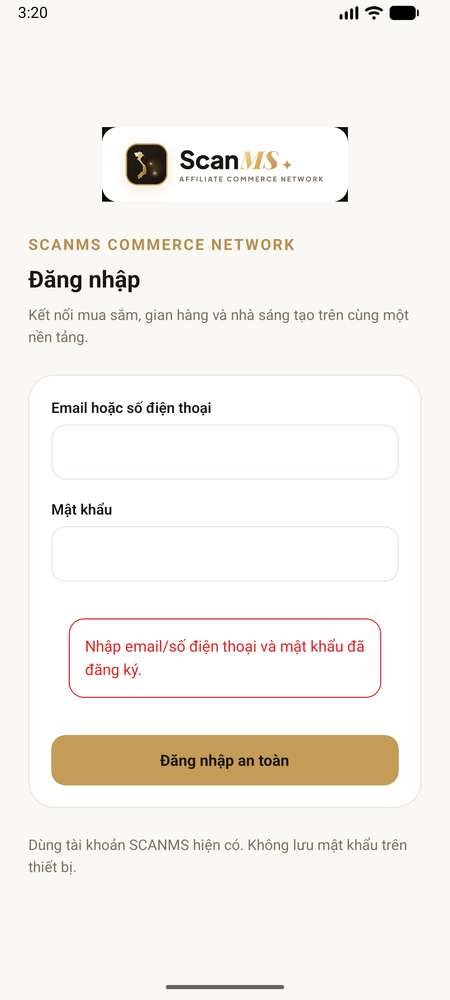

# Chạy Android thực tế — 03/11/2026

## Kết quả

Đã build thành công `:app:assembleDebug`, cài vào `Medium_Phone_API_37.0` và mở SCANMS trên Android 17/API 37. Backend dùng `backend/.env` hiện có; Metro cổng 8081. Không reset/migrate/seed DB hoặc thay mật khẩu để chạy app.

| Kiểm tra | Kết quả / bằng chứng |
| --- | --- |
| APK native | Build successful, 326 tasks; output `android/app/build/outputs/apk/debug/app-debug.apk` |
| Package | `vn.scanms.mobile`, version 1.0.0, versionCode 1, minSdk 24, targetSdk 36 |
| ABI | Chỉ x86_64 cho Emulator trong lần build này |
| Signature | `apksigner verify` exit code 0; `aapt dump badging` đúng package/nhãn SCANMS |
| Artifact bàn giao local | `Mobile/artifacts/scanms-debug-x86_64.apk`, 75.139.293 bytes |
| SHA-256 | `331af05b103d923c5c8448d6a8a7f4633bf564e2b12ba0b10379fc02e925d592` |
| Install | `adb install -r` trả Success |
| Foreground / cold start | MainActivity mở thành công; mở lại khi Metro đang chạy trả Status: ok |
| Màn đăng nhập native | Đã xem ảnh thật; giao diện vàng be, email/SĐT và mật khẩu trống |
| Validation trống | Có thông báo “Nhập email/số điện thoại và mật khẩu đã đăng ký.”; không gọi login với tài khoản thật |
| Bàn phím | Focus email mở IME, `mInputShown=true`; đã thao tác Back và mở lại app |
| Backend/Metro trên host | Health HTTP 200; Metro `packager-status:running`; native đã tải bundle từ Metro |
| Lint + TypeScript | PASS sau sửa config plugin |
| Test config Android | PASS 2/2; bộ 26 test mobile đã chạy ở lượt trước, không ghi đây là 26 test Android UI |

Đây là **APK debug cần Metro**, chưa phải bản demo độc lập Metro. Chưa thử đăng nhập bằng mật khẩu thật, chưa nghiệm thu 5 role, chưa thử chat hai client native hoặc các API mutation trên Android. Các kiểm tra API/đơn/tiền vẫn cần người nghiệm thu thực hiện theo [kịch bản](MOBILE_DEMO_SCRIPT.md). Health trên host không thay thế nghiệm thu API theo từng role trên thiết bị.

## Ảnh thật từ Emulator

Không có dữ liệu tài khoản/mật khẩu trong ảnh.





## Vấn đề môi trường đã xử lý

1. Cài bổ sung NDK 27.1, Build Tools 37 và CMake 3.22.1 qua Gradle sau khi license SDK đã được người dùng chấp nhận trong Android Studio.
2. Giới hạn worker/heap và tạm đóng Emulator trong lần build đầu khi máy gần hết RAM. Không đóng ứng dụng hoặc xóa file của người dùng để giải phóng tài nguyên.
3. Sửa source config plugin để CMake sinh object path tối đa 240 ký tự; đường dẫn gây lỗi MAX_PATH được hash xuống 234 ký tự. Không chuyển thư mục project hoặc chỉnh file thư viện.
4. Máy ảo API 37 từng hiện System UI phản hồi chậm khi boot; chọn Wait. Sau đó màn đăng nhập hoạt động. Dùng renderer software và 2 CPU khi mở lại.
5. Đã xác minh và cấp riêng `ACCESS_LOCAL_NETWORK` cho debug theo prompt Android 17 để tải Metro. Tên nhóm quyền hiển thị Nearby devices; source React Native/Expo xác định đây là quyền mạng local.

## Mở lại sau khi đóng các terminal

Backend (một instance):

```powershell
cd D:\ProjectCapstone\backend
npm run start:dev
```

Metro:

```powershell
cd D:\ProjectCapstone\Mobile
npm start -- --localhost
```

Mở Emulator trong Android Studio → chọn app **SCANMS** đã cài. Nếu cần cài lại APK đã có:

```powershell
$env:ANDROID_USER_HOME = "$env:USERPROFILE\.android"
$taskAdb = "$env:LOCALAPPDATA\Android\Sdk\platform-tools\adb.exe"
& $taskAdb -s emulator-5554 install -r D:\ProjectCapstone\Mobile\artifacts\scanms-debug-x86_64.apk
& $taskAdb -s emulator-5554 reverse tcp:8081 tcp:8081
& $taskAdb -s emulator-5554 shell am start -n vn.scanms.mobile/.MainActivity
```

Kiểm tra `adb devices` và thay serial nếu máy ảo có serial khác. Không chép APK x86_64 này sang điện thoại ARM rồi coi đó là bản đã được nghiệm thu cho điện thoại thật.
