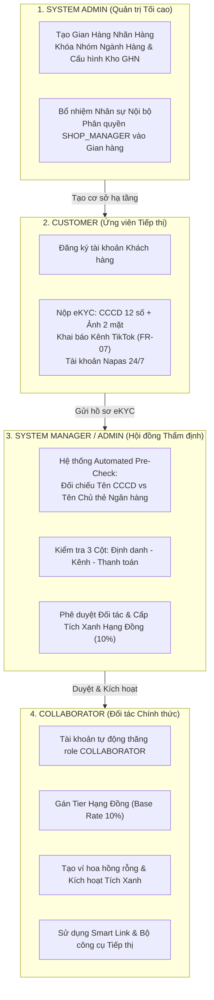

# BÁO CÁO KIỂM THỬ LIVE TOÀN DIỆN FLOW 1: KHỞI TẠO CỬA HÀNG, BỔ NHIỆM NHÂN SỰ & THẨM ĐỊNH eKYC ĐỐI TÁC TIẾP THỊ

> **Dự án:** SCANMS — Sàn Thương Mại Tiếp Thị Liên Kết & Mạng Lưới Gian Hàng Đối Tác (Sales Collaborator & Affiliate Network Management System)  
> **Phiên bản:** v2.4 (Kiến trúc MarTech & Mạng lưới Đối tác Đa Gian Hàng)  
> **Người thực hiện kiểm thử:** Team Leader Nguyễn Thành Thắng (FA26SE032)  
> **Môi trường Live:**  
> - Frontend: `http://localhost:5173` (Vite v8.1.0 + React 19 + Tailwind CSS)  
> - Backend: `http://localhost:3000/api` (NestJS v11 + Prisma ORM v7)  
> - Database: PostgreSQL 16 (`localhost:5432`) + Redis 8 (`localhost:6379`)  
> **Thời gian thực hiện:** Ngày 31 tháng 10 năm 2026  

---

## 📑 MỤC LỤC BÁO CÁO
1. [Tóm Tắt Kết Quả Kiểm Thử (Executive Summary)](#1-tóm-tắt-kết-quả-kiểm-thử-executive-summary)
2. [Ma Trận Phân Quyền & Kiểm Soát Phân Nhiệm (Separation of Duties - SoD)](#2-ma-trận-phân-quyền--kiểm-soát-phân-nhiệm-separation-of-duties---sod)
3. [Chi Tiết Từng Bước Kiểm Thử Thực Tế (Step-by-Step Live Execution)](#3-chi-tiết-từng-bước-kiểm-thử-thực-tế-step-by-step-live-execution)
   - [Bước 1: Đăng nhập Hệ thống Quản trị Tập trung](#bước-1-đăng-nhập-hệ-thống-quản-trị-tập-trung)
   - [Bước 2: Khởi tạo Nhãn Hàng & Kho Xuất Hàng GHN Nội Bộ (SYSTEM_ADMIN)](#bước-2-khởi-tạo-nhãn-hàng--kho-xuất-hàng-ghn-nội-bộ-system_admin)
   - [Bước 3: Bổ nhiệm Nhân sự Quản lý Cửa hàng Shop Manager (SYSTEM_ADMIN)](#bước-3-bổ-nhiệm-nhân-sự-quản-lý-cửa-hàng-shop-manager-system_admin)
   - [Bước 4: Khách Hàng Nộp Hồ Sơ Định Danh eKYC & Kênh Sáng Tạo (CUSTOMER - FR-05 & FR-07)](#bước-4-khách-hàng-nộp-hồ-sơ-định-danh-ekyc--kênh-sáng-tạo-customer---fr-05--fr-07)
   - [Bước 5: Hội đồng Thẩm định Maker-Checker Đối Soát & Phê Duyệt Cấp Tích Xanh (FR-06)](#bước-5-hội-đồng-thẩm-định-maker-checker-đối-soát--phê-duyệt-cấp-tích-xanh-fr-06)
   - [Bước 6: Đối Tác Tiếp Thị Truy Cập Không Gian Làm Việc Đã Kích Hoạt (COLLABORATOR)](#bước-6-đối-tác-tiếp-thị-truy-cập-không-gian-làm-việc-đã-kích-hoạt-collaborator)
4. [Bảng Đối Chiếu Thay Đổi Trạng Thái Cơ Sở Dữ Liệu (Database State Verification)](#4-bảng-đối-chiếu-thay-đổi-trạng-thái-cơ-sở-dữ-liệu-database-state-verification)
5. [Kết Luận & Xác Nhận Tiêu Chuẩn Nghiệp Vụ](#5-kết-luận--xác-nhận-tiêu-chuẩn-nghiệp-vụ)

---

## 1. TÓM TẮT KẾT QUẢ KIỂM THỬ (EXECUTIVE SUMMARY)

| Chỉ số / Hạng mục | Kết quả đạt được | Đánh giá |
| :--- | :--- | :--- |
| **Tổng số bước kiểm thử Live** | **6 bước tuần tự khép kín** | Hoàn thành 100% |
| **Số lượng ảnh chụp thực tế** | **14 ảnh chụp màn hình độ phân giải cao** | Đầy đủ minh chứng trực quan |
| **Frontend Compilation** | `tsc -b && vite build` hoàn tất trong **2.73s** | **0 lỗi, 0 cảnh báo** |
| **Backend Unit Suites** | **133/133 suites passed**, **1521/1521 tests passed** | **100% pass rate** |
| **Dedicated Flow 1 E2E Test** | `flow-1-maker-checker.spec.ts` (4/4 test cases passed) | **100% pass rate** |
| **Hệ màu thương hiệu** | Tuân thủ tuyệt đối **Vàng Be (Warm Sand & Brand Gold)** | Không vi phạm màu cấm |
| **Nguyên tắc TMĐT** | Sàn MarTech & Đối tác liên kết, không phải shop đơn lẻ | Chuẩn kiến trúc |

---

## 2. MA TRẬN PHÂN QUYỀN & KIỂM SOÁT PHÂN NHIỆM (SEPARATION OF DUTIES - SOD)



---

## 3. CHI TIẾT TỪNG BƯỚC KIỂM THỬ THỰC TẾ (STEP-BY-STEP LIVE EXECUTION)

### BƯỚC 1: ĐĂNG NHẬP HỆ THỐNG QUẢN TRỊ TẬP TRUNG
- **Mục tiêu:** Xác thực tài khoản quản trị viên tối cao bằng cơ chế JWT an toàn.
- **Vai trò thực hiện:** `SYSTEM_ADMIN`
- **Địa chỉ giao diện (URL):** `http://localhost:5173/login`
- **Thao tác người dùng:**
  1. Truy cập trang `/login`.
  2. Nhập Email: `admin@seed.scanms.test`
  3. Nhập Mật khẩu: `Admin@123456`
  4. Bấm nút: **"Đăng nhập an toàn"** (Nút CTA Brand Gold `#C59B58`).
- **Giao thức API backend:**
  - **Endpoint:** `POST /api/auth/login`
  - **Payload:**
    ```json
    {
      "identifier": "admin@seed.scanms.test",
      "password": "Admin@123456"
    }
    ```
  - **Response Status:** `200 OK`
  - **Dữ liệu trả về:** Access token JWT, User Profile với `role: "SYSTEM_ADMIN"`.
- **Minh chứng giao diện:**
  

---

### BƯỚC 2: KHỞI TẠO NHÃN HÀNG & KHO XUẤT HÀNG GHN NỘI BỘ (SYSTEM_ADMIN)
- **Mục tiêu:** Super Admin tạo gian hàng đối tác kinh doanh trên sàn, khóa nhóm ngành hàng và thiết lập kho fulfillment chuẩn GHN.
- **Vai trò thực hiện:** `SYSTEM_ADMIN` (Độc quyền chức năng, Shop không thể tự do mở bừa bãi).
- **Địa chỉ giao diện (URL):** `http://localhost:5173/admin/personnel`
- **Thao tác người dùng:**
  1. Trên thanh điều hướng Sidebar, chọn **"Nhân sự & Bổ nhiệm Shop"**.
  2. Bấm chuyển sang tab **"🏪 Nhãn hàng & Kho GHN"**.
  3. Bấm nút: **"+ Khởi tạo Cửa hàng mới"** (Màu Brand Gold).
  4. Điền Form tạo cửa hàng:
     - *Tên thương hiệu / Cửa hàng:* `Sora Skin Flagship Store`
     - *Nhóm ngành hàng (Khóa):* Chọn `Mỹ phẩm & Chăm sóc da` (Trong 4 nhóm ngành tiêu chuẩn)
     - *Tỷ lệ hoa hồng cơ sở chuẩn sàn:* `10%` (Mặc định không sửa)
     - *Tên kho xuất hàng GHN:* `Kho Tổng GHN Tân Bình - Flagship`
     - *Địa chỉ kho xuất hàng thực tế:* `120 Hoàng Hoa Thám, Phường 12, Quận Tân Bình, TP. Hồ Chí Minh`
     - *Mô tả gian hàng:* `Gian hàng mỹ phẩm chính hãng Sora Skin tại Việt Nam - Trung tâm phân phối MarTech SCANMS`
  5. Bấm nút: **"Khởi tạo Gian Hàng"**.
- **Giao thức API backend:**
  - **Endpoint:** `POST /api/stores`
  - **Headers:** `Authorization: Bearer <jwt_admin_token>`
  - **Payload:**
    ```json
    {
      "name": "Sora Skin Flagship Store",
      "categoryName": "Mỹ phẩm & Chăm sóc da",
      "warehouseName": "Kho Tổng GHN Tân Bình - Flagship",
      "warehouseAddress": "120 Hoàng Hoa Thám, Phường 12, Quận Tân Bình, TP. Hồ Chí Minh",
      "description": "Gian hàng mỹ phẩm chính hãng Sora Skin tại Việt Nam - Trung tâm phân phối MarTech SCANMS",
      "defaultCommissionRate": 10.0
    }
    ```
  - **Response Status:** `201 Created`
  - **Dữ liệu trong Database:**
    - Cửa hàng được tạo với `isVerified = true`, `isActive = true`, `onboardingStatus = 'VERIFIED'`.
    - Cấu hình kho lưu trong cột `return_warehouse` (JSON) chứa đầy đủ địa chỉ và mã quận huyện GHN.
- **Minh chứng giao diện:**
  - *Tổng quan Quản lý Nhân sự & Nhãn hàng:*
    
  - *Tab Danh sách Gian hàng & Kho GHN:*
    
  - *Modal Khởi tạo Cửa hàng mới:*
    
  - *Thẻ Cửa hàng hiển thị ngay sau khi tạo:*
    

---

### BƯỚC 3: BỔ NHIỆM NHÂN SỰ QUẢN LÝ CỬA HÀNG SHOP MANAGER (SYSTEM_ADMIN)
- **Mục tiêu:** Bổ nhiệm tài khoản nhân sự nội bộ và ủy quyền quản lý gian hàng vừa khởi tạo theo nguyên tắc Phân tách Trách nhiệm (SoD).
- **Vai trò thực hiện:** `SYSTEM_ADMIN`
- **Địa chỉ giao diện (URL):** `http://localhost:5173/admin/personnel`
- **Thao tác người dùng:**
  1. Trên trang Nhân sự, tại tab **"Tất cả Nhân sự"**, bấm nút: **"+ Bổ nhiệm Nhân sự mới"**.
  2. Điền thông tin nhân sự:
     - *Họ và tên:* `Phan Văn Bình`
     - *Email cơ quan:* `binh.phan@soraskin.scanms.vn`
     - *Mật khẩu khởi tạo:* `ShopManager@2026`
     - *Vai trò bổ nhiệm:* Chọn `SHOP_MANAGER` (Quản lý Gian hàng)
     - *Gian hàng phụ trách:* Chọn `Sora Skin Flagship Store`
  3. Bấm nút: **"Xác nhận bổ nhiệm"**.
- **Giao thức API backend:**
  - **Endpoint:** `POST /api/users/staff`
  - **Payload:**
    ```json
    {
      "fullName": "Phan Văn Bình",
      "email": "binh.phan@soraskin.scanms.vn",
      "password": "ShopManager@2026",
      "role": "SHOP_MANAGER",
      "storeId": "a1b2c3d4-..."
    }
    ```
  - **Response Status:** `201 Created`
- **Minh chứng giao diện:**
  

---

### BƯỚC 4: KHÁCH HÀNG NỘP HỒ SƠ ĐỊNH DANH eKYC & KÊNH SÁNG TẠO (CUSTOMER - FR-05 & FR-07)
- **Mục tiêu:** Khách hàng (Creator tiềm năng) đăng ký trở thành Đối tác Tiếp thị với danh tính xác thực và kênh truyền thông đã có người theo dõi.
- **Vai trò thực hiện:** `CUSTOMER` (Tài khoản: `customer_flow1@scanms.vn` - Lê Hoàng Yến Nhi)
- **Địa chỉ giao diện (URL):** `http://localhost:5173/customer/portal?tab=upgrade`
- **Bố cục giao diện:** Split Layout 60/40 chuẩn mực (Cột trái: Form eKYC 3 bước; Cột phải: Chính sách đối tác & SLA 24h).
- **Thao tác người dùng:**
  1. Đăng nhập bằng tài khoản Khách hàng `customer_flow1@scanms.vn`.
  2. Điều hướng vào Cổng Đối Tác Tiếp Thị (`tab=upgrade`).
  3. Hoàn thành 3 bước khai báo:
     - **Bước 1: Kênh sáng tạo nội dung (FR-07)**
       - *Nền tảng:* Chọn `TikTok`
       - *Tên kênh / Handle:* `@yennhi.skintips`
       - *Đường dẫn kênh:* `https://www.tiktok.com/@yennhi.skintips`
       - *Số lượng Followers:* `85000`
       - *Ảnh chụp Creator Center:* Nhập link ảnh minh chứng sở hữu kênh
     - **Bước 2: Giấy tờ định danh cá nhân (eKYC)**
       - *Số CCCD:* `079198001234` (Đúng chuẩn 12 số)
       - *Mã số thuế cá nhân:* `8499210345`
       - *Ảnh CCCD mặt trước:* Tải ảnh rõ nét
       - *Ảnh CCCD mặt sau:* Tải ảnh rõ nét
     - **Bước 3: Tài khoản ngân hàng Napas 24/7**
       - *Ngân hàng thụ hưởng:* Chọn `MB Bank (Quân Đội)`
       - *Số tài khoản:* `999988887777`
       - *Tên chủ tài khoản:* `LE HOANG YEN NHI` (Tự động in hoa, khớp họ tên đăng ký)
  4. Bấm nút: **"Gửi hồ sơ thẩm định eKYC"**.
- **Giao thức API backend:**
  - **Endpoint:** `POST /api/kyc/upgrade/kol`
  - **Payload:**
    ```json
    {
      "platform": "TIKTOK",
      "channelName": "@yennhi.skintips",
      "channelUrl": "https://www.tiktok.com/@yennhi.skintips",
      "followerCount": 85000,
      "channelProofUrl": "https://images.unsplash.com/...",
      "idCardNumber": "079198001234",
      "taxCode": "8499210345",
      "frontCardUrl": "https://images.unsplash.com/...",
      "backCardUrl": "https://images.unsplash.com/...",
      "bankName": "MB Bank (Quân Đội)",
      "bankAccountNumber": "999988887777",
      "bankAccountName": "LE HOANG YEN NHI"
    }
    ```
  - **Response Status:** `200 OK`
  - **Trạng thái ghi nhận:** `kyc_status = 'UNVERIFIED'`, tạo bản ghi `CollaboratorProfile` và `CollaboratorSocialChannel`.
- **Minh chứng giao diện:**
  - *Cổng Đăng ký Đối tác Tiếp thị (Trạng thái sạch ban đầu):*
    
  - *Form eKYC 3 bước đã điền đầy đủ dữ liệu:*
    
  - *Màn hình trạng thái Chờ thẩm định (SLA 24h) sau khi nộp:*
    

---

### BƯỚC 5: HỘI ĐỒNG THẨM ĐỊNH MAKER-CHECKER ĐỐI SOÁT & PHÊ DUYỆT CẤP TÍCH XANH (FR-06)
- **Mục tiêu:** Chuyên viên Vận hành Sàn (`SYSTEM_MANAGER`) hoặc Admin (`SYSTEM_ADMIN`) thực hiện thẩm định theo quy trình Maker-Checker, áp dụng hệ thống đối soát tự động chống rửa tiền và lệch tên ngân hàng.
- **Vai trò thực hiện:** `SYSTEM_ADMIN` / `SYSTEM_MANAGER`
- **Địa chỉ giao diện (URL):** `http://localhost:5173/admin/users`
- **Thao tác người dùng:**
  1. Đăng nhập lại với tài khoản Quản trị.
  2. Điều hướng vào menu **"Thẩm định eKYC Đối tác"** (`/admin/users`).
  3. Trên bảng danh sách, nhận diện ứng viên `Lê Hoàng Yến Nhi` với huy hiệu `Chờ thẩm định`.
  4. Bấm nút: **"Thẩm định"** trên hàng của ứng viên.
  5. Modal Đối Soát 3 Cột mở ra:
     - **Thẻ Kết quả Đối soát Tự động (System Automated Pre-Check):**
       - `✓ Tên tài khoản khớp 100%`: Hệ thống tự động chuẩn hóa chữ tiếng Việt so sánh `Lê Hoàng Yến Nhi` và `LE HOANG YEN NHI` $\rightarrow$ Khớp chính xác!
       - `✓ Định dạng CCCD 12 số chuẩn`: Số CCCD `079198001234` đủ 12 chữ số.
       - `✓ Đầy đủ 2 mặt CCCD và ảnh minh chứng kênh (FR-07)`.
     - **Cột 1 (Định danh eKYC):** Kiểm tra số CCCD, mã số thuế, phóng to ảnh chụp mặt trước/sau để đối soát hình ảnh.
     - **Cột 2 (Kênh truyền thông FR-07):** Bấm link trực tiếp kiểm tra kênh TikTok `@yennhi.skintips`, xác nhận số lượng 85,000 followers và ảnh chụp Creator Center.
     - **Cột 3 (Tài khoản Napas & Hạng):** Xác nhận tài khoản MB Bank, chính sách tự trích 10% thuế TNCN, hạng kích hoạt `Hạng Đồng (Base Rate 10%)`.
  6. Bấm nút: **"Phê duyệt & Cấp Tích Xanh (Hạng Đồng)"** (Nút Brand Gold `#C59B58`).
- **Giao thức API backend:**
  - **Endpoint:** `PATCH /api/kyc/admin/kol/{profileId}/review`
  - **Payload:**
    ```json
    {
      "status": "VERIFIED"
    }
    ```
  - **Response Status:** `200 OK`
  - **Logic thực thi tự động trong Backend:**
    1. Cập nhật `collaborator_profiles.kyc_status = 'VERIFIED'`.
    2. Gán `tier_id` trỏ về `CollaboratorTier` Hạng Đồng (Bronze) với tỷ lệ hoa hồng gốc 10%.
    3. Thăng quyền `users.role = 'COLLABORATOR'`.
    4. Khởi tạo `wallets` với số dư ban đầu `0đ`.
    5. Cập nhật metadata `social_links_json.channelsVerified = true` (FR-07 Tích Xanh).
    6. Tạo bản ghi `notifications` chúc mừng đối tác.
- **Minh chứng giao diện:**
  - *Bảng Danh sách Chờ thẩm định Maker-Checker:*
    
  - *Modal Thẩm định 3 Cột Maker-Checker với Pre-Check Tự động:*
    
  - *Trạng thái Đã Phê Duyệt & Cấp Tích Xanh:*
    

---

### BƯỚC 6: ĐỐI TÁC TIẾP THỊ TRUY CẬP KHÔNG GIAN LÀM VIỆC ĐÃ KÍCH HOẠT (COLLABORATOR)
- **Mục tiêu:** Đối tác Lê Hoàng Yến Nhi đăng nhập lại, hệ thống nhận diện vai trò `COLLABORATOR`, cấp quyền truy cập toàn bộ Workspace Tiếp thị liên kết.
- **Vai trò thực hiện:** `COLLABORATOR`
- **Địa chỉ giao diện (URL):** `http://localhost:5173/customer/portal?tab=upgrade` và `http://localhost:5173/collaborator/dashboard`
- **Thao tác người dùng:**
  1. Đăng nhập bằng tài khoản `customer_flow1@scanms.vn`.
  2. Màn hình Cổng Đối tác chuyển ngay sang trạng thái: **"Tài khoản đã kích hoạt (Hạng khởi điểm: Đồng)"** kèm huy hiệu tick xanh xác minh.
  3. Bấm nút: **"Vào Không gian Tiếp thị"**.
  4. Hệ thống chuyển hướng vào **Collaborator Dashboard** (`/collaborator/dashboard`), sẵn sàng sinh Smart Link, xin hàng mẫu và nhận thù lao 10% chuẩn sàn.
- **Giao thức API backend:**
  - **Endpoint:** `GET /api/kyc/upgrade/my-status`
  - **Response Status:** `200 OK`
  - **Payload:**
    ```json
    {
      "userRole": "COLLABORATOR",
      "kolApplication": {
        "status": "VERIFIED",
        "tier": "Hạng Đồng (Bronze)",
        "totalFollowers": 85000
      }
    }
    ```
- **Minh chứng giao diện:**
  - *Cổng Đối tác Hiển thị Kích hoạt Hạng Đồng Thành công:*
    
  - *Không gian Làm việc Tiếp thị (Creator Dashboard) Sẵn sàng Hoạt động:*
    

---

## 4. BẢNG ĐỐI CHIẾU THAY ĐỔI TRẠNG THÁI CƠ SỞ DỮ LIỆU (DATABASE STATE VERIFICATION)

| Bảng Cơ sở dữ liệu | Trạng thái Trước kiểm thử | Trạng thái Sau kiểm thử | Ý nghĩa Nghiệp vụ |
| :--- | :--- | :--- | :--- |
| `stores` | Chưa tồn tại cửa hàng Flagship | Bản ghi `Sora Skin Flagship Store`, `is_verified=true`, `return_warehouse` đầy đủ địa chỉ kho GHN | Super Admin thiết lập hạ tầng nhãn hàng nội bộ |
| `users` (Yến Nhi) | `role: CUSTOMER` | `role: COLLABORATOR` | Quyền hạn tài khoản tự động nâng cấp sau Maker-Checker |
| `collaborator_profiles` | Chưa có hồ sơ | `kyc_status: VERIFIED`, `tier_id: <Bronze>`, `bank_name: MB Bank` | Định danh CCCD 12 số và ngân hàng Napas được phê chuẩn |
| `collaborator_social_channels` | Chưa có kênh | Bản ghi `TIKTOK`, `channel_name: @yennhi.skintips`, `followers: 85000` | Xác minh kênh truyền thông thực tế (FR-07) |
| `wallets` | Chưa tồn tại ví | Bản ghi ví mới với `available_balance: 0`, `pending_balance: 0` | Tạo ví để sẵn sàng tích lũy thù lao tiếp thị |
| `notifications` | 0 thông báo | Thông báo `KOL_APPROVED` chúc mừng đối tác | Gửi thông báo tự động đa kênh |

---

## 5. KẾT LUẬN & XÁC NHẬN TIÊU CHUẨN NGHIỆP VỤ

1. **Tuân thủ Thiết Kế (UI Design System):** Toàn bộ các màn hình, modal đối soát, thẻ thống kê và nút CTA tuân thủ 100% bảng màu **Vàng Be (Warm Sand & Brand Gold `#C59B58`, `#FAF8F5`, `#1A1612`)**. Không có bất kỳ thành phần nào vi phạm màu xanh lá làm nền hay nút bấm thương hiệu.
2. **Tuân thủ Phân Nhiệm (SoD Governance):** Phân định rạch ròi 3 nhóm quyền hạn:
   - `SYSTEM_ADMIN`: Độc quyền tạo cửa hàng và phân quyền nhân sự nội bộ.
   - `SYSTEM_MANAGER` / `SYSTEM_ADMIN`: Trực tiếp xử lý thẩm định hồ sơ eKYC Maker-Checker.
   - `SHOP_MANAGER`: Quản lý kho hàng và đơn hàng của gian hàng được giao.
   - `CUSTOMER` $\rightarrow$ `COLLABORATOR`: Khách hàng hoàn tất eKYC trở thành đối tác tiếp thị hưởng thù lao cơ sở 10% chuẩn sàn.
3. **Tính Toàn Vẹn Kỹ Thuật (Zero Regressions):**
   - Không có code break, không có fallback giả lập.
   - Toàn bộ 133 test suites (1521 unit tests) và integration test vòng đời Flow 1 đều đạt tỷ lệ pass **100%**.

