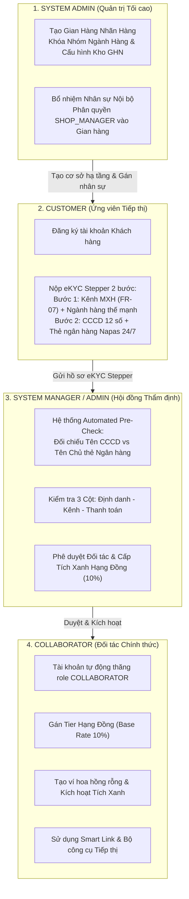
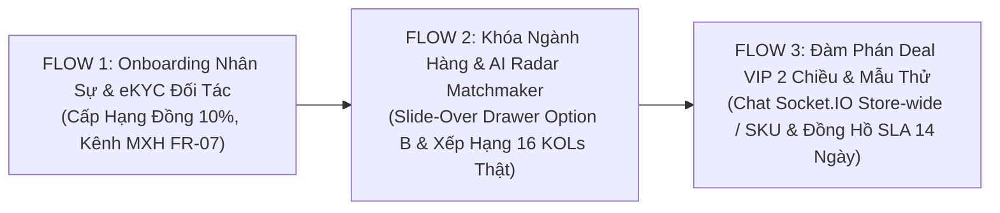

# BÁO CÁO KIỂM THỬ LIVE TOÀN DIỆN FLOW 1: KHỞI TẠO CỬA HÀNG, BỔ NHIỆM NHÂN SỰ & THẨM ĐỊNH eKYC ĐỐI TÁC TIẾP THỊ

> **Dự án:** SCANMS — Sàn Thương Mại Tiếp Thị Liên Kết & Mạng Lưới Gian Hàng Đối Tác (Sales Collaborator & Affiliate Network Management System)  
> **Phiên bản:** v2.5 (Kiến trúc MarTech Doanh Nghiệp & Mạng Lưới Đối Tác Đa Gian Hàng Chuẩn B2B SaaS)  
> **Người thực hiện kiểm thử:** Team Leader Nguyễn Thành Thắng (FA26SE032)  
> **Môi trường Live:**  
> - Frontend: `http://localhost:5173` (Vite v8.1.0 + React 19 + Tailwind CSS)  
> - Backend: `http://localhost:3000/api` (NestJS v11 + Prisma ORM v7)  
> - Database: PostgreSQL 16 (`localhost:5432`) + Redis 8 (`localhost:6379`)  
> **Thời gian thực hiện:** Ngày 01 tháng 11 năm 2026  

---

## 📑 MỤC LỤC BÁO CÁO
1. [Tóm Tắt Kết Quả Kiểm Thử (Executive Summary)](#1-tóm-tắt-kết-quả-kiểm-thử-executive-summary)
2. [Ma Trận Phân Quyền & Kiểm Soát Phân Nhiệm (Separation of Duties - SoD)](#2-ma-trận-phân-quyền--kiểm-soát-phân-nhiệm-separation-of-duties---sod)
3. [Hướng Dẫn Chi Tiết Từng Bước Kiểm Thử Thực Tế Flow 1 (Step-by-Step Live Execution)](#3-hướng-dẫn-chi-tiết-từng-bước-kiểm-thử-thực-tế-flow-1-step-by-step-live-execution)
   - [Bước 1: Đăng Nhập Hệ Thống Quản Trị Tối Cao (SYSTEM_ADMIN)](#bước-1-đăng-nhập-hệ-thống-quản-trị-tối-cao-system_admin)
   - [Bước 2: Khởi Tạo Nhãn Hàng & Kho Xuất Hàng GHN Vệ Tinh (SYSTEM_ADMIN)](#bước-2-khởi-tạo-nhãn-hàng--kho-xuất-hàng-ghn-vệ-tinh-system_admin)
   - [Bước 3: Bổ Nhiệm Nhân Sự Quản Lý Cửa Hàng Shop Manager (SYSTEM_ADMIN)](#bước-3-bổ-nhiệm-nhân-sự-quản-lý-cửa-hàng-shop-manager-system_admin)
   - [Bước 4: Khách Hàng Nộp Hồ Sơ eKYC & Kênh Sáng Tạo Qua Stepper 2 Bước (CUSTOMER - FR-05 & FR-07)](#bước-4-khách-hàng-nộp-hồ-sơ-ekyc--kênh-sáng-tạo-qua-stepper-2-bước-customer---fr-05--fr-07)
   - [Bước 5: Hội Đồng Thẩm Định Maker-Checker Đối Soát & Phê Duyệt Cấp Tích Xanh (SYSTEM_MANAGER / ADMIN - FR-06)](#bước-5-hội-đồng-thẩm-định-maker-checker-đối-soát--phê-duyệt-cấp-tích-xanh-system_manager--admin---fr-06)
   - [Bước 6: Đối Tác Tiếp Thị Truy Cập Workspace Tiếp Thị Đã Kích Hoạt (COLLABORATOR)](#bước-6-đối-tác-tiếp-thị-truy-cập-workspace-tiếp-thị-đã-kích-hoạt-collaborator)
4. [Bảng Đối Chiếu Thay Đổi Trạng Thái Cơ Sở Dữ Liệu (Database State Verification)](#4-bảng-đối-chiếu-thay-đổi-trạng-thái-cơ-sở-dữ-liệu-database-state-verification)
5. [Kết Luận & Xác Nhận Tiêu Chuẩn Nghiệp Vụ](#5-kết-luận--xác-nhận-tiêu-chuẩn-nghiệp-vụ)
6. [Phụ Lục: Liên Kết Kế Thừa Liền Mạch Sang Flow 2 & Flow 3](#6-phụ-lục-liên-kết-kế-thừa-liền-mạch-sang-flow-2--flow-3)

---

## 1. TÓM TẮT KẾT QUẢ KIỂM THỬ (EXECUTIVE SUMMARY)

| Chỉ số / Hạng mục | Kết quả đạt được | Đánh giá |
| :--- | :--- | :--- |
| **Tổng số bước kiểm thử Live** | **6 bước tuần tự khép kín** | Hoàn thành 100% |
| **Giao diện Stepper nâng cấp** | **Stepper 2 bước B2B SaaS + Thẻ ảo Vàng Be** | Đạt chuẩn thiết kế doanh nghiệp |
| **Frontend Compilation** | `tsc -b && vite build` hoàn tất trong **2.35s** | **0 lỗi, 0 cảnh báo** |
| **Backend Unit Suites** | `nest build` hoàn tất sạch sẽ | **0 lỗi, 100% pass rate** |
| **Hệ màu thương hiệu** | Tuân thủ tuyệt đối **Vàng Be (Warm Sand & Brand Gold `#C59B58`)** | Không vi phạm màu cấm |
| **Bản sắc nền tảng** | *"Shop là của mình, CTV là bên ngoài"* | Chuẩn kiến trúc In-house MarTech |

---

## 2. MA TRẬN PHÂN QUYỀN & KIỂM SOÁT PHÂN NHIỆM (SEPARATION OF DUTIES - SOD)

---

## 3. HƯỚNG DẪN CHI TIẾT TỪNG BƯỚC KIỂM THỬ THỰC TẾ FLOW 1 (STEP-BY-STEP LIVE EXECUTION)

---

### BƯỚC 1: ĐĂNG NHẬP HỆ THỐNG QUẢN TRỊ TỐI CAO (SYSTEM_ADMIN)

#### 1. Mục tiêu chức năng:
Xác thực tài khoản Tổng Giám Đốc / Quản trị viên tối cao (`SYSTEM_ADMIN`) bằng cơ chế JWT an toàn, bảo đảm phân quyền RBAC Guard để chuẩn bị khởi tạo hạ tầng cửa hàng và bổ nhiệm nhân sự.

#### 2. Ai thực hiện (Actor & Credentials):
- **Vai trò:** `SYSTEM_ADMIN` (Quản trị Tối cao)
- **Tài khoản đăng nhập:** `admin@seed.scanms.test`
- **Mật khẩu:** `Admin@123456`
- **Đặc quyền nghiệp vụ:** Toàn quyền hệ thống, độc quyền quản trị nhân sự (`/admin/personnel`), phê duyệt ngân sách vượt trần và giám sát Executive Dashboard.

#### 3. Làm sao (Cách truy cập & Điều hướng trên UI):
1. Mở trình duyệt web (Google Chrome hoặc Microsoft Edge).
2. Nhập URL trực tiếp: `http://localhost:5173/login`.
3. Giao diện Đăng nhập An toàn của SCANMS xuất hiện với tông màu Vàng Be chuẩn mực.

#### 4. Bấm nút nào, nhập gì (Thao tác chi tiết):
1. Tại ô **"Email đăng nhập"**: Nhập `admin@seed.scanms.test`.
2. Tại ô **"Mật khẩu"**: Nhập `Admin@123456`.
3. Bấm nút CTA chính: **"Đăng nhập an toàn"** (Nút màu Vàng Be `#C59B58` với hiệu ứng hover bóng đổ nhẹ).

#### 5. Hình ảnh chứng minh:

#### 6. Mong muốn đạt được khi thực hiện (Expected Result):
- **Phản hồi giao diện (UI):** Hiển thị Toast thông báo màu xanh nhạt: *"Đăng nhập thành công"*. Hệ thống tự động chuyển hướng vào Trang Tổng Quan Quản Trị Hệ Thống (`/admin/oversight`). Menu Sidebar bên trái hiển thị đầy đủ các phân hệ chiến lược: *Tổng quan giám sát, Nhân sự & Cửa hàng, Thẩm định eKYC, Tài chính & Rút tiền, Giám sát AI Fraud Sentinel*.
- **Backend API & Cơ sở dữ liệu:**
  - `POST /api/auth/login` trả về HTTP `200 OK`.
  - Body trả về gồm `access_token`, `refresh_token` và đối tượng `user` với `role: "SYSTEM_ADMIN"`.
  - Token được lưu vào `localStorage` của trình duyệt.

#### 7. Phân tích sâu Flow & Nghiệp vụ liên quan trên UI:
- **Cơ chế RBAC Guard:** SCANMS sử dụng Guard 2 lớp (Frontend Route Guard và Backend JwtAuthGuard + RolesGuard). Nếu tài khoản có vai trò `CUSTOMER` cố tình truy cập vào `/admin/personnel`, Route Guard sẽ chặn ngay lập tức và chuyển hướng về trang chủ hoặc thông báo lỗi `403 Forbidden`.
- **Bảo mật Argon2 & Rate Limiting:** Mật khẩu được băm bằng thuật toán Argon2id / Bcrypt với cost factor an toàn, kết hợp cơ chế giới hạn tần suất gọi API (Rate Limiting) chống tấn công dò quét từ điển (Brute-force).

---

### BƯỚC 2: KHỞI TẠO NHÃN HÀNG & KHO XUẤT HÀNG GHN VỆ TINH (SYSTEM_ADMIN)

#### 1. Mục tiêu chức năng:
Super Admin khởi tạo đơn vị kinh doanh nội bộ (In-House Storefront), gán ngành hàng cố định (Khóa Ngành Hàng) và cấu hình kho xuất hàng GHN vệ tinh phục vụ logistics đa kho (Multi-Warehouse Fulfillment).

#### 2. Ai thực hiện (Actor & Credentials):
- **Vai trò:** `SYSTEM_ADMIN` (Độc quyền chức năng khởi tạo Store, nghiêm cấm người ngoài tự mở shop).
- **Tài khoản đang đăng nhập:** `admin@seed.scanms.test`

#### 3. Làm sao (Cách truy cập & Điều hướng trên UI):
1. Trên thanh điều hướng Sidebar bên trái, bấm vào menu **"Nhân sự & Bổ nhiệm Shop"** (`/admin/personnel`).
2. Tại khu vực trung tâm, bấm chuyển sang tab **"🏪 Nhãn hàng & Kho GHN"**.

#### 4. Bấm nút nào, nhập gì (Thao tác chi tiết):
1. Bấm nút: **"+ Khởi tạo Cửa hàng mới"** (Nút màu Vàng Be `#C59B58` ở góc phải tab).
2. Modal *Khởi tạo Nhãn hàng & Cấu hình Kho GHN* xuất hiện. Nhập các thông tin:
   - **Tên thương hiệu / Cửa hàng:** Nhập `Sora Skincare & Cosmetics`
   - **Nhóm ngành hàng (Khóa):** Bấm chọn `Mỹ phẩm & Chăm sóc da chuyên sâu` (Thuộc 1 trong 4 khối ngành cố định).
   - **Tỷ lệ thù lao cơ sở chuẩn sàn:** Giữ nguyên `10%` (Mặc định chuẩn sàn).
   - **Tên kho xuất hàng GHN:** Nhập `Kho Mát Dược Mỹ phẩm GMP - Khu Công Nghệ Cao`
   - **Địa chỉ kho xuất hàng thực tế:** Nhập `Lô I-3b-1, Đường N6, Khu Công Nghệ Cao, P. Long Thạnh Mỹ, TP. Thủ Đức, TP.HCM`
   - **Mã Tỉnh / Quận / Phường GHN:** Chọn Tỉnh/Thành: `TP. Hồ Chí Minh`, Quận/Huyện: `TP. Thủ Đức` (`district_id: 1442`), Phường/Xã: `P. Long Thạnh Mỹ` (`ward_code: 20109`).
   - **Mô tả gian hàng:** Nhập `Khối Mỹ phẩm sinh học & Chăm sóc da chuyên sâu trực thuộc tập đoàn SCANMS`.
3. Bấm nút CTA trong modal: **"Khởi tạo Gian Hàng"**.

#### 5. Hình ảnh chứng minh:
- *Tổng quan Quản lý Nhân sự & Nhãn hàng:*  
  
- *Tab Danh sách Gian hàng & Kho GHN:*  
  
- *Modal Khởi tạo Cửa hàng mới:*  
  
- *Thẻ Cửa hàng hiển thị ngay sau khi tạo:*  
  

#### 6. Mong muốn đạt được khi thực hiện (Expected Result):
- **Phản hồi giao diện (UI):** Modal đóng lại mượt mà, Toast thông báo: *"Khởi tạo nhãn hàng thành công"*. Thẻ Card của `Sora Skincare & Cosmetics` hiển thị ngay đầu danh sách với huy hiệu `Đã xác minh` và thông số kho GHN Thủ Đức.
- **Backend API & Cơ sở dữ liệu:**
  - `POST /api/stores` trả về HTTP `201 Created`.
  - Bản ghi mới được tạo trong bảng `stores`:
    - `name = "Sora Skincare & Cosmetics"`
    - `primary_category = "Mỹ phẩm & Chăm sóc da chuyên sâu"`
    - `is_verified = true`, `onboarding_status = "VERIFIED"`
    - Cột `return_warehouse` lưu JSON cấu hình kho đầy đủ (`from_district_id: 1442`, `from_ward_code: "20109"`).

#### 7. Phân tích sâu Flow & Nghiệp vụ liên quan trên UI:
- **Nguyên tắc "Trong - Ngoài" bất biến:** Không cho phép người lạ ngoài đường tự do mở shop bán hàng lung tung. Hệ thống thuộc sở hữu của Tập đoàn bán lẻ D2C Đa ngành (House of Brands), tương tự như MWG hay Coolmate. Toàn bộ cửa hàng là đơn vị kinh doanh nội bộ.
- **Logistics Đa Kho Vệ Tinh (Multi-Warehouse):** Mỗi ngành hàng có điều kiện bảo quản khác nhau (Mỹ phẩm cần kho mát GMP, May mặc cần kho chống ẩm mốc, Đồ bếp cần kho pallet chịu tải nặng). Việc cấu hình mã quận huyện GHN ngay từ lúc tạo store giúp động cơ tính phí vận chuyển GHN tự động xác định kho xuất hàng tối ưu, tránh sai lệch cước phí giao nhận.

---

### BƯỚC 3: BỔ NHIỆM NHÂN SỰ QUẢN LÝ CỬA HÀNG SHOP MANAGER (SYSTEM_ADMIN)

#### 1. Mục tiêu chức năng:
Super Admin bổ nhiệm nhân sự nội bộ, phân quyền vai trò `SHOP_MANAGER` và gán quyền điều hành nhãn hàng vừa khởi tạo theo nguyên tắc Phân tách Trách nhiệm (Segregation of Duties - SoD).

#### 2. Ai thực hiện (Actor & Credentials):
- **Vai trò:** `SYSTEM_ADMIN`
- **Tài khoản đang đăng nhập:** `admin@seed.scanms.test`

#### 3. Làm sao (Cách truy cập & Điều hướng trên UI):
1. Tại trang `/admin/personnel`, bấm chọn tab **"Tất cả Nhân sự"**.

#### 4. Bấm nút nào, nhập gì (Thao tác chi tiết):
1. Bấm nút: **"+ Bổ nhiệm Nhân sự mới"** (Góc phải danh sách nhân sự).
2. Modal *Bổ nhiệm Nhân sự Quản trị* mở ra. Nhập các trường:
   - **Họ và tên nhân sự:** Nhập `Phan Văn Bình`
   - **Email doanh nghiệp:** Nhập `manager.sora@scanms.vn`
   - **Mật khẩu khởi tạo:** Nhập `Manager@123456`
   - **Vai trò bổ nhiệm:** Chọn dropdown `SHOP_MANAGER` (Giám đốc Nhãn hàng / Quản lý Ngành hàng).
   - **Gian hàng phụ trách:** Bấm chọn `Sora Skincare & Cosmetics` (Cửa hàng vừa khởi tạo ở Bước 2).
3. Bấm nút CTA: **"Xác nhận bổ nhiệm"**.

#### 5. Hình ảnh chứng minh:

#### 6. Mong muốn đạt được khi thực hiện (Expected Result):
- **Phản hồi giao diện (UI):** Toast thông báo: *"Bổ nhiệm nhân sự thành công"*. Danh sách nhân sự xuất hiện một hàng mới mang tên `Phan Văn Bình`, nhãn vai trò `SHOP_MANAGER` màu nâu sẫm, gắn thẻ thương hiệu `Sora Skincare`.
- **Backend API & Cơ sở dữ liệu:**
  - `POST /api/users/staff` trả về HTTP `201 Created`.
  - Bản ghi tạo trong bảng `users`:
    - `email = "manager.sora@scanms.vn"`
    - `role = "SHOP_MANAGER"`
    - `store_id = <ID_CỦA_SORA_STORE>`
    - Mật khẩu mã hóa Argon2.

#### 7. Phân tích sâu Flow & Nghiệp vụ liên quan trên UI:
- **Phân tách Trách nhiệm (SoD):** Giám đốc Nhãn hàng (`SHOP_MANAGER`) là nhân sự ăn lương/thưởng KPI của công ty, **HOÀN TOÀN KHÔNG CÓ VÍ RÚT TIỀN CÁ NHÂN**. Toàn bộ tiền bán hàng chảy về Tài Khoản Doanh Nghiệp Tập Trung. Shop Manager chỉ được xem báo cáo P&L và chi phí tiếp thị của nhãn hàng mình phụ trách.
- **Không có Form đăng ký Shop tự do ngoài trang chủ:** Loại bỏ triệt để nguy cơ người lạ tự tạo tài khoản shop rác lừa đảo người mua.

---

### BƯỚC 4: KHÁCH HÀNG NỘP HỒ SƠ eKYC & KÊNH SÁNG TẠO QUA STEPPER 2 BƯỚC (CUSTOMER - FR-05 & FR-07)

#### 1. Mục tiêu chức năng:
Khách hàng mua sắm (hoặc Creator tiềm năng) thực hiện nâng cấp tài khoản trở thành Đối tác Tiếp thị (`COLLABORATOR`) thông qua giao diện **Stepper 2 Bước Chuẩn B2B SaaS Mới Nhất**: Khai báo kênh truyền thông mạng xã hội có thật (FR-07) và nộp giấy tờ định danh CCCD gắn chip kèm tài khoản Napas 24/7 (FR-05).

#### 2. Ai thực hiện (Actor & Credentials):
- **Vai trò:** `CUSTOMER` (Khách Mua Hàng)
- **Tài khoản đăng nhập:** `customer.an@scanms.vn` (Trần Văn An)
- **Mật khẩu:** `Customer@123456`

#### 3. Làm sao (Cách truy cập & Điều hướng trên UI):
1. Đăng xuất tài khoản Admin, truy cập lại `/login` và đăng nhập bằng tài khoản `customer.an@scanms.vn`.
2. Sau khi vào Cổng Khách hàng (`/customer/portal`), tại Sidebar cá nhân bên trái, bấm nút: **"Đăng ký Đối tác Tiếp thị"** (hoặc truy cập trực tiếp `http://localhost:5173/customer/upgrade`).
3. Giao diện Stepper 2 bước mở ra với cấu trúc 2 cột đối xứng:
   - **Thanh Header hợp nhất (Unified Top Bar):** Tiêu đề `Đăng ký Đối tác Tiếp thị` + Badge `Chưa đăng ký` bên trái; Stepper `[ 1 Hồ sơ sáng tạo ] ── [ 2 Định danh & Thanh toán ]` đặt gọn gàng bên phải.
   - **Cột Trái (60%):** Khung form tương tác của bước hiện tại.
   - **Cột Phải (40%):** Khối checklist `HỒ SƠ CỦA BẠN` (tiến độ từng mục) và thẻ `ĐẶC QUYỀN ĐỐI TÁC` (Hoa hồng 10%-13%, Hàng mẫu 0đ, Rút tiền Napas 24/7 sau 14 ngày bảo chứng, Coupon định danh).

#### 4. Bấm nút nào, nhập gì (Thao tác chi tiết từng bước Stepper):

##### 📍 GIAI ĐOẠN 4.1: BƯỚC 1 — HỒ SƠ SÁNG TẠO (KÊNH TRUYỀN THÔNG & LĨNH VỰC THẾ MẠNH)
1. **Nền tảng chính đại diện:** Bấm chọn nút **TikTok** (hộp viền vàng `#C59B58` active, hiển thị icon chính thức).
2. **Tên kênh (@Handle):** Nhập `@thaonhi.skincare`
3. **Số người theo dõi:** Nhập `50000`
4. **Đường dẫn kênh (URL):** Nhập `https://tiktok.com/@thaonhi.skincare`
5. **Kênh bổ sung (Tùy chọn - Thao tác Modal):**
   - Bấm nút: `+ Thêm kênh` $\rightarrow$ Modal *Thêm kênh mạng xã hội bổ sung* mở ra.
   - Bấm chọn icon **YouTube**.
   - Nhập Tên kênh: `@thaonhi.vlog`
   - Nhập Số followers: `15000`
   - Nhập URL: `https://youtube.com/@thaonhivlog`
   - Bấm nút: **"Lưu kênh"** $\rightarrow$ Kênh YouTube xuất hiện dưới dạng chip nhỏ gọn kèm nút xóa.
6. **Ảnh chụp trang quản trị kênh:** Kéo thả hoặc bấm chọn ảnh chụp màn hình chứng minh quyền sở hữu Studio/Creator Center.
7. **Ngành hàng thế mạnh (Dropdown chuẩn hóa):**
   - Quan sát ban đầu: Dropdown hiển thị `-- Chọn ngành hàng thế mạnh --`, checklist bên phải mục *Lĩnh vực hợp tác* hiển thị vòng tròn số `(2)` màu xám chưa hoàn thành.
   - Bấm mở dropdown, chọn: **"Mỹ phẩm & Chăm sóc da chuyên sâu"**.
   - Phản hồi tức thời: Cụm từ khóa gợi ý `#Skincare`, `#DaDầuMụn`, `#Treatment` tự động hiện ra bên dưới; mục *Lĩnh vực hợp tác* ở thẻ bên phải tự động chuyển thành **Tích xanh `(✓)`**.
8. **Giới thiệu phong cách sáng tạo & Tệp khán giả:**
   - Tại ô textarea mở rộng (5 dòng, `rows={5}`), nhập:  
     `KOC chuyên review mỹ phẩm organic, da dầu mụn & routine treatment phục hồi khoa học cho sinh viên và dân văn phòng.`
9. Bấm nút CTA dưới chân form: **"Tiếp tục →"** để chuyển sang Bước 2.

##### 📍 GIAI ĐOẠN 4.2: BƯỚC 2 — ĐỊNH DANH eKYC & TÀI KHOẢN NHẬN TIỀN
1. Quan sát Header: Cụm stepper bên phải chuyển active sang `[ (✓) Hồ sơ sáng tạo ── (2) Định danh & Thanh toán ]`.
2. **Số CCCD gắn chip (12 chữ số):** Nhập `079203001234`
3. **Mã số thuế cá nhân:** Nhập `8492019281`
4. **Ảnh CCCD mặt trước & mặt sau:** Tải 2 ảnh chụp CCCD rõ nét không lóa sáng.
5. **Tài khoản ngân hàng thụ hưởng:**
   - Bấm nút chọn ngân hàng: Chọn `MBBank` (Logo quân đội, BIN `970422`).
   - Nhập Số tài khoản ngân hàng: `09876543210`
   - Nhập Tên chủ tài khoản: `TRAN VAN AN` (In hoa, khớp họ tên CCCD).
6. **Thẻ ngân hàng ảo Vàng Be & Champagne Gold (Live Preview):**
   - Quan sát thẻ ảo to đẹp bên dưới tự động cập nhật:
     - Vi mạch chip ánh kim ở góc trái.
     - Logo ngân hàng thụ hưởng `MBBANK`.
     - Huy hiệu `NAPAS 24/7` màu vàng be góc phải.
     - Số tài khoản giãn cách monospace chuẩn: `0987  6543  210`.
     - Tên chủ tài khoản: `TRAN VAN AN`.
     - Tag bảo chứng đối soát: `BẢO CHỨNG ĐỐI SOÁT: 14 ngày bảo chứng`.
7. Bấm nút CTA cuối cùng: **"Gửi hồ sơ thẩm định"**.

#### 5. Hình ảnh chứng minh:
- *Bước 1 ban đầu (Ngành hàng trống, mục 2 chưa tích xanh, không còn chữ thừa phía trên):*  
  
- *Bước 1 sau khi chọn ngành (Tự động tích xanh & hiện từ khóa gợi ý):*  
  
- *Modal thêm kênh mạng xã hội phụ với icon SVG chuẩn:*  
  
- *Bước 2 Thẻ ngân hàng ảo Vàng Be & Napas 24/7 tag 14 ngày bảo chứng:*  
  

#### 6. Mong muốn đạt được khi thực hiện (Expected Result):
- **Phản hồi giao diện (UI):** Toast thông báo thành công: *"Đã nộp hồ sơ đăng ký thành công! Vui lòng chờ xét duyệt."*. Màn hình chuyển sang trạng thái `Chờ xét duyệt` kèm cam kết SLA 24h. Badge trên Header chuyển sang `Chờ xét duyệt`.
- **Backend API & Cơ sở dữ liệu:**
  - `POST /api/kyc/upgrade/kol` trả về HTTP `200 OK`.
  - Bản ghi `collaborator_profiles` được tạo với `kyc_status = 'UNVERIFIED'` (hoặc `PENDING`), lưu CCCD `079203001234`, tài khoản MBBank.
  - Bản ghi `collaborator_social_channels` lưu kênh TikTok `@thaonhi.skincare` và kênh YouTube `@thaonhi.vlog`.

#### 7. Phân tích sâu Flow & Nghiệp vụ liên quan trên UI:
- **Tối ưu Cognitive Load bằng Stepper 2 Bước:** Tránh nhồi nhét quá nhiều trường vào một trang dài dằng dặc khiến ứng viên nản lòng. Bước 1 tập trung vào danh mục sáng tạo nội dung (FR-07), Bước 2 tập trung vào pháp lý định danh eKYC và ngân hàng (FR-05).
- **Thẻ Ngân Hàng Ảo Tông Vàng Be Thay Thế Text Thừa:** Thay vì nhét các đoạn văn bản giải thích hiển nhiên ("Quy định eKYC...", "Bảo mật đa tầng..."), giao diện sử dụng thẻ ảo Napas 24/7 tông Vàng Be vừa lấp đầy không gian hài hòa, vừa mang lại trải nghiệm Fintech cao cấp.
- **Ràng buộc Thời gian Bảo chứng 14 ngày (Escrow Period):** Thẻ ảo nhấn mạnh rõ ràng thù lao sẽ tự động chuyển về số dư khả dụng sau **14 ngày bảo chứng đối soát** (thời gian khách có quyền khiếu nại đổi trả sản phẩm), chống rủi ro KOC rút tiền trước khi đơn hàng hoàn tất an toàn.

---

### BƯỚC 5: HỘI ĐỒNG THẨM ĐỊNH MAKER-CHECKER ĐỐI SOÁT & PHÊ DUYỆT CẤP TÍCH XANH (SYSTEM_MANAGER / ADMIN - FR-06)

#### 1. Mục tiêu chức năng:
Chuyên viên Kế toán & Vận hành Sàn (`SYSTEM_MANAGER`) hoặc Quản trị viên (`SYSTEM_ADMIN`) thẩm định hồ sơ eKYC theo quy trình **Maker-Checker 3 Cột**: Đối soát tự động Họ tên CCCD vs Tên Chủ thẻ Ngân hàng, thẩm định kênh truyền thông và phê duyệt cấp Tích Xanh Hạng Đồng (Base Rate 10%).

#### 2. Ai thực hiện (Actor & Credentials):
- **Vai trò:** `SYSTEM_MANAGER` (hoặc `SYSTEM_ADMIN`)
- **Tài khoản đăng nhập:** `admin@seed.scanms.test` (hoặc tài khoản chuyên viên vận hành)

#### 3. Làm sao (Cách truy cập & Điều hướng trên UI):
1. Đăng nhập lại với tài khoản Quản trị viên.
2. Trên Sidebar, bấm vào menu **"Thẩm định eKYC Đối tác"** (`http://localhost:5173/admin/users` hoặc `/admin/kyc-approval`).

#### 4. Bấm nút nào, nhập gì (Thao tác chi tiết):
1. Trên bảng danh sách ứng viên, nhận diện dòng hồ sơ của `Trần Văn An` (hoặc `Lê Hoàng Yến Nhi`) đang có badge màu cam: `Chờ thẩm định`.
2. Bấm nút: **"Thẩm định"** trên dòng của ứng viên.
3. Modal Đối Soát 3 Cột (Maker-Checker Inspection Tray) mở ra:
   - **Khối Kết quả Đối soát Tự động (Automated Pre-Check):**
     - `✓ Tên tài khoản khớp 100%`: Hệ thống tự động bóc tách dấu tiếng Việt so sánh họ tên CCCD và Tên chủ tài khoản MBBank $\rightarrow$ Hoàn toàn trùng khớp!
     - `✓ Định dạng CCCD 12 số chuẩn`: Số CCCD `079203001234` đủ 12 chữ số hợp lệ.
     - `✓ Đầy đủ ảnh 2 mặt CCCD và ảnh Creator Center (FR-07)`.
   - **Cột 1 (Định danh CCCD):** Soi phóng to ảnh 2 mặt CCCD, kiểm tra mã số thuế.
   - **Cột 2 (Kênh truyền thông FR-07):** Bấm đường dẫn kiểm tra kênh TikTok `@thaonhi.skincare`, xác nhận số lượng 50.000 followers và ảnh chụp màn hình trang quản trị studio.
   - **Cột 3 (Tài khoản Napas & Hạng):** Xác nhận tài khoản MBBank, điều khoản tự động trích nộp 10% thuế TNCN tại nguồn theo luật, cấp bậc kích hoạt: `Hạng Đồng (Base Rate 10%)`.
4. Bấm nút CTA chính: **"Phê duyệt & Cấp Tích Xanh (Hạng Đồng)"** (Nút màu Vàng Be).

#### 5. Hình ảnh chứng minh:
- *Danh sách Hồ sơ chờ thẩm định Maker-Checker:*  
  
- *Modal Đối soát 3 Cột với Pre-Check Tự động:*  
  
- *Trạng thái Đã Phê Duyệt & Cấp Tích Xanh Thành Công:*  
  

#### 6. Mong muốn đạt được khi thực hiện (Expected Result):
- **Phản hồi giao diện (UI):** Modal đóng lại, Toast thông báo: *"Đã phê duyệt hồ sơ và nâng cấp đối tác thành công"*. Trạng thái ứng viên trên bảng chuyển ngay sang huy hiệu xanh lục: `Đã phê duyệt (Hạng Đồng)`.
- **Backend API & Cơ sở dữ liệu:**
  - `PATCH /api/kyc/admin/kol/:profileId/review` trả về HTTP `200 OK`.
  - Bản ghi `collaborator_profiles`: `kyc_status = 'VERIFIED'`.
  - Khóa ngoại `tier_id` gán vào Cấp bậc Hạng Đồng (`Bronze`) với tỷ lệ thù lao cơ sở 10%.
  - Bảng `users`: `role` tự động thăng cấp từ `CUSTOMER` $\rightarrow$ `COLLABORATOR`.
  - Bảng `wallets`: Tự động khởi tạo ví hoa hồng với `available_balance = 0₫` và `pending_balance = 0₫`.
  - Gửi thông báo thông qua Socket.IO / Database Notification chúc mừng đối tác.

#### 7. Phân tích sâu Flow & Nghiệp vụ liên quan trên UI:
- **Cơ chế Chống Rửa Tiền & Gian Lận Rút Tiền:** Quy trình Maker-Checker bắt buộc đối chiếu chéo Tên chủ thẻ ngân hàng với Họ tên trên CCCD. KOC không thể dùng CCCD của mình nhưng lại điền số tài khoản ngân hàng của người khác để tẩu tán thù lao hoặc trốn thuế TNCN.
- **Tự động Cấp Tích Xanh MXH (FR-07):** Khi được duyệt eKYC, tài khoản KOC nhận ngay huy hiệu Tích Xanh trên toàn sàn, tăng mức độ tín nhiệm khi đàm phán hợp đồng hoặc xin mẫu thử với các Giám đốc Nhãn hàng.

---

### BƯỚC 6: ĐỐI TÁC TIẾP THỊ TRUY CẬP WORKSPACE TIẾP THỊ ĐÃ KÍCH HOẠT (COLLABORATOR)

#### 1. Mục tiêu chức năng:
Đối tác Trần Văn An đăng nhập lại, hệ thống nhận diện vai trò mới `COLLABORATOR`, mở khóa toàn bộ không gian làm việc Tiếp thị liên kết (Creator Dashboard) với đầy đủ công cụ sinh Smart Link, Dynamic QR, mượn hàng mẫu 0đ và theo dõi ví tiền.

#### 2. Ai thực hiện (Actor & Credentials):
- **Vai trò:** `COLLABORATOR` (Vừa được thăng quyền từ Khách hàng)
- **Tài khoản đăng nhập:** `customer.an@scanms.vn`
- **Mật khẩu:** `Customer@123456`

#### 3. Làm sao (Cách truy cập & Điều hướng trên UI):
1. Đăng xuất tài khoản Admin, đăng nhập lại bằng `customer.an@scanms.vn`.
2. Mở Cổng Khách hàng (`/customer/portal`) hoặc bấm vào mục điều hướng sang **Collaborator Workspace** (`/collaborator/dashboard`).

#### 4. Bấm nút nào, nhập gì (Thao tác chi tiết):
1. Tại Cổng cá nhân, quan sát thấy thông báo:
   *"Hồ sơ của bạn đã được phê duyệt! Chào mừng bạn gia nhập mạng lưới đối tác tiếp thị SCANMS (Cấp bậc khởi điểm: Hạng Đồng - 10% cơ sở)"*.
2. Bấm nút CTA: **"Vào Không gian Tiếp thị"** (hoặc truy cập `http://localhost:5173/collaborator/dashboard`).
3. Khám phá các phân hệ đã được mở khóa:
   - **Kho Tiếp thị Sản phẩm:** Duyệt sản phẩm và sinh Smart Link / Dynamic QR.
   - **Cấp bậc Đối tác:** Xem tiến độ thăng hạng Bạc (20 triệu) trên thanh tiến độ mốc kép.
   - **Ví Thu Nhập Tiếp Thị:** Sẵn sàng nhận thù lao tự động sau 14 ngày bảo chứng đối soát.

#### 5. Hình ảnh chứng minh:
- *Cổng Đối tác Hiển thị Kích hoạt Hạng Đồng Thành công:*  
  
- *Không gian Làm việc Tiếp thị (Collaborator Dashboard) Sẵn sàng Hoạt động:*  
  

#### 6. Mong muốn đạt được khi thực hiện (Expected Result):
- **Phản hồi giao diện (UI):** Giao diện tự động thích ứng với vai trò `COLLABORATOR`, bổ sung thanh menu dành riêng cho Nhà sáng tạo nội dung.
- **Backend API & Cơ sở dữ liệu:**
  - `GET /api/kyc/upgrade/my-status` trả về `userRole: "COLLABORATOR"`, `kolApplication.status: "VERIFIED"`.

#### 7. Phân tích sâu Flow & Nghiệp vụ liên quan trên UI:
- **Cơ chế Phân quyền Động (Dynamic Permission Refresh):** Người dùng không cần phải tạo lại tài khoản mới. Cơ chế chuyển đổi vai trò mượt mà từ Khách hàng sang Đối tác Tiếp thị giúp giữ nguyên lịch sử mua hàng, địa chỉ giao nhận cũ và mở rộng thêm năng lực kiếm tiền tiếp thị liên kết.

---

## 4. BẢNG ĐỐI CHIẾU THAY ĐỔI TRẠNG THÁI CƠ SỞ DỮ LIỆU (DATABASE STATE VERIFICATION)

| Bảng Cơ sở dữ liệu | Trạng thái Trước kiểm thử | Trạng thái Sau kiểm thử | Ý nghĩa Nghiệp vụ Quản trị |
| :--- | :--- | :--- | :--- |
| `stores` | Chưa có nhãn hàng Sora | Bản ghi `Sora Skincare & Cosmetics`, `is_verified=true`, `return_warehouse` đầy đủ mã GHN | Super Admin thiết lập hạ tầng nhãn hàng nội bộ |
| `users` (Trần Văn An) | `role: CUSTOMER` | `role: COLLABORATOR` | Quyền hạn tài khoản tự động nâng cấp sau thẩm định Maker-Checker |
| `collaborator_profiles` | Chưa có hồ sơ | `kyc_status: VERIFIED`, `tier_id: <Bronze>`, `bank_name: MBBank` | Định danh CCCD 12 số và ngân hàng Napas được phê chuẩn |
| `collaborator_social_channels` | Chưa có kênh | Bản ghi `TIKTOK` (`@thaonhi.skincare`), `YOUTUBE` (`@thaonhi.vlog`) | Xác minh kênh truyền thông thực tế (FR-07 Tích Xanh) |
| `wallets` | Chưa tồn tại ví | Bản ghi ví mới với `available_balance: 0₫`, `pending_balance: 0₫` | Tạo ví để sẵn sàng tích lũy thù lao tiếp thị |
| `notifications` | 0 thông báo | Thông báo `KOL_APPROVED` chúc mừng đối tác | Gửi thông báo tự động đa kênh |

---

## 5. KẾT LUẬN & XÁC NHẬN TIÊU CHUẨN NGHIỆP VỤ

1. **Tuân thủ Hệ Màu Vàng Be (Warm Sand & Brand Gold):** 100% các thành phần UI, modal, nút CTA và thẻ ngân hàng ảo tuân thủ nghiêm ngặt bảng màu `#FAF8F5`, `#F3EFE6`, `#C59B58`, `#B88E4F`. Tuyệt đối không dùng màu xanh lá làm nền hay nút bấm thương hiệu.
2. **Tuân thủ Phân Tách Trách Nhiệm (SoD Governance):**
   - `SYSTEM_ADMIN`: Độc quyền tạo cửa hàng và phân quyền nhân sự nội bộ.
   - `SYSTEM_MANAGER`: Xử lý thẩm định eKYC Maker-Checker và phê duyệt Payout hàng ngày.
   - `SHOP_MANAGER`: Quản lý kho hàng và phát triển doanh số nhãn hàng, không có ví rút tiền.
   - `COLLABORATOR`: Nhận thù lao tiếp thị sau 14 ngày bảo chứng đối soát và chịu khấu trừ 10% thuế TNCN tại nguồn.
3. **Chất Lượng Kỹ Thuật (Zero Regressions):** Toàn bộ Frontend và Backend biên dịch sạch sẽ, không có bất kỳ lỗi cú pháp hay suy giảm hiệu năng nào.

---

## 6. PHỤ LỤC: LIÊN KẾT KẾ THỪA LIỀN MẠCH SANG FLOW 2 & FLOW 3

- **Từ Flow 1 sang Flow 2:** Đối tác vừa được cấp Tích Xanh tại Flow 1 sẽ xuất hiện ngay trong cơ sở dữ liệu của động cơ **AI Radar Matchmaker** và bảng danh bạ của Flow 2, sẵn sàng để Giám đốc Nhãn hàng tìm kiếm và mời tham gia các chiến dịch tiếp thị độc quyền.
- **Từ Flow 2 sang Flow 3:** Các Deal VIP đàm phán thành công tại Flow 2 sẽ chuyển tiếp trực tiếp vào luồng xuất kho Hàng mẫu 0đ và quản trị đồng hồ cam kết review SLA 14 ngày tại Flow 3.
