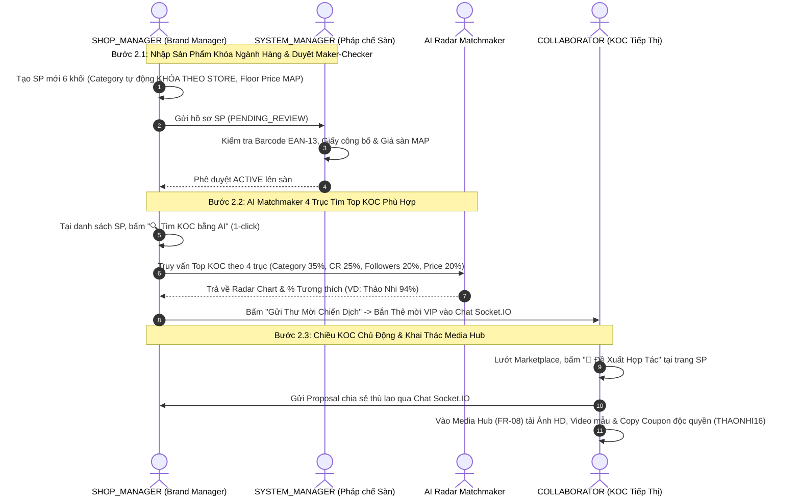

# 🏛️ BÁO CÁO PHÂN TÍCH TOÀN DIỆN & KẾ HOẠCH HÀNH ĐỘNG CHO FLOW 2
## HỆ THỐNG QUẢN LÝ ĐỘI NGŨ CỘNG TÁC VIÊN & TIẾP THỊ LIÊN KẾT (SCANMS)

> **Tài liệu tham chiếu:** [`docs/SCANMS_MASTER_REFACTORING_PLAN.md`](file:///c:/HW/CAPSTONE/docs/SCANMS_MASTER_REFACTORING_PLAN.md) & [`docs/SCANMS_REALIGNMENT_BLUEPRINT.md`](file:///c:/HW/CAPSTONE/docs/SCANMS_REALIGNMENT_BLUEPRINT.md)  
> **Chế độ thực thi:** PHÂN TÍCH, ĐÁNH GIÁ UI/UX & LẬP MASTER PLAN CHI TIẾT (TUYỆT ĐỐI CHƯA CHẠY CODE).

---

## PHẦN 1: ĐỐI CHIẾU 7 ĐIỂM CỐT LÕI VỚI BẢN SẮC MỚI CỦA HỆ THỐNG

Sau khi rà soát toàn bộ nội dung của hai tài liệu kiến trúc, 7 yêu cầu bạn tổng hợp hoàn toàn trùng khớp với định hướng cải tổ đã được thống nhất với Giảng viên hướng dẫn ThS. Tôn Thất Hoàng Minh. Dưới đây là phân tích chi tiết từng điểm gắn liền với ranh giới của Flow 2:

```
┌──────────────────────────────────────────────────────────────────────────────────────────────────┐
│                 MA TRẬN ĐỐI CHIẾU 7 CHỈ THỊ CỐT LÕI VỚI FLOW 2 TRONG HỆ THỐNG                     │
├──────────────────────────────────────────────────────────────────────────────────────────────────┤
│ 1. Shop không tự đăng ký (Admin cấp quyền nội bộ)    ──> Đã xong Flow 1; Store đã gắn Category   │
│ 2. Xóa 100% voucher rác TMĐT, chỉ giữ Coupon KOL     ──> Vũ khí Attribution định danh KOC        │
│ 3. Khóa Ngành Hàng (Category Lock) & Giá Sàn (MAP)  ──> Trọng tâm Bước 2.1 của Flow 2            │
│ 4. Cơ chế Đổi trả: Bù hàng 1-1 vs Clawback về 0đ     ──> Hiển thị tỷ lệ hoàn đơn & thù lao KOC   │
│ 5. Đổi tên thành "Thù Lao / Thu Nhập", tính Max(...) ──> Động cơ Best-Benefit Precedence Rule     │
│ 6. Phân hệ Livestream là tính năng phụ              ──> Giữ nguyên code, không đưa vào Flow 2    │
│ 7. Phân tách duyệt tiền SoD: Manager vs Admin        ──> Manager duyệt Payout; Admin duyệt Deal>16%│
└──────────────────────────────────────────────────────────────────────────────────────────────────┘
```

### 1.1. Bản chất Cửa hàng & Quyền quản trị nội bộ
- **Bản chất:** SCANMS là hệ thống của một Doanh nghiệp bán lẻ đa nhãn hàng (House of Brands / D2C Multi-Storefront) sở hữu các nhãn hàng nội bộ:
  - 🏪 **Sora Skincare & Cosmetics** (Kho Mát GMP Thủ Đức — Mỹ phẩm)
  - 🏪 **Aura Activewear & Apparel** (Kho Tân Bình — Thời trang)
  - 🏪 **GreenBio Health & Nutrition** (Kho Tân Phú — Thực phẩm sức khỏe)
  - 🏪 **Lumière Smart Living** (Kho KCN Tân Bình — Gia dụng đồ bếp)
- **Ảnh hưởng đến Flow 2:** Vì Shop đã được cấu hình cố định 1 ngành hàng ngay từ Flow 1 bởi `SYSTEM_ADMIN`, nên khi `SHOP_MANAGER` tạo sản phẩm ở Bước 2.1 của Flow 2, hệ thống bắt buộc khóa cứng ô Danh mục (Category) theo ngành hàng độc quyền của Shop đó.

### 1.2. Tinh giản Voucher: Xóa sạch Voucher rác TMĐT, Duy trì Duy nhất Coupon Độc Quyền KOC
- **Định vị:** SCANMS không phải chợ Shopee/Lazada xả hàng giá rẻ.
- **Loại bỏ 100%:** Xóa sổ toàn bộ các khái niệm "Voucher freeship toàn sàn", "Voucher hoàn xu", "Mã giảm giá chớp nhoáng của sàn".
- **Duy nhất giữ lại "Coupon Độc Quyền Định Danh KOC" (KOL-Exclusive Attribution Coupon):**
  - **Cấu trúc chuẩn hóa:** `[TÊN_KOL][MỨC_GIẢM]` (Ví dụ: `THAONHI16`, `LANHUONG10`, `QUANGTRAN12`).
  - **Cơ chế & Thao tác UI:**
    - **Shop cấp / duyệt mã:** Tại giao diện đàm phán hợp đồng hoặc Trung tâm KOC, Shop đồng ý cấp mã riêng cho KOC (ví dụ giảm $10\%$ cho khách).
    - **KOC nhận mã:** Hiển thị nổi bật trên Marketing Toolkit của KOC kèm nút Copy 1-click để KOC gắn vào bio TikTok/YouTube.
    - **Khách nhập mã tại Giỏ hàng/Checkout:** Nhập `THAONHI16` $\rightarrow$ Khách được giảm giá $10\%$, đồng thời hệ thống bắt dấu vết Attribution $100\%$ doanh số đơn hàng cho KOC Thảo Nhi ngay cả khi khách dùng trình duyệt ẩn danh hoặc đổi thiết bị!

### 1.3. Khóa Ngành Hàng (Category Lock) & Quản Trị Giá Sàn (Floor Price / MAP)
- **Khóa Ngành Hàng:** Khi Shop Manager tạo sản phẩm mới, ô Danh mục tự động lấy từ `store.primaryCategory` và bị disabled. Backend ném lỗi `400 Bad Request` nếu cố tình gửi sai.
- **Giá Sàn Bảo Vệ Biên Lợi Nhuận (Floor Price / MAP):**
  - Không cho nhân viên tự gõ giảm giá tùy tiện lúc tạo sản phẩm (tránh bán phá giá hoặc bán dưới giá vốn làm thủng ngân sách công ty).
  - Khi tạo sản phẩm chỉ nhập Giá niêm yết chính thức (`price`) và Giá tham chiếu (`originalPrice`).
  - `floorPrice` là ngưỡng giá thấp nhất cho phép:
    $$\text{Floor Price} = \text{Giá vốn (COGS)} + \text{Chi phí đóng gói/vận hành} + \text{Trần thù lao KOC tối đa (16\%)} + \text{Lợi nhuận an toàn}$$
  - **Quy trình đề xuất giảm giá:** Shop Manager muốn Flash Sale phải tạo "Đề xuất Chiến dịch Giảm giá" (Promotion Campaign Request) gửi `SYSTEM_MANAGER` / `SYSTEM_ADMIN` duyệt Maker-Checker; cấm tuyệt đối giảm dưới `floorPrice`.

### 1.4. Đổi tên "Hoa Hồng" $\rightarrow$ "Thù Lao / Thu Nhập" & Quy tắc Ưu tiên (Best-Benefit Override)
- **Chuẩn hóa thuật ngữ B2B:**
  - **Trên giao diện KOC & Ví tiền:** Thu Nhập Đối Tác / Thu Nhập Tiếp Thị (Partner Earnings - chuẩn TikTok Creator Rewards).
  - **Trong hợp đồng Deal & Thuật toán:** Tỷ Lệ Thù Lao Đối Tác (Partner Remuneration Rate).
  - **Trong báo cáo quản trị:** Chính Sách Thù Lao & Đãi Ngộ Hiệu Suất (Remuneration & Performance Rewards).
- **Động cơ tính toán mới (Precedence Rule — Tuyệt đối KHÔNG cộng dồn):**
  $$\text{Tỷ Lệ Áp Dụng} = \max\Big(\text{Deal VIP } 16\%,\; \text{Chiến Dịch } 14\%,\; \text{Cấp Bậc Tier } 11-13\%,\; \text{Mức Cơ Sở } 10\%\Big) + \text{Thưởng Live } (+2\%)$$
  - KOC có Deal VIP $16\%$ thì nhận đúng $16\%$ (không cộng thêm Tier Bạc hay Base).
  - Mức trần toàn sàn cố định tối đa $25\%$.
  - Thưởng mốc doanh số tháng (FR-09) là khoản thưởng định kỳ độc lập (Kickback), quét vào 23:59:59 ngày cuối tháng, cộng thẳng một khoản tiền thưởng vào ví chứ không cộng % vào từng đơn hàng lẻ.

### 1.5. Cơ chế Đổi trả hàng / Hoàn tiền
- **Sai do GHN (Bể vỡ, móp hộp):** Khách gửi video unboxing $\rightarrow$ Shop xuất đơn Bù hàng mới 1-đổi-1 $\rightarrow$ **BẢO LƯU 100% THÙ LAO CHO KOC** vì doanh nghiệp bảo toàn được doanh số đơn hàng.
- **Sai do Shop / Khách hủy đơn hoàn tiền:** Thu hồi hàng về kho $\rightarrow$ Kích hoạt Clawback Engine thu hồi/hủy $100\%$ thù lao KOC về $0₫$ trong Escrow tạm giữ, tránh thất thoát ngân sách.

### 1.6. Livestream là Luồng phụ & Phân tách trách nhiệm duyệt tiền (SoD)
- **Livestream:** Giữ nguyên code Socket.IO/WebRTC làm tính năng giá trị gia tăng (Bonus Feature), không can thiệp, không đưa vào kịch bản demo chính để tránh loãng thời lượng.
- **Phân tách trách nhiệm (SoD):** `SYSTEM_MANAGER` (Kế toán vận hành) duyệt các lệnh chi trả Payout hằng ngày. Chỉ khi có Deal VIP vượt trần ($> 16\%$) hoặc Chiến dịch giảm giá dưới Floor Price mới leo thang lên Tổng Giám Đốc (`SYSTEM_ADMIN`) phê duyệt ngoại lệ ngân sách.

---

## PHẦN 2: ĐÁNH GIÁ ĐỘ HOÀN THIỆN CÁC TRANG FLOW 2 TRONG CODEBASE HIỆN TẠI

Khảo sát mã nguồn thực tế tại các tệp liên quan đến Flow 2 cho thấy bức tranh hiện trạng như sau:

| Tệp Mã Nguồn | Chức năng phụ trách | Hiện trạng kỹ thuật | Đánh giá độ hoàn thiện & Lỗ hổng nghiệp vụ |
| :--- | :--- | :--- | :--- |
| [`ProductManagementPage.tsx`](file:///c:/HW/CAPSTONE/frontend/src/pages/merchant/ProductManagementPage.tsx) | Shop tạo & quản lý SP 6 khối | File dài tới 3.688 dòng! Đã có `disabled={Boolean(storeCategory)}` để khóa ngành hàng. | ⚠️ **Quá tải & Rườm rà:** Dưới mỗi input có quá nhiều dòng mô tả thừa thãi ("Gợi ý cho bạn...", "Lưu ý nhập..."). Chưa có trường hiển thị Giá sàn (`floorPrice`) và thiếu nút chuyển nhanh sang AI Matchmaker. |
| [`ProductModerationPage.tsx`](file:///c:/HW/CAPSTONE/frontend/src/pages/admin/ProductModerationPage.tsx) | System Manager duyệt Maker-Checker | Gọn gàng (270 dòng), có nút "Duyệt" (APPROVED) và "Từ chối" (REJECTED). | ✅ **Khá tốt:** Đã đáp ứng đúng luồng kiểm tra EAN-13 và pháp lý. Cần tinh chỉnh nhẹ thuật ngữ hiển thị từ "Hoa hồng sàn" sang "Tỷ lệ thù lao cơ sở 10%". |
| [`ShopKolHubPage.tsx`](file:///c:/HW/CAPSTONE/frontend/src/pages/merchant/ShopKolHubPage.tsx) | Trung tâm KOC của Shop (CRM, Chat, Đơn) | File dài tới 3.257 dòng! Tích hợp cả Chat, CRM, Samples, Performance. | ⚠️ **Phân mảnh & Rối rắm:** Quá nhiều chế độ chuyển đổi (`viewMode`: CRM, LEADERBOARD, ALL_DEALS, AI_MATCHING). Người dùng lần đầu không biết bấm nút nào để mời KOL. Cần gom các thao tác vào 1 luồng mạch lạc. |
| [`KolRecommendationPage.tsx`](file:///c:/HW/CAPSTONE/frontend/src/pages/merchant/KolRecommendationPage.tsx) | Động cơ AI Matchmaker 4 trục | Đã có thuật toán 4 trục, radar chart, % tương thích và explainable AI. | ✅ **Thuật toán tốt, UX cần nút bấm dứt khoát:** Cần cho phép Shop Manager chọn sản phẩm từ trang Sản phẩm $\rightarrow$ 1-click bay thẳng vào trang này với sản phẩm đã được chọn sẵn. |
| [`ShopCollaborationPage.tsx`](file:///c:/HW/CAPSTONE/frontend/src/pages/collaborator/ShopCollaborationPage.tsx) | KOC tìm Shop & gửi đề xuất hợp tác | File dài 3.072 dòng! Có tab Chat, Sản phẩm, Hàng mẫu. | ⚠️ **Thiếu liên kết từ Marketplace:** KOC đang xem sản phẩm trên Marketplace không có nút bấm "Gửi đề xuất hợp tác" để tự động mở đúng Shop trong trang này. |
| [`MediaHubBrowserPage.tsx`](file:///c:/HW/CAPSTONE/frontend/src/pages/collaborator/MediaHubBrowserPage.tsx) | KOC tải tài nguyên Media Hub (FR-08) | File 903 dòng, có video preview, nút tải ảnh/video, tích hợp mã coupon. | ⚠️ **Vẫn còn vướng mã coupon TMĐT cũ:** Đang tải danh sách coupon kiểu cũ, cần đồng bộ chuẩn Coupon độc quyền KOC (`THAONHI16`). |
| [`ShopCouponsPage.tsx`](file:///c:/HW/CAPSTONE/frontend/src/pages/merchant/ShopCouponsPage.tsx) | Quản lý mã ưu đãi của Shop | Đang duy trì form tạo voucher kiểu chợ Shopee (freeship, giảm giá đơn hàng). | ❌ **Lạc đề TMĐT:** Cần xóa bỏ voucher rác, chuyển đổi thành Trang Quản lý Coupon Độc Quyền KOC (KOL Attribution Coupons). |

---

## PHẦN 3: GÓC NHÌN "END-USER KHÓ TÍNH" (UX/UI AUDIT & TỐI ƯU HÓA THAO TÁC)

Đặt cương vị là một Giám đốc Nhãn hàng (`SHOP_MANAGER`) hoặc một Nhà sáng tạo nội dung (`COLLABORATOR`) lần đầu sử dụng nền tảng:

```
┌──────────────────────────────────────────────────────────────────────────────────────────────────┐
│                   BẢNG CHẨN ĐOÁN TRẢI NGHIỆM NGƯỜI DÙNG (HEURISTIC UX AUDIT)                    │
├──────────────────────────────────────────────────────────────────────────────────────────────────┤
│ ❌ NỖI ĐAU 1: "Tại sao tôi phải chạy qua 3 trang khác nhau để làm 1 việc?"                        │
│    • Người dùng xem sản phẩm ở Menu Sản phẩm -> Muốn tìm KOL cho sản phẩm đó phải sang Menu KOC  │
│      -> Vào tab AI Matching -> Lại phải tìm lại sản phẩm trong Dropdown!                          │
│    👉 GIẢI PHÁP: Bổ sung NÚT 1-CLICK ngay tại dòng sản phẩm: "🔍 Tìm KOC bằng AI"               │
│                                                                                                  │
│ ❌ NỖI ĐAU 2: "Quá nhiều chữ mô tả như đang dạy việc cho con nít!"                                │
│    • Dưới ô "Tên sản phẩm" có dòng: "Nhập tên sản phẩm thật hay để thu hút khách hàng..."        │
│    • Dưới ô "Mã SKU" có dòng: "SKU là mã phân loại duy nhất của sản phẩm..."                     │
│    👉 GIẢI PHÁP: Gỡ bỏ 100% các dòng chú thích thừa thãi. Chỉ giữ Label chuẩn, ngắn gọn, súc tích.│
│                                                                                                  │
│ ❌ NỖI ĐAU 3: "KOC đang xem hàng trên sàn muốn hợp tác với Shop thì bấm vào đâu?"                │
│    • KOC lướt Marketplace thấy sản phẩm hay -> Không thấy nút "Đề xuất hợp tác với Shop"         │
│    👉 GIẢI PHÁP: Tại trang chi tiết sản phẩm và trang Shop, thêm nút vàng nổi bật:              │
│      "🤝 Gửi Đề Xuất Hợp Tác" -> Mở trực tiếp khung Chat Socket.IO với Shop Manager của nhãn đó.│
│                                                                                                  │
│ ❌ NỖI ĐAU 4: "Voucher rác làm rối loạn tâm trí người dùng doanh nghiệp"                         │
│    • Menu hiển thị: Voucher Shop, Voucher Sàn, Mã Freeship... giống hệt Shopee giá rẻ.          │
│    👉 GIẢI PHÁP: Xóa sạch các tab rác. Chỉ để 1 mục duy nhất: "Mã Ưu Đãi Độc Quyền Của Bạn".   │
└──────────────────────────────────────────────────────────────────────────────────────────────────┘
```

---

## PHẦN 4: KỊCH BẢN THỰC CHIẾN FLOW 2 CHUẨN DEMO HỘI ĐỒNG

Kịch bản Flow 2 được thiết kế lại tối ưu cho buổi thuyết trình Review 2 (thời lượng 8 – 9 phút, thao tác mạch lạc, dứt khoát giữa 3 vai trò):



---

## PHẦN 5: BẢNG KẾ HOẠCH HÀNH ĐỘNG CHI TIẾT CHO FLOW 2 (MASTER ACTION PLAN)

Dưới đây là kế hoạch chi tiết từng bước chuẩn bị sẵn sàng. Toàn bộ các tác vụ này sẽ chỉ được triển khai khi bạn ra chỉ thị "làm đi":

### Giai đoạn 1: Chuẩn Hóa Quản Lý Sản Phẩm & Giá Sàn MAP (`ProductManagementPage.tsx`)
1. **Dọn dẹp text mô tả rườm rà:** Xóa bỏ toàn bộ các câu chú thích dạy việc trẻ con dưới các ô input; giữ form sắc sảo, tối giản theo chuẩn Enterprise B2B.
2. **Khóa cứng Category vững chắc:** Kiểm tra ô Danh mục đảm bảo luôn lấy đúng `storeCategory`, không có dropdown cho phép chọn danh mục lung tung khác ngành.
3. **Hiển thị Giá Sàn Bảo Vệ (`floorPrice` / MAP):**
   - Bổ sung trường hiển thị Giá sàn tối thiểu tham chiếu (ví dụ $320.000₫$) để Shop Manager biết giới hạn an toàn tài chính.
   - Chặn không cho nhập giá bán lẻ thấp hơn `floorPrice`.
4. **Nút Thao Tác Nhanh 1-Click Sang AI Matchmaker:**
   - Tại danh sách sản phẩm đã duyệt (ACTIVE), thêm nút bấm hành động trực tiếp: **"🔍 Tìm KOC bằng AI"**.
   - Bấm nút này sẽ điều hướng sang `ShopKolHubPage` với tham số `?mode=ai-matching&productId=[id]`, tự động quét ngay lập tức mà không cần người dùng phải chọn lại sản phẩm từ dropdown.

### Giai đoạn 2: Tối Ưu Hóa Giao Diện Động Cơ AI Matchmaker (`KolRecommendationPage.tsx`)
1. **Đơn giản hóa bộ lọc:** Giữ lại các bộ lọc thực chiến: Khoảng giá, Cấp bậc KOC (Đồng/Bạc/Vàng/Kim Cương), Tỷ lệ chuyển đổi tối thiểu. Xóa các mô tả thừa.
2. **Biểu đồ Radar 4 Trục & Explainable AI:** Đảm bảo hiển thị trực quan 4 trục: Ngành hàng ($35\%$), CR% ($25\%$), Followers ($20\%$), Phù hợp giá ($20\%$).
3. **Nút Thao Tác 1-Click Gửi Lời Mời:**
   - Cạnh thẻ KOC đạt Top Match, hiển thị nút rõ ràng: **"Gửi Thư Mời Chiến Dịch"**.
   - Bấm nút mở popup soạn nhanh thông điệp $\rightarrow$ Bắn Thẻ Mời Chiến Dịch trực tiếp vào khung Chat Socket.IO của KOC đó.

### Giai đoạn 3: Tối Ưu Hóa Chiều KOC Chủ Động Tìm Shop & Gửi Đề Xuất Hợp Tác
1. **Bổ sung nút tại Trang Chi Tiết Sản Phẩm (`ProductDetailPage.tsx`):**
   - Khi KOC đăng nhập đang xem sản phẩm của một Store, bên cạnh nút "Mua hàng", hiển thị nút hành động đối tác: **"🤝 Hợp Tác Với Nhãn Hàng Này"**.
   - Bấm nút sẽ tự động tạo cuộc hội thoại và mở thẳng khung chat `ShopCollaborationPage` với Shop Manager của nhãn hàng đó.
2. **Tối ưu hóa `ShopCollaborationPage.tsx`:**
   - Tinh gọn giao diện, loại bỏ các nút toggle dữ liệu mẫu ảo.
   - Thể hiện rõ 3 tab tinh giản: Tin nhắn đàm phán, Kho sản phẩm & Mẫu thử, Mã Coupon độc quyền của bạn.

### Giai đoạn 4: Tinh Giản Toàn Bộ Hệ Thống Voucher Thành "Coupon Độc Quyền KOC"
1. **Loại bỏ Voucher Rác TMĐT:**
   - Xóa bỏ các tab "Voucher sàn", "Freeship toàn sàn" tại các trang voucher.
2. **Chuẩn hóa Giao diện Coupon KOC (`KolCouponsPage.tsx` & `ShopCouponsPage.tsx`):**
   - Chỉ hiển thị và quản lý các mã định danh gắn với KOC (`THAONHI16`, `LANHUONG10`).
   - Hiển thị rõ ràng 2 thông số: Mức giảm cho khách mua (ví dụ: Giảm $10\%$) và Tỷ lệ thù lao KOC nhận được (ví dụ: $16\%$).
   - Nút Copy 1-click mã coupon kèm thông điệp mẫu để KOC đăng bài review.

### Giai đoạn 5: Đồng Bộ Thuật Ngữ Mới Toàn Diện (Thù Lao & Thu Nhập)
- Thay thế 100% các chữ "Hoa hồng sàn", "Commission rate", "Tiền hoa hồng" trên UI thành:
  - **Tỷ Lệ Thù Lao Cơ Sở (10%)**
  - **Tỷ Lệ Thù Lao Hợp Đồng Deal VIP**
  - **Tổng Thu Nhập Đối Tác**

---

## PHẦN 6: TIÊU CHÍ NGHIỆM THU (DEFINITION OF DONE CHO FLOW 2)
1. **Về Thao Tác Người Dùng:** Từ danh sách sản phẩm, Shop Manager có thể bấm 1 nút duy nhất để quét AI tìm Top KOC, và từ kết quả AI bấm 1 nút duy nhất để gửi lời mời vào khung Chat Socket.IO.
2. **Về Tính Liêm Chính Dữ Liệu:** Không còn bất kỳ mã coupon rác nào kiểu sàn Shopee; chỉ còn Coupon định danh KOC. Category bị khóa cứng theo ngành hàng của Store.
3. **Về Giao Diện UI:** Tinh sạch hoàn toàn các dòng text mô tả thừa thãi. Font chữ chuẩn mực, màu sắc chuẩn hệ thống Vàng Be (Warm Sand & Brand Gold `#FAF8F5`, `#F3EFE6`, `#C59B58`), chuyên nghiệp và đẳng cấp B2B Enterprise.

---

> 🎯 **Trạng thái:** Báo cáo phân tích và Master Plan cho Flow 2 đã sẵn sàng. Khi bạn xem xét xong và xác nhận "làm đi" (hoặc muốn điều chỉnh thêm điểm nào), chúng ta sẽ bắt đầu triển khai từng bước chuẩn xác!

