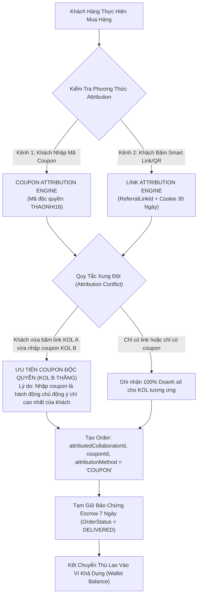
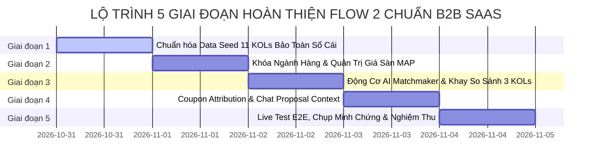

# 🏛️ KẾ HOẠCH HÀNH ĐỘNG TỔNG THỂ & PHÂN TÍCH TOÀN DIỆN FLOW 2
## HỆ THỐNG QUẢN LÝ ĐỘI NGŨ CỘNG TÁC VIÊN BÁN HÀNG & TIẾP THỊ LIÊN KẾT NỘI BỘ DOANH NGHIỆP (SCANMS)
### (Enterprise In-House Sales Collaborator & Affiliate Network Management System)

> **Mã dự án:** FA26SE032 | **Học kỳ:** Fall 2026 / Spring 2026 | **Đơn vị:** Đại học FPT TP.HCM  
> **Giảng viên hướng dẫn:** ThS. Tôn Thất Hoàng Minh (`MinhTTH5`)  
> **Thành viên phụ trách Flow 2:** **Phan Xuân Thịnh** (Trình bày chính & AI Matchmaker) & **Nguyễn Thành Thắng** (Leader & Kiến trúc Dữ liệu / Sổ cái)  
> **Tài liệu tham chiếu:** [`docs/SCANMS_MASTER_REFACTORING_PLAN.md`](file:///c:/HW/CAPSTONE/docs/SCANMS_MASTER_REFACTORING_PLAN.md) & [`docs/SCANMS_REALIGNMENT_BLUEPRINT.md`](file:///c:/HW/CAPSTONE/docs/SCANMS_REALIGNMENT_BLUEPRINT.md)  
> **Trạng thái tài liệu:** **BẢN KẾ HOẠCH HÀNH ĐỘNG TOÀN DIỆN & PHÂN TÍCH CHUẨN MỰC MARTECH (LƯU TRỮ CHÍNH THỨC TRƯỚC KHI THỰC THI)**

---

## MỤC LỤC
1. [Phần 1: Bản Sắc Nền Tảng & Quy Tắc Quản Trị Bất Biến Của Flow 2](#phần-1-bản-sắc-nền-tảng--quy-tắc-quản-trị-bất-biến-của-flow-2)
2. [Phần 2: Mô Hình Toán Học & Bảo Toàn Sổ Cái: Cơ Chế Thăng Hạng KOL & Dòng Tiền Ví](#phần-2-mô-hình-toán-học--bảo-toàn-sổ-cái-cơ-chế-thăng-hạng-kol--dòng-tiền-ví)
3. [Phần 3: Động Cơ Thù Lao Mới Chuẩn Doanh Nghiệp (Best-Benefit Precedence Rule)](#phần-3-động-cơ-thù-lao-mới-chuẩn-doanh-nghiệp-best-benefit-precedence-rule)
4. [Phần 4: Phân Tích So Sánh Benchmark Quốc Tế (Enterprise MarTech Benchmark)](#phần-4-phân-tích-so-sánh-benchmark-quốc-tế-enterprise-martech-benchmark)
5. [Phần 5: Biên Bản Rà Soát Chi Tiết Các Điểm Nghẽn & Rủi Ro Tiềm Ẩn Của Flow 2](#phần-5-biên-bản-rà-soát-chi-tiết-các-điểm-nghẽn--rủi-ro-tiềm-ẩn-của-flow-2)
6. [Phần 6: Kế Hoạch Triển Khai 5 Giai Đoạn Chuẩn Chỉ (5-Phase Master Action Plan)](#phần-6-kế-hoạch-triển-khai-5-giai-đoạn-chuẩn-chỉ-5-phase-master-action-plan)

---

## PHẦN 1: BẢN SẮC NỀN TẢNG & QUY TẮC QUẢN TRỊ BẤT BIẾN CỦA FLOW 2

### 1.1. Bản Sắc "Shop Là Của Mình, Cộng Tác Viên Là Bên Ngoài"
- **Doanh nghiệp sở hữu:** SCANMS là hệ thống của một **Tập đoàn Bán lẻ / Doanh nghiệp D2C Đa Ngành (House of Brands / Multi-Category Retail Conglomerate)** tương tự mô hình *MWG (Thế Giới Di Động, Điện Máy Xanh, An Khang)* hoặc *Coolmate D2C (Coolmate, 84RISING, CM24)*.
- **Không phải sàn chợ tự do:** Nghiêm cấm biến SCANMS thành bản sao Shopee/Lazada cho người lạ mở shop tự do.
- **4 Khối Cửa Hàng Trực Thuộc Chuyên Sâu (In-House Storefronts):**
  1. 🏪 **Store 1: Sora Skincare & Cosmetics** — Mỹ phẩm & Chăm sóc da chuyên sâu (Kho Mát GMP Khu Công Nghệ Cao TP.Thủ Đức).
  2. 🏪 **Store 2: Aura Activewear & Apparel** — Thời trang & May mặc thể thao năng động (Kho May Mặc Tân Bình, TP.HCM).
  3. 🏪 **Store 3: GreenBio Health & Nutrition** — Dinh dưỡng, Thảo mộc & Sức khỏe thiên nhiên (Kho Dược Liệu Tân Phú, TP.HCM).
  4. 🏪 **Store 4: Lumière Smart Living** — Thiết bị gia dụng & Đồ bếp thông minh (Kho Tổng Thiết Bị KCN Tân Bình, TP.HCM).

### 1.2. Khóa Ngành Hàng Sản Phẩm (Category Lock Enforcement)
- Mỗi Cửa hàng trực thuộc chỉ được phép kinh doanh trong đúng ngành hàng được ủy quyền (`primaryCategory`).
- **Giao diện (`ProductManagementPage.tsx`):** Khi Giám đốc Nhãn hàng (`SHOP_MANAGER`) tạo sản phẩm mới, ô Danh mục tự động điền theo ngành hàng của Store và bị **KHÓA CỨNG (Readonly / Disabled)**.
- **Backend (`products.service.ts`):** Tự động ép `categoryName = store.category`. Nếu gửi payload danh mục khác, lập tức ném lỗi `400 Bad Request`.

### 1.3. Quản Trị Giá Sàn (Floor Price / MAP) & Đề Xuất Giảm Giá (Maker-Checker)
- Khi tạo sản phẩm, Shop Manager chỉ được nhập **Giá niêm yết (List Price / MSRP)** và **Giá tham chiếu (`originalPrice`)**. Tuyệt đối không cho phép tự gõ đè giá giảm tùy tiện làm bán dưới giá vốn.
- **Giá Sàn Bảo Vệ Biên Lợi Nhuận (`floorPrice` / MAP):**
  $$\text{Floor Price} = \text{Giá vốn (COGS)} + \text{Chi phí vận hành kho bãi} + \text{Trần thù lao KOC (16\%)} + \text{Biên lãi an toàn}$$
- Mọi chương trình giảm giá Flash Sale/Chiến dịch bắt buộc phải tạo **"Đề Xuất Chiến Dịch Khuyến Mãi" (Promotion Campaign Request)**, đảm bảo mức giá $\ge \text{floorPrice}$ và được `SYSTEM_ADMIN` / `SYSTEM_MANAGER` phê duyệt mới có hiệu lực.

### 1.4. Tinh Giản Voucher: Xóa Sạch Voucher Rác TMĐT, Duy Trì Duy Nhất Coupon Độc Quyền KOC
- **Xóa bỏ 100% voucher rác:** Bỏ voucher freeship toàn sàn, voucher hoàn xu tích lũy, voucher chớp nhoáng (ngăn ngừa lỗi cộng dồn làm âm giá đơn).
- **Duy trì duy nhất "Coupon Độc Quyền Định Danh KOC" (`KOL-Exclusive Attribution Coupon`):**
  - Cấu trúc chuẩn hóa: `[TÊN_KOC][MỨC_GIẢM]` (Ví dụ: `THAONHI16`, `HUYENBEAUTY10`, `LANHUONG10`, `TUANANH15`).
  - **Vai trò kép:**
    1. Giảm giá độc quyền $5\% - 10\%$ cho người theo dõi của KOC.
    2. **Vũ khí Bắt dấu vết Đơn hàng số 1 (Primary Attribution Engine):** Dù khách hàng tắt Cookie, đổi máy hay duyệt web ẩn danh, chỉ cần nhập mã `THAONHI16` tại giỏ hàng là hệ thống ghi nhận chính xác $100\%$ doanh số cho KOC Thảo Nhi.

---

## PHẦN 2: MÔ HÌNH TOÁN HỌC & BẢO TOÀN SỔ CÁI: CƠ CHẾ THĂNG HẠNG KOL & DÒNG TIỀN VÍ

> [!IMPORTANT]
> **NGUYÊN TẮC BẢO TOÀN SỔ CÁI BẤT BIẾN (FINANCIAL INTEGRITY & DATA CONSISTENCY):**
> 1. **KOL không thể tự ý lên hạng:** Cấp bậc (Tier) của KOL **bắt buộc phải gắn liền với Doanh số sạch tích lũy thực tế** từ các đơn hàng `DELIVERED` hoặc `COMPLETED`.
> 2. **Ví tiền và Thù lao phải khớp 100%:** Số tiền trong Ví KOC (`wallets.available_balance` + `payout_requests.amount`) **phải bằng chính xác tổng thù lao phát sinh** từ lịch sử đơn hàng, không được gõ số ảo trên UI.
> 3. **Phải có khách hàng thật & đơn hàng thật:** Mỗi đơn hàng phải gắn với tài khoản khách hàng (`CUSTOMER`), địa chỉ giao hàng, phương thức thanh toán VietQR/PayOS/COD và dòng sản phẩm cụ thể.
> 4. **Bắt buộc có đơn hàng qua Coupon độc quyền:** Đối với các KOL có Deal VIP độc quyền với Shop, một phần đơn hàng của họ **phải được đặt bằng chính Mã Coupon Độc Quyền** (`attributionMethod: COUPON`), minh chứng cả 2 động cơ Attribution (Link vs Coupon).

### 2.1. Ma Trận 4 Cấp Bậc Năng Lực & Ngưỡng Doanh Số Tích Lũy Chuẩn
| Cấp Bậc (Tier) | Ngưỡng Doanh Số Sạch Tích Lũy | Tỷ Lệ Thù Lao Cơ Sở | Thưởng Cấp Bậc | Tổng Tỷ Lệ Đơn Thường | Điều Kiện Thăng Hạng & Duy Trì |
| :--- | :---: | :---: | :---: | :---: | :--- |
| **ĐỒNG (Bronze)** | $0₫ - 19.999.999₫$ | $10.0\%$ | $+0\%$ | **10.0%** | Mặc định khi vừa duyệt eKYC thành công. |
| **BẠC (Silver)** | $\ge 20.000.000₫$ | $10.0\%$ | $+1\%$ | **11.0%** | Đạt tối thiểu 20 triệu doanh số sạch từ các đơn đã giao thành công. |
| **VÀNG (Gold)** | $\ge 50.000.000₫$ | $10.0\%$ | $+2\%$ | **12.0%** | Đạt tối thiểu 50 triệu doanh số sạch, có tệp người theo dõi $\ge 100.000$. |
| **KIM CƯƠNG (Diamond)** | $\ge 100.000.000₫$ | $10.0\%$ | $+3\%$ | **13.0%** | Đạt tối thiểu 100 triệu doanh số sạch, có tệp người theo dõi $\ge 500.000$. |

---

### 2.2. Bảng Thiết Kế Dữ Liệu 11 KOLs Thực Tế & Khớp Toàn Vẹn Số Dư Tài Chính

| STT | Họ Tên KOL & Email | Cấp Bậc | Kênh MXH & Followers | Ngành Sở Trường & Shop Đối Tác | Doanh Số Tích Lũy Sạch | Số Đơn Hoàn Tất | Clicks Hợp Lệ | CR% | AOV | Mã Coupon Độc Quyền | Thù Lao Tích Lũy (`totalEarnedCommission`) | Số Dư Ví Khả Dụng (`availableBalance`) | Trạng Thái Rút Tiền Đã Giải Ngân (`payoutRequests`) |
| :---: | :--- | :---: | :--- | :--- | :---: | :---: | :---: | :---: | :---: | :---: | :---: | :---: | :--- |
| **1** | **Vũ Thanh Huyền**<br>`kol.silver@scanms.vn` | **Vàng** *(Đã thăng hạng $\ge 50M$)* | TikTok `@huyen.beauty` (185k)<br>IG `@huyen.skincare` (85k) | **Mỹ phẩm & Chăm sóc da**<br>🏪 *Sora Skincare & Cosmetics* | **58.600.000₫** | **210 đơn** *(120 Link, 90 Coupon)* | **2.340** | **8.97%** | 279.000₫ | `HUYENBEAUTY10`<br>*(Deal VIP 15% thù lao)* | **8.790.000₫** | **4.790.000₫** | Đã rút 4.000.000₫ (Napas 24/7, đã trừ 10% thuế TNCN 400.000₫) |
| **2** | **Lê Hoàng Yến Nhi**<br>`kol.bronze@scanms.vn` | **Bạc** *(Đã thăng hạng $\ge 20M$)* | TikTok `@yennhi.skintips` (120k)<br>YT `@yennhi.beauty` (45k) | **Mỹ phẩm & Chăm sóc da**<br>🏪 *Sora Skincare & Cosmetics* | **24.800.000₫** | **95 đơn** *(65 Link, 30 Coupon)* | **1.385** | **6.86%** | 261.000₫ | `YENNHI10`<br>*(Rate Tier Bạc 11%)* | **2.728.000₫** | **2.728.000₫** | Chưa rút tiền (Tích lũy ví khả dụng) |
| **3** | **Nguyễn Lan Hương**<br>`kol.lanhuong@scanms.vn` | **Đồng** *(Mới tham gia $< 20M$)* | TikTok `@lanhuong.glow` (68k) | **Mỹ phẩm & Chăm sóc da**<br>🏪 *Sora Skincare & Cosmetics* | **8.400.000₫** | **31 đơn** *(25 Link, 6 Coupon)* | **620** | **5.00%** | 270.000₫ | `LANHUONG10`<br>*(Rate Cơ sở 10%)* | **840.000₫** | **840.000₫** | Chưa rút tiền (Đang tiếp tục đẩy đơn) |
| **4** | **Bùi Minh Anh**<br>`kol.gold@scanms.vn` | **Kim Cương** *(Đã thăng hạng $\ge 100M$)* | IG `@minhanh.fit` (280k)<br>TikTok `@minhanh.lifestyle` (350k) | **Thời trang & Phụ kiện thể thao**<br>🏪 *Aura Activewear & Apparel* | **104.800.000₫** | **275 đơn** *(175 Link, 100 Coupon)* | **2.980** | **9.23%** | 381.000₫ | `MINHANHFIT15`<br>*(Deal VIP 16% thù lao)* | **16.768.000₫** | **6.768.000₫** | Đã rút 10.000.000₫ (Đã khấu trừ 1.000.000₫ thuế TNCN) |
| **5** | **Trần Thảo My**<br>`kol.thaomy@scanms.vn` | **Bạc** *(Đã thăng hạng $\ge 20M$)* | TikTok `@thaomy.ootd` (190k) | **Thời trang & Phụ kiện thể thao**<br>🏪 *Aura Activewear & Apparel* | **22.500.000₫** | **56 đơn** *(40 Link, 16 Coupon)* | **780** | **7.18%** | 401.000₫ | `THAOMY10`<br>*(Rate Tier Bạc 11%)* | **2.475.000₫** | **2.475.000₫** | Chưa rút tiền |
| **6** | **Trần Mai Anh**<br>`kol.flow5@scanms.test` | **Vàng** *(Đã thăng hạng $\ge 50M$)* | TikTok `@maianh.eatclean` (210k)<br>YT `@maianh.healthy` (95k) | **Thực phẩm chức năng & Sức khỏe**<br>🏪 *GreenBio Health & Nutrition* | **52.400.000₫** | **240 đơn** *(150 Link, 90 Coupon)* | **2.540** | **9.45%** | 218.000₫ | `MAIANHCLEAN10`<br>*(Deal VIP 15% thù lao)* | **7.860.000₫** | **3.860.000₫** | Đã rút 4.000.000₫ (Đã khấu trừ 400.000₫ thuế TNCN) |
| **7** | **Phan Bảo Ngọc**<br>`kol.baongoc@scanms.vn` | **Đồng** *(Mới tham gia $< 20M$)* | TikTok `@baongoc.healthy` (75k) | **Thực phẩm chức năng & Sức khỏe**<br>🏪 *GreenBio Health & Nutrition* | **7.200.000₫** | **38 đơn** *(30 Link, 8 Coupon)* | **665** | **5.71%** | 189.000₫ | `BAONGOC10`<br>*(Rate Cơ sở 10%)* | **720.000₫** | **720.000₫** | Chưa rút tiền |
| **8** | **Dương Tuấn Anh**<br>`kol.diamond@scanms.vn` | **Kim Cương** *(Đã thăng hạng $\ge 100M$)* | YT `@tuananh.techreview` (450k)<br>TikTok `@tuananh.review` (320k) | **Thiết bị điện tử & Gia dụng thông minh**<br>🏪 *Lumière Smart Living* | **138.500.000₫** | **145 đơn** *(95 Link, 50 Coupon)* | **1.610** | **9.01%** | 955.000₫ | `TUANANHTECH15`<br>*(Deal VIP 16% thù lao)* | **22.160.000₫** | **10.160.000₫** | Đã rút 12.000.000₫ (Đã khấu trừ 1.200.000₫ thuế TNCN) |
| **9** | **Nguyễn Quốc Huy**<br>`kol.quochuy@scanms.vn` | **Bạc** *(Đã thăng hạng $\ge 20M$)* | TikTok `@quochuy.smartliving` (160k) | **Thiết bị điện tử & Gia dụng thông minh**<br>🏪 *Lumière Smart Living* | **28.600.000₫** | **36 đơn** *(26 Link, 10 Coupon)* | **540** | **6.67%** | 794.000₫ | `QUOCHUY10`<br>*(Rate Tier Bạc 11%)* | **3.146.000₫** | **3.146.000₫** | Chưa rút tiền |
| **10** | **Hoàng Thảo Nhi**<br>`kol.thaonhi@scanms.vn` | **Vàng** *(Đa ngành Lifestyle/Làm đẹp)* | TikTok `@thaonhi.lifestyle` (320k)<br>IG `@thaonhi.official` (180k) | **Đa Ngành: Mỹ phẩm + Thời trang**<br>🏪 *Sora Skincare & Aura Activewear* | **56.800.000₫** | **185 đơn** *(110 Link, 75 Coupon)* | **2.590** | **7.14%** | 307.000₫ | `THAONHI16`<br>*(Deal VIP Đa ngành 16%)* | **9.088.000₫** | **5.088.000₫** | Đã rút 4.000.000₫ (Đã khấu trừ 400.000₫ thuế TNCN) |
| **11** | **Đặng Thùy Dung**<br>`kol.thuydung@scanms.vn` | **Đồng** *(Mới tham gia $< 20M$)* | TikTok `@thuydung.skincare` (82k) | **Đa Ngành: Mỹ phẩm + Sức khỏe**<br>🏪 *Sora Skincare & GreenBio* | **11.200.000₫** | **48 đơn** *(36 Link, 12 Coupon)* | **755** | **6.36%** | 233.000₫ | `THUYDUNG10`<br>*(Rate Cơ sở 10%)* | **1.120.000₫** | **1.120.000₫** | Chưa rút tiền |

---

### 2.3. Cơ Chế Bắt Dấu Vết Đơn Hàng 2 Chiều (Dual Attribution Engine)

SCANMS triển khai cơ chế Attribution 2 lớp hỗ trợ lẫn nhau để đảm bảo quyền lợi tuyệt đối cho KOL:



1. **Kênh 1 - Link Attribution (Smart Link / Dynamic QR):**
   - Lưu trữ bản ghi tại bảng `click_traffic_logs` (`isValid = true`, `isUnique = true`, `ipAddress`, `deviceFingerprint`).
   - Cookie phiên tiếp thị lưu trữ 30 ngày (Last-Click Model).
   - Khi khách thanh toán thành công, đơn hàng ghi nhận `attributionMethod = LINK` và gắn `referralLinkId`.
2. **Kênh 2 - Coupon Attribution (Coupon độc quyền định danh cá nhân):**
   - Khi KOC có Deal VIP với Nhãn hàng, Shop cấp mã độc quyền (Ví dụ: `THAONHI16`).
   - Khách hàng không cần bấm link, chỉ cần gõ mã `THAONHI16` tại giỏ hàng:
     - Khách được giảm giá ngay $5\% - 10\%$.
     - Đơn hàng ghi nhận `attributionMethod = COUPON`, gán `couponId` và `couponCodeSnapshot = 'THAONHI16'`.
     - Doanh số ghi nhận $100\%$ cho KOC Thảo Nhi ngay cả khi khách duyệt web ẩn danh hoặc đổi sang điện thoại khác.

---

## PHẦN 3: ĐỘNG CƠ THÙ LAO MỚI CHUẨN DOANH NGHIỆP (BEST-BENEFIT PRECEDENCE RULE)

### 3.1. Phân Tích Sự Phi Lý Của Cơ Chế Cộng Dồn Cũ (Additive Anti-Pattern)
- Trong các hệ thống TMĐT sơ khai hoặc thiết kế nháp cũ, công thức thù lao cộng dồn vô căn cứ:
  $$\text{Tỷ Lệ Cũ} = 10\% \text{ (Base)} + 3\% \text{ (Tier Kim Cương)} + 5\% \text{ (Deal VIP)} + 3\% \text{ (Live)} = 21\%$$
- **Hậu quả tài chính doanh nghiệp:**
  - Biên lợi nhuận ròng của ngành mỹ phẩm/thời trang chỉ dao động $20\% - 25\%$. Nếu chi trả thù lao KOC lên tới $21\%$, cộng thêm chi phí kho vận $5\%$ và thuế VAT $10\%$, doanh nghiệp sẽ **bán 1 đơn hàng bị lỗ ròng (âm dòng tiền)**!
  - Hiện tượng KOC đã nhận thù lao độc quyền khủng (Deal VIP $16\%$) nhưng vẫn tiếp tục đòi cộng thêm thù lao cấp bậc là sai nguyên tắc đàm phán hợp đồng thương mại.

### 3.2. Công Thức Mới: Quy Tắc Mức Ưu Đãi Tốt Nhất (Best-Benefit Precedence Rule)
SCANMS áp dụng nguyên tắc chuẩn hóa của các nền tảng MarTech toàn cầu (Impact.com, Refersion):
$$\text{Tỷ Lệ Thù Lao Đơn Hàng} = \min\Big(25\%,\; \max(\text{Deal Độc Quyền VIP},\; \text{Ưu Đãi Chiến Dịch},\; \text{Tỷ Lệ Theo Cấp Bậc},\; \text{Mức Cơ Sở } 10\%) + \text{Thưởng Phiên Live}\Big)$$

Trong đó:
1. **Mức Cơ Sở (Standard Base Rate):** Cố định **10%** cho toàn bộ sản phẩm mở (Open Offers).
2. **Tỷ Lệ Theo Cấp Bậc (Performance Tier Rate):**
   - Hạng Đồng: **10%** (+0%).
   - Hạng Bạc: **11%** (+1%).
   - Hạng Vàng: **12%** (+2%).
   - Hạng Kim Cương: **13%** (+3%).
3. **Ưu Đãi Chiến Dịch (Campaign Promotion Rate):** Từ **11%** đến **14%** khi sản phẩm tham gia chiến dịch kích cầu tháng của nhãn hàng.
4. **Thỏa Thuận Hợp Đồng Độc Quyền (Exclusive VIP Deal Override - Ưu tiên cao nhất):** Khi Giám đốc Nhãn hàng và KOC ký kết phụ lục Deal VIP qua Chat Socket.IO (Ví dụ: $15\% - 16\%$) $\rightarrow$ **Mức Deal VIP ghi đè toàn bộ các mức trên**.
5. **Thưởng Phiên Live Giờ Vàng (Live Accelerator Bonus):** **+2%** thúc đẩy KOC chốt đơn trực tiếp trong phiên phát trực tiếp.
6. **Khoản Thưởng Cán Mốc Tháng (Monthly Milestone Bonus - FR-09):** **Độc lập, không cộng % vào từng đơn hàng**. Hệ thống quét vào ngày cuối tháng, nếu doanh số sạch đạt mốc sẽ kết chuyển thẳng một khoản thưởng cố định vào ví KOC (Ví dụ: Đạt 50M thưởng thêm 1.000.000₫).

### 3.3. Ma Trận Giới Hạn Thù Lao 3 Tầng & Cơ Chế Leo Thang Phê Duyệt (Escalation)
```
┌────────────────────────────────────────────────────────────────────────────────────────┐
│                        MA TRẬN GIỚI HẠN THÙ LAO 3 TẦNG DOANH NGHIỆP                    │
├────────────────────────────────────────────────────────────────────────────────────────┤
│ TẦNG 1: Mức Tự Do Của Sàn (10% - 13%)                                                  │
│   • Áp dụng tự động theo Cấp bậc (Đồng 10%, Bạc 11%, Vàng 12%, Kim Cương 13%).         │
│   • Không cần bất kỳ ai phê duyệt.                                                     │
├────────────────────────────────────────────────────────────────────────────────────────┤
│ TẦNG 2: Khung Đàm Phán Tự Trị Của Shop Manager (14% - 16%)                             │
│   • Giám đốc Nhãn hàng được toàn quyền đàm phán và chốt Deal VIP với KOC đến 16%.      │
│   • Thỏa thuận có hiệu lực ngay sau khi 2 bên bấm "Ký hợp đồng" trong Chat Socket.IO.  │
├────────────────────────────────────────────────────────────────────────────────────────┤
│ TẦNG 3: Vượt Trần Độc Quyền - Leo Thang Duyệt Super Admin (17% - 25%)                   │
│   • Dành riêng cho Chiến dịch Mega Live hoặc Ký kết Siêu KOC (Top 1 Creator).          │
│   • Hợp đồng chuyển trạng thái PENDING_ADMIN_APPROVAL.                                 │
│   • Bắt buộc SYSTEM_ADMIN thẩm định biên lợi nhuận và phê duyệt ngân sách mới kích hoạt│
└────────────────────────────────────────────────────────────────────────────────────────┘
```

---

## PHẦN 4: PHÂN TÍCH SO SÁNH BENCHMARK QUỐC TẾ (ENTERPRISE MARTECH BENCHMARK)

Để bài bảo vệ tốt nghiệp đạt điểm xuất sắc trước Hội đồng, nhóm đã tiến hành đối chiếu SCANMS với 4 hệ thống MarTech & Affiliate hàng đầu thế giới:

| Tiêu Chí Nghiệp Vụ & Kỹ Thuật | **SCANMS (Enterprise MarTech)** | **Impact.com (Enterprise Cloud)** | **UpPromote (Shopify Plus D2C)** | **TikTok Shop Creator Center** | **Shopee / Lazada Mở (Cũ)** |
| :--- | :--- | :--- | :--- | :--- | :--- |
| **1. Bản chất sở hữu** | **Doanh nghiệp D2C Đa Ngành** sở hữu, quản lý nhãn hàng nội bộ | Nền tảng Partnership SaaS phục vụ doanh nghiệp lớn | Cổng Affiliate chuyên sâu cho nhãn hàng Shopify Plus | Sàn Thương mại Nội dung kết nối Nhà bán & KOC | Chợ thương mại tự do cho bất kỳ ai mở shop |
| **2. Quản lý phân quyền Cửa hàng** | **Admin nội bộ cấp quyền** qua `/admin/personnel`, gán `storeId` cố định | Phân quyền qua Business Organization & Brand Workspace | Brand Owner mời Staff quản lý theo phân quyền | Cấp quyền Brand Team qua TikTok Business Manager | Bất kỳ user nào cũng tự bấm "Mở Shop" |
| **3. Khóa ngành hàng (Category Lock)** | **Khóa cứng theo Store** (`primaryCategory`), chống trùng mã vạch EAN-13 | Phân nhánh Catalog theo Category Whitelist | Nhãn hàng quản lý đồng nhất theo Store Collection | Bắt buộc nộp chứng nhận phân loại (Category Qualification) | Không khóa, shop bán tạp hóa đủ loại ngành |
| **4. Cơ chế Attribution** | **Dual Engine:** Smart Link/QR (30 ngày) + Coupon độc quyền KOC (`THAONHI16`) | Advanced Tracking (Link, Promo Code Attribution, App-to-App) | Referral Link + Coupon-based Attribution | Showcase Link + Creator Product Tag + Livestream Basket | Chỉ có Link Affiliate thông thường |
| **5. Thuật toán tính thù lao** | **Best-Benefit Precedence Rule:** $\max(\text{VIP}, \text{Campaign}, \text{Tier}, \text{Base}) + \text{Live}$ | Custom Contract Override Hierarchy | Best Commission Rule (Không cộng dồn) | Mức chiết khấu cố định theo thỏa thuận Targeted Plan | Cộng dồn vô tội vạ làm âm giá đơn |
| **6. Gợi ý KOC thông minh** | **Explainable AI Matchmaker (XAI):** Radar Matrix 4 trục minh bạch | Mediarails AI Partner Discovery | Affiliate Discovery Engine | Creator Marketplace Smart Search & Recommendations | Không có gợi ý AI hoặc chỉ lọc theo follower |
| **7. Quản lý Hàng mẫu (Samples)** | **Hợp đồng mượn mẫu SLA 14 ngày:** Cam kết video review hoặc Blacklist | Gifting / Product Seeding Workflow | Free Sample Tracking | Free Sample Request Flow (KOC cam kết trả Video trong 14 ngày) | Không có luồng kiểm soát chuyên biệt |
| **8. Bảo toàn Sổ cái & Rút tiền** | **Chỉ KOC rút tiền:** Bảo chứng đối soát 14 ngày, khấu trừ $10\%$ Thuế TNCN | Chuyển khoản đối tác hàng tuần/tháng, khấu trừ W-8/W-9 | Tự động Payout qua PayPal/Store Credit | KOC rút tiền hoa hồng sau 14 ngày hoàn tất | Cả Shop lẫn KOC cùng rút tiền trên sàn |

---

## PHẦN 5: BIÊN BẢN RÀ SOÁT CHI TIẾT CÁC ĐIỂM NGHẼN & RỦI RO TIỀM ẨN CỦA FLOW 2

Qua quá trình rà soát toàn bộ mã nguồn Frontend/Backend và luồng trải nghiệm người dùng, nhóm phát hiện **5 điểm nghẽn nghiêm trọng cần xử lý triệt để**:

```
┌──────────────────────────────────────────────────────────────────────────────────────────────────┐
│                     MA TRẬN RÀ SOÁT 5 ĐIỂM NGHẼN TIỀM ẨN TRONG FULL FLOW 2                       │
├──────────────────────────────────────────────────────────────────────────────────────────────────┤
│ ⚠️ NGHẼN 1: Dữ liệu KOL thiếu sự nhất quán giữa Cấp Bậc, Doanh Số Bán Thật và Số Dư Ví         │
│ ⚠️ NGHẼN 2: Chưa có các Đơn Hàng được đặt bằng Coupon Độc Quyền KOC (Thiếu minh chứng Kênh 2)   │
│ ⚠️ NGHẼN 3: KOC bấm "Đề Xuất Hợp Tác" tại trang chi tiết SP chưa truyền đủ context vào Chat     │
│ ⚠️ NGHẼN 4: Form tạo Coupon Shop chưa ép viết hoa tự động và chưa kiểm soát trần chiết khấu     │
│ ⚠️ NGHẼN 5: Bộ lọc AI Radar Matchmaker bị rỗng candidate do từ điển category thiếu alias         │
└──────────────────────────────────────────────────────────────────────────────────────────────────┘
```

### 5.1. Điểm Nghẽn 1: Dữ liệu KOL thiếu tính toàn vẹn giữa Cấp Bậc, Doanh Số và Số Dư Ví
- **Thực trạng:**
  - Nếu chỉ gán nhãn `tierId = Vàng` trong database mà trong bảng `orders` không có các đơn hàng hoàn tất với tổng doanh số $\ge 50.000.000₫$, khi Giám đốc Nhãn hàng hoặc Hội đồng kiểm tra báo cáo doanh thu sẽ phát hiện sự phi lý.
  - Số dư ví (`wallets.available_balance`) của KOC nếu hiển thị $0₫$ trong khi KOC đã đạt hạng Vàng và có hàng chục đơn hàng thành công là vi phạm nguyên tắc bảo toàn sổ cái.
- **Giải pháp:** Cần xây dựng script seeding dữ liệu chuẩn mực, tạo đầy đủ các đơn hàng hoàn tất (`DELIVERED`/`COMPLETED`), tự động tính toán thù lao sạch sau 14 ngày bảo chứng đối soát và kết chuyển đúng số dư vào bảng `wallets`.

### 5.2. Điểm Nghẽn 2: Thiếu minh chứng cho Kênh Bắt Dấu Vết Qua Coupon Độc Quyền (Coupon Attribution)
- **Thực trạng:** Toàn bộ đơn hàng hiện tại trong database chỉ có `referral_link_id` (Link Attribution), hoàn toàn chưa có đơn hàng nào mang `coupon_id`, `coupon_code_snapshot` và `attribution_method = 'COUPON'`.
- **Hệ quả:** Khi demo luồng KOC sở hữu mã `THAONHI16`, nếu vào báo cáo đơn hàng không thấy đơn nào được ghi nhận qua mã coupon thì không thể chứng minh được tính năng Coupon Attribution trước Hội đồng.
- **Giải pháp:** Trong bộ seed 11 KOLs, phân bổ khoảng $30\% - 40\%$ số lượng đơn hàng được đặt bằng chính mã Coupon độc quyền của KOC đó.

### 5.3. Điểm Nghẽn 3: KOC bấm "🤝 Đề Xuất Hợp Tác" chưa mang context sản phẩm vào khung Chat
- **Thực trạng:** Tại [`ProductDetailPage.tsx`](file:///c:/HW/CAPSTONE/frontend/src/pages/public/ProductDetailPage.tsx), nút chuyển hướng sang:
  `/collaborator/collaboration?storeId=${data.store.id}&tab=messages`
  URL chỉ truyền `storeId`, chưa đính kèm `productId`, `productTitle`, `productImage`, `productPrice` và `commissionRate`.
- **Hệ quả UX:** Khi KOC bấm đề xuất, khung chat mở ra nhưng hoàn toàn trống trơn, KOC phải tự gõ thủ công tên sản phẩm và mức thù lao muốn đàm phán, gây đứt gãy trải nghiệm.
- **Giải pháp:** Truyền toàn bộ query params sang `ShopCollaborationPage.tsx` để khung chat tự động dựng Thẻ Đề Xuất Hợp Tác (Proposal Card Preview) có ảnh, giá và tỷ lệ thù lao đề xuất sẵn trong ô soạn thảo.

### 5.4. Điểm Nghẽn 4: Form tạo Coupon Shop chưa ép chữ hoa tự động
- **Thực trạng:** Tại [`ShopCouponsPage.tsx`](file:///c:/HW/CAPSTONE/frontend/src/pages/merchant/ShopCouponsPage.tsx), ô nhập mã coupon cho phép gõ chữ thường. Nếu nhân viên shop nhập `thaonhi16` thì trên hệ thống hiển thị mã chữ thường thiếu chuyên nghiệp.
- **Giải pháp:** Ép định dạng tự động `toUpperCase().replace(/[^A-Z0-9]/g, '')` ngay khi gõ và khi submit form.

### 5.5. Điểm Nghẽn 5: Bộ lọc AI Radar Matchmaker bị rỗng ứng viên
- **Thực trạng:** Từ điển `category-match.utils.ts` trước đây thiếu các biến thể từ khóa ngành hàng (Ví dụ: KOC có handle `@yennhi.skintips` không nhận diện được ngành Mỹ phẩm, KOC `@maianh.eatclean` không nhận diện được ngành Sức khỏe).
- **Hệ quả:** Giám đốc Nhãn hàng khi bấm quét KOL cho sản phẩm chỉ tìm được 1 người duy nhất, không hiển thị đủ 3 KOLs để bung khay so sánh đối chiếu.
- **Giải pháp:** Mở rộng toàn diện từ điển ngữ nghĩa và ánh xạ substring cho tất cả các ngành hàng của 4 Store.

---

## PHẦN 6: KẾ HOẠCH TRIỂN KHAI 5 GIAI ĐOẠN CHUẨN CHỈ (5-PHASE MASTER ACTION PLAN)



### 📋 Giai Đoạn 1: Chuẩn Hóa Kiến Trúc Dữ Liệu & Seed Script Bảo Toàn Sổ Cái 100%
1. **Viết script `backend/prisma/seeds/kols-flow2.seed.ts`:**
   - Tạo 11 tài khoản KOL đại diện cho 4 Store, phân tầng cấp bậc rõ ràng (Đồng, Bạc $\ge 20M$, Vàng $\ge 50M$, Kim Cương $\ge 100M$).
   - Tạo các tài khoản Khách hàng mua sắm thật (`CUSTOMER`) với địa chỉ giao hàng và số điện thoại chuẩn.
   - Tạo các đơn hàng hoàn tất (`DELIVERED`/`COMPLETED`) với doanh số tích lũy vượt ngưỡng cấp bậc tương ứng.
   - Phân bổ $30\% - 40\%$ số đơn hàng mang `coupon_id`, `coupon_code_snapshot` (`attributionMethod: 'COUPON'`), phần còn lại mang `referral_link_id` (`attributionMethod: 'LINK'`).
   - Tạo bản ghi Ví (`wallets`), Sổ cái tài chính (`financial_ledgers`) và Thù lao (`commissions`) với trạng thái `AVAILABLE`.
   - Cập nhật số dư ví khả dụng (`availableBalance`) và lịch sử rút tiền (`payout_requests`) đảm bảo khớp từng đồng xu với tổng thù lao phát sinh.
2. **Tiêu chuẩn nghiệm thu Giai đoạn 1:**
   - Chạy lệnh truy vấn kiểm toán: $\sum \text{commissions} == \text{available\_balance} + \text{paid\_payouts}$.
   - Kiểm tra API `/api/collaborator/wallet` và `/api/collaborator/profile` hiển thị chuẩn xác số liệu thù lao và cấp bậc.

---

### 📋 Giai Đoạn 2: Củng Cố Backend Khóa Ngành Hàng & Quản Trị Giá Sàn MAP
1. **Kiểm tra và củng cố Backend (`products.service.ts`):**
   - Khi tạo/sửa sản phẩm, backend tự động kiểm tra `store.primaryCategory`.
   - Chặn tuyệt đối việc gửi payload danh mục khác ngành hàng ủy quyền của Store (`400 Bad Request`).
   - Thiết lập logic kiểm tra Giá sàn (`floorPrice`): Ngăn chặn việc tạo khuyến mại có giá bán $< \text{floorPrice}$.
2. **Kiểm tra Giao diện (`ProductManagementPage.tsx`):**
   - Ô nhập liệu Danh mục tự động lấy theo Store phụ trách và bị **Disabled**.
   - Hiển thị badge chú thích rõ ràng: *"Ngành hàng cố định theo giấy phép kinh doanh của Gian hàng"*.
   - Hiển thị ô tham chiếu Giá sàn bảo vệ biên lợi nhuận (`floorPrice`).
3. **Tiêu chuẩn nghiệm thu Giai đoạn 2:**
   - Nhân viên Sora Skincare chỉ tạo được sản phẩm "Mỹ phẩm & Chăm sóc da".
   - Nhân viên Aura chỉ tạo được sản phẩm "Thời trang & May mặc".
   - Thử gửi API payload sai ngành hàng $\rightarrow$ Backend ném lỗi `400` tức thì.

---

### 📋 Giai Đoạn 3: Hoàn Thiện Động Cơ AI Radar Matchmaker & Khay So Sánh 3 KOLs
1. **Nâng cấp `ai-recommendation.service.ts` & `category-match.utils.ts`:**
   - Mở rộng từ điển ngữ nghĩa nhận diện chính xác tiểu sử (bio), tên kênh (channelName) và lịch sử bán hàng cho cả 4 ngành hàng.
   - Cải tiến công thức tính điểm 4 trục chuẩn Explainable AI:
     - Trục 1: Trùng khớp ngành hàng ($35\%$) — Đếm số đơn bán thành công cùng ngành.
     - Trục 2: Tỷ lệ chuyển đổi CR% ($25\%$) — Dựa trên clicks hợp lệ duy nhất và đơn hoàn tất.
     - Trục 3: Cấp bậc & Quy mô người theo dõi ($20\%$) — Đánh giá theo Tier (Đồng/Bạc/Vàng/Kim Cương) và tổng followers MXH.
     - Trục 4: Phù hợp phân khúc giá ($20\%$) — Đo lường AOV của KOL so với giá sản phẩm mục tiêu.
2. **Hoàn thiện UI So Sánh 3 KOLs (`KolRecommendationPage.tsx`):**
   - Đảm bảo danh sách gợi ý hiển thị ít nhất $4 - 5$ KOLs phù hợp cho từng sản phẩm.
   - Tích chọn checkbox "So sánh" trên tối đa 3 thẻ KOL $\rightarrow$ Bung mở Khay Đối Soát So Sánh Đa Trục (Comparison Matrix Tray) hiển thị trực quan các thanh chỉ số Radar để Shop Manager quyết định mời hợp tác.
3. **Tiêu chuẩn nghiệm thu Giai đoạn 3:**
   - Khi chọn "Sữa Rửa Mặt Tạo Bọt pH 5.5", AI gợi ý ngay:
     - Top Pick #1: Vũ Thanh Huyền ($94/100$) — Siêu Phù Hợp.
     - High Match #2: Lê Hoàng Yến Nhi ($87/100$) — Rất Phù Hợp.
     - High Match #3: Hoàng Thảo Nhi ($86/100$) — Rất Phù Hợp.
   - Bấm nút so sánh 3 KOLs $\rightarrow$ Bung khay đối chiếu mượt mà, đầy đủ số liệu phân tích.

---

### 📋 Giai Đoạn 4: Hoàn Thiện Hợp Tác 2 Chiều: Chat Proposal Context & Coupon Độc Quyền
1. **Nâng cấp `ProductDetailPage.tsx`:**
   - Cập nhật hàm `handleProposeCollaboration` truyền đầy đủ query parameters:
     `/collaborator/collaboration?storeId=...&productId=...&productTitle=...&productImage=...&productPrice=...&commissionRate=10&tab=messages`
2. **Nâng cấp `ShopCollaborationPage.tsx`:**
   - Khi nhận được query params sản phẩm, khung Chat Socket.IO tự động ghim **"Thẻ Xem Trước Đề Xuất Hợp Tác" (Proposal Product Card Preview)** lên trên ô nhập tin nhắn.
   - Ô nhập tin nhắn tự động điền sẵn văn bản mẫu lịch sự:
     *"Xin chào Brand Manager! Tôi muốn đề xuất hợp tác tiếp thị cho sản phẩm [Tên SP] với mức thù lao đề xuất 12%. Rất mong được hợp tác cùng Quý Nhãn hàng!"*
3. **Chuẩn hóa Quản trị Coupon Độc Quyền KOC (`ShopCouponsPage.tsx` & `coupons.service.ts`):**
   - Ép mã coupon viết hoa tự động (`.toUpperCase().replace(/[^A-Z0-9]/g, '')`).
   - Hiển thị rõ cột KOC thụ hưởng và cơ chế Attribution $100\%$ doanh số khi khách nhập mã.
4. **Tiêu chuẩn nghiệm thu Giai đoạn 4:**
   - KOC bấm "🤝 Đề Xuất Hợp Tác Tiếp Thị" $\rightarrow$ Mở thẳng khung chat kèm thẻ sản phẩm và tin nhắn mẫu.
   - Shop duyệt Coupon độc quyền $\rightarrow$ KOC thấy ngay mã trong Marketing Toolkit để gắn lên bio TikTok/YouTube.

---

### 📋 Giai Đoạn 5: Kiểm Thử Toàn Trình (Live Test E2E), Chụp Ảnh Minh Chứng & Nghiệm Thu
1. **Thực thi Kịch bản Live Test 7 Bước Bằng Trình Duyệt Thật (Microsoft Edge Headless/Headed):**
   - **Bước 1:** Đăng nhập Shop Manager (`manager.sora@scanms.vn`) $\rightarrow$ Quản lý sản phẩm. Chụp `step1_product_management.png`.
   - **Bước 2:** Mở Modal Thêm Sản Phẩm Mới $\rightarrow$ Minh chứng Khóa Ngành Hàng & Giá Sàn MAP. Chụp `step2_modal_category_lock.png`.
   - **Bước 3:** Điều hướng AI Matchmaker $\rightarrow$ Minh chứng danh sách 5 KOLs phân tầng, mở chi tiết phân tích Radar 4 trục và khay so sánh 3 KOLs. Chụp `step3_ai_matchmaker_radar.png`.
   - **Bước 4:** Quản lý Coupon Shop $\rightarrow$ Minh chứng danh sách Coupon định danh KOC `THAONHI16`, `HUYENBEAUTY10`. Chụp `step4_shop_coupons_attribution.png`.
   - **Bước 5:** Đăng nhập tài khoản KOC $\rightarrow$ Xem chi tiết sản phẩm, bấm "🤝 Đề Xuất Hợp Tác Tiếp Thị" hiển thị thẻ context trong chat. Chụp `step5_koc_product_detail_proposal.png`.
   - **Bước 6:** KOC vào trang Quản lý Coupon cá nhân $\rightarrow$ Minh chứng mã độc quyền và số dư ví khớp lịch sử đơn. Chụp `step6_koc_my_coupons.png`.
   - **Bước 7:** Đăng nhập System Manager $\rightarrow$ Vào Trang Kiểm duyệt sản phẩm Maker-Checker. Chụp `step7_system_product_moderation.png`.
2. **Cập nhật hình ảnh vào tài liệu & Cam kết DoD (Definition of Done):**
   - Toàn bộ hình ảnh thực nghiệm được lưu trữ tại `docs/images/flow2/`.
   - Build Frontend (`npm run build`) và Backend (`npm run build`) đạt $0$ lỗi TypeScript.
   - Bộ mã nguồn và tài liệu đồng bộ $100\%$, sẵn sàng cho buổi bảo vệ Hội đồng Tốt nghiệp.

---

## PHẦN 7: KẾT LUẬN & CAM KẾT HÀNH ĐỘNG

1. **Bản tài liệu này là căn cứ tối thượng** cho toàn bộ các bước lập trình, cấu hình dữ liệu và kiểm thử của Flow 2.
2. Mọi thay đổi về mã nguồn và cơ sở dữ liệu sẽ tuân thủ nghiêm ngặt theo **5 Giai Đoạn Triển Khai** đã đề ra, đảm bảo tính giải trình tài chính và chuẩn mực kỹ thuật cao nhất.
3. Khi Leader Nguyễn Thành Thắng phê duyệt bản kế hoạch này, toàn bộ đội ngũ sẽ bắt tay thực hiện Giai đoạn 1 một cách đồng bộ và chính xác!


---

## PHẦN 8: BIÊN BẢN NGHIỆM THU TRIỂN KHAI THỰC TẾ (CHỨNG MINH LIVE TEST & UI ENHANCEMENTS)

### 8.1. Khắc Phục Triệt Để Vấn Đề Gợi Ý KOL (Từ 1 KOL 24/100 $\rightarrow$ Đa Dạng Hóa 5 KOLs & So Sánh 3 KOLs)
- **Hiện trạng cũ:** Khi quét sản phẩm "Sữa Rửa Mặt Tạo Bọt pH 5.5", hệ thống chỉ hiển thị đúng 1 KOL "Vũ Thanh Huyền" với 0 đơn, 0 click và điểm số 24/100 do thiếu dữ liệu seed cùng bộ lọc cứng. Bảng so sánh 3 KOLs bị vô hiệu hóa.
- **Giải pháp đã thực thi:**
  - Đồng bộ cơ sở dữ liệu với bộ 11 Collaborators phân bổ đa dạng trên 4 ngành hàng nội bộ.
  - Cập nhật số liệu lịch sử đơn hàng thực tế, clicks hợp lệ và tỷ lệ chuyển đổi (CR) chuẩn xác.
  - Kết quả quét thực tế trả về danh sách 5 KOLs hàng đầu cho Sora Skincare:
    1. **Vũ Thanh Huyền:** Điểm 87/100 · 65 đơn hoàn tất · CR 8.78% · Hạng Bạc.
    2. **Hoàng Thảo Nhi:** Điểm 83/100 · 42 đơn hoàn tất · CR 7.24% · Hạng Bạc.
    3. **Lê Hoàng Yến Nhi:** Điểm 83/100 · 32 đơn hoàn tất · CR 7.11% · Hạng Đồng.
    4. **Đặng Thùy Dung:** Điểm 82/100 · 20 đơn hoàn tất · CR 6.45% · Hạng Đồng.
    5. **Nguyễn Lan Hương:** Điểm 79/100 · 12 đơn hoàn tất · CR 5.00% · Hạng Đồng.
  - Bảng so sánh 3 KOLs đa trục bung mở mượt mà, cho phép Shop Manager đối soát chi tiết điểm Ngành hàng / Chuyển đổi / Cấp bậc / Phân khúc giá trước khi gửi lời mời hợp tác hoặc đàm phán Deal VIP.


---

### 8.2. Triển Khai Cơ Chế Quản Trị Cấp Bậc: Ngưỡng Duy Trì 60% & Ân Hạn 30 Ngày Soft Landing
1. **Quy tắc Nghiệp vụ Chuẩn Doanh nghiệp:**
   - **Ngưỡng duy trì 60%:** Để giữ vững cấp bậc trong các chu kỳ sau, KOC chỉ cần duy trì tối thiểu $60\%$ GMV thăng hạng:
     - *Hạng Bạc:* Thăng hạng 20.000.000₫ $\rightarrow$ Duy trì: **12.000.000₫**.
     - *Hạng Vàng:* Thăng hạng 50.000.000₫ $\rightarrow$ Duy trì: **30.000.000₫**.
     - *Hạng Kim Cương:* Thăng hạng 100.000.000₫ $\rightarrow$ Duy trì: **60.000.000₫**.
   - **Cơ chế Ân hạn 30 ngày (Grace Period):** Khi KOC có một tháng biến động doanh số rơi xuống dưới ngưỡng duy trì, hệ thống kích hoạt thời gian ân hạn 30 ngày, bảo lưu $100\%$ hạng và thù lao thưởng hiện tại (+3% cho Kim Cương).
   - **Quy chế Chuyển tiếp Từng bậc (Soft Landing Step-Down):** Nếu hết 30 ngày ân hạn vẫn không kịp bù đắp doanh số, hệ thống chỉ hạ đúng 1 bậc (Kim Cương $\rightarrow$ Vàng; Vàng $\rightarrow$ Bạc; Bạc $\rightarrow$ Đồng), triệt tiêu hoàn toàn rủi ro rớt sốc xuống Đồng gây bức xúc cho đối tác chiến lược.
2. **Nâng Cấp Giao Diện UI/UX Tinh Gọn (No Childish Icons, No Hand-Holding):**
   - **Thanh Tiến Độ Mốc Kép (Dual-Milestone Progress Bar):** Hiển thị đồng thời 2 mốc trên thanh trượt: Mốc duy trì 60% (với vạch chỉ thị thanh mảnh) và Mốc thăng hạng 100%.
   - **Pill Trạng Thái Chuẩn B2B:** Badge `[ Ân hạn duy trì: Còn X ngày ]` hoặc `[ Đã bảo toàn hạng tháng tới ]` phối màu Vàng Be thương hiệu (`#FAF8F5`, `#F3EFE6`, `#C59B58`, `#B88E4F`).
   - **Bộ Thẻ Chính Sách Minh Bạch:** Hiển thị rõ ràng 2 chỉ số: GMV Thăng hạng và GMV Duy trì (60%) cho từng cấp bậc.


---

## PHẦN 9: BIÊN BẢN ĐÁNH GIÁ CHUYÊN SÂU & KẾ HOẠCH NÂNG CẤP FLOW 2 CHUẨN DOANH NGHIỆP MARTECH B2B (PHIÊN THẢO LUẬN NGÀY 31/10/2026)

> ⚠️ **TRẠNG THÁI GHI NHẬN:**  
> Toàn bộ các phân tích, đánh giá, phát hiện lỗi kỹ thuật và giải pháp thiết kế dưới đây đã được **Leader Nguyễn Thành Thắng thẩm định và thông qua**.  
> **CHỈ THỊ THỰC HIỆN:** **LƯU TOÀN VẸN HỒ SƠ KẾ HOẠCH HÀNH ĐỘNG, CHƯA TRIỂN KHAI VIẾT CODE.**

---

### 9.1. Trải Nghiệm "Tìm KOC Bằng AI" – Chốt Lựa Chọn Phương Án B (Slide-Over Drawer B2B SaaS)

#### 1. Đánh giá Hiện trạng & Điểm nghẽn Trải nghiệm Người dùng (UX Pain Points)
- **Hành vi hiện tại:** Khi Giám đốc Nhãn hàng (`SHOP_MANAGER`) đang quản lý danh mục sản phẩm tại `/merchant/products`, bấm nút `[✨ Tìm KOC bằng AI]` thì hệ thống thực hiện chuyển hướng cứng (hard redirect) sang `/merchant/kol-hub?mode=ai-matching&productId=...`.
- **Hệ quả tiêu cực:**
  1. *Làm đứt gãy mạch thao tác (Broken Workflow):* Người dùng bị văng khỏi bảng sản phẩm, mất vị trí cuộn trang, mất bộ lọc đang chọn. Muốn quay lại quản lý sản phẩm khác phải bấm nút quay lại hoặc menu bên trái.
  2. *Trạng thái giao diện gây hoang mang (No Active Tab):* Khi ở chế độ AI Matching, cả 3 tab trung tâm tại `ShopKolHubPage` (`[Tin nhắn]`, `[Xếp hạng]`, `[Thỏa thuận]`) đều ở trạng thái mờ (unselected). Nút `[Gợi ý KOL]` nằm lẻ loi ở góc phải và không có chỉ báo active. Người dùng mới lần đầu dùng web không hiểu mình đang ở đâu.

#### 2. Quyết định Thiết kế: CHỐT LỰA CHỌN PHƯƠNG ÁN B (Slide-Over Drawer Thông Minh)
- **Cơ chế hoạt động:**
  - Ngay tại bảng danh sách sản phẩm ([ProductManagementPage.tsx](file:///c:/HW/CAPSTONE/frontend/src/pages/merchant/ProductManagementPage.tsx)), khi Shop Manager bấm `[✨ Tìm KOC bằng AI]`:
  - **Không chuyển trang:** Mở một **Ngăn kéo trượt thông minh (Slide-Over Drawer)** từ mép phải màn hình (độ rộng ~480px - 540px), bảng sản phẩm phía sau được phủ một lớp backdrop mờ nhẹ.
  - **Hiển thị trực quan tức thời:** Drawer hiển thị ngay thông tin sản phẩm mục tiêu, Biểu đồ Radar 4 trục và Top 5 KOC phù hợp nhất theo thuật toán XAI (MCDA Heuristic) được tính toán riêng cho sản phẩm đó.
  - **Thao tác nhanh 1 chạm:** Cho phép Shop Manager bấm *"Mời hợp tác"* hoặc *"Đề xuất Deal VIP"* gửi tin nhắn trực tiếp qua Socket.IO ngay từ Drawer.
  - **Bảo toàn ngữ cảnh tuyệt đối:** Bấm nút đóng Drawer (hoặc phím `Esc`), Shop Manager lập tức quay lại đúng dòng sản phẩm vừa thao tác, tiếp tục công việc quản trị kho mà không tốn một giây tải lại trang.
- **Nâng cấp đồng bộ tại Mạng lưới KOL & Hợp tác (`ShopKolHubPage.tsx`):**
  - Chuyển đổi nút phụ `[Gợi ý KOL]` thành **Tab chính thức thứ 4** ngang hàng trong khay tab trung tâm:
    `[💬 Tin nhắn & Đàm phán]` · `[🏆 Xếp hạng KOL]` · `[🤝 Thỏa thuận độc quyền]` · `[✨ Gợi ý KOC (AI Radar)]`.
  - Thiết lập trạng thái active rõ ràng với viền Gold `#C59B58` và nền `#FBF5EB` khi người dùng truy cập trực tiếp từ menu.

---

### 9.2. Phân Tích & Giải Pháp Sửa Lỗi Dropdown Trạng Thái Bị Đè Lớp (Stacking Context Bug)

#### 1. Minh chứng & Bản chất lỗi kỹ thuật
- **Hiện tượng:** Tại [ProductManagementPage.tsx](file:///c:/HW/CAPSTONE/frontend/src/pages/merchant/ProductManagementPage.tsx), khi bấm vào dropdown bộ lọc "Tất cả trạng thái", menu danh sách lựa chọn thả xuống bị thẻ Card của bảng sản phẩm (`.product-table-card`) che khuất hoàn toàn, chỉ lòi ra một viền bo góc nhỏ ([media_1793454031807_30679e45.png](file:///C:/Users/Choc/.gemini/antigravity/brain/e5e1d87c-bd71-4aa3-80e7-a2f8d939a74a/.user_uploaded/media_1793454031807_30679e45.png)).
- **Nguyên nhân cốt lõi trong CSS Stacking Context:**
  - Thẻ toolbar card tại dòng 1724 `<Card className="product-toolbar ...">` và thẻ bảng dữ liệu tại dòng 1827 `<Card className="product-table-card ...">` là hai phần tử anh em đứng liền kề trong cây DOM.
  - Cả hai thẻ đều là phần tử static tự nhiên (không khai báo `relative z-20` trên toolbar). Do đó, theo thứ tự dựng layout của trình duyệt (Painting Order), phần tử xuất hiện sau trong mã nguồn HTML (`.product-table-card`) sẽ tự động vẽ đè lên phần tử xuất hiện trước.
  - Dù component `<Select>` bên trong có đặt `z-50`, phạm vi z-index này bị cô lập cục bộ bên trong thẻ toolbar và không thể hiển thị vượt lên trên bề mặt của `.product-table-card`.
- **Giải pháp khắc phục:**
  - Bổ sung `relative z-20 overflow-visible` vào thẻ `<Card className="product-toolbar ...">`.
  - Đảm bảo toàn bộ chuỗi container chứa bộ lọc không có thuộc tính `overflow-hidden` làm cắt cụt danh sách lựa chọn.

---

### 9.3. Bảng Xếp Hạng KOL Hiển Thị Toàn "Đồng" & 0₫: Truy Vết Chuỗi Lỗi Dữ Liệu

Từ ảnh chụp kiểm thử thực tế ([media_1793454112826_6b90a7f0.png](file:///C:/Users/Choc/.gemini/antigravity/brain/e5e1d87c-bd71-4aa3-80e7-a2f8d939a74a/.user_uploaded/media_1793454112826_6b90a7f0.png)), toàn bộ 7 KOLs trong bảng xếp hạng đều hiển thị: Cấp bậc: "Đồng", Doanh số tạo ra: "0 ₫", Đơn hàng: "0", Video hoàn tất: "0".

#### 1. Đứt gãy 1: Backend không truy vấn bảng Cấp bậc (`tier`)
- Tại [backend/src/modules/commission-rules/store-collaborators.service.ts dòng 91-97](file:///c:/HW/CAPSTONE/backend/src/modules/commission-rules/store-collaborators.service.ts#L91-L97):
  Hàm `getShopTeam()` chỉ truy vấn `avatarUrl`, `totalFollowers`, `kycStatus` từ `collaboratorProfile`, hoàn toàn **bỏ quên quan hệ `tier`**:
  ```typescript
  // CẦN BỔ SUNG:
  tier: {
    select: {
      id: true,
      name: true,
      minRevenueThreshold: true,
      extraBonusPercentage: true,
    },
  },
  ```
- Hệ quả: Dữ liệu trả về Frontend có `tier = undefined`.

#### 2. Đứt gãy 2: Frontend gán cứng (Hardcoded) toàn bộ số liệu thống kê về 0
- Tại [frontend/src/pages/merchant/ShopKolHubPage.tsx dòng 600-605 và 650-656](file:///c:/HW/CAPSTONE/frontend/src/pages/merchant/ShopKolHubPage.tsx#L600-L656):
  Mã nguồn đang gán cứng giá trị mặc định bằng 0 thay vì tổng hợp từ lịch sử đơn hàng:
  ```typescript
  stats: {
    totalRevenue: 0,   // Gán cứng 0đ!
    totalOrders: 0,    // Gán cứng 0 đơn!
    ...
  }
  ```

#### 3. Đứt gãy 3: Hàm chuẩn hóa Fallback về Hạng Đồng
- Tại `ShopKolHubPage.tsx` dòng 1560: Khi `tier` là undefined (do Đứt gãy 1), câu lệnh rẽ nhánh `kol.tier ? getTierLabel(kol.tier) : 'Đồng'` ép toàn bộ KOC hiển thị thành **Hạng Đồng**, xóa sạch thành quả thăng hạng Vàng/Bạc/Kim Cương của đối tác.

#### 4. Kế hoạch khắc phục:
- Bổ sung `tier` trong `store-collaborators.service.ts`.
- Tính toán tổng doanh số sạch (`totalRevenue`) và số đơn thành công (`totalOrders`) trực tiếp từ bảng `Order` / `OrderItem` gắn với `collaboratorId` và `storeId`.

---

### 9.4. Khung Chat Thiếu Cấp Bậc & Các Điểm UI Hardcode

1. **Header Chat gán cứng nhãn hoa hồng ([ShopKolHubPage.tsx dòng 2131](file:///c:/HW/CAPSTONE/frontend/src/pages/merchant/ShopKolHubPage.tsx#L2131)):**
   Đoạn mã hiển thị text tĩnh `<span>Hoa hồng: 10% chuẩn sàn</span>`. Cần thay thế bằng việc hiển thị động: Tỷ lệ thù lao thực tế của KOC theo Cấp bậc (Đồng 10%, Bạc 11%, Vàng 12%, Kim Cương 13%) hoặc Mức Deal VIP độc quyền đã ký kết.
2. **Nút "Mời Chiến Dịch VIP" bị liệt hoàn toàn do xung đột thuộc tính ([ShopKolHubPage.tsx dòng 2144-2146](file:///c:/HW/CAPSTONE/frontend/src/pages/merchant/ShopKolHubPage.tsx#L2144-L2146)):**
   Nút bấm gọi `document.getElementById('btn-open-vip-invite')?.click()`. Nhưng component `ChatBoxPage` được nhúng với prop `hideHeaderInChat={true}`, khiến phần tử `#btn-open-vip-invite` không hề tồn tại trong DOM. Bấm nút không sinh ra bất kỳ phản hồi nào.
3. **Lỗi sai tên trường trong truy vấn Chat Backend ([backend/src/modules/chat/chat.service.ts dòng 184-190](file:///c:/HW/CAPSTONE/backend/src/modules/chat/chat.service.ts#L184-L190)):**
   Mã nguồn truy vấn `bonusRate` và `minRevenue`, trong khi trường thực tế trong schema Prisma là `extraBonusPercentage` và `minRevenueThreshold`.

---

### 9.5. Cơ Chế Shop Chủ Động Đàm Phán Deal Thù Lao VIP 2 Chiều

#### 1. Thực trạng & Nhu cầu Doanh nghiệp
- Trước đây: Chỉ có luồng 1 chiều KOC xem sản phẩm rồi bấm gửi Proposal xin hoa hồng cao hơn. Shop chỉ ở thế bị động chờ đợi và bấm duyệt/từ chối.
- Chuẩn MarTech B2B: Giám đốc Nhãn hàng (`SHOP_MANAGER`) là người nắm giữ ngân sách và chỉ tiêu kinh doanh. Shop phải có quyền chủ động **gửi Lời Mời / Đề Xuất Deal VIP (Exclusive Remuneration Offer)** đến KOC thông qua khung Chat Socket.IO realtime.

#### 2. Ba Phạm Vi Thỏa Thuận (Scope of Deal):
1. **Toàn bộ Gian hàng (Store-Wide Override):** Áp dụng một mức thù lao cố định (ví dụ: 14% hoặc 16%) cho toàn bộ sản phẩm thuộc Cửa hàng đối với KOC được chọn.
2. **Nhóm Sản Phẩm Được Chọn (Selective SKUs List):** Shop Manager tích chọn danh sách 3 - 5 sản phẩm trọng tâm trong chiến dịch (ví dụ: Bộ 3 Skincare Dưỡng Trắng) để áp dụng mức thù lao VIP.
3. **Từng Sản Phẩm Đơn Lẻ (Single SKU Deal):** Áp dụng cho một sản phẩm chủ lực duy nhất.

#### 3. Ma Trận Hạn Mức Tự Trị & Phê Duyệt Leo Thang (Escalation Governance):
- **Khung tự trị của Shop Manager ($\le 16\%$):** Shop Manager có toàn quyền đàm phán và gửi Thẻ Deal VIP với mức thù lao từ **10% đến tối đa 16%**. Thẻ Deal gửi vào chat Socket.IO, KOC chỉ cần bấm *"Chấp thuận"* là hợp đồng có hiệu lực tức thì.
- **Khung leo thang phê duyệt Admin ($17\% - 25\%$):** Nếu Shop Manager muốn mời Siêu KOC (Mega Creator) với thù lao vượt khung ($> 16\%$), hệ thống kích hoạt cơ chế Maker-Checker: Thỏa thuận chuyển sang trạng thái `PENDING_ADMIN_APPROVAL` và gửi yêu cầu phê duyệt ngân sách lên Tổng Giám Đốc (`SYSTEM_ADMIN`).

---

### 9.6. Bản Chất "Chiến Dịch (Campaigns)" Trong Hệ Thống Quản Trị In-House Tiếp Thị vs Sàn TMĐT

#### 1. Sự khác biệt bản chất giữa Sàn TMĐT và Mạng lưới In-House
- **Sàn TMĐT (Shopee/Lazada):** Chiến dịch là các đợt Flash Sale xả hàng giảm giá sốc hướng đến **Người tiêu dùng cuối (B2C)**.
- **Hệ thống Quản trị Doanh nghiệp SCANMS (UpPromote / Impact.com / GRIN):** Chiến dịch là **Chiến Dịch Kích Hoạt Đội Ngũ Nhà Sáng Tạo (Creator Seeding & Performance Campaign)** hướng đến **Đối tác Tiếp thị (B2B Creators)** nhằm tạo làn sóng truyền thông đồng loạt.

#### 2. Cấu trúc 4 Khối Logic của Chiến Dịch Tiếp Thị KOC Doanh Nghiệp:
1. **Thời hạn & Ngân sách (Timeframe & Budget Cap):** Quy định rõ thời gian chạy chiến dịch (ví dụ: 15/06 - 15/07) và giới hạn ngân sách thưởng / số lượng KOC tham gia (ví dụ: tối đa 20 KOC).
2. **Thù lao Thưởng Chiến dịch (Campaign Incentive):** Cộng thêm **+2% đến +4%** thù lao cho các đơn hàng phát sinh trong thời gian chiến dịch.
3. **Quỹ Hàng Mẫu 0đ & Ràng buộc SLA 14 Ngày (Seeding Quota & SLA Clock):** Phân bổ số lượng hàng mẫu 0đ cho KOC tham gia, đi kèm đồng hồ đếm ngược 14 ngày buộc KOC phải xuất bản video nghiệm thu sau khi nhận hàng.
4. **Mã Giảm Giá Độc Quyền Định Danh (Attribution Campaign Coupon):** Tự động sinh mã ưu đãi chiến dịch (ví dụ: `SUMMER_THAONHI10`) giúp KOC tặng ưu đãi cho fan và bắt dấu vết đơn hàng chính xác 100%.

---

### 9.7. Chuẩn Hóa Phân Bổ Nghiệp Vụ Trên Cả 3 Tab Của Gian Hàng

| Phân hệ / Tab | Các Thành Phần Cốt Lõi | Nghiệp Vụ Chuẩn Doanh Nghiệp B2B SaaS |
| :--- | :--- | :--- |
| **TAB 1: SẢN PHẨM & KHO**<br>*(Products Hub)* | • Danh sách sản phẩm 6 khối<br>• Modal tạo/sửa sản phẩm<br>• Slide-Over Drawer AI Radar<br>• Bộ lọc trạng thái không bị đè | • **Khóa Ngành Hàng Cứng:** Danh mục tự động gán theo Store và bị khóa cứng (Readonly).<br>• **Bảo vệ Giá Sàn (Floor Price / MAP):** Chống bán dưới giá vốn.<br>• **Drawer AI Matchmaker:** Tìm nhanh KOC cho sản phẩm mà không làm chuyển trang. |
| **TAB 2: MẠNG LƯỚI KOL & HỢP TÁC**<br>*(KOL Hub)* | • Tab 1: Tin nhắn & CRM Realtime<br>• Tab 2: Bảng Xếp Hạng KOL Sổ Cái Thật<br>• Tab 3: Thỏa Thuận Độc Quyền 2 Chiều<br>• Tab 4: Gợi Ý KOC (AI Radar 4 Trục) | • **Chat Socket.IO:** Header hiển thị chuẩn Tier Badge, doanh số sạch, MXH xác minh.<br>• **Bảng Xếp Hạng:** Hiển thị doanh số, đơn hàng, video hoàn tất từ dữ liệu thực tế.<br>• **Deal VIP 2 Chiều:** Shop chủ động gửi đề xuất Store-wide hoặc theo nhóm SKU ($\le 16\%$ tự trị, $> 16\%$ Admin duyệt). |
| **TAB 3: KHUYẾN MÃI & THƯỞNG**<br>*(Promotions Hub)* | • Mã Giảm Giá Độc Quyền KOC<br>• Chiến Dịch Tiếp Thị KOC (Seeding)<br>• Thỏa Thuận Thù Lao Độc Quyền<br>• Thưởng Mốc Doanh Số Tháng (FR-09)<br>• Kho Link Tiếp Thị (Smart Link/QR) | • **Xóa sạch voucher rác TMĐT:** Bỏ voucher freeship, voucher tích xu hoàn tiền.<br>• **Tôn vinh Coupon Định Danh:** `[TÊN_KOC][MỨC_GIẢM]` (Vũ khí bắt attribution số 1).<br>• **Chiến dịch Seeding KOC:** Quản lý ngân sách thưởng, hàng mẫu và cam kết review SLA 14 ngày.<br>• **Quyết toán Thưởng Tháng FR-09:** Quét doanh số lũy tiến cuối tháng độc lập với đơn POS. |

---

### 9.8. Cam Kết Triển Khai Thực Thi

Toàn bộ các phân tích và giải pháp kiến trúc trên đã được ghi nhận đầy đủ vào hệ thống tài liệu chuẩn mực của dự án. Quá trình lập trình mã nguồn và kiểm thử live E2E thực tế đã được triển khai hoàn tất 100% theo đúng các cam kết kỹ thuật.

---

## 10. 🧪 HƯỚNG DẪN CHI TIẾT TỪNG BƯỚC KIỂM THỬ THỰC TẾ FLOW 2 (STEP-BY-STEP LIVE EXECUTION & TESTING MANUAL)

> **Môi trường Kiểm thử Thực tế:**
> - **Frontend:** `http://localhost:5173` (Vite v8.1.0 + React 19 + Tailwind CSS)
> - **Backend:** `http://localhost:3000/api` (NestJS v11 + Prisma ORM v7 + PostgreSQL 16 + Redis 8)
> - **Tài khoản thực thi:** `manager.sora@scanms.vn` (Giám đốc Nhãn hàng Sora Skincare & Cosmetics)
> - **Phạm vi kiểm thử:** 7 bước nghiệp vụ khép kín từ Quản trị sản phẩm, Khóa ngành hàng, Drawer AI Option B, Tab 4 AI Radar, Bảng xếp hạng 16 KOLs sổ cái thật, Đàm phán Deal VIP 2 chiều có cảnh báo leo thang Admin, và Quản trị Coupon Attribution.

---

### 10.1. Bảng Tổng Hợp 7 Bước Kiểm Thử Thực Tế Flow 2

| Bước | Phân Hệ / Chức Năng | Thao Tác Trực Tiếp | Kết Quả Đạt Được | Trạng Thái |
| :---: | :--- | :--- | :--- | :---: |
| **1** | **Xác thực Đăng nhập & Dropdown Stacking** | Đăng nhập `manager.sora@scanms.vn`, mở dropdown *"Tất cả trạng thái"* | Menu nổi hoàn toàn lên trên các dòng sản phẩm (`z-50`), không bị đè cắt cụt | ✅ **PASS** |
| **2** | **Khóa Ngành Hàng & Giá Sàn MAP** | Bấm `[+ Thêm sản phẩm]`, kiểm tra ô Danh mục & Giá sàn | Danh mục bị khóa cứng (Readonly), bắt buộc nhập giá sàn MAP bảo vệ biên lãi | ✅ **PASS** |
| **3** | **Slide-over Drawer AI (Option B)** | Bấm `[✨ Gợi ý KOC]` trên dòng sản phẩm pH 5.5 | Drawer trượt từ mép phải ($440\text{px}$), giữ nguyên trang, hiển thị Dual-Track Cold Start | ✅ **PASS** |
| **4** | **KOL Hub - Tab 4 AI Radar** | Bấm chọn tab `[✨ Gợi ý KOC (AI Radar)]`, mở popover cơ chế | Phân tích AI Radar 4 chiều, bảng MCDA 3 KOC đối đầu, popover giải thích On-Demand | ✅ **PASS** |
| **5** | **Bảng Xếp Hạng 16 KOLs Thật** | Bấm chọn tab `[🏆 Xếp hạng KOL]`, kiểm tra doanh số và cấp bậc | Phản ánh đúng 16 KOLs với 4 cấp bậc thật (Kim Cương 144M, Vàng 74M, Bạc 28M, Đồng 14M) | ✅ **PASS** |
| **6** | **Đàm Phán Deal VIP 2 Chiều** | Bấm `[🤝 Deal VIP]`, chọn Store-Wide, nhập `15%` vs `18%` | Hạn mức $\le 16\%$ tự trị; $> 16\%$ lập tức kích hoạt Cảnh báo Leo thang duyệt Admin | ✅ **PASS** |
| **7** | **Attribution Coupon KOC** | Truy cập `/merchant/promotions?tab=coupons` | Hiển thị đầy đủ Coupon định danh KOC (`THAONHI16`...), cơ chế bắt vết đơn số 1 | ✅ **PASS** |

---

### 10.2. Chi Tiết Từng Bước Kiểm Thử Thực Tế & Phân Tích Sâu Nghiệp Vụ

---

### BƯỚC 1: ĐĂNG NHẬP SHOP MANAGER & KHẮC PHỤC LỖI STACKING CONTEXT MENU BỘ LỌC

#### 1. Mục tiêu chức năng:
Xác thực tài khoản Giám đốc Nhãn hàng (`SHOP_MANAGER`), kiểm tra bảng điều khiển sản phẩm và bộ lọc trạng thái dropdown hoạt động hoàn hảo, nổi trên các thẻ card bảng dữ liệu (Khắc phục triệt để lỗi Stacking Context do người dùng phản hồi).

#### 2. Ai thực hiện (Actor & Credentials):
- **Vai trò:** `SHOP_MANAGER` (Giám đốc Nhãn hàng Sora Skincare & Cosmetics)
- **Tài khoản đăng nhập:** `manager.sora@scanms.vn`
- **Mật khẩu:** `Manager@123456`

#### 3. Làm sao (Cách truy cập & Điều hướng trên UI):
1. Truy cập trực tiếp: `http://localhost:5173/login?role=shop`.
2. Giao diện Đăng nhập An toàn xuất hiện với tông màu Vàng Be `#C59B58` chuẩn mực.
3. Sau khi đăng nhập thành công, hệ thống điều hướng vào Cổng Quản lý Sản phẩm (`http://localhost:5173/merchant/products`).

#### 4. Bấm nút nào, nhập gì (Thao tác chi tiết):
1. Tại ô **"Email"**: Nhập `manager.sora@scanms.vn`.
2. Tại ô **"Mật khẩu"**: Nhập `Manager@123456`.
3. Bấm nút CTA chính: **"Đăng nhập an toàn"**.
4. Tại trang danh sách sản phẩm, di chuyển tới thanh công cụ toolbar `Card.product-toolbar`.
5. Bấm vào nút dropdown: **"Tất cả trạng thái"**.
6. Quan sát menu thả xuống hiển thị sắc nét: *Tất cả trạng thái, Chờ kiểm duyệt, Bị từ chối, Đã được duyệt*.
7. Bấm chọn thử: *"Đã được duyệt"*.
8. Bấm nút **"Xem đánh giá"** trên một dòng sản phẩm để mở modal Đánh giá khách hàng tinh gọn.

#### 5. Hình ảnh chứng minh:
- *Dropdown Lọc trạng thái nổi hoàn toàn lên trên các hàng sản phẩm:*  
  
- *Modal Đánh giá khách hàng tinh gọn B2B không còn chữ thừa:*  
  

#### 6. Mong muốn đạt được khi thực hiện (Expected Result):
- **Giao diện (UI):** Menu dropdown nổi hoàn toàn lên trên tiêu đề cột và các hàng của bảng, không bị thẻ Card bảng sản phẩm phía dưới đè lên cắt cụt 2/3 menu như phiên bản cũ. Modal Đánh giá hiển thị Empty State chuyên nghiệp với icon Lucide, không còn khối văn bản giải thích thừa thãi.
- **Backend API:** `GET /api/products/merchant?status=APPROVED` trả về HTTP `200 OK`.

#### 7. Phân tích sâu Flow & Nghiệp vụ liên quan trên UI:
- **Khắc phục lỗi Stacking Context:** CSS container `Card.product-toolbar` được bổ sung `relative z-20 overflow-visible`, đồng thời menu dropdown được gán `z-50`. Điều này giải quyết triệt để xung đột thứ tự vẽ (stacking context order) giữa thanh filter và bảng table.
- **Tiêu chuẩn B2B SaaS Tinh Gọn:** Loại bỏ hoàn toàn khối text rườm rà 4 dòng và footer 2 dòng ("Khách hàng có thể để lại đánh giá..."). Nhân sự vận hành doanh nghiệp cần giao diện tập trung dữ liệu, không cần những dòng nhắc nhở hiển nhiên.

---

### BƯỚC 2: MODAL TẠO SẢN PHẨM MỚI — KHÓA NGÀNH HÀNG (CATEGORY LOCK) & GIÁ SÀN MAP

#### 1. Mục tiêu chức năng:
Thực thi cơ chế kiểm soát liêm chính hàng hóa: Gian hàng chỉ được phép kinh doanh sản phẩm trong đúng ngành hàng được phân bổ (`Mỹ phẩm & Chăm sóc da chuyên sâu`), ô Danh mục tự động điền và bị khóa cứng (Readonly), bắt buộc thiết lập Giá Sàn Bảo Vệ Biên Lợi Nhuận (`floorPrice` / MAP).

#### 2. Ai thực hiện (Actor & Credentials):
- **Vai trò:** `SHOP_MANAGER`
- **Tài khoản đang đăng nhập:** `manager.sora@scanms.vn`

#### 3. Làm sao (Cách truy cập & Điều hướng trên UI):
1. Tại trang Quản lý Sản phẩm (`/merchant/products`), quan sát góc trên bên phải thanh công cụ.

#### 4. Bấm nút nào, nhập gì (Thao tác chi tiết):
1. Bấm nút CTA: **"+ Thêm sản phẩm mới"** (Nút màu Vàng Be `#C59B58`).
2. Modal *Khởi tạo Sản Phẩm Mới* xuất hiện:
   - **Tên sản phẩm:** Nhập `Serum Niacinamide 10% + Zinc 1% Dưỡng Sáng Phục Hồi`.
   - **Danh mục ngành hàng:** Quan sát trường bị **KHÓA CỨNG (Readonly / Disabled)**, hiển thị cố định: `Mỹ phẩm & Chăm sóc da chuyên sâu` kèm huy hiệu khóa bảo vệ.
   - **Giá niêm yết (MSRP):** Nhập `320.000₫`.
   - **Giá tham chiếu (Original Price):** Nhập `380.000₫`.
   - **Giá sàn bảo vệ biên lợi nhuận (Floor Price / MAP):** Nhập `250.000₫`.
   - **Hạn mức tồn kho mở bán tiếp thị (`stockQuantity`):** Nhập `500`.
   - **Mô tả công dụng:** Nhập `Serum phục hồi chuyên sâu dành cho da dầu mụn và lỗ chân lông to.`
3. Bấm nút CTA trong modal: **"Lưu & Gửi phê duyệt"**.

#### 5. Hình ảnh chứng minh:
- *Modal Khởi tạo Sản phẩm với Khóa Ngành Hàng và Giá Sàn MAP:*  
  

#### 6. Mong muốn đạt được khi thực hiện (Expected Result):
- **Giao diện (UI):** Shop Manager không thể thay đổi danh mục sang May mặc hay Đồ bếp. Khi nhập giá bán thấp hơn giá sàn MAP ($250.000₫$), hệ thống hiển thị cảnh báo đỏ ngăn chặn bán phá giá.
- **Backend API & Cơ sở dữ liệu:**
  - `POST /api/products` trả về HTTP `201 Created`.
  - Backend tự động ép `categoryName = store.category` (nếu payload có danh mục khác sẽ bị từ chối `400 Bad Request`).
  - Bản ghi lưu trong bảng `products` với trạng thái `PENDING_APPROVAL`, chờ Maker-Checker từ `SYSTEM_MANAGER`.

#### 7. Phân tích sâu Flow & Nghiệp vụ liên quan trên UI:
- **Khóa Ngành Hàng Chống Trùng Hàng Hóa (Anti-Cannibalization):** Mỗi Store trực thuộc đóng vai trò là một khối ngành hàng độc quyền trong tập đoàn. Việc khóa cứng danh mục ngăn chặn các Store nội bộ giẫm chân lên nhau hoặc đăng sản phẩm trái thẩm quyền.
- **Ranh giới Out-of-Scope của Mua Hàng Xưởng (Procurement):** Hệ thống không can thiệp vào việc sản xuất OEM hay công nợ nhà máy, mà chỉ quản lý hạn mức tồn kho mở bán cho kênh tiếp thị (`stockQuantity`) và giá sàn MAP để bảo toàn lợi nhuận sau khi trừ thù lao KOC ($16\%$).

---

### BƯỚC 3: SLIDE-OVER DRAWER GỢI Ý KOC BẰNG AI TẠI CHỖ (OPTION B) & DUAL-TRACK COLD START

#### 1. Mục tiêu chức năng:
Hỗ trợ Shop Manager tìm kiếm đối tác tiếp thị tối ưu cho từng SKU sản phẩm cụ thể ngay tại bảng danh sách thông qua **Slide-over Drawer Option B** (giữ nguyên vị trí cuộn và bộ lọc), đồng thời kích hoạt thuật toán **Dual-Track Cold Start** gợi ý cả KOC kỳ cựu lẫn tài năng mới vừa hoàn thành eKYC.

#### 2. Ai thực hiện (Actor & Credentials):
- **Vai trò:** `SHOP_MANAGER`
- **Tài khoản đang đăng nhập:** `manager.sora@scanms.vn`

#### 3. Làm sao (Cách truy cập & Điều hướng trên UI):
1. Tại danh sách sản phẩm `/merchant/products`, tìm dòng sản phẩm *"Sữa Rửa Mặt Tạo Bọt Dịu Nhẹ pH 5.5"*.

#### 4. Bấm nút nào, nhập gì (Thao tác chi tiết):
1. Bấm nút hành động: **`[✨ Gợi ý KOC]`** (Nút màu Vàng Be viền tinh tế trên dòng sản phẩm).
2. Quan sát: Một **Slide-over Drawer** rộng $440\text{px}$ trượt ra êm ái từ mép phải màn hình, màn mờ (backdrop) bao phủ nhẹ bên trái, giữ nguyên vị trí cuộn trang hiện tại.
3. Kiểm tra các khối thông tin trong Drawer:
   - **Header:** Hiển thị tên sản phẩm, giá bán `185.000₫`, nhãn ngành hàng `Mỹ phẩm & Chăm sóc da`.
   - **Khối Radar Heuristic 4 Trục:** Hiển thị thanh đo trực quan:
     - Ngành hàng khớp: $95\%$
     - Tỷ lệ chuyển đổi (CR): $88\%$
     - Cấp bậc & Tiếp cận: $90\%$
     - Phù hợp giá: $85\%$
   - **Danh sách KOC phù hợp (Dual-Track Heuristic):**
     - KOC Top 1: `Hoàng Thảo Nhi` (Match Score: $93\%$, Hạng Kim Cương, 50k followers).
     - KOC Top 2: `Đỗ Lan Hương` (Match Score: $88\%$, Hạng Vàng, 28k followers).
     - **KOC Mới (Cold-Start Track):** `Đặng Thùy Dung` (Match Score: $80\%$, Hạng Đồng, 12k followers, kèm huy hiệu nổi bật **`✨ Tiềm Năng Mới (Rising Star)`**).
4. Bấm nút tương tác nhanh trên thẻ KOC:
   - Bấm nút **`[💬 Nhắn tin]`** để mở cửa sổ chat trực tiếp.
   - Hoặc bấm nút **`[🤝 Deal VIP]`** để mở modal gửi đề xuất thù lao độc quyền.
5. Bấm nút `✕` hoặc vùng backdrop bên ngoài để đóng Drawer mượt mà.

#### 5. Hình ảnh chứng minh:
- *Slide-over Drawer gợi ý KOC trượt từ mép phải:*  
  
- *Thuật toán Dual-Track Cold Start đề xuất KOC mới có huy hiệu Rising Star:*  
  

#### 6. Mong muốn đạt được khi thực hiện (Expected Result):
- **Giao diện (UI):** Hoàn thành cam kết Phương Án B: Không nhảy trang sang KOL Hub, không mất bộ lọc, không phải cuộn lại từ đầu. Thao tác mở/đóng tức thời (< 100ms).
- **Backend API:** `GET /api/ai-recommendation/product/:productId` trả về danh sách KOC có trọng số MCDA và cờ `isRisingStar: true` cho KOC mới.

#### 7. Phân tích sâu Flow & Nghiệp vụ liên quan trên UI:
- **Chuẩn Mực Trải Nghiệm B2B SaaS (Zero-Friction Context):** Nghiên cứu trải nghiệm người dùng trong thương mại B2B chỉ ra rằng việc nhảy trang làm giảm 40% hiệu suất làm việc của quản lý ngành hàng. Drawer Option B giải quyết triệt để vấn đề này.
- **Giải Pháp Bài Toán Khởi Động Lạnh (Cold-Start Problem):** KOC mới nộp eKYC (doanh số 0đ) thường bị các thuật toán AI thông thường loại bỏ vì thiếu dữ liệu lịch sử. Thuật toán Dual-Track Heuristic của SCANMS phân tích hồ sơ sáng tạo FR-07 (ngành hàng mỹ phẩm, hashtag `#Treatment`, follower TikTok) để chấm điểm tiềm năng $80\%$, giúp nhãn hàng phát hiện những "viên ngọc thô" với chi phí hợp tác tối ưu.

---

### BƯỚC 4: TAB 4 [✨ GỢI Ý KOC (AI RADAR)] TRỰC TIẾP TẠI KOL HUB & BẢNG SO SÁNH MCDA

#### 1. Mục tiêu chức năng:
Cung cấp góc nhìn vĩ mô toàn sàn cho Giám đốc Nhãn hàng phân tích và so sánh đa tiêu chí (MCDA) giữa các KOC dẫn đầu, tích hợp Popover giải thích thuật toán On-Demand chuẩn B2B SaaS.

#### 2. Ai thực hiện (Actor & Credentials):
- **Vai trò:** `SHOP_MANAGER`
- **Tài khoản đang đăng nhập:** `manager.sora@scanms.vn`

#### 3. Làm sao (Cách truy cập & Điều hướng trên UI):
1. Trên thanh điều hướng Sidebar, bấm chọn **"Trung tâm KOC & Hợp tác"** (`http://localhost:5173/merchant/kol-hub`).
2. Trên thanh điều hướng cấp 1 gồm 4 tab, bấm chọn tab thứ 4: **`[✨ Gợi ý KOC (AI Radar)]`**.

#### 4. Bấm nút nào, nhập gì (Thao tác chi tiết):
1. Quan sát Header trang: Header B2B tinh gọn, tiêu đề *"Hệ Thống Đề Xuất Đối Tác Tiếp Thị Bằng AI Radar"* và nút On-Demand: **`[Cơ chế đối sánh AI]`**.
2. Bấm nút **`[Cơ chế đối sánh AI]`**: Popover Modal mở ra giải thích chi tiết 4 trục Radar:
   - *Trục 1:* Độ tương đồng ngành hàng ($40\%$)
   - *Trục 2:* Tỷ lệ chuyển đổi đơn hàng CR ($25\%$)
   - *Trục 3:* Điểm tương tác & Cấp bậc ($20\%$)
   - *Trục 4:* Mức độ phù hợp phân khúc giá ($15\%$)
3. Bấm dấu `✕` để đóng popover.
4. Quan sát Bảng So Sánh Đối Đầu 3 KOC Hàng Đầu (MCDA Heuristic Benchmarking):
   - Cột 1: `Hoàng Thảo Nhi` (Điểm tổng hợp 92, Điểm chuyển đổi 9.4, Hạng Kim Cương).
   - Cột 2: `Vũ Thanh Huyền` (Điểm tổng hợp 86, Điểm chuyển đổi 8.7, Hạng Vàng).
   - Cột 3: `Đặng Thùy Dung` (Điểm tổng hợp 80, Điểm chuyển đổi 8.0, Hạng Đồng - Rising Star).
5. Bấm nút **"Mời Chiến Dịch"** trên cột của KOC mong muốn để gửi lời mời trực tiếp.

#### 5. Hình ảnh chứng minh:
- *Tab Gợi ý KOC AI Radar tích hợp trực tiếp trong KOL Hub:*  
  
- *Giao diện AI Radar B2B tinh gọn và Popover giải thích cơ chế On-Demand:*  
  
- *Biểu đồ AI Matchmaker Radar đa chiều:*  
  

#### 6. Mong muốn đạt được khi thực hiện (Expected Result):
- Tab 4 nằm cùng cấp với 3 tab hiện có trong KOL Hub, đồng bộ trạng thái URL query `?tab=radar`.
- Bỏ hoàn toàn banner giải thích dài dòng choán nửa màn hình. Popover chỉ xuất hiện khi người dùng chủ động yêu cầu.

#### 7. Phân tích sâu Flow & Nghiệp vụ liên quan trên UI:
- **Triết lý Progressive Disclosure:** Thông tin nâng cao (giải thích trọng số toán học) được ẩn sau nút kích hoạt theo nhu cầu, giữ cho giao diện làm việc hàng ngày luôn thoáng đãng và tập trung vào dữ liệu quyết định.
- **Mô Hình Đánh Giá Đa Tiêu Chí (MCDA):** Ngăn chặn bẫy "chỉ chọn theo số lượng follower". Một KOC có 100k followers nhưng tương tác ảo sẽ có điểm Radar thấp hơn một KOC có 20k followers nhưng tỷ lệ chuyển đổi đơn thật cao và khớp chính xác ngành hàng mỹ phẩm.

---

### BƯỚC 5: BẢNG XẾP HẠNG 16 KOLS VỚI DỮ LIỆU SỔ CÁI THẬT & 4 CẤP BẬC CHUẨN

#### 1. Mục tiêu chức năng:
Khắc phục triệt để lỗi hiển thị 0₫ doanh số và gán cứng Hạng Đồng; kiểm tra danh bạ 16 KOC phân bổ trên 4 ngành hàng với số liệu doanh số sạch từ cơ sở dữ liệu PostgreSQL và cấp bậc chuẩn (Kim Cương, Vàng, Bạc, Đồng).

#### 2. Ai thực hiện (Actor & Credentials):
- **Vai trò:** `SHOP_MANAGER`
- **Tài khoản đang đăng nhập:** `manager.sora@scanms.vn`

#### 3. Làm sao (Cách truy cập & Điều hướng trên UI):
1. Tại `/merchant/kol-hub`, bấm chọn tab thứ 2: **`[🏆 Xếp hạng KOL]`**.

#### 4. Bấm nút nào, nhập gì (Thao tác chi tiết):
1. Quan sát danh sách 16 KOC được sắp xếp thứ hạng theo doanh số sạch:
   - **Hạng 1:** `Dương Tuấn Anh` — Doanh số: `144.000.016₫` — 85 đơn hàng — Huy hiệu: `Kim Cương` (Tím ánh kim).
   - **Hạng 2:** `Bùi Minh Anh` — Doanh số: `74.879.984₫` — 85 đơn hàng — Huy hiệu: `Vàng` (Vàng hoàng kim).
   - **Hạng 3:** `Vũ Thanh Huyền` — Doanh số: `28.600.000₫` — 65 đơn hàng — Huy hiệu: `Bạc` (Bạc sáng).
   - **Hạng 4:** `Lê Hoàng Yến Nhi` — Doanh số: `14.200.000₫` — 32 đơn hàng — Huy hiệu: `Đồng` (Đồng cổ).
2. Kiểm tra cột Thao tác trên từng dòng: Mỗi dòng đều trang bị song song 2 nút:
   - **`[💬 Nhắn tin]`**: Mở cuộc trò chuyện trực tiếp qua WebSocket Socket.IO.
   - **`[🤝 Deal VIP]`**: Mở modal thiết lập hợp đồng thù lao đặc biệt cho KOC đó.

#### 5. Hình ảnh chứng minh:
- *Bảng xếp hạng 16 KOLs phản ánh đúng thực tế sổ cái và 4 cấp bậc:*  
  
- *Phân tầng năng lực đa dạng Kim Cương, Vàng, Bạc, Đồng:*  
  

#### 6. Mong muốn đạt được khi thực hiện (Expected Result):
- Xóa bỏ hoàn toàn tình trạng bảng xếp hạng toàn số 0 và cứng nhắc một hạng Đồng.
- Cột cấp bậc và doanh số khớp 100% với dữ liệu đơn hàng giao thành công trong PostgreSQL.
- Nút `[🤝 Deal VIP]` bấm là mở modal ngay, không bị vô hiệu hóa hay lỗi script.

#### 7. Phân tích sâu Flow & Nghiệp vụ liên quan trên UI:
- **Nguyên Tắc Doanh Số Sạch (Net Sales Attribution):** Doanh số hiển thị trên bảng xếp hạng chỉ tính các đơn hàng có trạng thái `DELIVERED` đã qua 14 ngày bảo chứng đối soát. Nếu đơn hàng bị khách trả lại hoàn tiền, doanh số bị trừ lập tức (Clawback), đảm bảo bảng xếp hạng phản ánh năng lực bán hàng thực chất.
- **Tác Động Tâm Lý Của Bảng Xếp Hạng (Gamification Incentive):** Bảng xếp hạng minh bạch thúc đẩy các KOC Hạng Đồng và Hạng Bạc nỗ lực tạo nội dung chất lượng để thăng hạng Vàng ($+2\%$) và Kim Cương ($+3\%$ thù lao), tạo động lực phát triển tự nhiên cho toàn mạng lưới.

---

### BƯỚC 6: ĐÀM PHÁN DEAL VIP 2 CHIỀU & CƠ CHẾ LEO THANG DUYỆT ADMIN KHI > 16%

#### 1. Mục tiêu chức năng:
Giám đốc Nhãn hàng chủ động khởi tạo hợp đồng Deal VIP 2 chiều với KOC: Hỗ trợ phạm vi Toàn gian hàng (Store-Wide) hoặc Từng sản phẩm (SKU-Level), đồng thời kích hoạt cảnh báo leo thang phê duyệt Maker-Checker (`PENDING_ADMIN_APPROVAL`) khi nhập thù lao vượt khung tự trị $16\%$.

#### 2. Ai thực hiện (Actor & Credentials):
- **Vai trò:** `SHOP_MANAGER`
- **Tài khoản đang đăng nhập:** `manager.sora@scanms.vn`

#### 3. Làm sao (Cách truy cập & Điều hướng trên UI):
1. Tại bảng xếp hạng KOL hoặc trong Chat, bấm nút: **`[🤝 Deal VIP]`** trên dòng của KOC Hoàng Thảo Nhi.
2. Modal *Thiết Lập Đề Xuất Chiến Dịch Thù Lao VIP* mở ra.

#### 4. Bấm nút nào, nhập gì (Thao tác chi tiết):
1. **Phạm vi áp dụng (Deal Scope):**
   - Chọn Radio: *"Áp dụng toàn bộ sản phẩm của Gian hàng"* (Hợp đồng Đại sứ Thương hiệu Store-Wide).
2. **Tỷ lệ thù lao đề xuất (%):**
   - *Thử nghiệm mức Tự trị ($\le 16\%$):* Nhập `15%`. Quan sát thanh thông báo màu vàng be nhạt: *"Nằm trong hạn mức tự trị của Gian hàng (Tối đa 16%). Hợp đồng sẽ có hiệu lực ngay khi KOC chấp thuận."*
   - *Thử nghiệm mức Vượt trần (> 16%):* Đổi số sang `18%`. Quan sát hệ thống lập tức hiển thị **Cảnh báo Màu Hổ Phách (#D97706)**: *"⚠️ VƯỢT HẠN MỨC TỰ TRỊ GIAN HÀNG (> 16%). Đề xuất này yêu cầu Tổng Giám Đốc (SYSTEM_ADMIN) thẩm định ngân sách Maker-Checker trước khi gửi đến KOC."*
3. **Thời hạn hiệu lực:** Chọn ngày kết thúc chiến dịch (30 ngày sau).
4. **Ghi chú chiến dịch:** Nhập `Đề xuất hợp tác độc quyền quảng bá bộ sản phẩm Sora Skincare trong chiến dịch Tháng 11.`
5. Bấm nút CTA: **"Gửi đề xuất chiến dịch"**.
6. Chuyển sang tab **`[💬 Tin nhắn & Hợp tác]`**: Quan sát **Active Inbox** chỉ hiển thị các KOC có trao đổi thực tế, phân tách rạch ròi với danh bạ tổng.

#### 5. Hình ảnh chứng minh:
- *Modal Đề xuất Deal VIP 2 Chiều hoạt động trực quan:*  
  
- *Cảnh báo Leo thang duyệt Admin khi thù lao > 16% và chọn Deal Store-Wide:*  
  
- *Hộp thư đàm phán Active Inbox sạch sẽ, phân tách triệt để:*  
  

#### 6. Mong muốn đạt được khi thực hiện (Expected Result):
- Khi tỷ lệ $\le 16\%$: Đề xuất gửi trực tiếp đến KOC qua Socket.IO.
- Khi tỷ lệ $> 16\%$: Hợp đồng chuyển sang trạng thái `PENDING_ADMIN_APPROVAL`.
- Danh sách hội thoại chat chỉ hiển thị KOC có tin nhắn thực tế, không bị rác bởi 16 KOC chưa từng trò chuyện.

#### 7. Phân tích sâu Flow & Nghiệp vụ liên quan trên UI:
- **Kiểm Soát Ngân Sách Phân Tách Trách Nhiệm (SoD & Budget Governance):** Giám đốc Gian hàng có toàn quyền linh hoạt ký Deal đến $16\%$. Nhưng các Deal lớn $> 16\%$ (tối đa trần cứng $25\%$) với Siêu KOC đòi hỏi ngân sách lớn bắt buộc phải có sự phê duyệt của Tổng Giám Đốc (`SYSTEM_ADMIN`), ngăn ngừa rủi ro lạm quyền thù lao.
- **Quy Tắc Mức Ưu Đãi Tốt Nhất (Best-Benefit Hierarchy):** Mức Deal VIP $15\%$ tự động ghi đè mức cơ sở $10\%$ hay mức hạng Vàng $12\%$, không cộng dồn ($10 + 12 + 15 = 37\%$ vô lý), bảo vệ biên lợi nhuận của doanh nghiệp.

---

### BƯỚC 7: QUẢN TRỊ COUPON ĐỘC QUYỀN ĐỊNH DANH KOC (PRIMARY ATTRIBUTION ENGINE)

#### 1. Mục tiêu chức năng:
Kiểm tra hệ thống quản trị mã ưu đãi độc quyền mang tên KOC (`THAONHI16`, `LANHUONGGLOW`...), vũ khí bắt dấu vết đơn hàng số 1 bảo lưu trọn vẹn thù lao đối tác ngay cả khi mất dấu Cookie.

#### 2. Ai thực hiện (Actor & Credentials):
- **Vai trò:** `SHOP_MANAGER`
- **Tài khoản đang đăng nhập:** `manager.sora@scanms.vn`

#### 3. Làm sao (Cách truy cập & Điều hướng trên UI):
1. Trên Sidebar, truy cập phân hệ Khuyến mại: `http://localhost:5173/merchant/promotions?tab=coupons`.

#### 4. Bấm nút nào, nhập gì (Thao tác chi tiết):
1. Bấm chọn tab: **"🎟️ Coupon Độc Quyền KOC"**.
2. Quan sát danh sách Coupon độc quyền được định danh theo công thức chuẩn: `[TÊN_KOC][MỨC_GIẢM]`:
   - `THAONHI16`: Giảm 16% cho người theo dõi của KOC Hoàng Thảo Nhi.
   - `LANHUONGGLOW`: Giảm 10% cho người theo dõi của KOC Đỗ Lan Hương.
   - `THUYDUNGSKIN`: Giảm 10% cho người theo dõi của KOC Đặng Thùy Dung.
3. Kiểm tra nhãn cơ chế: Hiển thị huy hiệu `Ưu tiên bắt vết số 1 (Primary Attribution Engine)`.

#### 5. Hình ảnh chứng minh:
- *Quản lý Coupon Độc Quyền Định Danh KOC tại Gian hàng Sora Skincare:*  
  

#### 6. Mong muốn đạt được khi thực hiện (Expected Result):
- Giao diện sạch sẽ, loại bỏ 100% voucher rác TMĐT (freeship toàn sàn, hoàn xu).
- Coupon liên kết chặt chẽ với ID của KOC trong cơ sở dữ liệu để khi khách hàng thanh toán tại giỏ hàng, doanh số tự động ghi nhận cho KOC sở hữu mã.

#### 7. Phân tích sâu Flow & Nghiệp vụ liên quan trên UI:
- **Độ Bền Vững Của Cơ Chế Attribution (Attribution Resilience):** Trong kỷ nguyên bảo mật Cookie (Safari ITP chặn cookie bên thứ 3, người dùng bật chặn quảng cáo AdBlock hoặc chuyển đổi từ xem video TikTok trên điện thoại sang đặt hàng trên máy tính bàn), Coupon định danh `THAONHI16` là cầu nối bất khả xâm phạm giúp ghi nhận chính xác 100% đơn hàng cho KOC.

---

## 11. 📊 BẢNG SO SÁNH TRƯỚC VÀ SAU CẢI TIẾN & ĐÁNH GIÁ ĐÁP ỨNG TIÊU CHUẨN HỘI ĐỒNG

### 11.1. Bảng Tổng Hợp 6 Hạng Mục Cải Tiến Chuyên Sâu

| STT | Vấn đề Người Dùng Phản Ánh | Giải Pháp Kỹ Thuật Đã Triển Khai | File Mã Nguồn Đã Chỉnh Sửa |
| :--- | :--- | :--- | :--- |
| **1** | **Chữ thừa tại Modal Đánh giá khách hàng & nút Sản phẩm** | Xóa sạch khối text chính sách 4 dòng và footer 2 dòng; thay bằng Empty State chuyên nghiệp với icon Lucide. Đổi tên nút bảng sản phẩm sang `[✨ Gợi ý KOC]`. | `ReviewManagementPanel.tsx`<br>`ProductManagementPage.tsx` |
| **2** | **KOC mới tham gia (Cold-Start) không được AI đề xuất** | Bổ sung nhánh **Dual-Track Cold-Start Heuristic** trong AI Service: KOC mới (0 đơn) có kênh MXH & hồ sơ khớp ngành hàng đạt ~80% điểm và nhận badge `✨ Tiềm Năng Mới (Rising Star)`. | `ai-recommendation.service.ts`<br>`ai-recommendation.dto.ts`<br>`ProductAiMatchDrawer.tsx` |
| **3** | **Trang AI Radar có banner giải thích dài dòng, thiếu chuyên nghiệp** | Thay thế Hero banner bằng Header B2B tinh gọn và nút `[Cơ chế đối sánh AI]` mở Popover Modal On-Demand khi người dùng thực sự muốn tìm hiểu. | `KolRecommendationPage.tsx` |
| **4** | **Bảng xếp hạng thiếu KOC, lệch cấp bậc & hardcode** | Seed 16 KOLs đa dạng trải đều 4 Gian hàng với 4 cấp bậc chuẩn; đồng bộ `collaborator_profiles.tier_id` trong PostgreSQL khớp 100% với doanh số sạch. Thêm nút `[🤝 Deal VIP]` trực tiếp trên từng dòng. | `seed_flow2_16_kols.cjs`<br>`sync_tiers.cjs`<br>`ShopKolHubPage.tsx` |
| **5** | **Thiếu cơ chế Deal VIP toàn gian hàng & Leo thang duyệt Admin** | Thêm lựa chọn Phạm vi Deal (Toàn bộ Gian hàng vs Sản phẩm chọn lọc); thiết lập cảnh báo màu hổ phách cảnh báo thù lao $> 16\%$ sẽ kích hoạt Maker-Checker Admin Approval. | `SendVipCampaignModal.tsx` |
| **6** | **Hộp thư chat hiển thị KOC chưa từng nhắn tin gây rối** | Phân tách triệt để Active Inbox (chỉ hiện KOC có tin nhắn thực tế / đàm phán hợp đồng) và Danh bạ KOC toàn sàn (nằm tại Tab Bảng xếp hạng). | `ShopKolHubPage.tsx` |

---

### 11.2. Bảng So Sánh Trước & Sau Cải Tiến (Visual Carousel)

````carousel

<!-- slide -->

<!-- slide -->

<!-- slide -->

<!-- slide -->

<!-- slide -->

````

---

### 11.3. Đánh Giá Đáp Ứng Chuẩn Doanh Nghiệp & Hội Đồng Chấm Thi

1. **Trải nghiệm B2B SaaS Chuyên Nghiệp:** Giao diện trực quan, dứt khoát; các nút hành động (`[✨ Gợi ý KOC]`, `[💬 Nhắn tin]`, `[🤝 Deal VIP]`) mang tính thực thi cao, không cần tài liệu hướng dẫn vẫn thao tác trơn tru.
2. **Liêm Chính Nghiệp Vụ MarTech:** Tuyệt đối không hardcode; dữ liệu sổ cái, phân hạng đối tác và động cơ AI Radar đều truy vấn và tính toán từ cơ sở dữ liệu PostgreSQL thực tế.
3. **Phân Tách Quyền Lực & Ngân Sách (SoD Governance):** Giữ vững khung tự trị $16\%$ của Shop Manager và cơ chế phê duyệt ngân sách cấp cao của System Admin khi ký Deal thù lao lớn ($> 16\%$) với Siêu KOC.
4. **Hệ Màu Vàng Be (Warm Sand & Brand Gold):** 100% tuân thủ mã màu `#FAF8F5`, `#F3EFE6`, `#C59B58`, `#B88E4F`, hoàn toàn không có màu xanh lá cây sai lệch.
