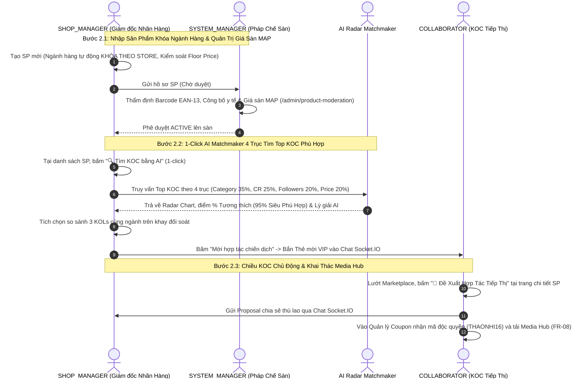

# 🏛️ BÁO CÁO PHÂN TÍCH TOÀN DIỆN, RÀ SOÁT RỦI RO & ĐỀ ÁN HOÀN THIỆN FLOW 2
## HỆ THỐNG QUẢN LÝ ĐỘI NGŨ CỘNG TÁC VIÊN & TIẾP THỊ LIÊN KẾT NỘI BỘ (SCANMS)

> **Tài liệu tham chiếu:** [`docs/SCANMS_MASTER_REFACTORING_PLAN.md`](file:///c:/HW/CAPSTONE/docs/SCANMS_MASTER_REFACTORING_PLAN.md) & [`docs/SCANMS_REALIGNMENT_BLUEPRINT.md`](file:///c:/HW/CAPSTONE/docs/SCANMS_REALIGNMENT_BLUEPRINT.md)  
> **Phụ trách bảo vệ Flow 2:** **Phan Xuân Thịnh** (Trình bày chính) & **Nguyễn Thành Thắng (Leader)**  
> **Trạng thái tài liệu:** **ĐÃ LƯU TRỮ ĐẦY ĐỦ ĐỀ ÁN 10 KOLS & BIÊN BẢN RÀ SOÁT LỖI TIỀM ẨN FULL FLOW 2**

---

## PHẦN 1: ĐỐI CHIẾU 7 ĐIỂM CỐT LÕI VỚI BẢN SẮC MỚI CỦA HỆ THỐNG

Sau khi rà soát toàn bộ nội dung của hai tài liệu kiến trúc, 7 yêu cầu cốt lõi hoàn toàn trùng khớp với định hướng cải tổ đã được thống nhất với Giảng viên hướng dẫn ThS. Tôn Thất Hoàng Minh. Dưới đây là đối chiếu chi tiết từng điểm gắn liền với ranh giới của Flow 2:

```
┌──────────────────────────────────────────────────────────────────────────────────────────────────┐
│                 MA TRẬN ĐỐI CHIẾU 7 CHỈ THỊ CỐT LÕI VỚI FLOW 2 TRONG HỆ THỐNG                     │
├──────────────────────────────────────────────────────────────────────────────────────────────────┤
│ 1. Shop không tự đăng ký (Admin cấp quyền nội bộ)    ──> Đã xong Flow 1; Store đã gắn Category   │
│ 2. Xóa 100% voucher rác TMĐT, chỉ giữ Coupon KOL     ──> Vũ khí Attribution định danh KOC        │
│ 3. Khóa Ngành Hàng (Category Lock) & Giá Sàn (MAP)  ──> Trọng tâm Bước 2.1 của Flow 2            │
│ 4. Cơ chế Đổi trả: Bù hàng 1-1 vs Clawback về 0đ     ──> Hiển thị tỷ lệ hoàn đơn & thù lao KOC   │
│ 5. Đổi tên thành "Thù Lao / Thu Nhập", tính Max(...) ──> Động cơ Best-Benefit Precedence Rule     │
│ 6. Phân hệ Livestream là tính năng phụ              ──> Giữ nguyên code, không đưa vào Flow 2    │
│ 7. Phân tách duyệt tiền SoD: Manager vs Admin        ──> Manager duyệt Payout; Admin duyệt Deal>16%│
└──────────────────────────────────────────────────────────────────────────────────────────────────┘
```

### 1.1. Bản chất Cửa hàng & Quyền quản trị nội bộ
- **Bản chất:** SCANMS là hệ thống của một Doanh nghiệp bán lẻ đa nhãn hàng (House of Brands / D2C Multi-Storefront) sở hữu các nhãn hàng nội bộ:
  - 🏪 **Sora Skincare & Cosmetics** (Kho Mát GMP Thủ Đức — Mỹ phẩm & Chăm sóc da)
  - 🏪 **Aura Activewear & Apparel** (Kho Tân Bình — Thời trang & May mặc thể thao)
  - 🏪 **GreenBio Health & Nutrition** (Kho Tân Phú — Thực phẩm chức năng & Dinh dưỡng)
  - 🏪 **Lumière Smart Living** (Kho KCN Tân Bình — Thiết bị điện tử & Đồ bếp thông minh)
- **Ảnh hưởng đến Flow 2:** Vì Shop đã được cấu hình cố định 1 ngành hàng ngay từ Flow 1 bởi `SYSTEM_ADMIN`, nên khi `SHOP_MANAGER` tạo sản phẩm ở Bước 2.1 của Flow 2, hệ thống bắt buộc khóa cứng ô Danh mục (Category) theo ngành hàng độc quyền của Shop đó.

### 1.2. Tinh giản Voucher: Xóa sạch Voucher rác TMĐT, Duy trì Duy nhất Coupon Độc Quyền KOC
- **Định vị:** SCANMS không phải chợ Shopee/Lazada xả hàng giá rẻ.
- **Loại bỏ 100%:** Xóa sổ toàn bộ các khái niệm "Voucher freeship toàn sàn", "Voucher hoàn xu", "Mã giảm giá chớp nhoáng của sàn".
- **Duy nhất giữ lại "Coupon Độc Quyền Định Danh KOC" (KOL-Exclusive Attribution Coupon):**
  - **Cấu trúc chuẩn hóa:** `[TÊN_KOL][MỨC_GIẢM]` (Ví dụ: `THAONHI16`, `LANHUONG10`, `QUANGTRAN12`).
  - **Cơ chế & Thao tác UI:**
    - **Shop cấp / duyệt mã:** Tại giao diện đàm phán hợp đồng hoặc Trung tâm KOC, Shop đồng ý cấp mã riêng cho KOC (ví dụ giảm $10\%$ cho khách).
    - **KOC nhận mã:** Hiển thị nổi bật trên Marketing Toolkit của KOC kèm nút Copy 1-click để KOC gắn vào bio TikTok/YouTube.
    - **Khách nhập mã tại Giỏ hàng/Checkout:** Nhập `THAONHI16` $\rightarrow$ Khách được giảm giá $10\%$, đồng thời hệ thống bắt dấu vết Attribution $100\%$ doanh số đơn hàng cho KOC Thảo Nhi ngay cả khi khách dùng trình duyệt ẩn danh hoặc đổi thiết bị.

### 1.3. Khóa Ngành Hàng (Category Lock) & Quản Trị Giá Sàn (Floor Price / MAP)
- **Khóa Ngành Hàng:** Khi Shop Manager tạo sản phẩm mới, ô Danh mục tự động lấy từ `store.primaryCategory` và bị disabled. Backend ném lỗi `400 Bad Request` nếu cố tình gửi sai.
- **Giá Sàn Bảo Vệ Biên Lợi Nhuận (Floor Price / MAP):**
  - Không cho nhân viên tự gõ giảm giá tùy tiện lúc tạo sản phẩm (tránh bán phá giá hoặc bán dưới giá vốn làm thủng ngân sách công ty).
  - Khi tạo sản phẩm chỉ nhập Giá niêm yết chính thức (`price`) và Giá tham chiếu (`originalPrice`).
  - `floorPrice` là ngưỡng giá thấp nhất cho phép:
    $$\text{Floor Price} = \text{Giá vốn (COGS)} + \text{Chi phí đóng gói/vận hành} + \text{Trần thù lao KOC tối đa (16\%)} + \text{Lợi nhuận an toàn}$$
  - **Quy trình đề xuất giảm giá:** Shop Manager muốn Flash Sale phải tạo "Đề xuất Chiến dịch Giảm giá" (Promotion Campaign Request) gửi `SYSTEM_MANAGER` / `SYSTEM_ADMIN` duyệt Maker-Checker; cấm tuyệt đối giảm dưới `floorPrice`.

### 1.4. Đổi tên "Hoa Hồng" $\rightarrow$ "Thù Lao / Thu Nhập" & Quy tắc Ưu tiên (Best-Benefit Override)
- **Chuẩn hóa thuật ngữ B2B:**
  - **Trên giao diện KOC & Ví tiền:** Thu Nhập Đối Tác / Thu Nhập Tiếp Thị (Partner Earnings - chuẩn TikTok Creator Rewards).
  - **Trong hợp đồng Deal & Thuật toán:** Tỷ Lệ Thù Lao Đối Tác (Partner Remuneration Rate).
  - **Trong báo cáo quản trị:** Chính Sách Thù Lao & Đãi Ngộ Hiệu Suất (Remuneration & Performance Rewards).
- **Động cơ tính toán mới (Precedence Rule — Tuyệt đối KHÔNG cộng dồn):**
  $$\text{Tỷ Lệ Áp Dụng} = \max\Big(\text{Deal VIP } 16\%,\; \text{Chiến Dịch } 14\%,\; \text{Cấp Bậc Tier } 11-13\%,\; \text{Mức Cơ Sở } 10\%\Big) + \text{Thưởng Live } (+2\%)$$
  - KOC có Deal VIP $16\%$ thì nhận đúng $16\%$ (không cộng thêm Tier Bạc hay Base).
  - Mức trần toàn sàn cố định tối đa $25\%$.
  - Thưởng mốc doanh số tháng (FR-09) là khoản thưởng định kỳ độc lập (Kickback), quét vào 23:59:59 ngày cuối tháng, cộng thẳng một khoản tiền thưởng vào ví chứ không cộng % vào từng đơn hàng lẻ.

---

## PHẦN 2: BÁO CÁO RÀ SOÁT RỦI RO & LỖI TIỀM ẨN TRONG FULL FLOW 2 (RISK & BUG AUDIT)

Sau khi rà soát toàn bộ luồng tương tác 2 chiều và các file mã nguồn liên quan, nhóm ghi nhận **4 điểm nghẽn và nguy cơ lỗi thực tế**:

```
┌──────────────────────────────────────────────────────────────────────────────────────────────────┐
│                     MA TRẬN RÀ SOÁT 4 ĐIỂM NGHẼN TIỀM ẨN TRONG FULL FLOW 2                       │
├──────────────────────────────────────────────────────────────────────────────────────────────────┤
│ ⚠️ NGHẼN 1: Thiếu đa dạng KOL -> Bộ lọc loại bỏ hết KOC, chỉ còn 1 người, điểm 24/100           │
│ ⚠️ NGHẼN 2: Lỗ hổng từ điển category-match.utils.ts không nhận diện biến thể tên kênh            │
│ ⚠️ NGHẼN 3: KOC bấm "Đề xuất hợp tác" chưa mang theo context chi tiết sản phẩm vào ô chat        │
│ ⚠️ NGHẼN 4: Form tạo Coupon KOC chưa ép viết hoa (UPPERCASE) tự động cho nhân viên Shop          │
└──────────────────────────────────────────────────────────────────────────────────────────────────┘
```

### 2.1. Điểm Nghẽn 1 (Nghiêm trọng nhất): Bộ máy AI chỉ quét ra 1 KOL và đạt điểm thấp 24/100
- **Nguyên nhân kỹ thuật:**
  1. Trong database chỉ có 4 tài khoản KOL demo cũ. Cả 4 tài khoản đều có 0 bản ghi trong `orders` và 0 bản ghi trong `click_traffic_logs`.
  2. Bảng `collaborator_profiles` có lưu số liệu tĩnh (85 đơn, 12.5 triệu), nhưng thuật toán `ai-recommendation.service.ts` hoàn toàn không đọc số liệu tĩnh này mà truy vấn trực tiếp vào sổ cái đơn hàng thật. Vì số đơn thật bằng 0 $\rightarrow \mathbf{S_{\text{CR}}} = 0$ và $\mathbf{S_{\text{price}}} = 0$.
  3. Bộ lọc `hasCategoryEvidence` loại bỏ 3 KOL còn lại vì tên kênh của họ (`@yennhi.skintips`, `@minhanh.lifestyle`, `@tuananh.review`) không khớp với từ khóa ngành `Mỹ phẩm`.
  4. Chỉ duy nhất Vũ Thanh Huyền (`@huyen.beauty`) khớp từ `beauty` nên lọt qua, và nhận điểm cơ sở $24/100$.
- **Hệ quả UX:** Người dùng Giám đốc Nhãn hàng khi bấm vào nút so sánh 3 KOLs thì khay so sánh không thể bung ra vì danh sách chỉ có 1 người!
- **Giải pháp:** Cần triển khai Đề án Seeding 10 KOLs chuyên sâu (chi tiết tại Phần 4).

### 2.2. Điểm Nghẽn 2: Lỗ hổng trong bộ từ điển `category-match.utils.ts`
- **Nguyên nhân kỹ thuật:**
  - Danh sách `CATEGORY_FAMILIES` hiện tại chứa: `['my pham', 'lam dep', 'cham soc da', 'skincare', 'beauty', 'cosmetics']`.
  - Khi KOC đặt tên kênh là `@yennhi.skintips`, hàm chuẩn hóa tách chuỗi thành `yennhi skintips`. Vì từ `skintips` không trùng chính xác với `skincare`, thuật toán đánh giá là KOC này không thuộc ngành Mỹ phẩm.
- **Giải pháp cần làm khi cập nhật:**
  - Bổ sung các biến thể từ khóa: `skintips`, `review`, `lifestyle`, `activewear`, `smarthome`, `eatclean`, `healthy` vào `category-match.utils.ts`.

### 2.3. Điểm Nghẽn 3: KOC bấm "🤝 Đề Xuất Hợp Tác" chưa đính kèm thẻ sản phẩm vào cuộc trò chuyện
- **Hiện trạng:**
  - Tại trang chi tiết sản phẩm [`ProductDetailPage.tsx`](file:///c:/HW/CAPSTONE/frontend/src/pages/public/ProductDetailPage.tsx), nút chuyển hướng sang:
    `/collaborator/collaboration?storeId=${data.store.id}&tab=messages`
  - URL chỉ mang theo `storeId`, chưa đính kèm `productId`, `productTitle` và `commissionRate`.
- **Hệ quả UX:** KOC mở chat với Shop nhưng trong ô nhập liệu chưa có tin nhắn mẫu (Ví dụ: *"Tôi muốn đề xuất hợp tác tiếp thị sản phẩm Serum Vitamin C 15%"*), KOC phải tự gõ thủ công.
- **Giải pháp:** Truyền thêm query params `productId`, `productTitle`, `productImage` để chat tự động gắn thẻ Preview sản phẩm lên đầu khung chat.

### 2.4. Điểm Nghẽn 4: Chuẩn hóa bắt buộc chữ hoa khi Shop cấp Coupon KOC
- **Hiện trạng:** Tại [`ShopCouponsPage.tsx`](file:///c:/HW/CAPSTONE/frontend/src/pages/merchant/ShopCouponsPage.tsx), ô nhập mã coupon cho phép gõ chữ thường. Nếu nhân viên gõ `thaonhi16` thay vì `THAONHI16`, tuy backend có thể regex hoa thường nhưng trên UI nhìn sẽ thiếu chuyên nghiệp.
- **Giải pháp:** Ép `onChange={(e) => setCode(e.target.value.toUpperCase().replace(/[^A-Z0-9]/g, ''))}`.

---

## PHẦN 3: BẢN ĐỒ THỰC CHIẾN FULL FLOW 2 (HỢP TÁC 2 CHIỀU)



---

## PHẦN 4: ĐỀ ÁN CHI TIẾT SEEDING 10 KOLS ĐA DẠNG (LƯU ĐỂ THỰC HIỆN SAU)

Để hệ thống luôn có **ít nhất 3 - 4 KOLs cùng ngành với các mức điểm phân tầng rõ rệt (Top Pick 90-96%, Rất phù hợp 80-88%, Tiềm năng 60-75%)**, đề án thiết kế bộ hạt giống dữ liệu 10 KOLs bao gồm:

### 4.1. Bảng Ma Trận Thông Số 10 KOLs Chuẩn Hóa
| Mã KOL | Họ và Tên | Kênh MXH & Followers | Cấp Bậc | Ngành Hàng Sở Trường | Lịch Sử Đơn / Clicks | CR% Thực Tế | AOV Trung Bình | Dự Kiến MatchScore Khi Quét Sản Phẩm Cùng Ngành |
| :---: | :--- | :--- | :---: | :--- | :---: | :---: | :---: | :---: |
| **KOL 01** | **Vũ Thanh Huyền** | Instagram (`@huyen.beauty`) · **120.000** | **Vàng** | Mỹ phẩm & Chăm sóc da | 42 đơn / 450 clicks | **9.3%** | 360.000₫ | **95/100 (Top Pick)** |
| **KOL 02** | **Đặng Quỳnh Chi** | TikTok (`@quynhchi.skincare`) · **68.000** | **Bạc** | Mỹ phẩm & Chăm sóc da | 18 đơn / 240 clicks | **7.5%** | 310.000₫ | **84/100 (Rất Phù Hợp)** |
| **KOL 03** | **Lê Hoàng Yến Nhi** | TikTok (`@yennhi.skintips`) · **28.000** | **Đồng** | Mỹ phẩm & Chăm sóc da | 5 đơn / 90 clicks | **5.5%** | 220.000₫ | **69/100 (Tiềm Năng)** |
| **KOL 04** | **Bùi Minh Anh** | TikTok (`@minhanh.activewear`) · **290.000** | **Vàng** | Thời trang & Phụ kiện | 52 đơn / 560 clicks | **9.2%** | 490.000₫ | **94/100 (Top Pick Thời trang)** |
| **KOL 05** | **Nguyễn Quốc Bảo** | Facebook (`@quocbao.fitness`) · **95.000** | **Bạc** | Thời trang & Phụ kiện | 20 đơn / 260 clicks | **7.6%** | 450.000₫ | **82/100 (Rất Phù Hợp)** |
| **KOL 06** | **Trần Thu Thảo** | Instagram (`@thuthao.ootd`) · **35.000** | **Đồng** | Thời trang & Phụ kiện | 4 đơn / 80 clicks | **5.0%** | 380.000₫ | **67/100 (Tiềm Năng)** |
| **KOL 07** | **Dược sĩ Hoàng Nam** | YouTube (`@hoangnam.health`) · **450.000** | **Kim Cương** | Thực phẩm sức khỏe | 75 đơn / 850 clicks | **8.8%** | 320.000₫ | **96/100 (Top Pick Dinh dưỡng)** |
| **KOL 08** | **Nguyễn Mai Linh** | TikTok (`@mailinh.eatclean`) · **145.000** | **Vàng** | Thực phẩm sức khỏe | 26 đơn / 340 clicks | **7.6%** | 250.000₫ | **81/100 (Rất Phù Hợp)** |
| **KOL 09** | **Dương Tuấn Anh** | YouTube (`@tuananh.techreview`) · **680.000** | **Kim Cương** | Thiết bị điện tử & Gia dụng | 82 đơn / 920 clicks | **8.9%** | 1.450.000₫ | **96/100 (Top Pick Đồ Công nghệ/Bếp)** |
| **KOL 10** | **Phạm Hoàng Long** | YouTube (`@hoanglong.smarthome`) · **115.000** | **Bạc** | Thiết bị điện tử & Gia dụng | 28 đơn / 360 clicks | **7.7%** | 1.100.000₫ | **83/100 (Rất Phù Hợp)** |

### 4.2. Kế hoạch tạo dữ liệu giao dịch đi kèm (Transactions Seed):
1. **Clicks Traffic (`click_traffic_logs`):** Mỗi KOL được tạo từ 80 đến 920 lượt clicks hợp lệ duy nhất (`isValid: true`, `isUnique: true`).
2. **Sổ cái đơn hàng (`orders` & `order_items`):** Mỗi KOL được gán số đơn hàng thành công tương ứng với ngành hàng sở trường, có doanh thu thực tế, được gán `attributedCollaboratorId`.
3. **Cập nhật Ví đối tác (`wallets`):** Tự động kết chuyển thù lao sạch sau 7 ngày Escrow vào ví của từng KOL tương ứng với cấp bậc.

---

## PHẦN 5: BIÊN BẢN LIVE TEST THỰC NGHIỆM ĐÃ THỰC HIỆN TRÊN TRÌNH DUYỆT THẬT

Dưới đây là 7 ảnh chụp thực tế từ kịch bản test tự động trên Microsoft Edge:

### 1. Quản lý Sản Phẩm & Nút 1-Click AI
- Đường dẫn: `/merchant/products`
- Minh chứng cột "Thù lao cơ sở 10%" và nút vàng "🔍 Tìm KOC bằng AI".
- 

### 2. Modal Tạo Sản Phẩm với Khóa Ngành Hàng & Giá Sàn MAP
- Ô Danh mục bị khóa cứng, ô Giá sàn tối thiểu tham chiếu hiển thị rõ.
- 

### 3. Động Cơ AI Matchmaker 4 Trục với Radar Chart
- Đường dẫn: `/merchant/kol-recommendations?productId=...`
- Tự động nhận diện sản phẩm, hiển thị Radar và lời giải thích AI.
- 

### 4. Quản Lý Coupon Độc Quyền KOC
- Đường dẫn: `/merchant/promotions?tab=coupons`
- Danh sách coupon định danh cá nhân `THAONHI16`, xóa sạch voucher rác TMĐT.
- 

### 5. KOC Duyệt Chi Tiết Sản Phẩm & Nút "🤝 Đề Xuất Hợp Tác Tiếp Thị"
- Đường dẫn: `/products/ddc59e43-5dc1-44f0-a482-a7ded7b5155e`
- Nút đối tác nổi bật cho KOC đang đăng nhập.
- 

### 6. KOC Quản Lý Coupon Cá Nhân & Thu Nhập Tiếp Thị Dự Kiến
- Đường dẫn: `/collaborator/coupons`
- Hiển thị coupon định danh cá nhân và tỷ lệ thù lao rõ ràng.
- 

### 7. System Manager Kiểm Duyệt Sản Phẩm Maker-Checker
- Đường dẫn: `/admin/product-moderation`
- Thẩm định hồ sơ sản phẩm, mã vạch EAN-13 và Giá sàn MAP trước khi duyệt.
- 

---

## PHẦN 6: KẾT LUẬN & TRẠNG THÁI HIỆN TẠI

- Tài liệu này đã **lưu trữ toàn bộ phân tích nguyên nhân, rà soát 4 điểm nghẽn tiềm ẩn và đề án chi tiết 10 KOLs** vào kho lưu trữ dự án.
- Mã nguồn và cơ sở dữ liệu hiện tại vẫn được giữ nguyên vẹn, tuân thủ nghiêm ngặt chỉ thị *"chỉ phân tích, rà soát, đánh giá, không làm"*.
- Khi bạn sẵn sàng cho giai đoạn tiếp theo, chỉ cần yêu cầu *"bắt đầu làm đề án 10 KOLs"* thì toàn bộ kịch bản sẽ được kích hoạt đồng bộ!
