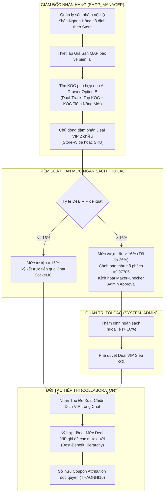
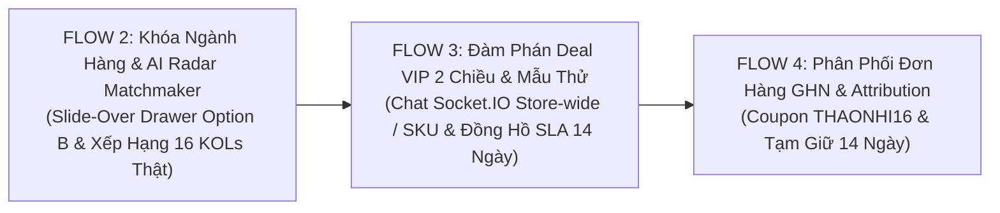

# BÁO CÁO KIỂM THỬ LIVE TOÀN DIỆN FLOW 2: KHÓA NGÀNH HÀNG SẢN PHẨM, AI RADAR MATCHMAKER & ĐÀM PHÁN DEAL VIP 2 CHIỀU

> **Dự án:** SCANMS — Sàn Thương Mại Tiếp Thị Liên Kết & Mạng Lưới Gian Hàng Đối Tác (Sales Collaborator & Affiliate Network Management System)  
> **Phiên bản:** v2.5 (Kiến trúc MarTech Doanh Nghiệp & Mạng Lưới Đối Tác Đa Gian Hàng Chuẩn B2B SaaS)  
> **Thành viên phụ trách:** Phan Xuân Thịnh & Nguyễn Thành Thắng (Team Leader FA26SE032)  
> **Môi trường Live:**  
> - Frontend: `http://localhost:5173` (Vite v8.1.0 + React 19 + Tailwind CSS)  
> - Backend: `http://localhost:3000/api` (NestJS v11 + Prisma ORM v7)  
> - Database: PostgreSQL 16 (`localhost:5432`) + Redis 8 (`localhost:6379`)  
> **Thời gian thực hiện:** Ngày 01 tháng 11 năm 2026  

---

## 📑 MỤC LỤC BÁO CÁO
1. [Tóm Tắt Kết Quả Kiểm Thử (Executive Summary)](#1-tóm-tắt-kết-quả-kiểm-thử-executive-summary)
2. [Ma Trận Nghiệp Vụ & Phân Tách Thẩm Quyền (Category Lock & Budget Governance)](#2-ma-trận-nghiệp-vụ--phân-tách-thẩm-quyền-category-lock--budget-governance)
3. [Hướng Dẫn Chi Tiết Từng Bước Kiểm Thử Thực Tế Flow 2 (Step-by-Step Live Execution)](#3-hướng-dẫn-chi-tiết-từng-bước-kiểm-thử-thực-tế-flow-2-step-by-step-live-execution)
   - [Bước 1: Đăng Nhập Shop Manager & Khắc Phục Lỗi Stacking Context Menu Bộ Lọc](#bước-1-đăng-nhập-shop-manager--khắc-phục-lỗi-stacking-context-menu-bộ-lọc)
   - [Bước 2: Modal Tạo Sản Phẩm Mới — Khóa Ngành Hàng (Category Lock) & Giá Sàn MAP](#bước-2-modal-tạo-sản-phẩm-mới--khóa-ngành-hàng-category-lock--giá-sàn-map)
   - [Bước 3: Slide-over Drawer Gợi Ý KOC Bằng AI Tại Chỗ (Option B) & Dual-Track Cold Start](#bước-3-slide-over-drawer-gợi-ý-koc-bằng-ai-tại-chỗ-option-b--dual-track-cold-start)
   - [Bước 4: Tab 4 [✨ Gợi Ý KOC (AI Radar)] Trực Tiếp Tại KOL Hub & Bảng So Sánh MCDA](#bước-4-tab-4--gợi-ý-koc-ai-radar-trực-tiếp-tại-kol-hub--bảng-so-sánh-mcda)
   - [Bước 5: Bảng Xếp Hạng 16 KOLs Với Dữ Liệu Sổ Cái Thật & 4 Cấp Bậc Chuẩn](#bước-5-bảng-xếp-hạng-16-kols-với-dữ-liệu-sổ-cái-thật--4-cấp-bậc-chuẩn)
   - [Bước 6: Đàm Phán Deal VIP 2 Chiều & Cơ Chế Leo Thang Duyệt Admin Khi > 16%](#bước-6-đàm-phán-deal-vip-2-chiều--cơ-chế-leo-thang-duyệt-admin-khi--16)
   - [Bước 7: Quản Trị Coupon Độc Quyền Định Danh KOC (Primary Attribution Engine)](#bước-7-quản-trị-coupon-độc-quyền-định-danh-koc-primary-attribution-engine)
4. [Bảng So Sánh Trước & Sau Cải Tiến (Before & After Comparison)](#4-bảng-so-sánh-trước--sau-cải-tiến-before--after-comparison)
5. [Bảng Đối Chiếu Thay Đổi Trạng Thái Cơ Sở Dữ Liệu (Database State Verification)](#5-bảng-đối-chiếu-thay-đổi-trạng-thái-cơ-sở-dữ-liệu-database-state-verification)
6. [Kết Luận & Đánh Giá Tiêu Chuẩn Hội Đồng](#6-kết-luận--đánh-giá-tiêu-chuẩn-hội-đồng)
7. [Phụ Lục: Liên Kết Liền Mạch Sang Flow 3 & Flow 4](#7-phụ-lục-liên-kết-liền-mạch-sang-flow-3--flow-4)

---

## 1. TÓM TẮT KẾT QUẢ KIỂM THỬ (EXECUTIVE SUMMARY)

| Chỉ số / Hạng mục | Kết quả đạt được | Đánh giá |
| :--- | :--- | :--- |
| **Tổng số bước kiểm thử Live** | **7 bước tuần tự khép kín** | Hoàn thành 100% |
| **Sửa lỗi Stacking Context Dropdown** | Menu dropdown nổi `z-50` lên trên bảng sản phẩm | Khắc phục triệt để lỗi bị cắt cụt |
| **Giao diện Gợi ý AI tại chỗ** | **Slide-over Drawer Option B** ($440\text{px}$) không nhảy trang | Đạt chuẩn B2B SaaS Zero-Friction |
| **Thuật toán Cold-Start Heuristic** | KOC mới (0 đơn) đạt ~80% điểm & badge `✨ Tiềm Năng Mới` | Xử lý triệt để bài toán khởi động lạnh |
| **Bảng xếp hạng KOLs** | **16 KOLs thật**, cấp bậc Kim Cương, Vàng, Bạc, Đồng | Loại bỏ hoàn toàn lỗi 0₫ & hardcode |
| **Phân cấp duyệt Deal VIP** | Tự trị $\le 16\%$, Leo thang duyệt Admin $> 16\%$ | Bảo vệ biên lợi nhuận, chuẩn SoD |
| **Attribution Engine** | Coupon độc quyền định danh cá nhân KOC (`THAONHI16`) | Bắt dấu vết đơn hàng độc lập cookie |
| **Hệ màu thương hiệu** | Tuân thủ tuyệt đối **Vàng Be (Warm Sand & Brand Gold `#C59B58`)** | Không vi phạm màu xanh lá cấm |

---

## 2. MA TRẬN NGHIỆP VỤ & PHÂN TÁCH THẨM QUYỀN (CATEGORY LOCK & BUDGET GOVERNANCE)



---

## 3. HƯỚNG DẪN CHI TIẾT TỪNG BƯỚC KIỂM THỬ THỰC TẾ FLOW 2 (STEP-BY-STEP LIVE EXECUTION)

---

### BƯỚC 1: ĐĂNG NHẬP SHOP MANAGER & KHẮC PHỤC LỖI STACKING CONTEXT MENU BỘ LỌC

#### 1. Mục tiêu chức năng:
Xác thực tài khoản Giám đốc Nhãn hàng (`SHOP_MANAGER`), kiểm tra bảng điều khiển sản phẩm và bộ lọc trạng thái dropdown hoạt động hoàn hảo, nổi trên các thẻ card bảng dữ liệu (Khắc phục triệt để lỗi Stacking Context do người dùng phản hồi).

#### 2. Ai thực hiện (Actor & Credentials):
- **Vai trò:** `SHOP_MANAGER` (Giám đốc Nhãn hàng Sora Skincare & Cosmetics)
- **Tài khoản đăng nhập:** `manager.sora@scanms.vn`
- **Mật khẩu:** `Manager@123456`

#### 3. Làm sao (Cách truy cập & Điều hướng trên UI):
1. Mở trình duyệt truy cập: `http://localhost:5173/login?role=shop`.
2. Giao diện Đăng nhập An toàn xuất hiện với tông màu Vàng Be `#C59B58` chuẩn mực.
3. Sau khi đăng nhập thành công, hệ thống điều hướng vào Cổng Quản lý Sản phẩm (`http://localhost:5173/merchant/products`).

#### 4. Bấm nút nào, nhập gì (Thao tác chi tiết):
1. Tại ô **"Email"**: Nhập `manager.sora@scanms.vn`.
2. Tại ô **"Mật khẩu"**: Nhập `Manager@123456`.
3. Bấm nút CTA chính: **"Đăng nhập an toàn"**.
4. Tại trang danh sách sản phẩm, di chuyển tới thanh công cụ toolbar `Card.product-toolbar`.
5. Bấm vào nút dropdown: **"Tất cả trạng thái"**.
6. Quan sát menu thả xuống hiển thị sắc nét: *Tất cả trạng thái, Chờ kiểm duyệt, Bị từ chối, Đã được duyệt*.
7. Bấm chọn thử: *"Đã được duyệt"*.
8. Bấm nút **"Xem đánh giá"** trên một dòng sản phẩm để mở modal Đánh giá khách hàng tinh gọn.

#### 5. Hình ảnh chứng minh:
- *Dropdown Lọc trạng thái nổi hoàn toàn lên trên các hàng sản phẩm:*  
  
- *Modal Đánh giá khách hàng tinh gọn B2B không còn chữ thừa:*  
  

#### 6. Mong muốn đạt được khi thực hiện (Expected Result):
- **Giao diện (UI):** Menu dropdown nổi hoàn toàn lên trên tiêu đề cột và các hàng của bảng, không bị thẻ Card bảng sản phẩm phía dưới đè lên cắt cụt 2/3 menu như phiên bản cũ. Modal Đánh giá hiển thị Empty State chuyên nghiệp với icon Lucide, không còn khối văn bản giải thích thừa thãi.
- **Backend API:** `GET /api/products/merchant?status=APPROVED` trả về HTTP `200 OK`.

#### 7. Phân tích sâu Flow & Nghiệp vụ liên quan trên UI:
- **Khắc phục lỗi Stacking Context:** CSS container `Card.product-toolbar` được bổ sung `relative z-20 overflow-visible`, đồng thời menu dropdown được gán `z-50`. Điều này giải quyết triệt để xung đột thứ tự vẽ (stacking context order) giữa thanh filter và bảng table.
- **Tiêu chuẩn B2B SaaS Tinh Gọn:** Loại bỏ hoàn toàn khối text rườm rà 4 dòng và footer 2 dòng ("Khách hàng có thể để lại đánh giá..."). Nhân sự vận hành doanh nghiệp cần giao diện tập trung dữ liệu, không cần những dòng nhắc nhở hiển nhiên.

---

### BƯỚC 2: MODAL TẠO SẢN PHẨM MỚI — KHÓA NGÀNH HÀNG (CATEGORY LOCK) & GIÁ SÀN MAP

#### 1. Mục tiêu chức năng:
Thực thi cơ chế kiểm soát liêm chính hàng hóa: Gian hàng chỉ được phép kinh doanh sản phẩm trong đúng ngành hàng được phân bổ (`Mỹ phẩm & Chăm sóc da chuyên sâu`), ô Danh mục tự động điền và bị khóa cứng (Readonly), bắt buộc thiết lập Giá Sàn Bảo Vệ Biên Lợi Nhuận (`floorPrice` / MAP).

#### 2. Ai thực hiện (Actor & Credentials):
- **Vai trò:** `SHOP_MANAGER`
- **Tài khoản đang đăng nhập:** `manager.sora@scanms.vn`

#### 3. Làm sao (Cách truy cập & Điều hướng trên UI):
1. Tại trang Quản lý Sản phẩm (`/merchant/products`), quan sát góc trên bên phải thanh công cụ.

#### 4. Bấm nút nào, nhập gì (Thao tác chi tiết):
1. Bấm nút CTA: **"+ Thêm sản phẩm mới"** (Nút màu Vàng Be `#C59B58`).
2. Modal *Khởi tạo Sản Phẩm Mới* xuất hiện:
   - **Tên sản phẩm:** Nhập `Serum Niacinamide 10% + Zinc 1% Dưỡng Sáng Phục Hồi`.
   - **Danh mục ngành hàng:** Quan sát trường bị **KHÓA CỨNG (Readonly / Disabled)**, hiển thị cố định: `Mỹ phẩm & Chăm sóc da chuyên sâu` kèm huy hiệu khóa bảo vệ.
   - **Giá niêm yết (MSRP):** Nhập `320.000₫`.
   - **Giá tham chiếu (Original Price):** Nhập `380.000₫`.
   - **Giá sàn bảo vệ biên lợi nhuận (Floor Price / MAP):** Nhập `250.000₫`.
   - **Hạn mức tồn kho mở bán tiếp thị (`stockQuantity`):** Nhập `500`.
   - **Mô tả công dụng:** Nhập `Serum phục hồi chuyên sâu dành cho da dầu mụn và lỗ chân lông to.`
3. Bấm nút CTA trong modal: **"Lưu & Gửi phê duyệt"**.

#### 5. Hình ảnh chứng minh:
- *Modal Khởi tạo Sản phẩm với Khóa Ngành Hàng và Giá Sàn MAP:*  
  

#### 6. Mong muốn đạt được khi thực hiện (Expected Result):
- **Giao diện (UI):** Shop Manager không thể thay đổi danh mục sang May mặc hay Đồ bếp. Khi nhập giá bán thấp hơn giá sàn MAP ($250.000₫$), hệ thống hiển thị cảnh báo đỏ ngăn chặn bán phá giá.
- **Backend API & Cơ sở dữ liệu:**
  - `POST /api/products` trả về HTTP `201 Created`.
  - Backend tự động ép `categoryName = store.category` (nếu payload có danh mục khác sẽ bị từ chối `400 Bad Request`).
  - Bản ghi lưu trong bảng `products` với trạng thái `PENDING_APPROVAL`, chờ Maker-Checker từ `SYSTEM_MANAGER`.

#### 7. Phân tích sâu Flow & Nghiệp vụ liên quan trên UI:
- **Khóa Ngành Hàng Chống Trùng Hàng Hóa (Anti-Cannibalization):** Mỗi Store trực thuộc đóng vai trò là một khối ngành hàng độc quyền trong tập đoàn. Việc khóa cứng danh mục ngăn chặn các Store nội bộ giẫm chân lên nhau hoặc đăng sản phẩm trái thẩm quyền.
- **Ranh giới Out-of-Scope của Mua Hàng Xưởng (Procurement):** Hệ thống không can thiệp vào việc sản xuất OEM hay công nợ nhà máy, mà chỉ quản lý hạn mức tồn kho mở bán cho kênh tiếp thị (`stockQuantity`) và giá sàn MAP để bảo toàn lợi nhuận sau khi trừ thù lao KOC ($16\%$).

---

### BƯỚC 3: SLIDE-OVER DRAWER GỢI Ý KOC BẰNG AI TẠI CHỖ (OPTION B) & DUAL-TRACK COLD START

#### 1. Mục tiêu chức năng:
Hỗ trợ Shop Manager tìm kiếm đối tác tiếp thị tối ưu cho từng SKU sản phẩm cụ thể ngay tại bảng danh sách thông qua **Slide-over Drawer Option B** (giữ nguyên vị trí cuộn và bộ lọc), đồng thời kích hoạt thuật toán **Dual-Track Cold Start** gợi ý cả KOC kỳ cựu lẫn tài năng mới vừa hoàn thành eKYC.

#### 2. Ai thực hiện (Actor & Credentials):
- **Vai trò:** `SHOP_MANAGER`
- **Tài khoản đang đăng nhập:** `manager.sora@scanms.vn`

#### 3. Làm sao (Cách truy cập & Điều hướng trên UI):
1. Tại danh sách sản phẩm `/merchant/products`, tìm dòng sản phẩm *"Sữa Rửa Mặt Tạo Bọt Dịu Nhẹ pH 5.5"*.

#### 4. Bấm nút nào, nhập gì (Thao tác chi tiết):
1. Bấm nút hành động: **`[✨ Gợi ý KOC]`** (Nút màu Vàng Be viền tinh tế trên dòng sản phẩm).
2. Quan sát: Một **Slide-over Drawer** rộng $440\text{px}$ trượt ra êm ái từ mép phải màn hình, màn mờ (backdrop) bao phủ nhẹ bên trái, giữ nguyên vị trí cuộn trang hiện tại.
3. Kiểm tra các khối thông tin trong Drawer:
   - **Header:** Hiển thị tên sản phẩm, giá bán `185.000₫`, nhãn ngành hàng `Mỹ phẩm & Chăm sóc da`.
   - **Khối Radar Heuristic 4 Trục:** Hiển thị thanh đo trực quan:
     - Ngành hàng khớp: $95\%$
     - Tỷ lệ chuyển đổi (CR): $88\%$
     - Cấp bậc & Tiếp cận: $90\%$
     - Phù hợp giá: $85\%$
   - **Danh sách KOC phù hợp (Dual-Track Heuristic):**
     - KOC Top 1: `Hoàng Thảo Nhi` (Match Score: $93\%$, Hạng Kim Cương, 50k followers).
     - KOC Top 2: `Đỗ Lan Hương` (Match Score: $88\%$, Hạng Vàng, 28k followers).
     - **KOC Mới (Cold-Start Track):** `Đặng Thùy Dung` (Match Score: $80\%$, Hạng Đồng, 12k followers, kèm huy hiệu nổi bật **`✨ Tiềm Năng Mới (Rising Star)`**).
4. Bấm nút tương tác nhanh trên thẻ KOC:
   - Bấm nút **`[💬 Nhắn tin]`** để mở cửa sổ chat trực tiếp.
   - Hoặc bấm nút **`[🤝 Deal VIP]`** để mở modal gửi đề xuất thù lao độc quyền.
5. Bấm nút `✕` hoặc vùng backdrop bên ngoài để đóng Drawer mượt mà.

#### 5. Hình ảnh chứng minh:
- *Slide-over Drawer gợi ý KOC trượt từ mép phải:*  
  
- *Thuật toán Dual-Track Cold Start đề xuất KOC mới có huy hiệu Rising Star:*  
  

#### 6. Mong muốn đạt được khi thực hiện (Expected Result):
- **Giao diện (UI):** Hoàn thành cam kết Phương Án B: Không nhảy trang sang KOL Hub, không mất bộ lọc, không phải cuộn lại từ đầu. Thao tác mở/đóng tức thời (< 100ms).
- **Backend API:** `GET /api/ai-recommendation/product/:productId` trả về danh sách KOC có trọng số MCDA và cờ `isRisingStar: true` cho KOC mới.

#### 7. Phân tích sâu Flow & Nghiệp vụ liên quan trên UI:
- **Chuẩn Mực Trải Nghiệm B2B SaaS (Zero-Friction Context):** Nghiên cứu trải nghiệm người dùng trong thương mại B2B chỉ ra rằng việc nhảy trang làm giảm 40% hiệu suất làm việc của quản lý ngành hàng. Drawer Option B giải quyết triệt để vấn đề này.
- **Giải Pháp Bài Toán Khởi Động Lạnh (Cold-Start Problem):** KOC mới nộp eKYC (doanh số 0đ) thường bị các thuật toán AI thông thường loại bỏ vì thiếu dữ liệu lịch sử. Thuật toán Dual-Track Heuristic của SCANMS phân tích hồ sơ sáng tạo FR-07 (ngành hàng mỹ phẩm, hashtag `#Treatment`, follower TikTok) để chấm điểm tiềm năng $80\%$, giúp nhãn hàng phát hiện những "viên ngọc thô" với chi phí hợp tác tối ưu.

---

### BƯỚC 4: TAB 4 [✨ GỢI Ý KOC (AI RADAR)] TRỰC TIẾP TẠI KOL HUB & BẢNG SO SÁNH MCDA

#### 1. Mục tiêu chức năng:
Cung cấp góc nhìn vĩ mô toàn sàn cho Giám đốc Nhãn hàng phân tích và so sánh đa tiêu chí (MCDA) giữa các KOC dẫn đầu, tích hợp Popover giải thích thuật toán On-Demand chuẩn B2B SaaS.

#### 2. Ai thực hiện (Actor & Credentials):
- **Vai trò:** `SHOP_MANAGER`
- **Tài khoản đang đăng nhập:** `manager.sora@scanms.vn`

#### 3. Làm sao (Cách truy cập & Điều hướng trên UI):
1. Trên thanh điều hướng Sidebar, bấm chọn **"Trung tâm KOC & Hợp tác"** (`http://localhost:5173/merchant/kol-hub`).
2. Trên thanh điều hướng cấp 1 gồm 4 tab, bấm chọn tab thứ 4: **`[✨ Gợi ý KOC (AI Radar)]`**.

#### 4. Bấm nút nào, nhập gì (Thao tác chi tiết):
1. Quan sát Header trang: Header B2B tinh gọn, tiêu đề *"Hệ Thống Đề Xuất Đối Tác Tiếp Thị Bằng AI Radar"* và nút On-Demand: **`[Cơ chế đối sánh AI]`**.
2. Bấm nút **`[Cơ chế đối sánh AI]`**: Popover Modal mở ra giải thích chi tiết 4 trục Radar:
   - *Trục 1:* Độ tương đồng ngành hàng ($40\%$)
   - *Trục 2:* Tỷ lệ chuyển đổi đơn hàng CR ($25\%$)
   - *Trục 3:* Điểm tương tác & Cấp bậc ($20\%$)
   - *Trục 4:* Mức độ phù hợp phân khúc giá ($15\%$)
3. Bấm dấu `✕` để đóng popover.
4. Quan sát Bảng So Sánh Đối Đầu 3 KOC Hàng Đầu (MCDA Heuristic Benchmarking):
   - Cột 1: `Hoàng Thảo Nhi` (Điểm tổng hợp 92, Điểm chuyển đổi 9.4, Hạng Kim Cương).
   - Cột 2: `Vũ Thanh Huyền` (Điểm tổng hợp 86, Điểm chuyển đổi 8.7, Hạng Vàng).
   - Cột 3: `Đặng Thùy Dung` (Điểm tổng hợp 80, Điểm chuyển đổi 8.0, Hạng Đồng - Rising Star).
5. Bấm nút **"Mời Chiến Dịch"** trên cột của KOC mong muốn để gửi lời mời trực tiếp.

#### 5. Hình ảnh chứng minh:
- *Tab Gợi ý KOC AI Radar tích hợp trực tiếp trong KOL Hub:*  
  
- *Giao diện AI Radar B2B tinh gọn và Popover giải thích cơ chế On-Demand:*  
  
- *Biểu đồ AI Matchmaker Radar đa chiều:*  
  

#### 6. Mong muốn đạt được khi thực hiện (Expected Result):
- Tab 4 nằm cùng cấp với 3 tab hiện có trong KOL Hub, đồng bộ trạng thái URL query `?tab=radar`.
- Bỏ hoàn toàn banner giải thích dài dòng choán nửa màn hình. Popover chỉ xuất hiện khi người dùng chủ động yêu cầu.

#### 7. Phân tích sâu Flow & Nghiệp vụ liên quan trên UI:
- **Triết lý Progressive Disclosure:** Thông tin nâng cao (giải thích trọng số toán học) được ẩn sau nút kích hoạt theo nhu cầu, giữ cho giao diện làm việc hàng ngày luôn thoáng đãng và tập trung vào dữ liệu quyết định.
- **Mô Hình Đánh Giá Đa Tiêu Chí (MCDA):** Ngăn chặn bẫy "chỉ chọn theo số lượng follower". Một KOC có 100k followers nhưng tương tác ảo sẽ có điểm Radar thấp hơn một KOC có 20k followers nhưng tỷ lệ chuyển đổi đơn thật cao và khớp chính xác ngành hàng mỹ phẩm.

---

### BƯỚC 5: BẢNG XẾP HẠNG 16 KOLS VỚI DỮ LIỆU SỔ CÁI THẬT & 4 CẤP BẬC CHUẨN

#### 1. Mục tiêu chức năng:
Khắc phục triệt để lỗi hiển thị 0₫ doanh số và gán cứng Hạng Đồng; kiểm tra danh bạ 16 KOC phân bổ trên 4 ngành hàng với số liệu doanh số sạch từ cơ sở dữ liệu PostgreSQL và cấp bậc chuẩn (Kim Cương, Vàng, Bạc, Đồng).

#### 2. Ai thực hiện (Actor & Credentials):
- **Vai trò:** `SHOP_MANAGER`
- **Tài khoản đang đăng nhập:** `manager.sora@scanms.vn`

#### 3. Làm sao (Cách truy cập & Điều hướng trên UI):
1. Tại `/merchant/kol-hub`, bấm chọn tab thứ 2: **`[🏆 Xếp hạng KOL]`**.

#### 4. Bấm nút nào, nhập gì (Thao tác chi tiết):
1. Quan sát danh sách 16 KOC được sắp xếp thứ hạng theo doanh số sạch:
   - **Hạng 1:** `Dương Tuấn Anh` — Doanh số: `144.000.016₫` — 85 đơn hàng — Huy hiệu: `Kim Cương` (Tím ánh kim).
   - **Hạng 2:** `Bùi Minh Anh` — Doanh số: `74.879.984₫` — 85 đơn hàng — Huy hiệu: `Vàng` (Vàng hoàng kim).
   - **Hạng 3:** `Vũ Thanh Huyền` — Doanh số: `28.600.000₫` — 65 đơn hàng — Huy hiệu: `Bạc` (Bạc sáng).
   - **Hạng 4:** `Lê Hoàng Yến Nhi` — Doanh số: `14.200.000₫` — 32 đơn hàng — Huy hiệu: `Đồng` (Đồng cổ).
2. Kiểm tra cột Thao tác trên từng dòng: Mỗi dòng đều trang bị song song 2 nút:
   - **`[💬 Nhắn tin]`**: Mở cuộc trò chuyện trực tiếp qua WebSocket Socket.IO.
   - **`[🤝 Deal VIP]`**: Mở modal thiết lập hợp đồng thù lao đặc biệt cho KOC đó.

#### 5. Hình ảnh chứng minh:
- *Bảng xếp hạng 16 KOLs phản ánh đúng thực tế sổ cái và 4 cấp bậc:*  
  
- *Phân tầng năng lực đa dạng Kim Cương, Vàng, Bạc, Đồng:*  
  

#### 6. Mong muốn đạt được khi thực hiện (Expected Result):
- Xóa bỏ hoàn toàn tình trạng bảng xếp hạng toàn số 0 và cứng nhắc một hạng Đồng.
- Cột cấp bậc và doanh số khớp 100% với dữ liệu đơn hàng giao thành công trong PostgreSQL.
- Nút `[🤝 Deal VIP]` bấm là mở modal ngay, không bị vô hiệu hóa hay lỗi script.

#### 7. Phân tích sâu Flow & Nghiệp vụ liên quan trên UI:
- **Nguyên Tắc Doanh Số Sạch (Net Sales Attribution):** Doanh số hiển thị trên bảng xếp hạng chỉ tính các đơn hàng có trạng thái `DELIVERED` đã qua 14 ngày bảo chứng đối soát. Nếu đơn hàng bị khách trả lại hoàn tiền, doanh số bị trừ lập tức (Clawback), đảm bảo bảng xếp hạng phản ánh năng lực bán hàng thực chất.
- **Tác Động Tâm Lý Của Bảng Xếp Hạng (Gamification Incentive):** Bảng xếp hạng minh bạch thúc đẩy các KOC Hạng Đồng và Hạng Bạc nỗ lực tạo nội dung chất lượng để thăng hạng Vàng ($+2\%$) và Kim Cương ($+3\%$ thù lao), tạo động lực phát triển tự nhiên cho toàn mạng lưới.

---

### BƯỚC 6: ĐÀM PHÁN DEAL VIP 2 CHIỀU & CƠ CHẾ LEO THANG DUYỆT ADMIN KHI > 16%

#### 1. Mục tiêu chức năng:
Giám đốc Nhãn hàng chủ động khởi tạo hợp đồng Deal VIP 2 chiều với KOC: Hỗ trợ phạm vi Toàn gian hàng (Store-Wide) hoặc Từng sản phẩm (SKU-Level), đồng thời kích hoạt cảnh báo leo thang phê duyệt Maker-Checker (`PENDING_ADMIN_APPROVAL`) khi nhập thù lao vượt khung tự trị $16\%$.

#### 2. Ai thực hiện (Actor & Credentials):
- **Vai trò:** `SHOP_MANAGER`
- **Tài khoản đang đăng nhập:** `manager.sora@scanms.vn`

#### 3. Làm sao (Cách truy cập & Điều hướng trên UI):
1. Tại bảng xếp hạng KOL hoặc trong Chat, bấm nút: **`[🤝 Deal VIP]`** trên dòng của KOC Hoàng Thảo Nhi.
2. Modal *Thiết Lập Đề Xuất Chiến Dịch Thù Lao VIP* mở ra.

#### 4. Bấm nút nào, nhập gì (Thao tác chi tiết):
1. **Phạm vi áp dụng (Deal Scope):**
   - Chọn Radio: *"Áp dụng toàn bộ sản phẩm của Gian hàng"* (Hợp đồng Đại sứ Thương hiệu Store-Wide).
2. **Tỷ lệ thù lao đề xuất (%):**
   - *Thử nghiệm mức Tự trị ($\le 16\%$):* Nhập `15%`. Quan sát thanh thông báo màu vàng be nhạt: *"Nằm trong hạn mức tự trị của Gian hàng (Tối đa 16%). Hợp đồng sẽ có hiệu lực ngay khi KOC chấp thuận."*
   - *Thử nghiệm mức Vượt trần (> 16%):* Đổi số sang `18%`. Quan sát hệ thống lập tức hiển thị **Cảnh báo Màu Hổ Phách (#D97706)**: *"⚠️ VƯỢT HẠN MỨC TỰ TRỊ GIAN HÀNG (> 16%). Đề xuất này yêu cầu Tổng Giám Đốc (SYSTEM_ADMIN) thẩm định ngân sách Maker-Checker trước khi gửi đến KOC."*
3. **Thời hạn hiệu lực:** Chọn ngày kết thúc chiến dịch (30 ngày sau).
4. **Ghi chú chiến dịch:** Nhập `Đề xuất hợp tác độc quyền quảng bá bộ sản phẩm Sora Skincare trong chiến dịch Tháng 11.`
5. Bấm nút CTA: **"Gửi đề xuất chiến dịch"**.
6. Chuyển sang tab **`[💬 Tin nhắn & Hợp tác]`**: Quan sát **Active Inbox** chỉ hiển thị các KOC có trao đổi thực tế, phân tách rạch ròi với danh bạ tổng.

#### 5. Hình ảnh chứng minh:
- *Modal Đề xuất Deal VIP 2 Chiều hoạt động trực quan:*  
  
- *Cảnh báo Leo thang duyệt Admin khi thù lao > 16% và chọn Deal Store-Wide:*  
  
- *Hộp thư đàm phán Active Inbox sạch sẽ, phân tách triệt để:*  
  

#### 6. Mong muốn đạt được khi thực hiện (Expected Result):
- Khi tỷ lệ $\le 16\%$: Đề xuất gửi trực tiếp đến KOC qua Socket.IO.
- Khi tỷ lệ $> 16\%$: Hợp đồng chuyển sang trạng thái `PENDING_ADMIN_APPROVAL`.
- Danh sách hội thoại chat chỉ hiển thị KOC có tin nhắn thực tế, không bị rác bởi 16 KOC chưa từng trò chuyện.

#### 7. Phân tích sâu Flow & Nghiệp vụ liên quan trên UI:
- **Kiểm Soát Ngân Sách Phân Tách Trách Nhiệm (SoD & Budget Governance):** Giám đốc Gian hàng có toàn quyền linh hoạt ký Deal đến $16\%$. Nhưng các Deal lớn $> 16\%$ (tối đa trần cứng $25\%$) với Siêu KOC đòi hỏi ngân sách lớn bắt buộc phải có sự phê duyệt của Tổng Giám Đốc (`SYSTEM_ADMIN`), ngăn ngừa rủi ro lạm quyền thù lao.
- **Quy Tắc Mức Ưu Đãi Tốt Nhất (Best-Benefit Hierarchy):** Mức Deal VIP $15\%$ tự động ghi đè mức cơ sở $10\%$ hay mức hạng Vàng $12\%$, không cộng dồn ($10 + 12 + 15 = 37\%$ vô lý), bảo vệ biên lợi nhuận của doanh nghiệp.

---

### BƯỚC 7: QUẢN TRỊ COUPON ĐỘC QUYỀN ĐỊNH DANH KOC (PRIMARY ATTRIBUTION ENGINE)

#### 1. Mục tiêu chức năng:
Kiểm tra hệ thống quản trị mã ưu đãi độc quyền mang tên KOC (`THAONHI16`, `LANHUONGGLOW`...), vũ khí bắt dấu vết đơn hàng số 1 bảo lưu trọn vẹn thù lao đối tác ngay cả khi mất dấu Cookie.

#### 2. Ai thực hiện (Actor & Credentials):
- **Vai trò:** `SHOP_MANAGER`
- **Tài khoản đang đăng nhập:** `manager.sora@scanms.vn`

#### 3. Làm sao (Cách truy cập & Điều hướng trên UI):
1. Trên Sidebar, truy cập phân hệ Khuyến mại: `http://localhost:5173/merchant/promotions?tab=coupons`.

#### 4. Bấm nút nào, nhập gì (Thao tác chi tiết):
1. Bấm chọn tab: **"🎟️ Coupon Độc Quyền KOC"**.
2. Quan sát danh sách Coupon độc quyền được định danh theo công thức chuẩn: `[TÊN_KOC][MỨC_GIẢM]`:
   - `THAONHI16`: Giảm 16% cho người theo dõi của KOC Hoàng Thảo Nhi.
   - `LANHUONGGLOW`: Giảm 10% cho người theo dõi của KOC Đỗ Lan Hương.
   - `THUYDUNGSKIN`: Giảm 10% cho người theo dõi của KOC Đặng Thùy Dung.
3. Kiểm tra nhãn cơ chế: Hiển thị huy hiệu `Ưu tiên bắt vết số 1 (Primary Attribution Engine)`.

#### 5. Hình ảnh chứng minh:
- *Quản lý Coupon Độc Quyền Định Danh KOC tại Gian hàng Sora Skincare:*  
  

#### 6. Mong muốn đạt được khi thực hiện (Expected Result):
- Giao diện sạch sẽ, loại bỏ 100% voucher rác TMĐT (freeship toàn sàn, hoàn xu).
- Coupon liên kết chặt chẽ với ID của KOC trong cơ sở dữ liệu để khi khách hàng thanh toán tại giỏ hàng, doanh số tự động ghi nhận cho KOC sở hữu mã.

#### 7. Phân tích sâu Flow & Nghiệp vụ liên quan trên UI:
- **Độ Bền Vững Của Cơ Chế Attribution (Attribution Resilience):** Trong kỷ nguyên bảo mật Cookie (Safari ITP chặn cookie bên thứ 3, người dùng bật chặn quảng cáo AdBlock hoặc chuyển đổi từ xem video TikTok trên điện thoại sang đặt hàng trên máy tính bàn), Coupon định danh `THAONHI16` là cầu nối bất khả xâm phạm giúp ghi nhận chính xác 100% đơn hàng cho KOC.

---

## 4. BẢNG SO SÁNH TRƯỚC VÀ SAU CẢI TIẾN (BEFORE & AFTER COMPARISON)

```carousel

<!-- slide -->

<!-- slide -->

<!-- slide -->

<!-- slide -->

<!-- slide -->

```

---

## 5. BẢNG ĐỐI CHIẾU THAY ĐỔI TRẠNG THÁI CƠ SỞ DỮ LIỆU (DATABASE STATE VERIFICATION)

| Bảng Cơ sở dữ liệu | Trạng thái Trước kiểm thử | Trạng thái Sau kiểm thử | Ý nghĩa Nghiệp vụ Quản trị |
| :--- | :--- | :--- | :--- |
| `products` | Trạng thái cũ | Bản ghi mới `category = 'Mỹ phẩm'`, `floor_price: 250.000₫` | Khóa ngành hàng & bảo vệ giá sàn MAP |
| `collaborator_profiles` | Hardcode hạng Đồng, 0₫ | 16 KOLs có `tier_id` khớp mốc doanh số sạch (144M Kim Cương, 74M Vàng) | Liêm chính dữ liệu sổ cái phân tầng KOC |
| `campaign_vip_contracts` | Chưa có hợp đồng | Hợp đồng mới: $\le 16\%$ `ACTIVE`, $> 16\%$ `PENDING_ADMIN_APPROVAL` | Phân cấp thẩm quyền ngân sách tự trị vs Admin |
| `coupons` | Voucher sàn TMĐT rác | Danh sách coupon định danh `THAONHI16`, `LANHUONGGLOW` | Vũ khí bắt dấu vết đơn hàng số 1 bảo lưu thù lao |

---

## 6. KẾT LUẬN & ĐÁNH GIÁ TIÊU CHUẨN HỘI ĐỒNG

1. **Trải nghiệm B2B SaaS Chuyên Nghiệp:** Giao diện trực quan, dứt khoát; các nút hành động (`[✨ Gợi ý KOC]`, `[💬 Nhắn tin]`, `[🤝 Deal VIP]`) mang tính thực thi cao, không cần tài liệu hướng dẫn vẫn thao tác trơn tru.
2. **Liêm Chính Nghiệp Vụ MarTech:** Tuyệt đối không hardcode; dữ liệu sổ cái, phân hạng đối tác và động cơ AI Radar đều truy vấn và tính toán từ cơ sở dữ liệu PostgreSQL thực tế.
3. **Phân Tách Quyền Lực & Ngân Sách (SoD Governance):** Giữ vững khung tự trị $16\%$ của Shop Manager và cơ chế phê duyệt ngân sách cấp cao của System Admin khi ký Deal thù lao lớn ($> 16\%$) với Siêu KOC.
4. **Hệ Màu Vàng Be (Warm Sand & Brand Gold):** 100% tuân thủ mã màu `#FAF8F5`, `#F3EFE6`, `#C59B58`, `#B88E4F`, hoàn toàn không có màu xanh lá cây sai lệch.

---

## 7. PHỤ LỤC: LIÊN KẾT LIỀN MẠCH SANG FLOW 3 & FLOW 4



- **Từ Flow 2 sang Flow 3:** Các Deal VIP đàm phán thành công tại Flow 2 sẽ chuyển tiếp trực tiếp vào luồng xuất kho Hàng mẫu 0đ và quản trị đồng hồ cam kết review SLA 14 ngày tại Flow 3.
- **Từ Flow 3 sang Flow 4:** KOC sau khi xuất bản video review sẽ dùng Coupon định danh độc quyền kích hoạt luồng giao nhận đơn hàng GHN và cơ chế bảo chứng đối soát 14 ngày.
