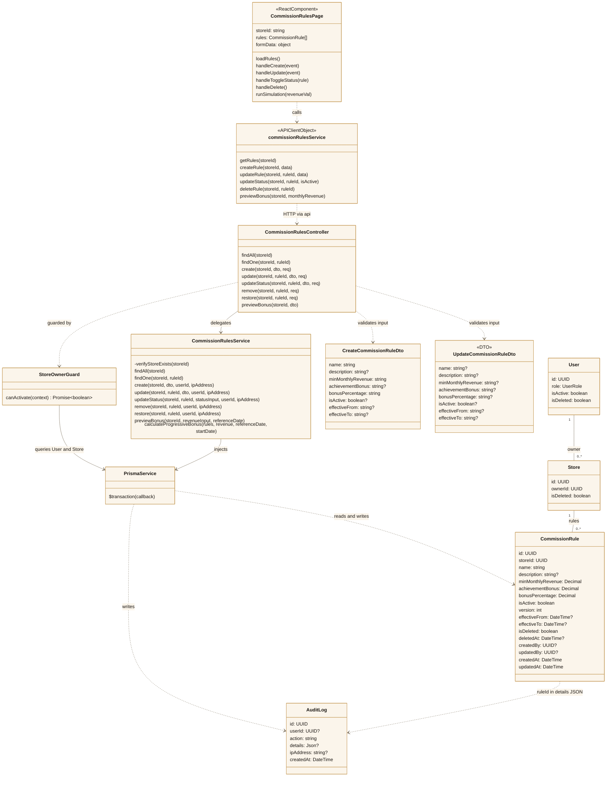
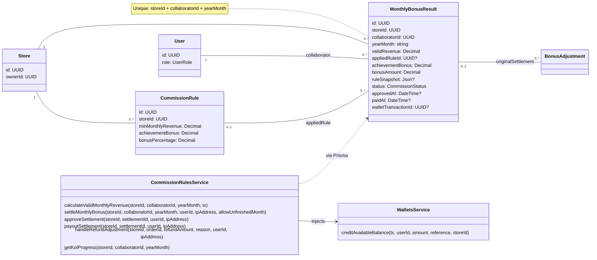

# SCANMS — FR-09: Cấu hình mốc thưởng doanh số tháng

Bộ Draw.io vừa đối chiếu lại theo kiểu trắng đen, sequence một trang: `diagrams/FR09_Configure_Monthly_Revenue_Bonus_Milestones_Class_Diagram.drawio` và `diagrams/FR09_Configure_Monthly_Revenue_Bonus_Milestones_Sequence_Diagram.drawio`. Xem `FR09_CODE_ANALYSIS.md` cho phạm vi và các điểm cần phân biệt với code hiện tại; các bản EN/Compact cũ vẫn được giữ.

Phân tích theo mã nguồn trong workspace ngày 16/10/2026, bao gồm các thay đổi local hiện có. Đây là sơ đồ triển khai hiện tại, không phải thiết kế đề xuất. Mở Markdown Preview để xem các khối Mermaid nếu trình xem hỗ trợ Mermaid.

## 1. Phạm vi và quy tắc thực tế

FR-09 có phần cốt lõi là Shop cấu hình mốc thưởng và mô phỏng tiền thưởng. Module hiện tại còn hỗ trợ tổng hợp doanh số KOL, chốt kỳ, duyệt, cộng ví, lịch sử và điều chỉnh hoàn tiền. Thưởng này tách biệt với hoa hồng từng đơn hàng.

| Nội dung | Hành vi trong code |
|---|---|
| Giao diện Shop | `CommissionRulesPage`, đường dẫn `/merchant/commission-rules`; giao diện reference cũng nhúng trang bằng iframe |
| Phạm vi dữ liệu | Mỗi mốc thuộc một `Store`; mỗi kỳ thưởng thuộc một Shop, một KOL và một tháng |
| Quyền cấu hình | `StoreOwnerGuard`: tài khoản hoạt động, `SHOP_MANAGER` sở hữu Shop; code có ngoại lệ cho hai tài khoản demo |
| Admin | `SYSTEM_ADMIN` được GET; không được tạo/sửa/xóa/chốt/duyệt/chi trả |
| Mô phỏng | Guard cho tài khoản đã xác thực, hoạt động gọi preview sau khi kiểm tra Shop; không đòi hỏi là chủ Shop |
| Tên và mô tả | Tên sau trim không rỗng, tối đa 150 ký tự; mô tả tối đa 500 ký tự ở DTO |
| Ngưỡng | `minMonthlyRevenue` là chuỗi số nguyên dương ở API; lưu Decimal(15,2) |
| Thưởng KPI | `achievementBonus` không âm, mặc định 0 |
| Tỷ lệ | `bonusPercentage` từ 0 đến 100, tối đa hai chữ số thập phân |
| Trùng mốc | Không được trùng ngưỡng trong cùng Shop với mốc chưa xóa, kể cả mốc đang tạm ngừng |
| Thứ tự | Ngưỡng cao hơn không được có tỷ lệ thưởng thấp hơn; kiểm tra trên các mốc chưa xóa |
| Sửa | Cập nhật cùng bản ghi, tăng `version`, ghi audit old/new; không tạo entity RuleVersion |
| Bật/tắt | Thay `isActive`, tăng `version`, ghi audit |
| Xóa | Xóa mềm: `isDeleted=true`, `isActive=false`, `deletedAt=now`; nhánh remove không tăng version |
| Hiệu lực | Backend có `effectiveFrom/effectiveTo`; form và payload create/update hiện chưa cung cấp chúng. Khi tạo, backend mặc định bắt đầu tại thời điểm tạo |
| Danh sách | Lấy tất cả mốc chưa xóa, kể cả tạm ngừng, sắp xếp ngưỡng tăng dần |
| Mô phỏng tự động | Frontend gọi preview sau debounce 400 ms khi doanh số/mốc thay đổi; không ghi ví |
| Chốt kỳ | Shop chọn tháng và nhập UUID KOL; mặc định chỉ chốt tháng đã kết thúc theo giờ Việt Nam |
| Trạng thái thưởng | `PENDING → APPROVED → PAID`; chưa thấy lịch cron gọi `settleMonthlyBonus` trong mã runtime đã tìm kiếm |

### Công thức thưởng

Trong một lần gọi `calculateProgressiveBonus`, chỉ xét mốc đang bật và phù hợp thời gian hiệu lực:

- Đạt mốc khi doanh số **lớn hơn hoặc bằng** ngưỡng.
- Thưởng cố định chỉ lấy ở **mốc cao nhất đạt được**, không cộng dồn KPI các mốc.
- Thưởng phần vượt tính riêng từng khoảng, dùng tỷ lệ của mốc bắt đầu khoảng.
- Tổng thưởng = thưởng KPI cao nhất + tổng thưởng các khoảng; tính bằng `Prisma.Decimal`, làm tròn hai chữ số thập phân.

Ví dụ chỉ có mốc 50 triệu, KPI 0, tỷ lệ 2%: doanh số 60 triệu nhận `(60 - 50) triệu × 2% = 200.000đ`. Nếu KPI là 500.000đ thì tổng là 700.000đ. Đúng 50 triệu chỉ nhận KPI, phần vượt bằng 0.

Ví dụ hai mốc: 50 triệu/KPI 500.000đ/2% và 100 triệu/KPI 1.500.000đ/3%. Doanh số 120 triệu cho kết quả `1.500.000 + 50.000.000 × 2% + 20.000.000 × 3% = 3.100.000đ`.

## 2. Class diagram — cấu hình và mô phỏng

`CommissionRulesPage` là React function component, `commissionRulesService` là object API client. Hai thành phần được mô hình hóa bằng ký pháp lớp để thể hiện phụ thuộc, không khẳng định chúng là TypeScript class. `CommissionRule`, `Store`, `User`, `AuditLog` là Prisma models; các thuộc tính không liên quan được lược bỏ. Service truy cập Prisma trực tiếp, không có Repository riêng trong module.



`createdBy/updatedBy` của CommissionRule là UUID scalar trong schema, không có khai báo Prisma relation đến User. `ruleId` trong AuditLog nằm trong JSON, không phải khóa ngoại. Vì vậy không vẽ quan hệ FK giả cho các trường này.

## 3. Sequence diagram — thêm mốc thưởng

Đây là sequence chính cho yêu cầu **Cấu hình mốc thưởng doanh số**. Tiền điều kiện: Shop đã mở trang, xác định `storeId` và tải danh sách. Các endpoint đầy đủ có prefix `/api`.

```mermaid
%%{init: {'theme':'base','themeVariables':{'primaryColor':'#FBF5EB','primaryTextColor':'#1A1612','primaryBorderColor':'#C59B58','lineColor':'#7D715E','actorBkg':'#F3EFE6','actorBorder':'#C59B58','actorTextColor':'#1A1612','signalColor':'#7D715E','signalTextColor':'#1A1612','noteBkgColor':'#FBF5EB','noteBorderColor':'#EEDFC6'}}}%%
sequenceDiagram
actor Shop as SHOP_MANAGER
participant UI as CommissionRulesPage
participant API as commissionRulesService
participant Guard as StoreOwnerGuard
participant Pipe as NestJS Pipes
participant C as CommissionRulesController
participant S as CommissionRulesService
participant DB as Prisma / PostgreSQL
Shop->>UI: Thêm mốc, nhập tên/ngưỡng/KPI/tỷ lệ, Lưu
UI->>API: createRule(storeId, formData đã trim)
API->>Guard: POST /api/stores/:storeId/commission-rules + Bearer
opt request.user chưa có
  Guard->>Guard: Xác minh JWT
  Guard->>DB: user.findUnique(payload.sub)
  DB-->>Guard: User
end
Guard->>DB: store.findUnique(storeId)
DB-->>Guard: Store
alt Không xác thực / tài khoản bị khóa / sai quyền / Shop không tồn tại
  Guard-->>API: HTTP 401 / 403 / 404
  API-->>UI: Lỗi
  UI-->>Shop: Hiển thị thông báo lỗi
else Guard cho phép
  Note over Guard: SHOP_MANAGER sở hữu Shop; có ngoại lệ demo trong code
  Guard->>Pipe: Chuyển request qua bước kiểm tra tham số/DTO
  alt UUID hoặc DTO không hợp lệ
    Pipe-->>API: HTTP 400
    API-->>UI: Lỗi dữ liệu
  else DTO hợp lệ
    Pipe->>C: create(storeId, dto, req)
    C->>S: create(storeId, dto, userId, ipAddress)
    S->>DB: verifyStoreExists(storeId)
    S->>S: Decimal; kiểm tra ngưỡng, KPI, tỷ lệ, tên, hiệu lực
    alt Kiểm tra nghiệp vụ đầu vào thất bại
      S-->>C: BadRequestException / NotFoundException
      C-->>API: HTTP 400 / 404
      API-->>UI: Hiển thị lỗi
    else Đầu vào hợp lệ
      S->>DB: BEGIN $transaction
      S->>DB: pg_advisory_xact_lock(hash theo storeId)
      S->>DB: Tìm mốc trùng ngưỡng và các mốc chưa xóa
      DB-->>S: Các mốc hiện có
      alt Trùng ngưỡng hoặc tỷ lệ sai thứ tự
        S->>DB: ROLLBACK do exception
        S-->>C: ConflictException / BadRequestException
        C-->>API: HTTP 409 / 400
        API-->>UI: Thông báo lỗi; giữ form
      else Thỏa quy tắc
        S->>DB: commissionRule.create(version=1, mặc định active=true)
        DB-->>S: Mốc mới
        S->>DB: auditLog.create(CREATE_COMMISSION_RULE)
        S->>DB: COMMIT
        S-->>C: Mốc mới; Decimal chuyển thành string
        C-->>API: HTTP 201
        API-->>UI: Thành công
        UI->>UI: Đóng modal, reset form, thông báo
        UI->>API: getRules(storeId)
        Note over API,DB: GET qua Guard → Controller.findAll → Service.findAll → DB
        API-->>UI: Mốc chưa xóa, ngưỡng tăng dần
        UI-->>Shop: Danh sách đã cập nhật
      end
    end
  end
end
Note over S,DB: Lỗi ghi rule hoặc audit trong transaction làm rollback toàn bộ
```

## 4. Sequence diagram — sửa, bật/tắt, xóa mềm

```mermaid
sequenceDiagram
actor Shop as SHOP_MANAGER
participant UI as CommissionRulesPage
participant API as commissionRulesService
participant C as CommissionRulesController
participant S as CommissionRulesService
participant DB as Prisma / PostgreSQL
Shop->>UI: Sửa / bật-tắt / xác nhận xóa
alt Sửa thông tin
  UI->>API: updateRule(storeId, ruleId, formData)
  API->>C: PATCH /api/stores/:storeId/commission-rules/:ruleId
  Note over API,C: StoreOwnerGuard và Pipes trước Controller; lỗi thì dừng
  C->>S: update(...)
  S->>DB: Kiểm tra Shop, đọc mốc chưa xóa đúng storeId
  S->>S: Kiểm tra đầu vào và khoảng hiệu lực
  S->>DB: BEGIN; kiểm tra trùng ngưỡng và thứ tự tỷ lệ
  S->>DB: update cùng bản ghi, version = version cũ + 1
  S->>DB: auditLog.create(UPDATE_COMMISSION_RULE, oldValues, newValues)
  S->>DB: COMMIT
else Bật hoặc tạm ngừng
  UI->>API: updateStatus(storeId, ruleId, !isActive)
  API->>C: PATCH /api/stores/:storeId/commission-rules/:ruleId/status
  Note over API,C: StoreOwnerGuard và Pipes trước Controller
  C->>S: updateStatus(...)
  S->>DB: Kiểm tra Shop và mốc; BEGIN
  S->>DB: update isActive, version + 1; ghi audit
  S->>DB: COMMIT
else Xóa mềm
  UI->>API: deleteRule(storeId, ruleId)
  API->>C: DELETE /api/stores/:storeId/commission-rules/:ruleId
  Note over API,C: StoreOwnerGuard và Pipes trước Controller
  C->>S: remove(...)
  S->>DB: Kiểm tra Shop và mốc; BEGIN
  S->>DB: isDeleted=true, isActive=false, deletedAt=now; ghi audit
  S->>DB: COMMIT
end
S-->>C: Kết quả
C-->>API: HTTP 200
API-->>UI: Thành công
UI->>API: getRules(storeId)
API-->>UI: Danh sách mới
UI-->>Shop: Thông báo và cập nhật danh sách
Note over S,DB: Sơ đồ thể hiện nhánh thành công; validation lỗi trả 400/404/409 tùy nhánh, lỗi trong transaction thì rollback
```

## 5. Sequence diagram — mô phỏng thưởng

```mermaid
sequenceDiagram
actor Shop
participant UI as CommissionRulesPage
participant API as commissionRulesService
participant C as CommissionRulesController
participant S as CommissionRulesService
participant DB as Prisma / PostgreSQL
Shop->>UI: Nhập doanh số mô phỏng
UI->>UI: Kiểm tra số không âm; debounce 400 ms
UI->>API: previewBonus(storeId, simRevenue)
API->>C: POST /api/stores/:storeId/commission-rules/preview
Note over API,C: Guard xác thực, kiểm tra tài khoản và Shop; Pipes kiểm tra DTO
C->>S: previewBonus(storeId, monthlyRevenue hoặc revenue hoặc 0)
S->>DB: Kiểm tra Shop; đọc mốc chưa xóa, ngưỡng tăng dần
DB-->>S: rules
S->>S: calculateProgressiveBonus(rules, revenue)
Note over S: Lọc active + thời gian hiệu lực hiện tại
alt Chưa đạt mốc
  S->>S: highestReachedRule=null, totalBonus=0
else Đã đạt mốc
  S->>S: Lấy KPI của mốc cao nhất
  loop Mỗi khoảng doanh số đã đạt
    S->>S: Phần vượt trong khoảng × tỷ lệ / 100
  end
  S->>S: Tổng KPI + thưởng các khoảng
end
S-->>C: highestReachedRule, achievementBonus, rangeBonuses, totalBonus, formula
C-->>API: Kết quả mô phỏng
API-->>UI: BonusPreviewResult
UI-->>Shop: Hiển thị tiền thưởng và cách tính
Note over S,DB: Chỉ đọc và tính toán; không tạo MonthlyBonusResult, không cộng ví
```

## 6. Class diagram — dữ liệu kỳ thưởng mở rộng

Sơ đồ bổ sung cho phần đã có trên web ngoài thao tác cấu hình. `MonthlyBonusResult.appliedRule` lưu mốc cao nhất; `ruleSnapshot` lưu thông tin kết quả tính, các khoảng và điều chỉnh, không phải quan hệ nhiều-nhiều đến mọi mốc.



## 7. Sequence diagram — chốt kỳ, duyệt và cộng ví

Sơ đồ này lược gọn API client, Guard và Controller để tập trung vòng đời; mọi yêu cầu quản lý vẫn đi qua các lớp này như sơ đồ tạo mốc.

```mermaid
sequenceDiagram
actor Shop as SHOP_MANAGER
participant UI as CommissionRulesPage
participant S as CommissionRulesService
participant W as WalletsService
participant DB as Prisma / PostgreSQL
Shop->>UI: Chọn tháng, nhập UUID KOL, Chốt thưởng
UI->>S: POST .../commission-rules/settle → settleMonthlyBonus
S->>DB: Kiểm tra Shop, KOL tồn tại và hoạt động
S->>S: Kiểm tra tháng theo giờ Việt Nam
Note over S: Chặn tương lai; UI không gửi allowUnfinishedMonth nên chặn tháng chưa kết thúc
S->>DB: BEGIN; tìm kết quả theo Shop + KOL + tháng
alt Đã chốt
  DB-->>S: Kết quả đã lưu
  S-->>UI: isAlreadySettled=true, giữ kết quả cũ
else Chưa chốt
  S->>S: calculateValidMonthlyRevenue(..., tx)
  S->>DB: Xác minh liên kết KOL-Shop; đọc đơn COMPLETED theo completedAt
  DB-->>S: Đơn và refunds COMPLETED; thông tin mốc sửa giữa tháng
  S->>S: Tổng max(0, finalAmount - refund bị chặn tối đa finalAmount)
  S->>DB: Đọc CommissionRule chưa xóa của Shop
  alt Có splitRevenue trước và sau mốc sửa
    S->>S: calculateProgressiveBonus cho hai phần, cộng totalBonus hai lần tính
  else Không chia kỳ
    S->>S: calculateProgressiveBonus cho doanh số tháng
  end
  S->>DB: Đọc BonusAdjustment PENDING cho tháng đích
  S->>S: netBonus = max(0, grossBonus + tổng điều chỉnh)
  S->>DB: Đánh dấu điều chỉnh APPLIED; tạo MonthlyBonusResult PENDING + snapshot
  S->>DB: Ghi SETTLE_MONTHLY_BONUS; COMMIT
  S-->>UI: Kết quả PENDING; UI tải lại lịch sử
end
Shop->>UI: Duyệt kỳ thưởng
UI->>S: PATCH .../settlements/:id/approve → approveSettlement
S->>DB: Tìm kết quả đúng Shop; yêu cầu PENDING
S->>DB: update APPROVED + approvedAt
S->>DB: auditLog.create(APPROVE_MONTHLY_BONUS)
Note over S,DB: Nhánh approve hiện không bọc update và audit trong cùng transaction
S-->>UI: APPROVED; UI tải lại lịch sử
Shop->>UI: Chi trả vào ví
UI->>S: POST .../settlements/:id/payout → payoutSettlement
S->>DB: BEGIN; đọc kết quả, kiểm tra APPROVED và chưa trả
S->>DB: updateMany có điều kiện → PAID + paidAt
alt count=0 hoặc trạng thái không hợp lệ
  S->>DB: ROLLBACK
  S-->>UI: Báo lỗi; không cộng ví
else Giành quyền chi trả thành công
  S->>W: creditAvailableBalance(tx, collaboratorId, bonusAmount, reference, storeId)
  W->>DB: Cập nhật ví và FinancialLedger trong transaction chung
  DB-->>W: wallet, ledger
  W-->>S: wallet, ledger
  S->>DB: Lưu walletTransactionId=ledger.id; ghi audit; COMMIT
  S-->>UI: PAID và giao dịch; UI tải lại lịch sử
end
```

## 8. Những chi tiết cần nói đúng khi bảo vệ

1. Doanh số thực tế trong code dùng `finalAmount` (comment ghi đã gồm phí vận chuyển), trừ hoàn tiền; không nên mô tả tự động loại phí vận chuyển. Chỉ lấy đơn `COMPLETED`, đúng Shop/KOL và `completedAt` trong tháng.
2. Có API restore, nhưng trong `CommissionRulesPage` đã đọc không có handler/nút khôi phục tương ứng. Không vẽ Shop bấm khôi phục như một luồng UI đã hoàn thiện.
3. `version` chỉ là số tăng trên cùng bản ghi, không có bảng lưu mọi phiên bản. Audit lưu old/new của thao tác sửa; snapshot kỳ thưởng lưu kết quả tính.
4. Nhánh chia doanh số khi sửa mốc giữa tháng cần phân biệt với công thức thông thường: truy vấn audit `UPDATE_COMMISSION_RULE` hiện chưa lọc `storeId`; hai lần tính dùng cùng tập rule hiện có, không tái dựng rule cũ từ audit. `grossBonus` cộng hai `totalBonus` (có thể chứa KPI hai lần), trong khi trường `achievementBonus` lấy giá trị lớn hơn. Đây là điểm chưa nhất quán quan sát được từ code, chưa xác nhận bằng chạy runtime trong lần phân tích này.
5. Chốt kỳ có unique key và trả kết quả cũ khi đọc thấy kỳ đã tồn tại. Không suy diễn rằng mọi request chốt đồng thời đều nhận kết quả idempotent thành công: nhánh này không có xử lý riêng lỗi unique race. Chi trả có thêm `updateMany` có điều kiện trong transaction.
6. Form thiếu token hoặc lỗi `/auth/me` hiện dùng fallback store ID. Đây là lựa chọn frontend; backend vẫn kiểm tra xác thực. Ngoại lệ hai tài khoản demo trong guard hiện dựa trên ID, không có điều kiện môi trường bao quanh.

## 9. Đối chiếu mã nguồn

| File | Điểm đối chiếu |
|---|---|
| [CommissionRulesPage.tsx](../frontend/src/pages/merchant/CommissionRulesPage.tsx) | State, loadRules, handleCreate/Update/Delete/ToggleStatus, debounce preview, chốt/duyệt/chi trả |
| [Frontend API client](../frontend/src/services/commission-rules.service.ts) | Payload và đường dẫn HTTP thực tế |
| [CommissionRulesController](../backend/src/modules/commission-rules/commission-rules.controller.ts) | Route `stores/:storeId/commission-rules`, controller methods |
| [StoreOwnerGuard](../backend/src/modules/commission-rules/guards/store-owner.guard.ts) | JWT, quyền Shop/Admin/preview, ngoại lệ demo |
| [CommissionRulesService](../backend/src/modules/commission-rules/commission-rules.service.ts) | Engine tại khoảng dòng 153; create 357; update 512; preview 922; doanh số 952; settle 1135; approve 1417; payout 1471 |
| [Create DTO](../backend/src/modules/commission-rules/dto/create-commission-rule.dto.ts) | Định dạng và giới hạn đầu vào |
| [Prisma schema](../backend/prisma/schema.prisma) | CommissionRule, MonthlyBonusResult, các FK và unique key |
| [main.ts](../backend/src/main.ts) | Prefix `/api`, ValidationPipe |

Các số dòng chỉ để định vị snapshot hiện tại và có thể đổi khi code được sửa. Tài liệu được kiểm tra bằng đọc source; chưa chạy ứng dụng, database hoặc test suite. Để báo cáo riêng FR-09 cấu hình, dùng sơ đồ ở mục 2–5; mục 6–7 là phần mở rộng vòng đời thưởng đang có trong module.
