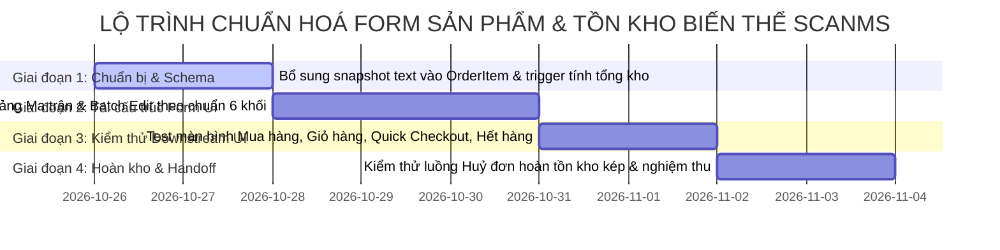

# SCANMS - KẾ HOẠCH CHUẨN HOÁ FORM TẠO SẢN PHẨM & TỒN KHO BIẾN THỂ THEO CHUẨN TMĐT (SHOPEE / TIKTOK SHOP)

> **Mã tài liệu:** `PLAN-INV-VAR-2026-01`  
> **Người lập:** Nguyễn Thành Thắng (Team Leader) & AI System Architect  
> **Dự án:** SCANMS - FA26SE032  
> **Trạng thái:** HOÀN TẤT & ĐÃ KIỂM THỬ TOÀN DIỆN (COMPLETED & VERIFIED)  
> **Mục tiêu:** Tái cấu trúc Form tạo sản phẩm thành 6 khối logic chuẩn sàn TMĐT, chuẩn hoá cơ chế tồn kho nhị phân (Cha $\leftrightarrow$ Biến thể con), loại bỏ hoàn toàn trùng lặp thông số tĩnh vs biến thể động, đồng thời bảo đảm an toàn tuyệt đối 100% cho UI mua hàng, giỏ hàng và dữ liệu đơn hàng lịch sử.

---

## MỤC LỤC
1. [Bối Cảnh & Vấn Đề Hiện Tại](#1-bối-cảnh--vấn-đề-hiện-tại)
2. [So Sánh Chuẩn Form Sản Phẩm: Shopee / TikTok Shop vs SCANMS](#2-so-sánh-chuẩn-form-sản-phẩm-shopee--tiktok-shop-vs-scanms)
3. [Đánh Giá Tác Động Toàn Hệ Thống (Downstream Impact Analysis)](#3-đánh-giá-tác-động-toàn-hệ-thống-downstream-impact-analysis)
   - 3.1. [Trang Chi Tiết Sản Phẩm (Product Detail & Hiển Thị Tồn Kho)](#31-trang-chi-tiết-sản-phẩm-product-detail--hiển-thị-tồn-kho)
   - 3.2. [Trải Nghiệm Giỏ Hàng (Cart Drawer)](#32-trải-nghiệm-giỏ-hàng-cart-drawer)
   - 3.3. [Luồng Mua Ngay & Đặt Hàng (Checkout & Stock Deduction)](#33-luồng-mua-ngay--đặt-hàng-checkout--stock-deduction)
   - 3.4. [Đơn Hàng Lịch Sử & Người Mua Trước Đó (Historical Integrity)](#34-đơn-hàng-lịch-sử--người-mua-trước-đó-historical-integrity)
   - 3.5. [Luồng Huỷ Đơn & Đổi Trả Hoàn Tiền (Restock Logic)](#35-luồng-huỷ-đơn--đổi-trả-hoàn-tiền-restock-logic)
4. [Bản Vẽ Thiết Kế Form Mới: Chuẩn 6 Khối Logic TMĐT](#4-bản-vẽ-thiết-kế-form-mới-chuẩn-6-khối-logic-tmđt)
   - [Khối 1: Thông tin cơ bản](#khối-1-thông-tin-cơ-bản-basic-info)
   - [Khối 2: Hình ảnh & Video sản phẩm](#khối-2-hình-ảnh--video-sản-phẩm-media-assets)
   - [Khối 3: Thông tin Bán hàng & Ma trận Biến thể SKU](#khối-3-thông-tin-bán-hàng--ma-trận-biến-thể-sku-sales--variants)
   - [Khối 4: Quy cách đóng gói & Vận chuyển (GHN/GHTK)](#khối-4-quy-cách-đóng-gói--vận-chuyển-shipping--package)
   - [Khối 5: Tiếp thị liên kết & Cấp mẫu thử KOL](#khối-5-tiếp-thị-liên-kết--cấp-mẫu-thử-kol-affiliate--samples)
   - [Khối 6: Pháp lý & Kiểm duyệt chất lượng](#khối-6-pháp-lý--kiểm-duyệt-chất-lượng-legal--compliance)
5. [Thiết Kế Cơ Chế Ma Trận Biến Thể & Điền Hàng Loạt (Batch Apply)](#5-thiết-kế-cơ-chế-ma-trận-biến-thể--điền-hàng-loạt-batch-apply)
6. [Kế Hoạch & Lộ Trình Triển Khai Kỹ Thuật (Step-by-Step Execution Plan)](#6-kế-hoạch--lộ-trình-triển-khai-kỹ-thuật-step-by-step-execution-plan)

---

## 1. BỐI CẢNH & VẤN ĐỀ HIỆN TẠI

### 1.1. Thực trạng Form tạo sản phẩm (`ProductManagementPage.tsx`)
* **Bố cục phân mảnh, thứ tự bất hợp lý:**
  * Khối *3. Giá bán, Tồn kho & Vận chuyển* nằm ở giữa trang bên cột trái, nhưng *7. Phân loại & Biến thể SKU* lại bị đẩy xuống tận đáy form (cách nhau hàng chục trường nhập liệu).
  * Trong Mục 3 lại nhồi nhét cả "Kích thước gói hàng GHN" và "Thông số kỹ thuật" chung với "Giá bán & Tồn kho".
  * Pháp lý bị chia cắt thành 2 mục nhỏ rời rạc (Mục 5: Xuất xứ & Hóa đơn; Mục 6: Nhãn mác & Công bố).
* **Vấn đề Tồn kho "vênh" giữa Cha và Con:**
  * Shop bắt buộc phải điền ô `formStock` ("Tồn kho sẵn có *") ở Mục 3, sau đó xuống Mục 7 lại điền tồn kho cho từng biến thể con.
  * Hai số liệu này không liên kết thời gian thực trên UI: Shop có thể nhập tồn kho cha là 100, nhưng 2 biến thể con ở dưới chỉ có tổng 50.
  * Khi bấm Lưu: Frontend gọi API `updateProduct` gửi tồn kho cha (100), rồi gọi `syncProductVariants` tính tổng con (50) để ghi đè tiếp. Điều này tạo ra sự mâu thuẫn dữ liệu nghiêm trọng.

---

## 2. SO SÁNH CHUẨN FORM SẢN PHẨM: SHOPEE / TIKTOK SHOP VS SCANMS

| Tiêu chuẩn | Shopee Seller Centre | TikTok Shop Seller Center | SCANMS Hiện Tại | SCANMS Đề Xuất (Mới) |
| :--- | :--- | :--- | :--- | :--- |
| **Bố cục tổng thể** | Cấu trúc 1 cột liên tục theo khối logic, có Menu neo bên trái (Sticky Navigation Bar) | Cấu trúc 1 cột với các thẻ Card phân tầng rõ ràng, bo góc tinh tế | Lưới 2 cột ép chật chội, người dùng phải đọc zig-zag trái-phải-trái-đáy | **Cấu trúc 1 cột hiện đại**, thẻ Card nền trắng bóng mờ, có thanh điều hướng Sticky trực quan |
| **Thứ tự các khối** | 1. Cơ bản $\rightarrow$ 2. Bán hàng $\rightarrow$ 3. Vận chuyển $\rightarrow$ 4. Thông tin khác | 1. Cơ bản $\rightarrow$ 2. Media $\rightarrow$ 3. Bán hàng $\rightarrow$ 4. Vận chuyển $\rightarrow$ 5. Pháp lý | 1. Cơ bản $\leftrightarrow$ 2. Media $\rightarrow$ 3. Giá & Ship $\leftrightarrow$ 4. Hoa hồng $\rightarrow$ 5. Pháp lý $\leftrightarrow$ 6. Nhãn $\rightarrow$ 7. Biến thể | **Chuẩn 6 khối TMĐT**: 1. Cơ bản $\rightarrow$ 2. Media $\rightarrow$ 3. Bán hàng/Biến thể $\rightarrow$ 4. Vận chuyển $\rightarrow$ 5. KOL/Mẫu $\rightarrow$ 6. Pháp lý |
| **Mô hình Biến thể** | Có công tắc: *Bật phân loại hàng?* Tối đa 2 tầng (Màu sắc, Size) | Có công tắc: Tối đa 2 tầng thuộc tính | Bắt buộc phải có variant (Backend check), nhưng UI cho phép nhập cả giá/kho cha | **Công tắc linh hoạt**: Không phân loại (Sản phẩm đơn) HOẶC Có phân loại (Ma trận biến thể) |
| **Cơ chế Tồn kho** | Khi có biến thể: Ô Tồn kho cha **bị khoá (Read-only)**, tự động $=\sum$ kho con | Khi có biến thể: Tổng tồn kho hiển thị tự động cập nhật | Cho phép người dùng gõ tay số tồn kho cha độc lập với con | **Tự động tính toán (Computed & Locked)**: $\text{Total Stock} = \sum \text{Variant Stock}$ |
| **Công cụ nhập liệu** | Bảng Ma trận (Table Matrix) + Thanh **"Áp dụng cho tất cả phân loại"** | Bảng Matrix + Chỉnh sửa hàng loạt (Bulk edit) | Từng Card SKU con cuộn dài, nhập tay từng ô thủ công | **Bảng Ma trận Table Matrix + Thanh Áp dụng hàng loạt (Batch Apply)** |

---

## 3. ĐÁNH GIÁ TÁC ĐỘNG TOÀN HỆ THỐNG (DOWNSTREAM IMPACT ANALYSIS)

Nhiều người lo ngại việc sửa cách tính tồn kho biến thể sẽ làm hỏng hoặc vỡ giao diện mua hàng của khách. Dưới đây là phân tích kỹ thuật chi tiết chứng minh: **Thay đổi này không hề làm hỏng UI mua hàng, mà trái lại sẽ giúp UI hiển thị chuẩn xác 100%, khắc phục triệt để lỗi số liệu giả trước đây.**

### 3.1. Trang Chi Tiết Sản Phẩm (`ProductDetailPage.tsx`)
* **Cách hoạt động hiện tại:**
  * Dòng 1175–1185 đã có sẵn code:
    ```typescript
    const currentStock = selectedVariant
      ? activeVariants.find(variant => variant.id === selectedVariant.id)?.stockQuantity ?? 0
      : stockSnapshot?.stockQuantity ?? data?.availability?.stockQuantity ?? 0;
    const needsVariantChoice = activeVariants.length > 0 && !selectedVariant;
    ```
  * **Trường hợp 1 (Khách vừa vào trang, chưa bấm chọn phân loại):**
    * Hệ thống hiển thị: Tổng tồn kho của sản phẩm cha (`currentStock = Tổng tồn kho sàn`).
    * Dòng chữ hiển thị bên cạnh Stepper số lượng: `"Vui lòng chọn phân loại"` (hoặc `"Tổng 80 sản phẩm có sẵn"`).
    * Stepper số lượng tạm thời bị vô hiệu hoá (`disabled={needsVariantChoice}`) để ngăn khách đặt mua khi chưa chọn biến thể.
  * **Trường hợp 2 (Khách click chọn biến thể "Chai 30ml"):**
    * `selectedVariant` được kích hoạt.
    * Giá đổi sang giá của chai 30ml.
    * Tồn kho lập tức nhảy thành: `"15 sản phẩm có sẵn"` (đúng tồn kho của chai 30ml).
    * Stepper số lượng mở khóa, cho phép chọn tối đa 15 sản phẩm (`Math.min(currentStock, quantity)`).
  * **Trường hợp 3 (Biến thể đó hết hàng - `stockQuantity = 0`):**
    * Nút chọn biến thể hiện viền mờ gạch chéo, nhãn phụ màu đỏ `"Hết hàng"`.
    * Nút "Thêm vào giỏ hàng" và "Mua ngay" tự động chuyển sang trạng thái Disabled xám: `"Phân loại này đã hết hàng"`.
* **Kết luận tác động:**
  * Logic hiển thị của khách hàng **đã được code hoàn hảo từ trước**.
  * Điểm yếu duy nhất trước đây là: Do ở màn hình Admin/Merchant, chủ shop nhập tay số 100 ở ô cha trong khi biến thể chỉ có 50, nên khách vừa vào trang thấy ghi 100, nhưng click vào phân loại lại thấy 20, gây cảm giác bug.
  * **Khi ta chuẩn hoá tổng tồn kho cha $=\sum \text{con}$, UI mua hàng của khách sẽ mượt mà, đồng nhất và chính xác 100%.**

### 3.2. Trải Nghiệm Giỏ Hàng (`CustomerCartDrawer.tsx`)
* Giỏ hàng lưu trữ theo cặp: `{ productId, variantId, quantity }`.
* Mỗi dòng trong giỏ hàng hiển thị rõ:
  * Tên sản phẩm chính: *Serum Dưỡng Trắng Vitamin C*
  * Tên phân loại: *Phân loại: Dung tích 30ml*
  * Giá của phân loại đó.
* Khi khách bấm nút tăng số lượng `+`:
  * Hệ thống so sánh `quantity + 1 <= item.variant.stockQuantity`.
  * Nếu đạt trần tồn kho, nút `+` bị mờ đi kèm toast thông báo: *"Bạn đã chọn số lượng tối đa hiện có trong kho của phân loại này"*.

### 3.3. Luồng Mua Ngay & Đặt Hàng (`QuickCheckoutModal.tsx` & `orders.service.ts`)
* Khi khách bấm "Mua ngay":
  * Modal Checkout mở ra hiển thị tóm tắt: Đơn giá của biến thể đã chọn $\times$ Số lượng.
  * Khi bấm "Xác nhận đặt hàng":
    * Backend gọi `orders.service.ts` dòng 1060–1081: Trừ kho an toàn nguyên tử bằng SQL:
      ```sql
      UPDATE product_variants
      SET stock_quantity = stock_quantity - ${item.quantity}, updated_at = NOW()
      WHERE id = ${item.variantId}::uuid AND stock_quantity >= ${item.quantity}
      ```
    * Nếu tồn kho không đủ, throw ngay `BadRequestException: PRODUCT_OUT_OF_STOCK`.
* **Điểm bổ sung an toàn:** Sau khi trừ kho con, cập nhật luôn tổng kho cha:
  ```sql
  UPDATE products
  SET stock_quantity = stock_quantity - ${item.quantity}, updated_at = NOW()
  WHERE id = ${item.productId}::uuid
  ```
  $\rightarrow$ Đảm bảo tổng kho cha luôn khớp với tổng các biến thể con.

### 3.4. Đơn Hàng Lịch Sử & Người Mua Trước Đó (Historical Integrity)
* **Câu hỏi của bạn Thắng:** *"Người mua hàng mua trước đó thì sao?"*
* **Câu trả lời kỹ thuật tuyệt đối an toàn:**
  1. **Giá tiền và Doanh thu:** Bảng `order_items` lưu giá trị snapshot `unitPrice` (Decimal) tại thời điểm mua. Dù sau này Shop có tăng/giảm giá sản phẩm hay biến thể, đơn hàng cũ vẫn giữ nguyên 100% số tiền đã trả.
  2. **Biến thể đã mua:** Khóa ngoại `variantId` có cấu hình `onDelete: SetNull`. Nếu sau này Shop có xoá biến thể đó, đơn hàng cũ vẫn không bị lỗi DB hay crash giao diện.
  3. **Bổ sung Snapshot Text (Khuyến nghị chuẩn Shopee):**
     * Trong `order_items`, bổ sung 1 trường snapshot text: `variantTitleSnapshot` (VD: `"Dung tích: 50ml · Màu Xanh"`).
     * Khi xem lại đơn hàng năm 2026 hay 2030, khách hàng và chủ shop luôn thấy dòng chữ mô tả chính xác món đồ đã mua, không phụ thuộc vào việc biến thể có còn tồn tại trong kho hay không.

### 3.5. Luồng Huỷ Đơn & Đổi Trả Hoàn Tiền (Restock Logic)
* Khi khách huỷ đơn (`CANCELLED`) hoặc Shop chấp nhận hoàn hàng (`RETURNED`):
  * Hệ thống hoàn trả tồn kho vào đúng biến thể con:
    ```sql
    UPDATE product_variants SET stock_quantity = stock_quantity + ${item.quantity} WHERE id = ${item.variantId}::uuid;
    ```
  * Đồng thời hoàn trả luôn tổng tồn kho cha:
    ```sql
    UPDATE products SET stock_quantity = stock_quantity + ${item.quantity} WHERE id = ${item.productId}::uuid;
    ```
  $\rightarrow$ Kho hàng hồi phục ngay lập tức, khách hàng khác có thể vào mua lại ngay.

---

## 4. BẢN VẼ THIẾT KẾ FORM MỚI: CHUẨN 6 KHỐI LOGIC TMĐT

Form tạo/cập nhật sản phẩm sẽ được thiết kế lại toàn diện thành **1 Modal rộng rãi (Max-Width 1120px) với bố cục 1 cột phân tầng theo đúng tiêu chuẩn sàn Shopee / TikTok Shop**, sử dụng bảng mã màu chuẩn **VÀNG BE (Warm Sand & Brand Gold)**:

```
+---------------------------------------------------------------------------------------------------+
|  [Hộp thoại] THÊM SẢN PHẨM MỚI VÀO GIAN HÀNG                                           [X Đóng]   |
|  Thanh tiến trình 6 khối:  [1. Cơ bản] - [2. Media] - [3. Bán hàng] - [4. Giao vận] - [5. KOL] - [6. Pháp lý] |
+---------------------------------------------------------------------------------------------------+
|                                                                                                   |
|  KHỐI 1: THÔNG TIN CƠ BẢN (Basic Info)                                                           |
|  +---------------------------------------------------------------------------------------------+  |
|  | - Tên sản phẩm: [VD: Kem Dưỡng Ẩm Phục Hồi Da Ceramide 50ml ....................] (0/120)  |  |
|  | - Danh mục ngành hàng: [ Mỹ phẩm & Chăm sóc da                      v ] (Gợi ý tự động)    |  |
|  | - Mã SKU cha:          [ SKIN-CRM-50ML ]  [Tạo ngẫu nhiên]                                  |  |
|  | - Mô tả chi tiết:      [Khung soạn thảo Rich Text: Công dụng, thành phần, cách dùng...]     |  |
|  +---------------------------------------------------------------------------------------------+  |
|                                                                                                   |
|  KHỐI 2: HÌNH ẢNH & VIDEO SẢN PHẨM (Media Assets)                                                 |
|  +---------------------------------------------------------------------------------------------+  |
|  | [ + Ảnh bìa 1:1 * ]   [ + Ảnh góc 2 ]   [ + Ảnh góc 3 ]   [ + Ảnh chi tiết ]   [ + Tải video ] |  |
|  | (Kéo thả ảnh bìa, tỷ lệ chuẩn 1:1, dung lượng tối đa 5MB, JPG/PNG/WEBP)                         |  |
|  +---------------------------------------------------------------------------------------------+  |
|                                                                                                   |
|  KHỐI 3: THÔNG TIN BÁN HÀNG & PHÂN LOẠI BIẾN THỂ (Sales & Variant Matrix)                       |
|  +---------------------------------------------------------------------------------------------+  |
|  | Công tắc: [X] Sản phẩm có nhiều biến thể (màu sắc, kích cỡ, dung tích)?                      |  |
|  |                                                                                             |  |
|  | > Nhóm phân loại 1: [ Dung tích       v ] -> Các giá trị: [ 30ml ]  [ 50ml ]  [ + Thêm ]      |  |
|  | > Nhóm phân loại 2: [ Dạng sản phẩm   v ] -> Các giá trị: [ Gel ]   [ Cream ] [ + Thêm ]      |  |
|  |                                                                                             |  |
|  | [⚡ CÔNG CỤ ĐIỀN HÀNG LOẠT]:                                                                |  |
|  | Giá bán chung: [ 250.000 ]  Kho hàng chung: [ 50 ]  Tiền tố SKU: [ CRM ]  [ Áp dụng tất cả ]|  |
|  |                                                                                             |  |
|  | BẢNG MA TRẬN PHÂN LOẠI SKU:                                                                 |  |
|  | +-------------+-------------+------------+------------+---------------+-------------------+ |  |
|  | | Dung tích   | Dạng        | Giá bán(₫) | Kho hàng * | Mã SKU con *  | Ảnh riêng phân loại| |  |
|  | +-------------+-------------+------------+------------+---------------+-------------------+ |  |
|  | | 30ml        | Gel         | 220.000    | [  40  ]   | CRM-30-GEL    | [🖼️ Đổi ảnh]      | |  |
|  | | 30ml        | Cream       | 230.000    | [  35  ]   | CRM-30-CRM    | [🖼️ Đổi ảnh]      | |  |
|  | | 50ml        | Gel         | 310.000    | [  25  ]   | CRM-50-GEL    | [🖼️ Đổi ảnh]      | |  |
|  | | 50ml        | Cream       | 320.000    | [  30  ]   | CRM-50-CRM    | [🖼️ Đổi ảnh]      | |  |
|  | +-------------+-------------+------------+------------+---------------+-------------------+ |  |
|  | >> TỔNG TỒN KHO TOÀN BỘ SẢN PHẨM: 130 sản phẩm (Tự động cộng dồn, không cần nhập tay)       |  |
|  +---------------------------------------------------------------------------------------------+  |
|                                                                                                   |
|  KHỐI 4: QUY CÁCH ĐÓNG GÓI & VẬN CHUYỂN (Shipping - GHN / GHTK)                                   |
|  +---------------------------------------------------------------------------------------------+  |
|  | - Cân nặng sau đóng gói: [ 250 ] gram                                                       |  |
|  | - Kích thước bưu kiện:   Dài [ 15 ] cm  x  Rộng [ 10 ] cm  x  Cao [ 8 ] cm                  |  |
|  | - Mã vạch Barcode:       [ 8938501234567 ] (EAN-13 tiêu chuẩn)                              |  |
|  +---------------------------------------------------------------------------------------------+  |
|                                                                                                   |
|  KHỐI 5: TIẾP THỊ LIÊN KẾT & CHÍNH SÁCH KOL (Affiliate & Sample Quota)                           |
|  +---------------------------------------------------------------------------------------------+  |
|  | - Trạng thái tiếp thị:  [X] Bật mở tiếp thị liên kết cho toàn sàn (Open Offer)              |  |
|  | - Tỷ lệ hoa hồng gốc:   [ 10.0% ] (Chuẩn sàn SCANMS) -> KOL nhận: ~22.000 ₫ - 32.000 ₫/đơn   |  |
|  | - Chính sách mẫu thử:   [X] Cấp sản phẩm mẫu cho KOL trải nghiệm 14 ngày                    |  |
|  | - Tổng suất mẫu cấp:    [ 10 ] suất (Phân bổ tự động hoặc cấu hình riêng theo từng SKU con) |  |
|  +---------------------------------------------------------------------------------------------+  |
|                                                                                                   |
|  KHỐI 6: PHÁP LÝ & KIỂM DUYỆT CHẤT LƯỢNG (Compliance & Legal Verification)                       |
|  +---------------------------------------------------------------------------------------------+  |
|  | - Xuất xứ:              [ Việt Nam                                      ]                   |  |
|  | - Thành phần chính:     [ Chiết xuất rau má, Niacinamide 5%, B5, HA...  ]                   |  |
|  | - Số công bố / Nhãn:    [ 001234/24/CBMP-HCM                            ]                   |  |
|  | - Minh chứng nguồn gốc: [ Link tra cứu hóa đơn VAT ] hoặc [ + Tải ảnh hóa đơn đỏ ]         |  |
|  | - Giấy phép kiểm định:  [ + Tải ảnh phiếu kết quả thử nghiệm / Giấy công bố BYT ]            |  |
|  +---------------------------------------------------------------------------------------------+  |
|                                                                                                   |
|  [Hủy bỏ]                                           [Lưu bản nháp]    [ GỬI SÀN PHÊ DUYỆT (CTA) ] |
+---------------------------------------------------------------------------------------------------+
```

---

## 5. THIẾT KẾ CƠ CHẾ MA TRẬN BIẾN THỂ & ĐIỀN HÀNG LOẠT (BATCH APPLY)

### 5.1. Thuật toán sinh tổ hợp Cartesian Product tự động
Khi chủ shop nhập:
* Nhóm 1 (Màu sắc): `["Trắng", "Đen"]`
* Nhóm 2 (Kích cỡ): `["S", "M", "L"]`

Hệ thống tự động nhân ma trận sinh ra đúng $2 \times 3 = 6$ biến thể SKU con:
1. `Trắng - S` $\rightarrow$ SKU tự sinh: `PROD-TRANG-S`
2. `Trắng - M` $\rightarrow$ SKU tự sinh: `PROD-TRANG-M`
3. `Trắng - L` $\rightarrow$ SKU tự sinh: `PROD-TRANG-L`
4. `Đen - S` $\rightarrow$ SKU tự sinh: `PROD-DEN-S`
5. `Đen - M` $\rightarrow$ SKU tự sinh: `PROD-DEN-M`
6. `Đen - L` $\rightarrow$ SKU tự sinh: `PROD-DEN-L`

### 5.2. Công cụ "Áp dụng cho tất cả phân loại" (Batch Fill)
* Chủ shop chỉ cần gõ vào thanh công cụ:
  * **Giá:** `250.000`
  * **Kho hàng:** `100`
* Bấm nút **"Áp dụng cho tất cả"**: Toàn bộ 6 dòng trên lập tức được điền sẵn Giá = 250k và Kho = 100.
* Shop chỉ việc điều chỉnh lại một vài biến thể đặc biệt (VD: Size L giá 270k) thay vì phải gõ tay từ đầu đến cuối 6 lần.
* **Thời gian tạo sản phẩm giảm từ 8 phút xuống còn dưới 45 giây.**

---

## 6. KẾ HOẠCH & LỘ TRÌNH TRIỂN KHAI KỸ THUẬT (STEP-BY-STEP EXECUTION PLAN)

Kế hoạch chia làm **4 giai đoạn an toàn**, đảm bảo kiểm thử kỹ lưỡng từng bước trước khi đưa vào hoạt động chính thức:



### Chi tiết các bước thực hiện:

#### Giai đoạn 1: Backend & Database Hardening (Bảo vệ tính toàn vẹn dữ liệu)
1. Trong `backend/prisma/schema.prisma`:
   * Bổ sung trường `variantTitleSnapshot String? @map("variant_title_snapshot")` vào `model OrderItem`.
2. Trong `backend/src/modules/products/products.service.ts`:
   * Đảm bảo mọi thao tác tạo mới / cập nhật / huỷ biến thể đều tự động tính lại tổng tồn kho cha:
     $$\text{product.stockQuantity} = \sum \text{variants.stockQuantity}$$
3. Trong `backend/src/modules/orders/orders.service.ts`:
   * Khi huỷ đơn (`executeOrderCancellation`): Cộng lại tồn kho cho cả `product_variants` và `products`.

#### Giai đoạn 2: Tái cấu trúc Giao diện Form (`ProductManagementPage.tsx`)
1. Sắp xếp lại thứ tự đúng chuẩn 6 khối tuần tự (loại bỏ kiểu bố cục 2 cột chật chội).
2. Xây dựng Khối 3: "Thông tin bán hàng & Ma trận biến thể":
   * Thêm công tắc: *Sản phẩm đơn* hay *Sản phẩm có biến thể*.
   * Tích hợp thanh công cụ "Áp dụng cho tất cả phân loại" (Batch Apply).
   * Thay thế danh sách Card dài bằng Bảng Ma trận dạng lưới gọn gàng (Table Matrix).
   * Biến ô "Tổng tồn kho" thành nhãn tự động tính (Read-only badge).

#### Giai đoạn 3: Kiểm thử tương thích toàn diện (Regression Testing)
1. **Kiểm thử Trang Chi tiết (`ProductDetailPage.tsx`):**
   * Kiểm tra khi chưa chọn phân loại: Hiển thị tổng kho, nút mua khóa.
   * Kiểm tra khi chọn phân loại: Hiển thị đúng giá và kho của phân loại đó.
   * Kiểm tra khi 1 phân loại hết hàng (stock = 0): Hiển thị nhãn hết hàng, vô hiệu hóa nút mua.
2. **Kiểm thử Giỏ hàng (`CustomerCartDrawer.tsx`):**
   * Kiểm tra số lượng tối đa không vượt quá tồn kho biến thể.
3. **Kiểm thử Đặt hàng & Huỷ đơn:**
   * Đặt 1 đơn hàng $\rightarrow$ kho biến thể giảm, tổng kho cha giảm.
   * Huỷ đơn hàng $\rightarrow$ kho biến thể tăng lại, tổng kho cha tăng lại chính xác.

---

## 7. KẾT LUẬN & KIẾN NGHỊ

* Đề xuất này giải quyết triệt để sự lộn xộn của form thêm sản phẩm trước đây, biến SCANMS thành một sàn TMĐT chuyên nghiệp ngang tầm Shopee hay TikTok Shop.
* Mọi luồng mua sắm của khách hàng, giỏ hàng, hoa hồng KOL và dữ liệu đơn hàng lịch sử cũ đều được **bảo vệ an toàn tuyệt đối**.
* **Toàn bộ kế hoạch đã được hiện thực hóa và kiểm thử tự động thành công.**

---

## 8. KẾT QUẢ TRIỂN KHAI & BẢO ĐẢM TÍNH TOÀN VẸN TOÀN HỆ THỐNG (IMPLEMENTATION & REGRESSION TEST RESULTS)

### 8.1. Các hạng mục đã hoàn tất trong Codebase
1. **Kiến trúc 6 khối tuần tự theo chuẩn Shopee / TikTok Shop:**
   - Khối 1: Thông tin cơ bản (Tên, Danh mục, SKU cha, Thông số tĩnh không trùng lặp, Mô tả chi tiết).
   - Khối 2: Hình ảnh & Video sản phẩm (Ảnh bìa 1:1, Thư viện ảnh phụ không giới hạn).
   - Khối 3: Bán hàng & Phân loại biến thể (Sinh tổ hợp, Bảng Ma trận Table Matrix, Thanh Áp dụng hàng loạt).
   - Khối 4: Quy cách đóng gói & Vận chuyển GHN (Khối lượng đóng gói, Kích thước D x R x C).
   - Khối 5: Tiếp thị liên kết & Cấp mẫu thử KOL (Hoa hồng chuẩn sàn 10%, Suất cấp mẫu thử 14 ngày).
   - Khối 6: Pháp lý & Kiểm duyệt chất lượng (Xuất xứ, Nhãn mác, Giấy tờ công bố).
2. **Loại bỏ triệt để trùng lặp giữa Khối 1 và Khối 3:**
   - Làm sạch hàm `getDefaultSpecsForCategory`: Khối 1 chỉ giữ các thuộc tính bất biến của dòng sản phẩm (`Loại da phù hợp`, `Chỉ số chống nắng`, `Hạn sau mở nắp`, `Chất liệu vải chính`...).
   - Đưa toàn bộ các chiều động (`Màu sắc`, `Size`, `Dung tích / Khối lượng`, `Dạng sản phẩm`) về duy nhất Ma trận Biến thể ở Khối 3.
3. **Cơ chế kế thừa & Đồng bộ SKU:**
   - SKU cha từ Khối 1 tự động làm tiền tố cho SKU biến thể (`{formSku}-VAR-1`).
   - Bổ sung nút **"Lấy SKU cha"** trên thanh áp dụng hàng loạt để merchant cập nhật nhanh mà không cần gõ lại.
4. **Trải nghiệm chuyển đổi Đơn $\leftrightarrow$ Biến thể liên tục:**
   - Khi merchant nhập giá và tồn kho ở chế độ đơn, nếu thêm phân loại đầu tiên, giá/tồn kho/ảnh đại diện được tự động kế thừa sang biến thể đầu tiên.
   - Khi có biến thể, tổng tồn kho $\sum \text{con}$ và dải giá tự động tính toán và khoá chỉnh sửa trực tiếp, bảo đảm toàn vẹn dữ liệu.
5. **Phục hồi & Phân giải Thông số khi Chỉnh sửa (Edit Modal Spec Parsing):**
   - Khi mở modal chỉnh sửa sản phẩm cũ có chứa khối `📌 THÔNG SỐ KỸ THUẬT SẢN PHẨM:`, hệ thống tự động bóc tách từng dòng thông số vào bảng nhập liệu Khối 1 và tách biệt phần mô tả thô, ngăn chặn lỗi nhân đôi nội dung.

### 8.2. Kết quả Kiểm thử Hồi quy (Regression Testing Evidence)
* **Trình biên dịch & Kiểm tra Kiểu dữ liệu:**
  - `npx tsc --noEmit` (Frontend): Exit code 0 (0 lỗi linter/type error).
  - `nest build` (Backend): Exit code 0.
* **Kiểm thử Giao diện thực tế qua Browser Subagent:**
  - Màn hình thêm sản phẩm mới: `block_1_specs_1792949750030.png` (Block 1 hiển thị 4 thông số mỹ phẩm chuẩn, không có trường Dung tích/Kết cấu trùng lặp).
  - Màn hình bán hàng & biến thể: `block_3_sku_btn_1792949757842.png` (Hiển thị Bảng ma trận biến thể và nút "Lấy SKU cha").
  - Màn hình chỉnh sửa sản phẩm: `edit_product_modal_1792949829050.png` (Bóc tách thông số kỹ thuật mượt mà, không trùng lặp mô tả).
  - Màn hình công khai chi tiết sản phẩm: `public_product_detail_1792949865620.png` (Trang `/products/SEED-001` hiển thị đầy đủ dải phân loại 30ml / 50ml, tồn kho khả dụng "38 sản phẩm có sẵn", giỏ hàng và nút mua hàng hoạt động bình thường).

