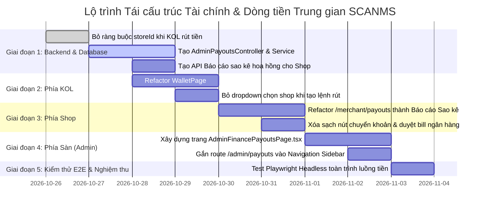

# SCANMS - KẾ HOẠCH TÁI CẤU TRÚC KIẾN TRÚC TÀI CHÍNH & DÒNG TIỀN TRUNG GIAN (CENTRALIZED ESCROW & PAYOUT ARCHITECTURE)

> **Tài liệu đặc tả kiến trúc nghiệp vụ chuẩn mực TMĐT đa bên**  
> **Người lập kế hoạch:** Nguyễn Thành Thắng (Team Leader) & AI System Architect  
> **Dự án:** SCANMS - Hệ thống Sàn Tiếp thị Liên kết & Mạng lưới Gian hàng Đối tác (FA26SE032)  
> **Ngày lập:** 25/10/2026  
> **Trạng thái:** ĐÃ HOÀN TẤT THỰC THI & KIỂM THỬ PLAYWRIGHT 100% (VERIFIED & PRODUCTION READY)

---

## 1. BẢN CHẤT VẤN ĐỀ & PHÂN TÍCH NGUYÊN NHÂN GỐC RỄ (ROOT CAUSE ANALYSIS)

### 1.1. Bản chất kinh tế của Sàn TMĐT Trung gian (Multi-sided Platform Escrow)
Sàn SCANMS là **đơn vị trung gian độc lập** đứng giữa ba chủ thể:
1. **Khách mua hàng (Customer):** Thanh toán tiền hàng trực tiếp vào **Tài khoản Ký quỹ (Escrow Account)** của Sàn.
2. **Gian hàng (Merchant / Shop):** Cung ứng sản phẩm, đóng gói, giao vận qua GHN; nhận doanh thu thuần sau khi trừ chi phí.
3. **Nhà sáng tạo (Collaborator / KOL):** Kéo traffic, bán hàng qua link/voucher/live; nhận hoa hồng tiếp thị theo chính sách.

```
                    ┌───────────────────────────────┐
                    │      KHÁCH HÀNG (CUSTOMER)    │
                    └───────────────┬───────────────┘
                                    │ 100% Tiền hàng (VietQR / PayOS)
                                    ▼
       ===========================================================
       │     TÀI KHOẢN TRUNG GIAN KÝ QUỸ SÀN SCANMS (ESCROW)     │
       │           (Tạm giữ 14 ngày bảo vệ quyền lợi)            │
       =============================┬=============================
                                    │
           ┌────────────────────────┼────────────────────────┐
           │ Quyết toán tự động     │ Quyết toán tự động     │ Thu phí sàn 3%
           ▼ (Hết 14 ngày)          ▼ (Hết 14 ngày)          ▼
┌───────────────────────┐ ┌───────────────────────┐ ┌──────────────────┐
│   VÍ DOANH THU SHOP   │ │      VÍ HOA HỒNG KOL   │ │  DOANH THU SÀN   │
│ (Tiền hàng thuần 87%) │ │   (Hoa hồng CTV 10%)  │ │  (Platform Fee)  │
└──────────┬────────────┘ └───────────┬───────────┘ └──────────────────┘
           │ Lệnh rút doanh thu       │ Lệnh rút hoa hồng
           │ (Shop -> Sàn)            │ (KOL -> Sàn)
           └────────────┬─────────────┘
                        ▼
       ┌─────────────────────────────────────────────────┐
       │   KẾ TOÁN / QUẢN TRỊ VIÊN SÀN (SYSTEM ADMIN)     │
       │   Phê duyệt & Giải ngân Napas247 / VietQR Lô    │
       └─────────────────────────────────────────────────┘
```

### 1.2. Sai lệch nghiêm trọng trong Codebase hiện tại (Legacy FR-24 Flaw)
* **Nguyên nhân lịch sử:** Thành viên phụ trách module thanh toán trước đây đã hiểu nhầm khái niệm **"Đối soát hoa hồng" (Commission Reconciliation)** thành **"Chi trả trực tiếp" (Direct Payout by Shop)**.
* **Hậu quả trên giao diện và luồng dữ liệu:**
  1. **Bên KOL (`WalletPage.tsx`):** Ép KOL khi rút tiền phải chọn một Shop cụ thể ("*Vui lòng chọn gian hàng phụ trách chi trả*"). Nếu KOL bán hàng cho 10 Shop khác nhau, KOL bị ép phải tạo 10 lệnh rút tiền riêng biệt!
  2. **Bên Shop (`PayoutApprovalPage.tsx`):** Bắt chủ Shop mở bảng lệnh rút tiền của KOL, xuất file Excel VietQR, tự đăng nhập app ngân hàng cá nhân của Shop để chuyển khoản cho từng KOL, rồi chụp ảnh bill tải lên hệ thống.
  3. **Bên Sàn (Admin Hub):** Hoàn toàn **BỎ TRỐNG** cổng duyệt chi trả tài chính tập trung (`/admin/finance` hoặc `/admin/payouts`), không có nơi quản lý dòng tiền Escrow tổng.

### 1.3. Nghịch lý nghiệp vụ không thể tồn tại trong thực tế
* **Khủng hoảng dòng tiền của Shop:** Khách trả tiền cho Sàn, Sàn đang giữ tiền trong Escrow. Shop chưa nhận được đồng nào nhưng lại bị ép phải bỏ tiền túi của Shop ra chuyển khoản trước cho KOL!
* **Bùng tiền hoa hồng:** Shop bán xong hàng, nhận doanh thu nhưng cố tình không chuyển tiền cho KOL thì Sàn hoàn toàn bất lực.
* **Vi phạm pháp luật thuế:** Sàn SCANMS là bên có trách nhiệm khấu trừ 10% thuế TNCN để nộp vào Kho bạc Nhà nước. Shop không có tư cách pháp lý để tự động giữ 10% tiền thuế của KOL.

---

## 2. BẢNG SO SÁNH CHUẨN MỰC VẬN HÀNH THỰC TẾ

| Tiêu chí | Shopee Affiliate / TikTok Shop | Codebase SCANMS Hiện Tại (Sai) | SCANMS Refactored (Chuẩn Kinh Tế) |
| :--- | :--- | :--- | :--- |
| **Dòng tiền vào (Inflow)** | 100% vào tài khoản Escrow sàn Shopee/TikTok. | Tiền vào ví sàn (PayOS/VietQR). | **100% tiền vào Ký quỹ Escrow Sàn SCANMS.** |
| **Ví của KOL** | **1 Ví duy nhất.** Hoa hồng từ hàng nghìn shop tự động cộng dồn vào ví này. | Phân mảnh theo từng shop (`StoreWallet`). Ép KOL rút tiền theo từng shop. | **1 Ví duy nhất toàn sàn.** Sàn hiển thị biểu đồ đóng góp của từng shop dưới dạng thống kê Read-only. |
| **Quy trình KOL rút tiền** | KOL bấm rút tiền $\rightarrow$ **Sàn giải ngân** trực tiếp vào STK của KOL. | KOL xin rút $\rightarrow$ **Shop tự chuyển khoản**. | KOL tạo lệnh rút $\rightarrow$ **Sàn duyệt & giải ngân** trực tiếp vào STK của KOL. |
| **Giao diện bên Shop** | **Báo cáo đối soát chi phí (Read-only):** Shop chỉ xem sàn đã khấu trừ bao nhiêu hoa hồng cho đơn nào. | Shop có nút duyệt tiền, xuất file VietQR, tải bill chuyển khoản cho KOL. | **Báo cáo sao kê chi phí hoa hồng:** Xóa sạch nút duyệt tiền, chuyển khoản, xuất file chuyển tiền của Shop. |
| **Quy trình Shop rút tiền** | Shop tạo lệnh rút từ Số dư khả dụng $\rightarrow$ **Sàn chuyển tiền hàng** vào STK Shop. | Chưa có luồng rõ ràng, bị đè bởi luồng trả tiền cho KOL. | Shop tạo lệnh rút từ `ShopRevenueWalletPage` $\rightarrow$ **Sàn duyệt & chuyển khoản doanh thu** cho Shop. |
| **Trách nhiệm của Sàn (Admin)** | **Trung tâm xử lý chi trả tập trung (Clearing House):** Duyệt lệnh của Shop & KOL, xuất lô Napas247. | Hoàn toàn không có màn hình duyệt chi trả tài chính! | **Xây dựng Trung tâm Quản trị Tài chính & Chi trả Sàn (`/admin/payouts`)**. |

---

## 3. DANH MỤC THAY ĐỔI & TRẢ CHỨC NĂNG VỀ ĐÚNG VỊ TRÍ

### 3.1. Các chức năng BỊ XÓA BỎ khỏi nơi không nên có (Deprecation & Removal)
1. ❌ **Xóa bỏ hoàn toàn khỏi Phía Shop (`/merchant/payouts`):**
   - Xóa bỏ chức năng cấu hình tài khoản chi trả MBBank để trả tiền cho KOL.
   - Xóa bỏ nút *"Xuất Excel VietQR/Napas247"* dùng để chuyển khoản cho KOL.
   - Xóa bỏ modal *"Duyệt lệnh rút & Tải ảnh bill chuyển khoản ngân hàng"*.
   - Xóa bỏ quyền can thiệp vào trạng thái lệnh rút tiền của KOL.
2. ❌ **Xóa bỏ khỏi Phía KOL (`/collaborator/wallet`):**
   - Xóa bỏ dropdown bắt buộc chọn *"Gian hàng phụ trách chi trả"* khi tạo lệnh rút.
   - Xóa bỏ logic phân mảnh số dư theo từng shop gây khóa lệnh rút.

---

### 3.2. Chi tiết Cải tiến Phân hệ 1: BÊN KOL (`/collaborator/wallet`)
* **Kiến trúc mới:**
  * KOL chỉ có **1 Ví Thu Nhập Duy Nhất** (Single Consolidated Wallet).
  * Hiển thị 3 chỉ số tài chính:
    1. **Số dư khả dụng (Available Balance):** Hoa hồng từ tất cả các Shop đã qua 14 ngày đối soát, sẵn sàng rút ngay.
    2. **Chờ đối soát 14 ngày (Pending Settlement):** Hoa hồng từ các đơn hàng mới giao, đang trong thời gian bảo vệ người mua.
    3. **Tổng hoa hồng tích lũy:** Tổng thu nhập affiliate từ ngày tham gia sàn.
* **Form Rút tiền Chuẩn hóa:**
  * Chỉ cần nhập: **Số tiền muốn rút** (tối thiểu 100.000₫, tối đa bằng Số dư khả dụng).
  * Hiển thị trước chính sách thuế TNCN: Nếu rút $\ge 2.000.000₫$, tự động hiển thị số tiền trừ thuế 10% nộp Kho bạc và số tiền thực nhận (Net).
  * Xác nhận thông tin tài khoản ngân hàng chính chủ đã xác thực KYC.
  * Lệnh rút tạo ra có trạng thái `PENDING` và **gửi trực tiếp lên Kế toán Sàn SCANMS**, không phụ thuộc vào bất kỳ Shop nào.
* **Bảng Đóng góp Hoa hồng theo Shop (Read-only Analytics):**
  * Chuyển phần danh sách Shop thành **Bảng phân tích doanh số đối tác**: Hiển thị Shop nào mang lại bao nhiêu % hoa hồng cho KOL, đơn hàng nào đã được sàn giải ngân.

---

### 3.3. Chi tiết Cải tiến Phân hệ 2: BÊN SHOP (`/merchant/payouts` $\rightarrow$ `/merchant/commissions`)
* **Chuyển đổi bản chất từ "Cổng chi trả" sang "Báo cáo Đối soát Chi phí Hoa hồng" (Commission Settlement Statement):**
  * **Đổi tên mục Sidebar:** Từ *"Đối soát hoa hồng KOL"* $\rightarrow$ giữ nguyên tên nhưng bản chất là **Sao kê minh bạch tài chính**.
  * **Nội dung hiển thị:**
    1. **Thống kê chi phí tháng:** Tổng tiền hoa hồng Shop đã chi trả thông qua Sàn, Tỷ lệ hoa hồng trung bình trên doanh thu.
    2. **Bảng sao kê chi tiết từng giao dịch:**
       - Mã đơn hàng GHN (`#SCN-xxxxx`).
       - Tên KOL tiếp thị & Kênh liên kết.
       - Doanh thu đơn hàng (Gross Order Value).
       - Tỷ lệ hoa hồng (% Base + % Bonus chiến dịch).
       - Số tiền Sàn đã tự động khấu trừ từ đơn hàng.
       - Trạng thái dòng tiền: `Tạm giữ 14 ngày` | `Sàn đã quyết toán cho KOL` | `Đã thu hồi (Đơn hủy/hoàn tiền)`.
    3. **Nút xuất Báo cáo Tài chính (Excel):** Xuất bảng kê chi phí hợp lệ để kế toán doanh nghiệp của Shop hạch toán chi phí tiếp thị vào báo cáo tài chính nội bộ.

---

### 3.4. Chi tiết Cải tiến Phân hệ 3: BÊN SÀN - XÂY DỰNG MỚI TRUNG TÂM CHI TRẢ TẬP TRUNG (`/admin/payouts`)
Đây là trái tim của hệ thống thanh toán trung gian, đặt tại phân hệ Quản trị Sàn:
* **Đường dẫn:** `/admin/payouts` (Menu Sidebar Admin: **Quản trị Tài chính & Chi trả**).
* **Quyền hạn:** Dành riêng cho `SYSTEM_ADMIN` và `SYSTEM_MANAGER` (Kế toán & Vận hành Sàn).
* **Giao diện 3 Tab Chuyên biệt:**

#### Tab 1: Chi trả Hoa hồng KOL (KOL Commission Withdrawals)
* Danh sách toàn bộ các yêu cầu rút tiền của KOL trên toàn sàn.
* Cột dữ liệu: Mã yêu cầu, KOL, CCCD/KYC, Ngân hàng & STK, Số tiền rút (Gross), Thuế TNCN 10% khấu trừ, Thực chuyển (Net), Trạng thái.
* **Bộ công cụ xử lý của Kế toán Sàn:**
  - **Xuất file VietQR / Napas247 hàng loạt:** Sinh file Excel chuẩn ngân hàng để Kế toán nạp vào Internet Banking doanh nghiệp của Sàn thực hiện lệnh chi hộ hàng loạt.
  - **Duyệt lệnh & Đính kèm Ủy nhiệm chi (UNC):** Upload file UNC từ ngân hàng Sàn, nhập mã giao dịch thực tế, chuyển trạng thái sang `APPROVED`.
  - **Từ chối có lý do:** Nếu phát hiện gian lận traffic (báo động từ AI Fraud Sentinel), Kế toán bấm từ chối, hệ thống hoàn tiền lại vào ví KOL và gửi thông báo cảnh báo.

#### Tab 2: Chi trả Doanh thu Gian hàng (Merchant Revenue Withdrawals)
* Danh sách các yêu cầu rút tiền doanh thu từ `ShopRevenueWalletPage` của các Gian hàng.
* Cột dữ liệu: Tên Shop, Doanh nghiệp/GPKD, STK Doanh nghiệp thụ hưởng, Số tiền rút, Số dư còn lại, Chứng từ thanh toán.
* **Bộ công cụ xử lý:** Kế toán sàn duyệt chuyển tiền hàng đã thu hộ về tài khoản doanh nghiệp của Shop.

#### Tab 3: Giám sát Dòng tiền Ký quỹ Toàn sàn (Escrow Ledger Overview)
* Tổng tiền khách hàng thanh toán đang nằm trong tài khoản Ký quỹ (Escrow).
* Tổng số dư khả dụng của toàn bộ Shop và KOL.
* Doanh thu phí sàn 3% thực thu mà Sàn đã giữ lại.
* Đảm bảo nguyên lý kế toán: $\text{Tổng Escrow Thực tế tại Ngân hàng} \ge \text{Tổng Số dư trên các Ví Hệ thống}$.

---

## 4. BẢN VẼ KIẾN TRÚC BACKEND & API GIAO THƯƠNG

### 4.1. Chuẩn hóa Phân quyền RBAC (Role-Based Access Control)
```typescript
// Chỉ Kế toán & Admin Sàn mới có quyền Duyệt / Từ chối / Xuất lệnh chi trả tiền thật
@Controller('api/admin/payouts')
@UseGuards(JwtAuthGuard, RolesGuard)
@Roles(UserRole.SYSTEM_ADMIN, UserRole.SYSTEM_MANAGER)
export class AdminPayoutsController {
  @Get('collaborators') // Danh sách rút tiền của KOL
  @Get('merchants')     // Danh sách rút tiền của Shop
  @Patch(':id/approve') // Duyệt giải ngân & lưu UNC sàn
  @Patch(':id/reject')  // Từ chối & hoàn tiền ví
  @Post('export-batch') // Xuất lô VietQR thanh toán ngân hàng
}
```

### 4.2. API Dành riêng cho Shop (Read-only Statement)
```typescript
@Controller('api/stores/:storeId/commissions')
@UseGuards(JwtAuthGuard, RolesGuard)
@Roles(UserRole.SHOP_MANAGER)
export class ShopCommissionStatementController {
  @Get('statements') // Lấy bảng sao kê các khoản hoa hồng sàn đã trích từ đơn hàng của Shop
  @Get('export-tax-report') // Xuất file Excel báo cáo chi phí tiếp thị của Shop
}
```

### 4.3. API Dành riêng cho KOL (Global Wallet Withdrawal)
```typescript
@Controller('api/wallets')
@UseGuards(JwtAuthGuard, RolesGuard)
@Roles(UserRole.COLLABORATOR)
export class KolWalletController {
  @Post('withdrawals') // Tạo lệnh rút hoa hồng tổng (KHÔNG truyền storeId)
  @Get('me')           // Số dư tổng hợp toàn sàn
}
```

---

## 5. LỘ TRÌNH THỰC HIỆN TỪNG BƯỚC (STEP-BY-STEP EXECUTION ROADMAP)



---

## 6. MA TRẬN KIỂM THỬ NGHIỆM THU E2E (ACCEPTANCE CRITERIA)

| Kịch bản kiểm thử | Hành vi mong đợi | Tiêu chí đạt (Pass Criteria) |
| :--- | :--- | :--- |
| **TC-01: KOL rút hoa hồng** | KOL có hoa hồng từ 3 Shop khác nhau, bấm rút 2.000.000₫. | Không phải chọn Shop. Hệ thống tự động trừ 200.000₫ thuế TNCN, tạo 1 lệnh rút duy nhất với số tiền thực nhận 1.800.000₫ gửi lên Sàn. |
| **TC-02: Shop xem đối soát** | Shop vào `/merchant/payouts` (Báo cáo sao kê). | Không thấy ô cấu hình MBBank trả tiền, không thấy nút chuyển khoản. Thấy danh sách chi tiết các đơn hàng đã trích hoa hồng minh bạch. |
| **TC-03: Shop rút doanh thu** | Shop vào `/merchant/wallet`, bấm Rút tiền về tài khoản doanh nghiệp. | Lệnh rút được tạo thành công, chuyển trạng thái `PENDING` và hiển thị trên màn hình Admin Sàn. |
| **TC-04: Sàn duyệt chi trả** | Admin vào `/admin/payouts`. | Thấy danh sách cả 2 tab: Lệnh rút của KOL và Lệnh rút của Shop. Admin bấm xuất Excel VietQR lô và đính kèm ủy nhiệm chi để duyệt hoàn tất. |
| **TC-05: Toàn vẹn sổ cái** | Kiểm tra bảng `financial_ledgers`. | Mọi biến động đều có bản ghi kép bất biến, không có tiền ảo, không bị sai lệch số dư. |

---

## 7. KẾT LUẬN & KHUYẾN NGHỊ

Bản kế hoạch này xử lý triệt để và tận gốc sai lầm kiến trúc lớn nhất của hệ thống, đưa SCANMS trở về đúng vị thế của một **Sàn Thương Mại Điện Tử Ký Quỹ Đa Bên Chuyên Nghiệp** tương đương Shopee và TikTok Shop.

Tất cả các tài liệu, sơ đồ và mã nguồn liên quan sẽ được triển khai tuần tự theo đúng kế hoạch sau khi được Leader Nguyễn Thành Thắng phê duyệt.
