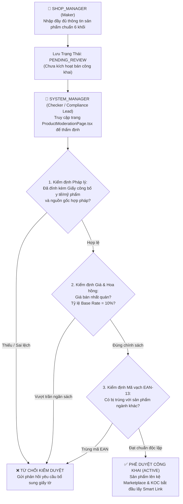

# 🏛️ KẾ HOẠCH TỔNG THỂ TÁI CẤU TRÚC HỆ THỐNG SCANMS

> **Chuẩn áp dụng Main Flow 5 — 31/10/2026:** Escrow 7 ngày lịch từ giao thành công, giữ tiếp nếu có claim/thẩm định; không cộng ngày lễ. FR-09 lấy mốc cao nhất, thưởng cố định hoặc % tổng doanh thu sạch, dùng chính sách đầu tháng và snapshot lịch sử; thay đổi giữa kỳ áp dụng kỳ sau. Chốt sau khi tháng kết thúc, cron 00:10 bù kỳ cũ. Công thức đơn dùng max + Live, trần 25%; Campaign tổng 11–16%, Live 2–3% theo AGENTS.md. Ngưỡng tích lũy 20/50/100 triệu tương ứng Bạc/Vàng/Kim Cương; 52 triệu là Vàng. Khi ví dụ/sơ đồ cũ khác quy tắc này, dùng chuẩn cập nhật tại đầu Blueprint. Xem [kết quả triển khai](MAIN_FLOW_5_FIX_RESULTS_2026-10-31.md) và [đăng ký dịch vụ bên ngoài](FLOW5_EXTERNAL_SERVICES_SETUP.md).

## HỆ THỐNG QUẢN LÝ ĐỘI NGŨ CỘNG TÁC VIÊN BÁN HÀNG & TIẾP THỊ LIÊN KẾT NỘI BỘ DOANH NGHIỆP
### (Enterprise In-House Sales Collaborator & Affiliate Network Management System)

> **Mã dự án:** FA26SE032 | **Học kỳ:** Fall 2026 / Spring 2026 | **Đơn vị:** Đại học FPT TP.HCM  
> **Giảng viên hướng dẫn:** ThS. Tôn Thất Hoàng Minh (`MinhTTH5`)  
> **Trưởng nhóm:** Nguyễn Thành Thắng (Lead Architect & Fullstack Engineer)  
> **Tài liệu tham chiếu:** `docs/SCANMS_REALIGNMENT_BLUEPRINT.md`  
> **Trạng thái tài liệu:** Kế hoạch hành động chi tiết & Bảng đối chiếu hiện trạng toàn diện (Exhaustive Execution Master Plan & Deep Comparative Audit) — **LƯU DỰ ÁN ĐỂ THẢO LUẬN, CHƯA TRIỂN KHAI CODE**.

---

## MỤC LỤC CHI TIẾT
1. [Phần 1: Tổng Quan Bản Sắc & Phân Tích So Sánh Benchmark Quốc Tế](#phần-1-tổng-quan-bản-sắc--phân-tích-so-sánh-benchmark-quốc-tế)
2. [Phần 2: Bảng Đối Chiếu Đa Chiều Toàn Diện: Cách Cũ (Sàn Chợ Mở) vs Cách Mới (Hệ Thống Doanh Nghiệp)](#phần-2-bảng-đối-chiếu-đa-chiều-toàn-diện-cách-cũ-sàn-chợ-mở-vs-cách-mới-hệ-thống-doanh-nghiệp)
3. [Phần 3: Phân Tích Chuyên Sâu Nút Thắt 1: Quản Lý Hàng Hóa, Kho Bãi & Kiểm Duyệt Maker-Checker](#phần-3-phân-tích-chuyên-sâu-nút-thắt-1-quản-lý-hàng-hóa-kho-bãi--kiểm-duyệt-maker-checker)
   * 3.1. Kịch Bản Cửa Hàng & Mô Hình Kho Bãi Theo Ngành Hàng
   * 3.2. Quy Trình Nhập Liệu Sản Phẩm Chuẩn 6 Khối Tuần Tự
   * 3.3. Quy Trình Kiểm Duyệt Sản Phẩm 2 Bước Chuẩn Mực: "Maker - Checker"
   * 3.4. Cơ Chế Khóa Ngành Hàng Cố Định Khi Tạo Sản Phẩm & Phân Tích So Sánh Quốc Tế
   * 3.5. Quy Trình Khởi Tạo Cửa Hàng Mới & Nguyên Tắc Bất Biến 1 Role SHOP_MANAGER
   * 3.6. Kế Hoạch Tái Cấu Trúc Seed Data Mới Chuẩn Hệ Thống Quản Lý CTV & Tiếp Thị Liên Kết
4. [Phần 4: Phân Tích Chuyên Sâu Nút Thắt 2: Dòng Tiền, Kế Toán Doanh Nghiệp & Cơ Chế Chi Trả (Payout)](#phần-4-phân-tích-chuyên-sâu-nút-thắt-2-dòng-tiền-kế-toán-doanh-nghiệp--cơ-chế-chi-trả-payout)
5. [Phần 5: Các Nghiệp Vụ Chuyển Đổi Liên Hoàn (Đổi Trả, Mẫu Thử, Deal VIP, Chống Gian Lận, Livestream)](#phần-5-các-nghiệp-vụ-chuyển-đổi-liên-hoàn-đổi-trả-mẫu-thử-deal-vip-chống-gian-lận-livestream)
6. [Phần 6: Kế Hoạch Tái Cấu Trúc UI: Cổng Đăng Ký Đối Tác (PartnerUpgradeTab) & Admin Personnel Page](#phần-6-kế-hoạch-tái-cấu-trúc-ui-cổng-đăng-ký-đối-tác-partnerupgradetab--admin-personnel-page)
7. [Phần 7: Ma Trận 5 Roles Đầy Đủ Vòng Đời - Chi Tiết Thao Tác, UI Button & API Mapping](#phần-7-ma-trận-5-roles-đầy-đủ-vòng-đời---chi-tiết-thao-tác-ui-button--api-mapping)
8. [Phần 8: Động Cơ Thù Lao Ưu Tiên (Precedence Rule) & Thưởng Mốc Tháng Độc Lập (FR-09)](#phần-8-động-cơ-thù-lao-ưu-tiên-precedence-rule--thưởng-mốc-tháng-độc-lập-fr-09)
9. [Phần 9: Lộ Trình 5 Giai Đoạn Triển Khai (5-Phase Roadmap) & Tiêu Chí Nghiệm Thu (DoD)](#phần-9-lộ-trình-5-giai-đoạn-triển-khai-5-phase-roadmap--tiêu-chí-nghiệm-thu-dod)

---

## PHẦN 1: TỔNG QUAN BẢN SẮC & PHÂN TÍCH SO SÁNH BENCHMARK QUỐC TẾ

### 1.1. Tái Định Vị Bản Sắc Hệ Thống: "Shop Là Của Mình, Cộng Tác Viên Là Bên Ngoài"
Trong các phiên bản thảo luận ban đầu, hệ thống SCANMS bị hiểu lầm là một sàn thương mại điện tử mở đa người bán (tương tự Shopee, Lazada hay Tiki Marketplace). Trên các sàn mở đó, bất kỳ người bán tự do nào từ bên ngoài cũng có thể đăng ký mở một gian hàng riêng, tự định giá và tự đăng bán các mặt hàng không rõ nguồn gốc.

Khi bảo vệ trước Hội đồng Tốt nghiệp Đại học FPT và Giảng viên hướng dẫn ThS. Tôn Thất Hoàng Minh, mô hình sàn mở bộc lộ sự phi lý về mặt đề tài:
* Tên đề tài tốt nghiệp là: **"HỆ THỐNG QUẢN LÝ ĐỘI NGŨ CỘNG TÁC VIÊN BÁN HÀNG VÀ TIẾP THỊ LIÊN KẾT"** (Sales Collaborator & Affiliate Network Management System - SCANMS).
* Mục tiêu của đề tài là xây dựng một nền tảng **MarTech (Marketing Technology) & Quản trị mạng lưới bán hàng** cho một **Doanh nghiệp Bán lẻ / D2C Đa Ngành Hàng (Multi-Category Retail Conglomerate / House of Brands)**.
* Một doanh nghiệp đầu tư xây dựng hệ thống tiếp thị liên kết là để **thúc đẩy doanh số cho các nhãn hàng trực thuộc của chính mình**, tập hợp mạng lưới KOC/CTV quảng bá sản phẩm của công ty, chứ không phải bỏ chi phí hạ tầng ra để làm "cái chợ trung gian" cho các đối thủ bên ngoài vào bán hàng cạnh tranh trực tiếp!

Do đó, mô hình kiến trúc chuẩn mực được xác lập:
1. **Doanh nghiệp (Enterprise):** Là chủ thể pháp lý sở hữu 100% nền tảng công nghệ SCANMS, sở hữu các thương hiệu / ngành hàng trực thuộc (In-house Brands / D2C Storefronts), ví dụ:
   * **Cửa hàng 1 (`Store 1`):** `Sora Home & Living` — Thiết bị gia dụng & Đồ bếp thông minh.
   * **Cửa hàng 2 (`Store 2`):** `Aura Activewear & Lifestyle` — Thời trang thể thao, may mặc năng động & Phụ kiện.
   * **Cửa hàng 3 (`Store 3`):** `GreenBio Health & Wellness` — Dinh dưỡng tự nhiên, Thảo mộc & Thực phẩm chức năng.
2. **Quản lý Cửa Hàng (`SHOP_MANAGER`):** Là nhân sự nội bộ doanh nghiệp (Giám đốc nhãn hàng / Trưởng ngành hàng / Brand Merchandiser). Nhân sự này do Quản trị viên tối cao (`SYSTEM_ADMIN`) bổ nhiệm, cấp tài khoản và gán quyền phụ trách ngành hàng cụ thể.
3. **Cộng tác viên / KOC (`COLLABORATOR`):** Là các đối tác tiếp thị ngoại vi (Content Creators, Influencers, KOL/KOC, Publishers). Họ nộp hồ sơ định danh điện tử (eKYC) để gia nhập mạng lưới phân phối, sử dụng công nghệ Smart Link / Dynamic QR để tiếp thị và nhận thù lao hiệu suất bán hàng (CPS - Cost Per Sale).

```
                      ┌─────────────────────────────────────────────────────────┐
                      │              DOANH NGHIỆP SỞ HỮU (SCANMS)                │
                      │       Hệ thống Tiếp thị Liên kết & CTV Nội bộ           │
                      └────────────────────────────┬────────────────────────────┘
                                                   │
                  ┌────────────────────────────────┴────────────────────────────────┐
                  ▼                                                                 ▼
      ┌─────────────────────────────┐                                 ┌─────────────────────────────┐
      │   TỔ CHỨC NỘI BỘ DOANH NGHIỆP│                                 │     ĐỐI TÁC TIẾP THỊ NGOẠI VI │
      ├─────────────────────────────┤                                 ├─────────────────────────────┤
      │ • SYSTEM_ADMIN: Quản trị    │                                 │ • COLLABORATOR: KOL/KOC     │
      │ • SYSTEM_MANAGER: Vận hành  │                                 │   - Đăng ký công khai       │
      │ • SHOP_MANAGER: Quản lý Brand│                                 │   - Thẩm định hồ sơ eKYC    │
      │   (Được cấp quyền nội bộ)   │                                 │   - Sinh Smart Link / QR    │
      │                             │                                 │   - Đàm phán Deal VIP       │
      │ 🏪 Sora Home & Living       │                                 │   - Mượn mẫu thử 14 ngày    │
      │ 🏪 Aura Activewear          │                                 │   - Nhận hoa hồng Napas     │
      │ 🏪 GreenBio Health          │                                 │                             │
      └─────────────────────────────┘                                 └─────────────────────────────┘
```

---

### 1.2. Phân Tích So Sánh Chuyên Sâu Với Các Nền Tảng Hàng Đầu (Benchmark Analysis)

Để đảm bảo tính thuyết phục học thuật và chuẩn mực kỹ thuật cao nhất, SCANMS được đối chiếu với các nền tảng Affiliate & MarTech hàng đầu thế giới:

| Tiêu Chí Kỹ Thuật & Nghiệp Vụ | **SCANMS (Chuẩn Mới)** | **Impact.com (Enterprise Cloud)** | **Refersion / UpPromote (Shopify Plus)** | **TikTok Shop Creator Center** | **Shopee / Lazada Mở (Cũ)** |
| :--- | :--- | :--- | :--- | :--- | :--- |
| **Bản chất kiến trúc** | In-House Enterprise Affiliate Network | Enterprise Partnership Automation | D2C Brand Multi-Storefront Portal | Social Commerce Affiliate Center | Open Multi-vendor Marketplace |
| **Quyền sở hữu Cửa hàng** | Doanh nghiệp sở hữu 100% | Nhãn hàng/Brand sở hữu | Thương hiệu sở hữu trên D2C | Brand/Merchant chính thức | Bất kỳ ai cũng tự tạo gian hàng |
| **Cơ chế tạo Shop Manager** | Admin nội bộ cấp tài khoản & gán Store | Super Admin phân quyền trong Team | Store Owner mời nhân viên (Staff) | Cấp quyền qua Business Manager | Người dùng tự đăng ký công khai |
| **Quy trình gia nhập KOC** | Nộp hồ sơ eKYC + Kênh MXH công khai | Partner Application Portal | Direct Affiliate Sign-up Form | Creator Onboarding Verification | Đăng ký tài khoản mua hàng chung |
| **Quy tắc tính thù lao** | **Precedence (Ưu tiên mức cao nhất)** | Custom Contract Hierarchy | Best Commission Override | Flat Rate / Targeted Plan | Stacking cộng dồn hỗn loạn |
| **Chống gian lận (Fraud)** | AI Sentinel + Rate Limit + Chặn tự mua | Dynamic Tracking + Fraud Alert | Click IP Filtering | Traffic Screening + Live Guard | Báo cáo thủ công sau sự vụ |
| **Quản lý Mẫu thử (Samples)** | Ký quỹ / Đánh giá tín nhiệm 14 ngày | Gifting / Seeding Campaign | Free Product Tracking | Free Sample Flow (Cam kết Video) | Không có luồng kiểm soát chuyên biệt |
| **Dòng tiền bán hàng** | Vào thẳng Master Corporate Account | Brand thu tiền trực tiếp | Store Stripe/Shopify Payments | TikTok Payments Gateway | Tiền giam tại ví trung gian sàn |
| **Cơ chế Rút tiền (Payout)** | **Chỉ KOC rút tiền** (trừ 10% TNCN) | Partner rút tiền chuyển khoản | Affiliate rút tiền qua PayPal/Bank | Creator rút tiền hoa hồng | Shop và CTV cùng rút tiền từ sàn |

---

## PHẦN 2: BẢNG ĐỐI CHIẾU ĐA CHIỀU TOÀN DIỆN: CÁCH CŨ (SÀN CHỢ MỞ) VS CÁCH MỚI (HỆ THỐNG DOANH NGHIỆP)

Bảng dưới đây phân tích đầy đủ và chi tiết toàn bộ các mặt nghiệp vụ, logic kỹ thuật, và tác động hệ thống giữa cách làm cũ và cách làm mới:

| STT | Khía Cạnh Nghiệp Vụ | **CÁCH LÀM CŨ (Mô hình Sàn Chợ Mở - Shopee Clone)** | **CÁCH LÀM MỚI (Mô hình Doanh Nghiệp In-House - MarTech SaaS)** | Nguyên Nhân Sâu Xa & Ảnh Hưởng Kỹ Thuật |
| :---: | :--- | :--- | :--- | :--- |
| **1** | **Đăng ký vai trò Shop** | Khách hàng vãng lai sau khi đăng nhập có thể truy cập `PartnerUpgradeTab.tsx`, chọn tab "Đăng ký Shop", nhập giấy phép kinh doanh cá nhân để tự tạo gian hàng. | **Loại bỏ 100% form đăng ký Shop công khai.** `SHOP_MANAGER` là nhân sự nội bộ, được `SYSTEM_ADMIN` cấp tài khoản và gán trực tiếp vào Store phụ trách qua trang `AdminPersonnelPage.tsx`. | Ngăn chặn triệt để tình trạng người ngoài tự ý tạo cửa hàng rác, bán hàng cạnh tranh với doanh nghiệp hoặc đưa hàng kém chất lượng vào hệ thống. |
| **2** | **Cấu trúc Kho bãi (Warehouse)** | Mỗi shop tự đăng ký một địa chỉ kho riêng lẻ như người bán tự do, sàn không quản lý điều kiện kho bãi. | Doanh nghiệp triển khai **Multi-Warehouse Fulfillment (Kho vệ tinh theo đặc thù ngành hàng)**: Kho mát thực phẩm/dược liệu, kho gia dụng cồng kềnh, kho thời trang may mặc. | Đáp ứng chuẩn mực bảo quản hàng hóa thực tế và tích hợp API GHN chuẩn xác (`from_district_id`, `from_ward_code`) để shipper lấy hàng đúng kho. |
| **3** | **Kiểm duyệt Sản phẩm (Product Moderation)** | Sàn kiểm duyệt shop ngoài đăng bán theo dạng "kiểm duyệt nội dung cộng đồng", dễ phát sinh tiêu cực hoặc chậm trễ. | Quy trình kiểm soát nội bộ chuẩn mực **Maker - Checker (Người tạo - Người duyệt pháp chế)**: Shop Manager nhập liệu $\rightarrow$ System Manager pháp chế kiểm tra tính pháp lý trước khi mở bán. | Đảm bảo 100% sản phẩm có giấy công bố y tế/mỹ phẩm hợp pháp, kiểm soát giá bán niêm yết và chống trùng lặp mã vạch EAN-13 giữa các ngành hàng. |
| **4** | **Dòng tiền Bán hàng (Cash Inflow)** | Tiền khách thanh toán bị giam ở tài khoản trung gian của sàn chợ. | Toàn bộ $100\%$ tiền thanh toán (VietQR, PayOS, COD shipper GHN) chảy thẳng vào **Tài Khoản Doanh Nghiệp Tập Trung (Corporate Master Account)**. | Doanh nghiệp chủ động nắm giữ dòng tiền kinh doanh tập trung, phục vụ hạch toán tài chính và luân chuyển vốn. |
| **5** | **Yêu cầu Rút tiền (Payout Outflow)** | Shop bán xong có số dư ví trên sàn và phải tạo lệnh gửi Admin sàn xin duyệt rút tiền về tài khoản ngân hàng của chủ shop. | **Shop Manager KHÔNG RÚT TIỀN**. Tiền bán hàng là của doanh nghiệp. **CHỈ CÓ KOC MỚI THỰC HIỆN LỆNH RÚT TIỀN (Payout)** để nhận hoa hồng tiếp thị sau 7 ngày Escrow (khấu trừ 10% thuế TNCN). | Tháo gỡ mâu thuẫn vô lý khi nhân sự công ty lại phải "làm đơn xin công ty cho rút tiền doanh thu". |
| **6** | **Báo cáo Tài chính của Shop** | Shop nhìn vào số dư ví cá nhân để rút tiền lẻ tẻ như một hộ kinh doanh cá thể. | Shop Manager xem **Báo Cáo Doanh Thu & Chi Phí Tiếp Thị (Store P&L & Commission Expenses)**: Doanh thu Net, Giá vốn (COGS), Chi phí hoa hồng KOC, Lợi nhuận đóng góp. | Cung cấp góc nhìn quản trị kinh doanh cho từng Brand Manager, giúp đánh giá hiệu quả chiến dịch tiếp thị liên kết (Affiliate ROI). |
| **7** | **Hệ thống Ví Người Dùng** | Hệ thống duy trì ví cho Khách hàng, ví cho KOC, và cả ví số dư cho từng Shop (`StoreWallet`). | **Chỉ duy trì 2 loại ví thực tế:**<br>1. Ví Khách Hàng (`Customer Wallet`): Nhận tiền hoàn khi đổi trả.<br>2. Ví KOC (`Collaborator Wallet`): Tích lũy hoa hồng bán hàng. | Đơn giản hóa cấu trúc cơ sở dữ liệu kế toán, loại bỏ các giao dịch ví ảo không có thật giữa nội bộ công ty với nhau. |
| **8** | **Quy trình Đổi trả / Hoàn tiền** | Khách hàng kiện Shop, Sàn đứng ra phân xử như Tòa án dân sự trung gian giữa 2 người ngoài xa lạ. | Quy trình **Chăm sóc Khách hàng (CSKH) nội bộ**: Khách khiếu nại $\rightarrow$ Thu hồi hàng về kho Store $\rightarrow$ Tự động **ĐÓNG BĂNG/HỦY HOA HỒNG KOC** trên đơn hàng bị trả. | Bảo vệ doanh nghiệp không bị thất thoát tiền hoa hồng khi khách hàng đã trả lại hàng và nhận tiền hoàn. |
| **9** | **Chính sách Hàng Mẫu (Samples)** | Shop tự phát hàng mẫu không theo dõi, KOC nhận mẫu xong không đăng bài cũng không bị xử lý. | Mẫu thử được hạch toán vào **Ngân sách Marketing thử nghiệm** của từng Store. KOC cam kết đăng video review trong 14 ngày. Vi phạm sẽ bị đưa vào **Blacklist toàn sàn**. | Tối ưu hóa chi phí hàng mẫu, nâng cao tỷ lệ chuyển đổi từ việc gửi mẫu sang doanh số bán hàng thực tế. |
| **10** | **Đàm phán Deal Độc quyền** | Thỏa thuận tự do giữa người bán ngoài và KOC, không có sự kiểm soát của chủ thương hiệu. | Là sự **phân bổ ngân sách hoa hồng chiến lược** giữa Trưởng nhãn hàng (`SHOP_MANAGER`) và Top KOC để đạt KPI doanh số lớn trong tháng. | Đảm bảo mức hoa hồng ưu đãi đặc biệt ($15\% - 18\%$) được cấp đúng người, đúng thời điểm và có cam kết doanh số rõ ràng. |
| **11** | **Động cơ Tính Thù lao (Commission)** | Cộng dồn vô lý 4-5 loại tỷ lệ hoa hồng (`Base 10% + Tier 3% + Deal 5% + Live 3% = 21%`), gây thủng biên lợi nhuận của doanh nghiệp. | Áp dụng **Quy Tắc Ưu Tiên Mức Cao Nhất (Best-Benefit Precedence Rule)**: $\max(\text{Deal}, \text{Campaign}, \text{Tier}, \text{Base}) + \text{Live Bonus}$. Thưởng tháng (FR-09) tính độc lập cuối kỳ. | Đảm bảo tính minh bạch, KOC luôn được hưởng mức quyền lợi cao nhất mà vẫn bảo vệ an toàn biên lợi nhuận tài chính của doanh nghiệp. |
| **12** | **Kiểm soát Gian lận Click (Anti-Fraud)** | Bỏ qua việc kiểm soát click ảo vì nghĩ rằng mô hình CPS chỉ tính tiền trên đơn hàng thành công. | Kích hoạt bộ lọc **Redis Sliding-Window Rate Limit** chống Click Flooding nhằm bảo vệ mẫu số tỷ lệ chuyển đổi $\text{CR\%}$ cho AI Smart Matcher và chống Cookie Stuffing. | Bảo vệ tính toàn vẹn của thuật toán AI xếp hạng đối tác và ngăn chặn bot làm nghẽn cơ sở dữ liệu PostgreSQL. |
| **13** | **Chính sách Tự Mua (Self-Referral)** | KOC tự tạo đơn hàng qua liên kết của chính mình để vừa dùng voucher giảm giá vừa nhận hoa hồng kép. | **Nghiêm cấm KOC tự mua qua link chính mình**: Hệ thống đối soát trùng `customerId`, SĐT, địa chỉ, tài khoản ngân hàng $\rightarrow$ Hủy $0\%$ hoa hồng; hướng KOC sang luồng Mượn Mẫu. | Ngăn chặn việc KOC trục lợi chính sách giá sỉ trá hình và bảo vệ tính công bằng của chương trình tiếp thị. |
| **14** | **Phân hệ Livestream** | Livestream được xem là phân hệ bắt buộc của mọi cửa hàng, gây loãng 5 Main Flows bảo vệ tốt nghiệp. | Định vị Livestream là **"Tính Năng Giá Trị Gia Tăng (Bonus / Value-Added Feature)"** phục vụ các phiên Mega Live giờ vàng của doanh nghiệp. | Giữ nguyên vẹn toàn bộ mã nguồn WebRTC/Socket.IO nhưng tập trung trọng tâm bảo vệ vào năng lực quản trị Affiliate MarTech. |

---

## PHẦN 3: PHÂN TÍCH CHUYÊN SÂU NÚT THẮT 1: QUẢN LÝ HÀNG HÓA, KHO BÃI & KIỂM DUYỆT MAKER-CHECKER

### 3.1. Kịch Bản 3 Cửa Hàng (Storefronts) & Mô Hình Kho Bãi Theo Ngành Hàng (Multi-Warehouse Fulfillment)

Trong một doanh nghiệp bán lẻ đa ngành hàng, việc gom tất cả sản phẩm vào một kho duy nhất là phi thực tế vì điều kiện bảo quản và phương thức đóng gói khác nhau hoàn toàn:

```
┌──────────────────────────────────────────────────────────────────────────────────────────────────┐
│                     HỆ THỐNG PHÂN BỔ KHO BÃI & ĐẶC THÙ NGÀNH HÀNG (SCANMS FULFILLMENT)            │
├──────────────────────────────────────────────────────────────────────────────────────────────────┤
│ 🏪 CỬA HÀNG 1: SORA HOME & LIVING (Khối Thiết Bị Gia Dụng & Đồ Bếp Thông Minh)                   │
│ • Địa chỉ kho xuất hàng: Kho Tổng Gia Dụng, Lô B4 KCN Tân Bình, Tây Thạnh, Tân Phú, TP.HCM       │
│ • Mã định danh GHN: from_district_id: 1452 (Tân Phú) | from_ward_code: "21011"                   │
│ • Đặc thù bảo quản: Kho diện tích rộng, giá kệ pallet chịu lực nặng, xe nâng bốc xếp hàng cồng   │
│   kềnh (Nồi chiên 5L, Máy ép chậm, Chảo chống dính đáy từ).                                      │
│ • Quy cách đóng gói: Thùng carton 5 lớp có mút xốp chống va đập, cân nặng từ 2.500g - 6.500g.    │
├──────────────────────────────────────────────────────────────────────────────────────────────────┤
│ 🏪 CỬA HÀNG 2: AURA ACTIVEWEAR & LIFESTYLE (Khối Thời Trang Thể Thao & May Mặc)                  │
│ • Địa chỉ kho xuất hàng: Kho May Mặc Thời Trang, 128/4 Hoàng Hoa Thám, Phường 12, Tân Bình, TP.HCM│
│ • Mã định danh GHN: from_district_id: 1444 (Tân Bình) | from_ward_code: "20708"                  │
│ • Đặc thù bảo quản: Kho khô ráo, giá treo chống ẩm mốc, phân loại ngăn nắp theo bảng ma trận     │
│   biến thể Màu sắc (Đen, Xám, Xanh Navy) và Kích cỡ (S, M, L, XL).                               │
│ • Quy cách đóng gói: Túi niêm phong PE chống nước, cân nặng nhẹ từ 250g - 650g.                   │
├──────────────────────────────────────────────────────────────────────────────────────────────────┤
│ 🏪 CỬA HÀNG 3: GREENBIO HEALTH & WELLNESS (Khối Dinh Dưỡng, Thảo Mộc & Sức Khỏe)                 │
│ • Địa chỉ kho xuất hàng: Kho Mát Tiêu Chuẩn GMP/GSP, Khu Công Nghệ Cao, Tăng Nhơn Phú B, TP.Thủ Đức│
│ • Mã định danh GHN: from_district_id: 1442 (Thủ Đức) | from_ward_code: "20109"                   │
│ • Đặc thù bảo quản: Kho mát kiểm soát nhiệt độ nghiêm ngặt (dưới 25°C), kiểm soát độ ẩm < 60%     │
│   (Hạt Granola nướng mật ong, Trà thảo mộc túi lọc, Bột Collagen thủy phân).                     │
│ • Quy cách đóng gói: Hộp giấy Kraft dán tem niêm phong chống hàng giả, cân nặng 350g - 1.200g.   │
└──────────────────────────────────────────────────────────────────────────────────────────────────┘
```

- **Tích hợp API GHN chuẩn xác:** Trong cơ sở dữ liệu, trường `Store.returnWarehouse` lưu trữ đối tượng JSON chứa thông tin bưu cục gửi hàng:
  ```json
  {
    "warehouseName": "Kho Mát Dược Liệu GreenBio",
    "contactName": "Trần Thị Quản Kho",
    "contactPhone": "0912345678",
    "address": "Khu Công Nghệ Cao, Tăng Nhơn Phú B, TP.Thủ Đức, TP.HCM",
    "ghnDistrictId": 1442,
    "ghnWardCode": "20109"
  }
  ```
  Khi khách hàng chốt đơn sản phẩm từ Store nào, hệ thống tự động bóc tách và gửi đúng mã kho xuất phát điểm đó sang GHN để tính cước phí chính xác theo khoảng cách địa lý.

---

### 3.2. Quy Trình Nhập Liệu Sản Phẩm Chuẩn 6 Khối Tuần Tự (`ProductManagementPage.tsx`)
`SHOP_MANAGER` khi tạo sản phẩm mới bắt buộc phải điền form tuần tự theo chuẩn sàn TMĐT quốc tế:

1. **Khối 1: Thông tin định danh cơ bản:** Tên sản phẩm, Ngành hàng/Danh mục, Thương hiệu trực thuộc, Mô tả chi tiết rich-text.
2. **Khối 2: Hình ảnh & Tài nguyên đa phương tiện:** Ảnh bìa chuẩn tỷ lệ 1:1 (tối thiểu $800 \times 800\text{px}$), Thư viện ảnh chi tiết góc chụp, Video sản phẩm quay thực tế (dùng cho KOC tải về làm Media Hub).
3. **Khối 3: Bán hàng & Ma trận biến thể 2 tầng (2-Tier Variant Matrix):**
   * Tầng 1: Thuộc tính nhóm (ví dụ: *Màu sắc: Đen, Trắng, Be*).
   * Tầng 2: Thuộc tính con (ví dụ: *Kích thước: S, M, L* hoặc *Dung tích: 500ml, 1000ml*).
   * Bảng ma trận tự động sinh $3 \times 3 = 9$ biến thể: Mỗi biến thể có SKU con riêng (`SR-NC-5L-BLK`), Giá bán lẻ, Giá so sánh, và Số lượng tồn kho tức thời. Hệ thống tự động tính tổng tồn kho của sản phẩm cha.
4. **Khối 4: Quy cách đóng gói & Vận chuyển (Logistics Dimensions):** Trọng lượng tịnh sau đóng gói (gram), Kích thước Dài x Rộng x Cao (cm) để hệ thống gửi dữ liệu tính cước vận chuyển GHN.
5. **Khối 5: Chính sách KOL & Mẫu thử:** Tỷ lệ hoa hồng mở sàn chuẩn $10\%$ (`defaultCommissionRate`), Công tắc mở nhận đăng ký mượn mẫu thử (`sampleEnabled = true`), Số lượng suất cấp mẫu tối đa trong tháng (ví dụ: cấp tối đa 20 suất mẫu thử cho chiến dịch).
6. **Khối 6: Pháp lý & Kiểm soát tuân thủ (Legal & Compliance):** Mã số công bố lưu hành mỹ phẩm/thực phẩm, Giấy kiểm nghiệm chất lượng, Xuất xứ nguồn gốc, Hóa đơn VAT đầu vào.

---

### 3.3. Quy Trình Kiểm Duyệt Sản Phẩm 2 Bước Chuẩn Mực: "Maker - Checker"



- **API Thẩm định của System Manager:**
  - **Endpoint:** `PATCH /api/v1/products/:id/moderation`
  - **Quyền hạn (RBAC):** `@Roles(UserRole.SYSTEM_MANAGER, UserRole.SYSTEM_ADMIN)`
  - **Payload:**
    ```json
    {
      "status": "ACTIVE", // hoặc "REJECTED"
      "moderationNote": "Hồ sơ giấy phép công bố mỹ phẩm số 1234/24/CBMP-HCM hợp lệ. Duyệt mở bán."
    }
    ```

---

### 3.4. Cơ Chế Khóa Ngành Hàng Cố Định Khi Tạo Sản Phẩm (Store-Category Lock Enforcement) & Phân Tích So Sánh Quốc Tế

#### A. Quy Tắc Nghiệp Vụ Bắt Buộc: "Cửa Hàng Nào Chuyên Sâu Ngành Hàng Đó"
Trong một hệ thống Quản lý Đối tác Tiếp thị (Affiliate Network), việc định vị rõ ràng chuyên môn của từng Cửa hàng/Nhãn hàng trực thuộc là điều kiện tiên quyết:
* **Mỗi Cửa hàng gắn chặt với 1 Ngành hàng cố định (`primaryCategory`):**
  * 🏪 `Sora Skincare & Cosmetics` $\rightarrow$ Ngành hàng cố định: **Mỹ phẩm & Chăm sóc da (Cosmetics & Skincare)**
  * 🏪 `Aura Activewear & Apparel` $\rightarrow$ Ngành hàng cố định: **Thời trang & Thể thao (Fashion & Apparel)**
  * 🏪 `GreenBio Health & Nutrition` $\rightarrow$ Ngành hàng cố định: **Dinh dưỡng & Sức khỏe (Health & Nutrition)**
  * 🏪 `Lumière Smart Living` $\rightarrow$ Ngành hàng cố định: **Gia dụng & Tiện ích thông minh (Smart Living & Gadgets)**
* **Cơ chế Khóa tại Giao diện Thêm Sản phẩm (`ProductManagementPage.tsx`):**
  * Khi `SHOP_MANAGER` mở modal "+ Thêm sản phẩm mới", ô nhập liệu **"Ngành hàng / Danh mục sản phẩm" (Category)** tự động hiển thị giá trị ngành hàng của Cửa hàng mà nhân sự đó phụ trách, và bị **KHÓA CỨNG (Disabled / Readonly)**.
  * Nhân sự không thể can thiệp, chỉnh sửa hay chọn ngành hàng khác từ dropdown.
* **Cơ chế Kiểm soát Chặt chẽ tại Backend (`POST /api/v1/products`):**
  * Backend tự động lấy `store.category` gắn vào sản phẩm mới tạo.
  * Nếu payload cố tình gửi danh mục sai lệch với ngành hàng của Store, hệ thống lập tức từ chối với lỗi `400 Bad Request: "Sản phẩm không thuộc ngành hàng được ủy quyền của gian hàng này"`.

#### B. Phân Tích, Đánh Giá & So Sánh Benchmark Quốc Tế

| Nền tảng Quốc tế | Cơ chế Quản lý Ngành hàng | Phân tích Nghiệp vụ & Kỹ thuật | So sánh & Bài học Áp dụng cho SCANMS |
| :--- | :--- | :--- | :--- |
| **TikTok Shop (Seller Center)** | **Category Whitelisting & Qualification Matrix** | TikTok Shop áp dụng cơ chế kiểm soát danh mục rất nghiêm ngặt (*Restricted Categories*). Người bán đăng ký ngành hàng nào (ví dụ *Beauty & Personal Care*) thì chỉ được cấp quyền đăng sản phẩm trong đúng cây danh mục đó. Muốn bán thêm ngành hàng khác, shop phải nộp hồ sơ chứng nhận độc lập (*Category Qualification*) để được mở quyền. | **Cực kỳ tối ưu cho Affiliate Marketing:** TikTok hiểu sâu sắc rằng Nhà sáng tạo nội dung (Creator/KOC) nhận link và xin mẫu thử theo sở trường (Niche). Việc khóa ngành hàng giúp KOC Beauty không bao giờ gặp phải chảo chống dính hay áo quần trong kho sản phẩm của shop mỹ phẩm. SCANMS áp dụng trực tiếp cơ chế này. |
| **Shopee Mall & LazMall** | **Authorized Brand Category Bound** | Gian hàng chính hãng (Mall) chỉ được phép mở bán các SKU thuộc đúng thương hiệu và danh mục đã được cấp phép theo hợp đồng phân phối độc quyền. Sàn khóa chặt danh mục bằng thỏa thuận pháp lý B2B. | **Kiểm soát Chất lượng & Pháp lý:** Mỗi ngành hàng có điều kiện kiểm định y tế, tem nhãn phụ và chính sách đổi trả khác nhau (Mỹ phẩm cần bảo quản tem seal, thời trang cần chính sách đổi size). Khóa ngành hàng giúp SCANMS bảo vệ uy tín thương hiệu công ty và đồng nhất quy trình logistics. |
| **Amazon (Brand Registry)** | **Product Classifier & Single-Vertical Stores** | Amazon yêu cầu mỗi thương hiệu phải xác lập mã phân loại hàng hóa (*Product Classifier*). Các nhãn hàng D2C trên Amazon tạo *Brand Storefront* chuyên biệt cho từng dòng sản phẩm. | **Tối ưu Hóa AI Matching:** Amazon định vị khách hàng tìm sản phẩm theo nhãn hàng chuyên sâu. SCANMS học hỏi cách phân bổ để thuật toán AI gợi ý (FR-30) so khớp chuẩn xác KOC theo thế mạnh ngành hàng. |
| **Tập đoàn Bán lẻ Đa Thương hiệu (House of Brands - Masan, Vinamilk, Coolmate)** | **Single-Vertical Business Units** | Doanh nghiệp chia tách các Brand con thành từng đơn vị độc lập: Coolmate chuyên đồ nam, 84RISING chuyên đồ nữ, CM24 chuyên mỹ phẩm nam. Không bao giờ bán chung chạ lộn xộn. | **Chuẩn mực Bản sắc Đề tài:** SCANMS là nền tảng quản trị của một Doanh nghiệp Bán lẻ Đa Ngành. Mỗi Store đại diện cho 1 Nhãn hàng D2C chuyên biệt của tập đoàn. |

---

### 3.5. Quy Trình Khởi Tạo Cửa Hàng Mới & Nguyên Tắc Bất Biến 1 Role `SHOP_MANAGER`

#### A. Khắc Phục Lỗ Hổng Kiến Trúc & Database
* **Thực trạng trước đây:** Bảng `stores` chỉ có 1 cột `owner_id`. Khi Super Admin bổ nhiệm thêm Manager mới cho Shop tại trang nhân sự, code cũ chạy `update({ where: { id: storeId }, data: { ownerId: newUser.id } })`, dẫn đến việc Manager cũ bị ghi đè và mất quyền quản trị. Đồng thời, trên giao diện Admin chưa có nút tạo Store mới.
* **Giải pháp Chuẩn Hóa:**
  1. Bổ sung liên kết `storeId` trên model `User` (`storeId String? @db.Uuid`).
  2. Khi Admin bổ nhiệm Manager phụ trách Shop, hệ thống cập nhật `newUser.storeId = store.id`.
  3. Logic kiểm tra quyền truy cập Shop của Manager: Hệ thống kiểm tra `store.ownerId === user.id || user.storeId === store.id`.

#### B. Nguyên Tắc Bất Biến 5 Roles (Không Sinh Thêm Role Phụ)
* Hệ thống tuân thủ tuyệt đối **5 Roles cốt lõi** đã chốt cho Đồ án Capstone:
  1. `CUSTOMER`: Khách hàng mua hàng qua link/voucher tiếp thị, theo dõi vận đơn GHN.
  2. `COLLABORATOR`: KOC/KOL đối tác tiếp thị, nộp eKYC, sinh Smart Link/QR, mượn mẫu thử 14 ngày, nhận hoa hồng Napas 24/7.
  3. `SHOP_MANAGER`: Quản lý toàn diện nhãn hàng trực thuộc (sản phẩm, tồn kho, duyệt mẫu thử, duyệt deal VIP, voucher, đơn hàng GHN).
  4. `SYSTEM_MANAGER`: Chuyên viên vận hành sàn (Duyệt eKYC, kiểm duyệt sản phẩm Maker-Checker, phân xử tranh chấp mẫu thử, giám sát gian lận).
  5. `SYSTEM_ADMIN`: Quản trị tối cao (Bổ nhiệm nhân sự nội bộ, khởi tạo Cửa hàng mới, Executive Financial Dashboard).
* **Một Cửa Hàng có thể có Nhiều Quản lý cùng mang Role `SHOP_MANAGER`:**
  * Cả 2 hoặc 3 nhân sự cùng làm việc cho một nhãn hàng **đều mang chung 1 vai trò là `SHOP_MANAGER`**, và đều có `storeId` trỏ về cùng một Cửa hàng.
  * Cả hai đều có toàn quyền điều hành nghiệp vụ của nhãn hàng đó mà **không cần đẻ thêm bất kỳ role phụ nào** (như `WAREHOUSE_STAFF` hay `DEAL_STAFF`), giữ vững 100% ma trận phân quyền RBAC đã đăng ký với Hội đồng chấm thi.

#### C. Quy Trình Super Admin Khởi Tạo Gian Hàng Mới (`AdminStoresModal`)
Quản trị viên tối cao (`SYSTEM_ADMIN`) mở modal "+ Tạo Gian Hàng Mới":
1. Nhập Tên Gian hàng / Thương hiệu (`name`, `slug`).
2. Chọn **1 Ngành hàng cố định duy nhất** (`primaryCategory` từ danh sách 4 ngành hàng cốt lõi).
3. Nhập **Địa chỉ Kho xuất hàng GHN (Pickup Warehouse)**: Tỉnh/Thành phố, Quận/Huyện, Phường/Xã, Địa chỉ cụ thể để tích hợp API GHN lấy hàng.
4. Nhập Tỷ lệ hoa hồng mở sàn cơ sở (`defaultCommissionRate: 10%`).
5. Chỉ định hoặc tạo mới tài khoản `SHOP_MANAGER` phụ trách đầu tiên.

---

### 3.6. Kế Hoạch Tái Cấu Trúc Seed Data Mới Chuẩn Hệ Thống Quản Lý CTV & Tiếp Thị Liên Kết

#### A. Đánh Giá & Nhận Xét Hạn Chế Của Bộ Seed Data Cũ
* **Quá nhiều gian hàng lan man:** Bộ dữ liệu seed cũ có quá nhiều shop ảo không rõ bản sắc, gây phân tán và thiếu tính tập trung của một Doanh nghiệp bán lẻ có chiến lược.
* **Sản phẩm chưa chuẩn Tiếp thị Liên kết:** Nhiều sản phẩm thiếu các thông tin quan trọng của một chiến dịch Affiliate: hoa hồng base $10\%$ chưa thống nhất, thiếu chính sách suất mượn mẫu thử 14 ngày SLA, thiếu tài nguyên đa phương tiện (ảnh studio, video review chân thực của KOC), thiếu quy cách đóng gói cân nặng để GHN tính cước.

#### B. Định Hình Bộ Seed Data Mới Tinh Gọn (4 Cửa Hàng Trực Thuộc Chuyên Sâu)
Thu gọn toàn bộ hệ thống về đúng **4 Cửa hàng Trực thuộc Chuẩn mực** đại diện cho 4 ngành hàng có tỷ trọng tiếp thị liên kết (KOL/KOC Affiliate) cao nhất thị trường Việt Nam:
1. 🏪 **Store 1: Sora Skincare & Cosmetics**
   * Ngành hàng cố định: `Mỹ phẩm & Chăm sóc da chuyên sâu`
   * Kho bãi: Kho Mát Tiêu Chuẩn GMP, Khu Công Nghệ Cao, TP.Thủ Đức, TP.HCM (`from_district_id: 1442`, `from_ward_code: 20109`)
   * Tệp KOC mục tiêu: Beauty Bloggers, Dược mỹ phẩm Reviewers, KOC Makeup.
   * Sản phẩm chủ lực: Serum Vitamin C 15% Dưỡng Sáng, Kem Chống Nắng Phổ Rộng SPF50+, Nước Tẩy Trang Rau Má Dịu Nhẹ.
2. 🏪 **Store 2: Aura Activewear & Apparel**
   * Ngành hàng cố định: `Thời trang & May mặc thể thao năng động`
   * Kho bãi: Kho May Mặc Thời Trang, 128/4 Hoàng Hoa Thám, Tân Bình, TP.HCM (`from_district_id: 1444`, `from_ward_code: 20708`)
   * Tệp KOC mục tiêu: Fashion TikTokers, Gymer / Vận động viên, KOC Biến hình thời trang.
   * Sản phẩm chủ lực: Áo Khoác Gió Thông Hơi Chống Nước, Quần Legging Thể Thao Nâng Mông, Balo Đa Năng Chống Trộm.
3. 🏪 **Store 3: GreenBio Health & Nutrition**
   * Ngành hàng cố định: `Dinh dưỡng, Thảo mộc & Sức khỏe thiên nhiên`
   * Kho bãi: Kho Dược Liệu & Thực Phẩm Sức Khỏe, Tân Phú, TP.HCM (`from_district_id: 1452`, `from_ward_code: 21011`)
   * Tệp KOC mục tiêu: KOC Eat-Clean, Huấn luyện viên Yoga/Pilates, Bác sĩ/Dược sĩ gia đình.
   * Sản phẩm chủ lực: Hạt Granola Nướng Mật Ong Rừng, Trà Thảo Mộc Thanh Nhiệt Giảm Stress, Bột Collagen Thủy Phân Vị Đào.
4. 🏪 **Store 4: Lumière Smart Living**
   * Ngành hàng cố định: `Thiết bị gia dụng & Đồ bếp thông minh`
   * Kho bãi: Kho Tổng Thiết Bị, Lô B4 KCN Tân Bình, TP.HCM (`from_district_id: 1452`, `from_ward_code: 21011`)
   * Tệp KOC mục tiêu: Food Bloggers, Mẹ đảm đang nội trợ, Reviewers đồ gia dụng thông minh.
   * Sản phẩm chủ lực: Nồi Chiên Không Dầu Điện Tử 5.5L, Máy Ép Chậm Trục Xoắn Ngang, Chảo Vân Đá Đáy Từ Chống Dính.

#### C. Tiêu Chuẩn Sản Phẩm Trong Seed Data Mới
Mỗi sản phẩm bắt buộc phải có đầy đủ 6 khối:
* Cố định đúng ngành hàng của Store.
* Mã vạch EAN-13 chuẩn nội bộ (không trùng lặp).
* Bảng ma trận biến thể 2 tầng (Màu sắc/Kích cỡ hoặc Dung tích/Mùi hương) có tồn kho và giá bán riêng.
* Trọng lượng và kích thước đóng gói để GHN tính cước tức thời.
* Chính sách KOC: Base Commission $10\%$, cho phép mượn mẫu thử 14 ngày (SLA), cam kết nộp video review.
* Tài nguyên Media Hub: Ít nhất 3 ảnh studio góc chụp sạch sẽ + 1 video quay trải nghiệm thực tế.

---

### 3.7. Ranh Giới Nghiệp Vụ Kho Vận & Dòng Vốn: Tại Sao Khâu Mua Hàng Xưởng (Procurement / PO / COGS) Nằm Hoàn Toàn Ngoài Quy Mô (Out of Scope)?

> [!IMPORTANT]
> **Ranh Giới Kiến Trúc Hệ Thống Chuẩn Mực: MarTech Affiliate Platform vs Hệ Thống ERP / SCM Doanh Nghiệp**  
> Khi `SHOP_MANAGER` tạo sản phẩm và điền tồn kho khả dụng (`stockQuantity`), bản chất nghiệp vụ trên sàn là **Cấp Phát Hạn Mức Tồn Kho Mở Bán Cho Kênh Tiếp Thị (Catalog Listing & Stock Allocation)**, hoàn toàn **KHÔNG PHẢI là Nghiệp vụ Mua hàng xưởng (Procurement / Purchasing)**.

1. **Bản chất thực tế của Doanh nghiệp sở hữu:**
   * Doanh nghiệp sở hữu SCANMS (hoặc các nhãn hàng nội bộ như Sora Skin, Aura, Lumière) đã có sẵn xưởng sản xuất OEM, văn phòng và mạng lưới kho bãi ngoài đời.
   * Chi phí sản xuất, hợp đồng mua bán với nhà xưởng (Purchase Orders - PO), thanh toán công nợ nhà máy (Accounts Payable - AP) và giá vốn hàng tồn kho (COGS) đã được hạch toán đầy đủ trong phần mềm kế toán quản trị nội bộ chuyên dụng (như SAP, Oracle NetSuite, MISA).
2. **Tại sao nghiệp vụ Mua Hàng Xưởng bắt buộc phải OUT OF SCOPE?**
   * Nếu đưa khâu "Mua hàng từ nhà cung cấp" vào SCANMS, đề tài sẽ bị **Vỡ Quy Mô (Scope Creep)**: Nhóm sẽ phải xây thêm phân hệ Nhà cung ứng (Vendors), Đơn đặt hàng PO, Kế toán công nợ xưởng (AP) và Quản lý giá vốn FIFO. Điều này làm mất hoàn toàn trọng tâm nghiên cứu về Tiếp thị liên kết, Thuật toán so khớp KOC và Phòng chống gian lận Attribution.
   * **Chuẩn mực quốc tế:** Các nền tảng hàng đầu (TikTok Shop Seller Center, Shopee, Amazon Seller Central, Impact.com) đều vận hành theo đúng chuẩn này: Người bán chỉ khai báo lượng tồn kho sẵn sàng mở bán (`stockQuantity`), sàn không can thiệp vào sổ sách nhập hàng xưởng của họ.
3. **Nguồn gốc Dòng Tiền & Hàng Hóa thực tế trên SCANMS:**
   * Tiền trên hệ thống là **tiền thật $100\%$ do Người mua hàng thanh toán** qua PayOS/VietQR hoặc trả COD cho bưu tá GHN.
   * Khi đơn hàng giao thành công và hết hạn bảo chứng Escrow (7 ngày), hệ thống tự động bóc tách:
     * Trả Thù lao cho KOC ($10\% - 16\%$) vào Ví rút tiền.
     * Trích Phí dịch vụ nền tảng ($3\%$).
     * Toàn bộ phần Doanh thu thuần còn lại ($\sim 81\% - 87\%$) thuộc về Doanh nghiệp/Nhãn hàng để bù đắp giá vốn hàng bán và ghi nhận lợi nhuận ròng.

---

### 3.8. Quản Trị Giá Bán & Bảo Vệ Biên Lợi Nhuận: Giá Sàn (Floor Price / MAP) & Quy Trình Đề Xuất Chiến Dịch Giảm Giá (Promotion Approval Workflow)

> [!WARNING]
> **Rủi Ro Doanh Nghiệp: Ngăn Chặn Tình Trạng Bán Phá Giá Hoặc Bán Dưới Giá Vốn!**  
> Trong mô hình công ty mẹ sở hữu đa nhãn hàng, `SHOP_MANAGER` là nhân sự được giao phụ trách kinh doanh ngành hàng. Nếu để Shop Manager có quyền tự ý sửa giá sản phẩm từ $400.000₫$ xuống $200.000₫$ tùy tiện khi tạo hoặc sửa hàng, doanh nghiệp sẽ gánh chịu rủi ro bán lỗ, không đủ bù chi phí vận hành và thù lao KOC, đồng thời phá hủy định vị thương hiệu (Brand Dilution).

1. **Loại Bỏ Ô "Tự Gõ Giá Giảm Lúc Tạo Sản Phẩm":**
   * Khi tạo sản phẩm mới trên form 6 khối, Shop Manager chỉ được phép khai báo duy nhất:
     * **Giá niêm yết chính thức (List Price / MSRP - `price`):** Mức giá bán lẻ tiêu chuẩn của nhãn hàng.
     * **Giá gạch tham chiếu (`originalPrice`):** Mức giá thị trường trước khuyến mãi.
   * Tuyệt đối không cho phép nhân viên tự gõ đè giá bán thấp lúc tạo hàng.
2. **Thiết Lập "Giá Sàn Bảo Vệ Biên Lợi Nhuận" (Floor Price / Minimum Advertised Price - MAP):**
   * Khi sản phẩm được duyệt lên hệ thống, `SYSTEM_ADMIN` / `SYSTEM_MANAGER` cấu hình một ngưỡng **Giá sàn tối thiểu (`floorPrice`)** cho từng SKU:
     $$\text{Floor Price} = \text{Giá vốn sản xuất (COGS)} + \text{Chi phí vận hành tối thiểu} + \text{Trần thù lao KOC tối đa (16\%) } + \text{Biên lãi ròng an toàn}$$
   * **Quy tắc bất biến:** Mọi chương trình khuyến mãi hay giảm giá trong tương lai dù được phê duyệt cũng **tuyệt đối không được phép giảm dưới mức `floorPrice` này**.
3. **Quy Trình Đề Xuất Chiến Dịch Giảm Giá Có Phê Duyệt (Promotion Campaign Request Workflow):**
   * Khi Shop Manager muốn chạy chương trình Flash Sale, xả kho hoặc kích cầu mùa lễ hội:
     * Shop Manager phải tạo một **"Yêu Cầu Chiến Dịch Khuyến Mãi" (Promotion Campaign Request)**.
     * Các tham số khai báo: Mức giá giảm đề xuất (hệ thống tự động kiểm tra $\ge \text{floorPrice}$), Thời gian bắt đầu (Start Time), Thời gian kết thúc (End Time), Ngân sách chiến dịch và Lý do xúc tiến thương mại.
     * **Cơ chế Maker-Checker trung ương:** `SYSTEM_MANAGER` hoặc `SYSTEM_ADMIN` thẩm định tác động tài chính. Khi bấm **"Phê duyệt (Approve)"**, hệ thống thiết lập lịch tự động kích hoạt giá ưu đãi đúng giờ mở màn và tự động hoàn giá niêm yết ban đầu khi kết thúc thời gian chiến dịch.

---

## PHẦN 4: PHÂN TÍCH CHUYÊN SÂU NÚT THẮT 2: DÒNG TIỀN, KẾ TOÁN DOANH NGHIỆP & CƠ CHẾ CHI TRẢ (PAYOUT)

### 4.1. Bản Chất Dòng Tiền Khép Kín Của Doanh Nghiệp (Corporate Cashflow Governance)
Trong một doanh nghiệp bán lẻ D2C sở hữu mạng lưới tiếp thị, dòng tiền vận hành hoàn toàn khép kín và minh bạch theo các nguyên lý kế toán tài chính sau:

```
                              ┌─────────────────────────────────────────────────────────┐
                              │ KHÁCH HÀNG MUA HÀNG (Thanh toán VietQR / PayOS / COD)   │
                              └────────────────────────────┬────────────────────────────┘
                                                           │ 100% Tiền mua hàng
                                                           ▼
                              ┌─────────────────────────────────────────────────────────┐
                              │ TÀI KHOẢN DOANH NGHIỆP TẬP TRUNG (Corporate Master Bank)│
                              └──────────────┬───────────────────────────┬──────────────┘
                                             │                           │
                    Doanh thu bán lẻ giữ lại │                           │ Trích hoa hồng tiếp thị (CPS)
                                             ▼                           ▼
                              ┌─────────────────────────────┐ ┌─────────────────────────────┐
                              │ QUỸ TÀI CHÍNH DOANH NGHIỆP  │ │ TÀI KHOẢN KÝ QUỸ ESCROW      │
                              │ (Hạch toán P&L theo Store)  │ │ (Tạm giữ an toàn 7 ngày)    │
                              └─────────────────────────────┘ └──────────────┬──────────────┘
                                                                             │
                                              Khách không đổi trả sau 7 ngày │ (Tự động giải tỏa)
                                                                             ▼
                                                              ┌─────────────────────────────┐
                                                              │ VÍ HOA HỒNG KHẢ DỤNG KOC    │
                                                              │ (availableBalance)          │
                                                              └──────────────┬──────────────┘
                                                                             │
                                           KOC bấm lệnh rút tiền (Payout >= 200.000₫)
                                                                             ▼
                                                              ┌─────────────────────────────┐
                                                              │ ADMIN PHÊ DUYỆT LỆNH CHI TRẢ│
                                                              │ • Tự động trừ 10% Thuế TNCN │
                                                              │ • Chuyển khoản Napas 24/7   │
                                                              └─────────────────────────────┘
```

### 4.2. Tại Sao Shop Manager Tuyệt Đối Không Rút Tiền?
* **Bản chất vai trò:** `SHOP_MANAGER` là nhân sự nội bộ (Trưởng phòng/Giám đốc nhãn hàng), hưởng chế độ lương và thưởng KPI của công ty. Toàn bộ tiền hàng thu từ khách là tài sản của công ty mẹ, không phải tiền túi cá nhân của người quản lý cửa hàng.
* **Sai lầm ở code cũ:** Code cũ copy màn hình rút tiền của sàn Shopee, để Shop tạo lệnh rút tiền rồi Admin duyệt chuyển khoản cho Shop. Điều này làm rối loạn sổ sách kế toán nội bộ.
* **Chuẩn hóa mới:**
  * Loại bỏ hoàn toàn tính năng "Shop rút tiền" khỏi giao diện và API.
  * Xóa bỏ tab "Merchant Withdrawal" trên trang `AdminFinancePayoutsPage.tsx`.
  * Thay thế bằng **Báo Cáo Hiệu Quả Kinh Doanh & Chi Phí Tiếp Thị Cửa Hàng (Store P&L & Commission Expenses)** tại trang `MerchantDashboardPage.tsx`:
    $$\text{Doanh Thu Thuần} = \text{Tổng Doanh Số Bán Hàng} - \text{Giá Trị Hàng Khách Đổi Trả}$$
    $$\text{Chi Phí Tiếp Thị} = \text{Tổng Hoa Hồng KOC Đã Trả} + \text{Chi Phí Hàng Mẫu Thử} + \text{Thưởng Mốc Tháng FR-09}$$
    $$\text{Lợi Nhuận Đóng Góp Store} = \text{Doanh Thu Thuần} - \text{Giá Vốn Hàng Bán (COGS)} - \text{Chi Phí Tiếp Thị}$$

---

### 4.3. Quy Trình Chi Trả Hoa Hồng KOC (Payout) & Khấu Trừ Thuế TNCN 10%
**CHỈ CÓ KOC MỚI LÀ CHỦ THỂ THỰC HIỆN LỆNH RÚT TIỀN (PAYOUT)** theo quy trình 4 bước chặt chẽ:

1. **Bước 1: Tạm giữ Escrow 7 ngày:** Khi đơn hàng hoàn thành (`DELIVERED`), tiền hoa hồng nằm ở trường `Wallet.pendingBalance`. Sau 7 ngày (thời hạn đổi trả theo luật định), nếu khách không khiếu nại, số tiền tự động chuyển sang `Wallet.availableBalance`.
2. **Bước 2: KOC khởi tạo yêu cầu rút tiền:**
   * KOC truy cập trang Ví (`/collaborator/wallet`), bấm **"Yêu cầu rút tiền"**.
   * Điều kiện: Số dư khả dụng $\ge 200.000\text{₫}$.
   * Chọn tài khoản ngân hàng thụ hưởng chính chủ đã được xác thực eKYC.
3. **Bước 3: Tự động tính Thuế Thu Nhập Cá Nhân (TNCN):**
   * Theo Thông tư 111/2013/TT-BTC, các khoản chi trả thù lao hoa hồng vãng lai từ $2.000.000\text{₫}$ trở lên cho cá nhân không ký hợp đồng lao động phải khấu trừ $10\%$ thuế TNCN tại nguồn:
     $$\text{Nếu } \text{Gross Amount} \ge 2.000.000\text{₫} \implies \text{Tax Amount} = \text{Gross Amount} \times 10\%$$
     $$\text{Net Amount (Số tiền thực nhận)} = \text{Gross Amount} - \text{Tax Amount}$$
   * Giao diện hiển thị rõ ràng bảng tính thuế để KOC nắm rõ trước khi xác nhận.
4. **Bước 4: System Manager (Kế toán Vận hành) phê duyệt & Chuyển khoản thực tế:**
   * `SYSTEM_MANAGER` (Chuyên viên Vận hành / Kế toán viên) truy cập `AdminFinancePayoutsPage.tsx`, kiểm tra danh sách lệnh rút tiền `PENDING`.
   * Bấm **"Phê duyệt chi trả"**:
     * Gọi cổng thanh toán ngân hàng (Napas 24/7 / MBBank API).
     * **Xóa bỏ triệt để đoạn code mock tự sinh mã `MBB...`:** Nếu API ngân hàng phản hồi lỗi, hệ thống phải bắt lỗi chính xác, hiển thị thông báo đỏ và **giữ nguyên trạng thái `PENDING`**, tuyệt đối không nuốt lỗi.
     * Khi ngân hàng xác nhận giao dịch thành công, cập nhật trạng thái `COMPLETED`, lưu mã `bankRefCode`, trừ tiền trong Escrow và xuất biên lai thuế điện tử.

---

### 4.4. Phân Định Trách Nhiệm Tài Chính Chuẩn Kiểm Toán (Segregation of Duties - SoD): SYSTEM_ADMIN vs SYSTEM_MANAGER

> [!IMPORTANT]
> **Giải Quyết Triệt Để Nguy Cơ Nghẽn Cổ Chai (Bottleneck) Ở Cấp Lãnh Đạo:**
> Tổng Giám Đốc (`SYSTEM_ADMIN`) tuyệt đối không ngồi duyệt từng lệnh rút tiền 500k, 1 triệu của KOL hằng ngày. Hệ thống phân tách 2 tầng trách nhiệm minh bạch:

1. **`SYSTEM_MANAGER` (Chuyên Viên Vận Hành / Kế Toán Chi Trả):**
   * Đối soát số dư ví sạch (hết 7 ngày Escrow) và phê duyệt lệnh rút tiền (Payout) hằng ngày.
   * Tự động khấu trừ $10\%$ Thuế TNCN tại nguồn khi duyệt chi.
   * Xử lý khiếu nại hoàn tiền đổi trả và kích hoạt Clawback Engine thu hồi thù lao về $0₫$.
2. **`SYSTEM_ADMIN` (Tổng Giám Đốc / CEO & Executive Board) — 5 Trụ Cột Chiến Lược:**
   * **🏛️ Quản trị Cơ cấu & Bổ nhiệm Nhân sự (`/admin/personnel`):** Độc quyền tạo Store mới, bổ nhiệm/thu hồi quyền `SHOP_MANAGER` và `SYSTEM_MANAGER`.
   * **📊 Executive Financial Dashboard (`/admin/analytics`):** Báo cáo Doanh thu GMV toàn sàn, Tỷ lệ chi phí tiếp thị (Affiliate Expense Ratio), Tổng tiền ký quỹ Escrow và Báo cáo Quyết toán Thuế TNCN toàn công ty nộp Nhà nước.
   * **🎯 Thẩm định Ngoại lệ Ngân sách:** Phê duyệt Deal VIP vượt trần ($> 16\%$) cho Siêu KOC; phê duyệt Chiến dịch Giảm giá (Flash Sale) bảo đảm trên Giá sàn (`floorPrice`).
   * **🛡️ Giám sát An ninh & Kiểm toán (`/admin/fraud-sentinel`, `/admin/audit-logs`):** Giám sát AI Fraud Sentinel chặn gian lận tự mua, click flooding; kiểm tra `AuditLog` để giám sát xem `SYSTEM_MANAGER` có duyệt chi đúng quy trình không.
   * **👑 Quyền hạn Kế thừa Tối cao (Master Fallback):** Kế thừa 100% quyền hạn của `SYSTEM_MANAGER` để can thiệp xử lý khẩn cấp khi cần.

---

## PHẦN 5: CÁC NGHIỆP VỤ CHUYỂN ĐỔI LIÊN HOÀN (ĐỔI TRẢ, MẪU THỬ, DEAL VIP, CHỐNG GIAN LẬN, LIVESTREAM)

### 5.1. Quy Trình Xử Lý Đổi Trả / Hoàn Tiền (CSKH Nội Bộ & Đóng Băng Hoa Hồng)
Khi khách hàng nhận sản phẩm bị lỗi, hỏng hóc hoặc không đúng mô tả:
1. **Khách hàng gửi yêu cầu:** Nộp hình ảnh/video unboxing và ảnh hộp carton ngoài trong vòng 7–14 ngày kể từ khi nhận hàng.
2. **Cơ chế phân xử 2 cấp (Two-Tier Dispute Escalation):**
   * *Cấp 1 (Tại Brand):* `SHOP_MANAGER` kiểm tra hồ sơ. Nếu Shop đồng ý, tạo đơn thu hồi hoặc bù hàng.
   * *Cấp 2 (Trọng tài Trụ sở Sàn):* Nếu Shop từ chối nhưng khách bấm **"Khiếu nại lên Tổng Công Ty"**, `SYSTEM_MANAGER` (Pháp chế trung tâm) sẽ thẩm định bằng chứng 3 điểm (ảnh đóng gói kho, biên bản giao GHN, video unboxing). Nếu Shop sai, `SYSTEM_MANAGER` có quyền ghi đè phán quyết (Force Refund/Replacement) và phạt trừ chi phí vào P&L của Store đó.
3. **Phân nhánh 2 kịch bản xử lý thực tế & Tác động đến Hoa hồng KOC:**
   * **Kịch bản A — Đổi Hàng Mới 1-đổi-1 (Do bể vỡ vận chuyển GHN hoặc lỗi sản xuất):**
     * Shop xuất kho gửi **1 sản phẩm mới nguyên vẹn bù cho khách** (GHN bồi thường chi phí hư hại cho Shop theo kỳ đối soát).
     * 🎯 **BẢO LƯU 100% HOA HỒNG CHO KOC:** Vì khách hàng cuối cùng vẫn giữ sản phẩm và doanh nghiệp vẫn bảo toàn được doanh số của đơn hàng!
   * **Kịch bản B — Trả Hàng & Hoàn Tiền 100% (Khách không ưng ý, hủy đơn):**
     * Shipper GHN thu hồi kiện hàng về kho Store phụ trách. Tiền hoàn trả lại vào Ví Khách Hàng.
     * 🎯 **KÍCH HOẠT CLAWBACK ENGINE:** Động cơ tài chính tự động quét và **HỦY / THU HỒI $100\%$ HOA HỒNG VỀ $0\text{₫}$** trong số dư tạm giữ `pendingBalance` của KOC, ngăn chặn hoàn toàn việc thất thoát chi phí tiếp thị của công ty.
4. **Chế tài đối với Shop bị trả hàng quá nhiều lần (Return Rate > 5%):**
   * Mọi chi phí vận chuyển 2 chiều và hao hụt bị trừ thẳng vào Báo cáo P&L của Shop đó.
   * Tỷ lệ hoàn đơn vượt quá $5\%$ kích hoạt Cảnh báo đỏ gửi lên Ban Giám Đốc (`SYSTEM_ADMIN`).
   * Mã sản phẩm (SKU) có tỷ lệ trả $\ge 15\%$ trong tháng sẽ bị tự động đóng băng (`QUALITY_REVIEW`) để kiểm tra lại nguồn hàng.
   * Chỉ số hoàn đơn được hiển thị công khai trên sàn, khiến KOC né tránh không nhận tiếp thị cho nhãn hàng chất lượng kém.

---

### 5.2. Quản Lý Ngân Sách Hàng Mẫu Thử (Sample Request Governance)
* Mẫu thử không phải quà tặng phát tự do mà được tính vào **Chi phí Tiếp thị Thử nghiệm (Marketing Seeding Budget)** của từng Brand:
  * KOC nộp yêu cầu xin mẫu kèm cam kết nội dung: Đăng video review kèm link tiếp thị trong vòng **14 ngày** kể từ khi nhận hàng.
  * `SHOP_MANAGER` duyệt hồ sơ dựa trên điểm tín nhiệm và mức độ phù hợp của kênh KOC. Nếu duyệt, Store tự tạo vận đơn GHN xuất kho mẫu thử.
* **Chế tài xử lý vi phạm cam kết mẫu thử:**
  * Nếu sau 14 ngày KOC không tải lên đường dẫn video review hoặc nộp video đối phó không hợp lệ:
    1. Hệ thống tự động hạ $20$ điểm uy tín tín nhiệm của KOC.
    2. Tạm khóa quyền gửi yêu cầu xin sản phẩm mẫu mới.
    3. `SYSTEM_MANAGER` mở phiên trọng tài (`AdminSampleRequestsPage.tsx`). Nếu KOC cố tình bùng hàng có giá trị cao, đưa KOC vào **Blacklist toàn hệ thống** và phong tỏa số dư hoa hồng đang chờ rút.

---

### 5.3. Đàm Phán Thù Lao Độc Quyền 2 Chiều (Exclusive Deal Negotiation)
* **Chiều 1 (KOC $\rightarrow$ Shop):** KOC có tệp khán giả trung thành và tỷ lệ chuyển đổi cao chủ động gửi **Bản Đề Xuất (Proposal)** xin mức hoa hồng VIP (ví dụ: $16\%$ thay vì $10\%$), cam kết mang lại tối thiểu 100 đơn hàng trong vòng 30 ngày.
* **Chiều 2 (Shop $\rightarrow$ KOC):** `SHOP_MANAGER` chủ động lọc danh sách Top KOC từ `ShopKolHubPage.tsx`, gửi **Thẻ Mời Hợp Tác Chiến Dịch** kèm mức đãi ngộ VIP qua khung Chat Socket.IO.
* Khi hai bên thống nhất, hệ thống tạo bản ghi `ExclusiveDeal` có hiệu lực trong khoảng thời gian cụ thể. Động cơ tính thù lao sẽ tự động kích hoạt mức chiết khấu này khi KOC phát sinh đơn hàng.

---

### 5.4. Phòng Chống Gian Lận Click & Cấm Tự Mua (Anti-Fraud Sentinel)
Nhiều người đặt câu hỏi: *"Hệ thống tính hoa hồng theo đơn hàng thành công (CPS), vậy tại sao vẫn phải tốn tài nguyên chống gian lận Click (Click Spam)?"*
* **Lý do 1: Bảo vệ Mẫu Số Tỷ Lệ Chuyển Đổi ($\text{CR\%}$) Của AI Smart Matcher:**
  $$\text{CR\% (Conversion Rate)} = \frac{\text{Tổng Số Đơn Hàng}}{\text{Tổng Số Lượt Click}}$$
  Thuật toán AI của SCANMS xếp hạng và gợi ý KOC cho nhãn hàng dựa trên tỷ lệ chuyển đổi thực tế. Nếu KOC dùng bot bắn hàng triệu click ảo, mẫu số bị thổi phồng làm $\text{CR\%}$ tụt thảm hại, phá hỏng toàn bộ độ chính xác của mô hình AI.
* **Lý do 2: Ngăn Chặn Cookie Stuffing & Cướp Đơn (Attribution Hijacking):** Kẻ gian cài script ẩn trên các diễn đàn/blog để tự động kích hoạt mã ref KOC vào trình duyệt của người dùng. Khi người dùng tự mua hàng, đơn bị cướp công ghi nhận cho kẻ gian lận.
* **Lý do 3: Chặn KOC Tự Mua Hàng:** KOC tự lấy link tiếp thị của mình để đặt đơn nhằm hưởng giảm giá kép (voucher sàn + hoa hồng). Hệ thống đối soát trùng lặp `customerId == collaboratorId` hoặc trùng SĐT/địa chỉ nhận/tài khoản ngân hàng $\rightarrow$ Hủy $0\%$ hoa hồng, chuyển KOC sang luồng Mượn Mẫu Thử.

---

### 5.5. Định Vị Phân Hệ Livestream
* **Giữ nguyên 100% trong mã nguồn:** Toàn bộ bảng cơ sở dữ liệu `LiveSession`, `LivePinnedProduct`, các trang `AdminLiveSessionsPage.tsx`, cơ chế ghim sản phẩm thời gian thực và chat Socket.IO vẫn hoạt động bình thường.
* **Định vị trong bài báo cáo tốt nghiệp:** Được xếp vào nhóm **"Tính Năng Giá Trị Gia Tăng (Bonus / Value-Added Feature)"** phục vụ các phiên Mega Live bán hàng giờ vàng, đem lại lợi thế cạnh tranh nhưng không làm phân tán thời lượng bảo vệ 5 Main Flows trọng tâm của đề tài.

---

## PHẦN 6: KẾ HOẠCH TÁI CẤU TRÚC UI: CỔNG ĐĂNG KÝ ĐỐI TÁC (PARTNERUPGRADETAB) & ADMIN PERSONNEL PAGE

### 6.1. Xử Lý Giao Diện `PartnerUpgradeTab.tsx`: Bỏ Tab Shop, Giữ UI Tinh Gọn & Đẳng Cấp
Khi xóa bỏ tùy chọn đăng ký Shop của khách hàng, trang nâng cấp vai trò được thiết kế lại thành **"Cổng Đăng Ký Đối Tác Sáng Tạo (Creator Partnership Portal)"** với bố cục **60/40 Split Layout (Tỷ Lệ Vàng 2 Cột)**, hoàn toàn không để lại khoảng trống thừa hay icon bừa bãi:

```
┌──────────────────────────────────────────────────────────────────────────────────────────────────┐
│ HEADER: TRỞ THÀNH ĐỐI TÁC SÁNG TẠO & TIẾP THỊ LIÊN KẾT (CREATOR PARTNERSHIP)                      │
│ Mô tả: Gia nhập mạng lưới phân phối sản phẩm chính hãng, nhận thù lao tự động & hỗ trợ mẫu thử... │
├──────────────────────────────────────────────────┬───────────────────────────────────────────────┤
│ CỘT TRÁI (60%): FORM ĐĂNG KÝ ĐỐI TÁC eKYC        │ CỘT PHẢI (40%): THẺ ĐẶC QUYỀN ĐỐI TÁC          │
│                                                  │                                               │
│ [Thẻ Trạng Thái Hồ Sơ: Chưa đăng ký / Chờ duyệt] │ ┌───────────────────────────────────────────┐ │
│                                                  │ │ 🏷️ HUY HIỆU ĐỐI TÁC CHÍNH THỨC           │ │
│ NHÓM 1: KÊNH NỘI DUNG SÁNG TẠO                   │ │ SCANMS Official Creator Program           │ │
│ • Nền tảng: [TikTok / YouTube / Instagram / FB]  │ ├───────────────────────────────────────────┤ │
│ • Tên Kênh & Đường dẫn kênh (URL)                │ │ ✨ 4 ĐẶC QUYỀN CỐT LÕI DÀNH CHO BẠN:      │ │
│ • Lượng người theo dõi (Followers)               │ │ 1. Hoa hồng sàn 10% tối thiểu cho mọi đơn │ │
│                                                  │ │ 2. Mượn mẫu thử 14 ngày không tốn phí     │ │
│ NHÓM 2: ĐỊNH DANH ĐIỆN TỬ (eKYC)                 │ │ 3. Đàm phán Deal độc quyền theo số liệu CR│ │
│ • Số CCCD/Hộ chiếu hợp lệ                        │ │ 4. Thanh toán Napas 24/7 minh bạch        │ │
│ • Tải ảnh CCCD Mặt trước / Mặt sau (Drag-Drop)   │ ├───────────────────────────────────────────┤ │
│                                                  │ │ ⏱️ QUY TRÌNH THẨM ĐỊNH 24H:               │ │
│ NHÓM 3: TÀI KHOẢN THỤ HƯỞNG HOA HỒNG             │ │ Bước 1: Nộp hồ sơ & Liên kết MXH          │ │
│ • Ngân hàng thụ hưởng (Hơn 40 ngân hàng VN)      │ │ Bước 2: Ban Quản Trị thẩm định eKYC       │ │
│ • Số tài khoản & Tên chủ thẻ (Viết hoa tự động)  │ │ Bước 3: Kích hoạt tài khoản Hạng Đồng     │ │
│                                                  │ │ Bước 4: Lấy Smart Link & Bắt đầu nhận tiền│ │
│ [NÚT BẤM BRAND: GỬI HỒ SƠ THẨM ĐỊNH (C59B58)]    │ └───────────────────────────────────────────┘ │
└──────────────────────────────────────────────────┴───────────────────────────────────────────────┘
```

* **Chuẩn hóa màu sắc (Atomic Design Tokens):**
  * Nền toàn trang: Canvas `#FAF8F5` (Soft Warm Cream).
  * Nền form & Thẻ card: Surface White `#FFFFFF`.
  * Đường viền phân cách: Border `#EAE4D7`.
  * Nút bấm chính & Điểm nhấn: Brand Gold `#C59B58` (Hover `#B88E4F`).
  * Màu chữ: Ink `#1A1612`, Muted `#7D715E`.

---

### 6.2. Trang Quản Trị Nhân Sự & Tạo Shop Manager: `AdminPersonnelPage.tsx`
Chức năng tạo `SHOP_MANAGER` được đưa về đúng vị trí độc quyền của **`SYSTEM_ADMIN`**:
* **Vị trí tuyến đường:** Tuyến đường mới `/admin/personnel` (tách biệt khỏi trang duyệt eKYC KOC tại `/admin/kyc`).
* **Thao tác trên UI:** Nút bấm chính `+ Thêm Quản Lý Cửa Hàng (Shop Manager)` mở Modal phân quyền:
  * Điền họ tên nhân sự, email công ty, số điện thoại, mật khẩu khởi tạo mã hóa Argon2.
  * **Trường chọn Cửa Hàng Phụ Trách (`Store Assignment`):** Dropdown lấy danh sách từ `GET /api/v1/stores` (`🏪 Sora Home & Living`, `🏪 Aura Activewear`, `🏪 GreenBio Health`).
  * Gọi API: `POST /api/v1/users/internal-staff` (được bảo vệ nghiêm ngặt bằng `@Roles(UserRole.SYSTEM_ADMIN)`).

---

## PHẦN 7: MA TRẬN 5 ROLES ĐẦY ĐỦ VÒNG ĐỜI - CHI TIẾT THAO TÁC, UI BUTTON & API MAPPING

Bảng dưới đây quy định toàn diện và chi tiết tất cả các thao tác nghiệp vụ, vị trí hiển thị trên giao diện, thành phần UI và API tương ứng cho toàn bộ 5 Roles trong hệ thống SCANMS:

```
┌──────────────────────────────────────────────────────────────────────────────────────────────────┐
│                               MA TRẬN PHÂN QUYỀN VÀ THAO TÁC 5 ROLES                            │
└──────────────────────────────────────────────────────────────────────────────────────────────────┘
```

### 7.1. Role 1: `CUSTOMER` (Khách Mua Hàng & Khách Vãng Lai)
| STT | Mã Thao Tác | Tên Chức Năng Nghiệp Vụ | Vị Trí UI / Nút Bấm Thao Tác | Modal / Trang Hiển Thị | API Endpoint & Method | Hành Động Hệ Thống Phía Sau |
| :---: | :---: | :--- | :--- | :--- | :--- | :--- |
| 1 | `C-01` | Duyệt danh mục & Lọc theo Store | Header công khai, thanh danh mục & tìm kiếm | `MarketplaceHomePage.tsx` | `GET /api/v1/products` | Lấy danh sách sản phẩm theo từng Store, hiển thị giá niêm yết |
| 2 | `C-02` | Bắt dấu vết liên kết tiếp thị (Attribution) | Khách click vào link `scanms.vn/l/:code` | Trình duyệt lưu trữ Cookie an toàn 30 ngày | `GET /api/v1/affiliate-links/resolve` | Ghi nhận Click, tạo Attribution Session trong Redis |
| 3 | `C-03` | Xem chi tiết sản phẩm & Kho xuất | Trang sản phẩm, xem địa chỉ kho và chính sách | `ProductDetailPage.tsx` | `GET /api/v1/products/:id` | Hiển thị mô tả, biến thể màu/size, xuất xứ, kho xuất hàng |
| 4 | `C-04` | Thêm vào giỏ & Chọn biến thể | Nút **"Thêm vào giỏ hàng"** màu Brand | `CartDrawer.tsx` / `CartPage.tsx` | LocalStorage + Đồng bộ Giỏ hàng | Kiểm tra tồn kho của biến thể SKU con trước khi cho thêm |
| 5 | `C-05` | Đặt hàng & Thanh toán trực tuyến | Nút **"Tiến hành thanh toán"** trong Giỏ | `CheckoutPage.tsx` | `POST /api/v1/orders` | Khởi tạo đơn hàng, gắn mã KOC vào `order.collaboratorId` |
| 6 | `C-06` | Thanh toán VietQR / PayOS / COD | Màn hình quét mã VietQR tự động | `PaymentModal.tsx` | Webhook `POST /api/v1/payments/webhook` | Xác thực chữ ký HMAC-SHA256, chuyển trạng thái đơn sang `PAID` |
| 7 | `C-07` | Theo dõi vận đơn GHN thời gian thực | Nút **"Xem chi tiết đơn"** trong Đơn mua | `OrderDetailPage.tsx` | `GET /api/v1/orders/:id/ghn-tracking` | Gọi API GHN lấy tọa độ và trạng thái lộ trình giao hàng |
| 8 | `C-08` | Gửi yêu cầu Đổi trả / Hoàn tiền | Nút **"Yêu cầu Đổi trả / Hoàn tiền"** (đơn `DELIVERED`) | Modal `ReturnRequestModal.tsx` | `POST /api/v1/returns` | Tạo yêu cầu đổi trả, tự động đóng băng hoa hồng KOC trong Escrow |
| 9 | `C-09` | Nộp hồ sơ trở thành Đối tác KOC | Nút **"Gửi hồ sơ thẩm định"** trong Cổng Đối Tác | `PartnerUpgradeTab.tsx` (Creator Portal) | `POST /api/v1/kyc/apply-kol` | Chuyển trạng thái sang `PENDING_REVIEW` để System Manager thẩm định |

---

### 7.2. Role 2: `COLLABORATOR` (Nhà Sáng Tạo Nội Dung / KOC / Affiliate Partner)
| STT | Mã Thao Tác | Tên Chức Năng Nghiệp Vụ | Vị Trí UI / Nút Bấm Thao Tác | Modal / Trang Hiển Thị | API Endpoint & Method | Hành Động Hệ Thống Phía Sau |
| :---: | :---: | :--- | :--- | :--- | :--- | :--- |
| 1 | `K-01` | Xem Báo cáo Thu nhập & Cấp bậc Tier | Menu **Tổng quan** (`/collaborator/dashboard`) | `CollaboratorDashboardPage.tsx` | `GET /api/v1/collaborators/dashboard-stats` | Hiển thị Hoa hồng tạm tính, Doanh số sạch, Hạng hiện tại (Đồng/Bạc...) |
| 2 | `K-02` | Khám phá AI Gợi Ý Sản Phẩm Phù Hợp | Menu **Sản phẩm tiếp thị** -> Tab "AI Gợi Ý" | `CollaboratorProductsPage.tsx` | `GET /api/v1/collaborators/recommendations` | Thuật toán AI tính điểm tương thích dựa trên tệp kênh MXH của KOC |
| 3 | `K-03` | Sinh Smart Link & Dynamic QR tiếp thị | Nút **"Tạo liên kết tiếp thị"** cạnh mỗi sản phẩm | Modal `GenerateSmartLinkModal.tsx` | `POST /api/v1/affiliate-links/generate` | Sinh link rút gọn `scanms.vn/l/:code` và mã QR chuẩn vector |
| 4 | `K-04` | Khai thác Kho tài nguyên số (Media Hub)| Menu **Kho Media Hub** (`/collaborator/media-hub`) | `MediaHubPage.tsx` | `GET /api/v1/media-hub` | Tải video review mẫu, hình ảnh sản phẩm chất lượng cao (FR-08) |
| 5 | `K-05` | Yêu cầu Mượn Sản phẩm mẫu (14 ngày) | Nút **"Yêu cầu mẫu thử"** tại chi tiết sản phẩm | Modal `SampleRequestModal.tsx` | `POST /api/v1/sample-requests` | Khởi tạo đơn mượn mẫu kèm cam kết đăng video review trong 14 ngày |
| 6 | `K-06` | Nộp bằng chứng Video Review mẫu thử | Nút **"Cập nhật video review"** tại đơn mẫu | Modal `SubmitSampleProofModal.tsx` | `POST /api/v1/sample-requests/:id/proof` | Nộp link video TikTok/YouTube, chuyển trạng thái sang `REVIEWED` |
| 7 | `K-07` | Đề xuất Hợp đồng Thù lao Độc quyền | Nút **"Đề xuất Deal VIP"** tại trang Gian hàng | Modal `ProposeDealModal.tsx` | `POST /api/v1/exclusive-deals` | Gửi đề xuất mức hoa hồng mục tiêu kèm KPI cam kết doanh số cho Shop |
| 8 | `K-08` | Tham gia Phiên Livestream Giờ Vàng | Nút **"Tham gia phiên Live"** tại thông báo | `CollaboratorLiveRoomPage.tsx` | Socket.IO `live:join` | Hưởng thưởng thêm $+2\%$ hoa hồng cho các đơn phát sinh trong phiên Live |
| 9 | `K-09` | Yêu cầu Rút tiền Hoa hồng (Payout) | Nút **"Yêu cầu rút tiền"** tại trang Ví | Modal `WithdrawModal.tsx` | `POST /api/v1/wallets/withdraw` | Khởi tạo lệnh rút tiền $\ge 200.000$đ, tự động trừ 10% thuế TNCN |
| 10 | `K-10` | Tải Bảng kê Khấu trừ Thuế TNCN | Nút **"Xuất chứng từ thuế"** tại lịch sử ví | Trang Ví KOC | `GET /api/v1/wallets/tax-invoices` | Tải file PDF chứng từ khấu trừ thuế TNCN điện tử theo quy định |

---

### 7.3. Role 3: `SHOP_MANAGER` (Quản Lý Cửa Hàng Trực Thuộc / Brand Manager)
| STT | Mã Thao Tác | Tên Chức Năng Nghiệp Vụ | Vị Trí UI / Nút Bấm Thao Tác | Modal / Trang Hiển Thị | API Endpoint & Method | Hành Động Hệ Thống Phía Sau |
| :---: | :---: | :--- | :--- | :--- | :--- | :--- |
| 1 | `S-01` | Thêm mới Sản phẩm chuẩn 6 khối | Nút **"+ Thêm sản phẩm mới"** tại Quản lý SP | `ProductCreateEditPage.tsx` | `POST /api/v1/products` | Kiểm tra EAN-13, cảnh báo AI trùng lặp, lưu `PENDING_REVIEW` |
| 2 | `S-02` | Cập nhật Bảng ma trận biến thể & Tồn kho| Nút **"Quản lý biến thể"** tại mỗi sản phẩm | Modal `VariantMatrixModal.tsx` | `PATCH /api/v1/products/:id/variants` | Cập nhật giá bán, SKU con và tồn kho tức thời cho từng biến thể |
| 3 | `S-03` | Cấu hình Địa chỉ Kho xuất hàng GHN | Menu **Cài đặt Cửa hàng** -> Tab "Kho Bãi" | `StoreSettingsPage.tsx` | `PATCH /api/v1/stores/:id/warehouse` | Lưu thông tin bưu cục gửi hàng (`district_id`, `ward_code`) |
| 4 | `S-04` | Phê duyệt Cấp mẫu thử cho KOC | Nút **"Phê duyệt cấp mẫu"** / **"Từ chối"** | `ShopSampleRequestsPage.tsx` | `PATCH /api/v1/sample-requests/:id/review` | Kiểm tra uy tín KOC, tạo vận đơn GHN xuất kho hàng mẫu thử |
| 5 | `S-05` | Đàm phán Hợp đồng Thù lao Độc quyền | Nút **"Chấp thuận"** / **"Phản hồi mức thù lao"** | `ShopDealsPage.tsx` | `PATCH /api/v1/exclusive-deals/:id/respond` | Thiết lập mức thù lao VIP riêng biệt có thời hạn cho KOC |
| 6 | `S-06` | Cấu hình Mốc Thưởng Doanh Số Tháng (FR-09)| Nút **"+ Thiết lập mốc thưởng mới"** | `ShopRevenueMilestonesPage.tsx` | `POST /api/v1/commission-rules/milestones` | Cấu hình bậc thang doanh số (VD: Đạt 50 triệu thưởng thêm 2%) |
| 7 | `S-07` | Chuẩn bị hàng & Tạo vận đơn GHN thật | Nút **"Chuẩn bị hàng & Tạo vận đơn"** | `OrdersManagementPage.tsx` | `POST /api/v1/shipping/ghn/create-order` | Đẩy thông tin sang GHN, sinh mã vận đơn thật, in phiếu gửi hàng |
| 8 | `S-08` | Mời KOC Hàng Đầu Hợp Tác (Shop -> KOC) | Nút **"Gửi lời mời hợp tác"** tại Trung tâm KOC | `ShopKolHubPage.tsx` | `POST /api/v1/exclusive-deals/invite` | Gửi thiệp mời chiến dịch kèm mức thù lao ưu đãi qua Chat Socket.IO |
| 9 | `S-09` | Quản lý Kho tài nguyên số của Brand | Nút **"Tải tài nguyên mới"** tại Media Hub | `ShopMediaHubManagePage.tsx` | `POST /api/v1/media-hub` | Đăng tải video unboxing, hình ảnh HD cho KOC tải về quảng bá |
| 10 | `S-10` | Xem Báo cáo Doanh thu & Chi phí Tiếp thị | Menu **Báo cáo Cửa hàng** (`/merchant/dashboard`) | `MerchantDashboardPage.tsx` | `GET /api/v1/stores/:id/pnl-report` | Xem Doanh thu, Tiền hoa hồng KOC đã phát sinh, ROI chiến dịch |

---

### 7.4. Role 4: `SYSTEM_MANAGER` (Chuyên Viên Vận Hành Sàn / Operations Specialist)
| STT | Mã Thao Tác | Tên Chức Năng Nghiệp Vụ | Vị Trí UI / Nút Bấm Thao Tác | Modal / Trang Hiển Thị | API Endpoint & Method | Hành Động Hệ Thống Phía Sau |
| :---: | :---: | :--- | :--- | :--- | :--- | :--- |
| 1 | `M-01` | Thẩm định Hồ sơ Định danh Đối tác (eKYC) | Nút **"Xác minh hợp lệ"** / **"Yêu cầu bổ sung"** | `KycApprovalPage.tsx` | `PATCH /api/v1/kyc/applications/:id/review` | Kiểm tra CCCD & Kênh MXH. Duyệt -> Kích hoạt Hạng Đồng (Bronze) |
| 2 | `M-02` | Kiểm duyệt Sản phẩm mới đăng (Maker-Checker)| Nút **"Duyệt công khai"** / **"Từ chối vi phạm"** | `ProductModerationPage.tsx` | `PATCH /api/v1/products/:id/moderation` | Kiểm tra tính độc bản, xuất xứ, giấy phép công bố mỹ phẩm/sức khỏe |
| 3 | `M-03` | Trọng tài Xử lý Vi phạm Hàng mẫu KOC | Nút **"Đánh dấu vi phạm & Phạt tín nhiệm"** | `AdminSampleRequestsPage.tsx` | `PATCH /api/v1/sample-requests/:id/arbitrate` | Xử lý KOC nhận mẫu quá 14 ngày không đăng video review |
| 4 | `M-04` | Phân xử Khiếu nại Đổi trả / Hoàn tiền | Nút **"Chấp thuận hoàn tiền"** / **"Bác khiếu nại"** | `DisputeResolutionPage.tsx` | `POST /api/v1/returns/:id/resolve` | Quyết định xuất quỹ Escrow hoàn tiền khách hoặc giải tỏa hoa hồng KOC |
| 5 | `M-05` | Giám sát Gian lận Lưu lượng (AI Fraud Sentinel)| Nút **"Chặn IP / Vô hiệu hóa liên kết"** | `AiFraudSentinelPage.tsx` | `POST /api/v1/fraud/mitigate` | Xem cảnh báo Click Flooding, phân tích điểm rủi ro AI, chặn gian lận |
| 6 | `M-06` | Kiểm duyệt Đánh giá Khách hàng (Reviews) | Nút **"Ẩn đánh giá vi phạm"** | `CustomerReviewModerationPage.tsx`| `PATCH /api/v1/reviews/:id/moderate` | Lọc ngôn từ kích động, spam hoặc đánh giá sai sự thật |
| 7 | `M-07` | Tra cứu Nhật ký Kiểm toán Hoạt động (Audit)| Menu **Nhật ký kiểm toán** | `AuditLogsPage.tsx` | `GET /api/v1/audit-logs` | Truy xuất toàn bộ lịch sử thao tác của các vai trò trong hệ thống |
| 8 | `M-08` | Phê duyệt Lệnh Rút Thu Nhập Đối Tác (Payout) | Nút **"Duyệt giải ngân Napas 24/7"** tại Quản lý Chi trả | `AdminFinancePayoutsPage.tsx` | `POST /api/v1/payouts/:id/approve` | Kiểm tra thời hạn 7 ngày Escrow, tự động khấu trừ 10% Thuế TNCN tại nguồn, xuất ủy nhiệm chi Napas 24/7 |

---

### 7.5. Role 5: `SYSTEM_ADMIN` (Quản Trị Viên Tối Cao / Super Admin & CEO)
| STT | Mã Thao Tác | Tên Chức Năng Nghiệp Vụ | Vị Trí UI / Nút Bấm Thao Tác | Modal / Trang Hiển Thị | API Endpoint & Method | Hành Động Hệ Thống Phía Sau |
| :---: | :---: | :--- | :--- | :--- | :--- | :--- |
| 1 | `A-01` | **Khởi tạo Cửa Hàng / Nhãn Hàng Trực Thuộc** | Nút **"+ Tạo Gian Hàng Mới"** | `AdminStoresModal.tsx` | `POST /api/v1/stores` | Tạo Cửa Hàng mới, chọn 1 ngành hàng độc quyền và gán kho xuất hàng GHN |
| 2 | `A-02` | **Bổ nhiệm Quản lý Cửa Hàng (Shop Manager)**| Nút **"+ Thêm Quản lý Cửa Hàng"** | `AdminPersonnelPage.tsx` | `POST /api/v1/users/internal-staff` | Bổ nhiệm nhân sự nội bộ, phân bổ Store trực thuộc cụ thể (`storeId`) |
| 3 | `A-03` | **Bổ nhiệm Chuyên viên Vận Hành (Kế toán)** | Nút **"+ Thêm Chuyên viên Vận Hành"** | `AdminPersonnelPage.tsx` | `POST /api/v1/users/internal-staff` | Cấp quyền `SYSTEM_MANAGER` cho nhân sự phòng vận hành và kế toán chi trả |
| 4 | `A-04` | Khóa / Mở khóa tài khoản toàn hệ thống | Nút toggle trạng thái **"Hoạt động / Khóa"** | `AdminPersonnelPage.tsx` | `PATCH /api/v1/users/:id/toggle-status` | Vô hiệu hóa quyền truy cập khi nhân sự nghỉ việc hoặc KOC vi phạm quy chế |
| 5 | `A-05` | Phê duyệt Ngoại Lệ Ngân Sách (Deal VIP > 16%) | Nút **"Phê duyệt Ngân sách Ngoại lệ"** | Khung Chat Socket.IO / Modal | `PATCH /api/v1/exclusive-deals/:id/approve-exception` | Thẩm định và phê duyệt mức thù lao vượt trần ($> 16\%$) cho Siêu KOC triệu followers |
| 6 | `A-06` | Executive Financial & Performance Dashboard | Menu **Executive Dashboard** | `AdminAnalyticsHubPage.tsx` | `GET /api/v1/analytics/executive-summary` | Giám sát GMV toàn sàn, Tỷ lệ chi phí tiếp thị (Affiliate Expense Ratio), Dòng tiền Escrow và Báo cáo Quyết toán Thuế TNCN |
| 7 | `A-07` | Giám sát An Ninh AI Fraud & Kiểm Toán Bất Biến| Menu **AI Fraud Sentinel & Audit Logs** | `AiFraudSentinelPage.tsx` / `AuditLogsPage.tsx` | `GET /api/v1/fraud` & `GET /api/v1/audit-logs` | Giám sát tính liêm chính khi duyệt chi tiền của System Manager; kế thừa 100% quyền hạn giải quyết khủng hoảng |

---

## PHẦN 8: ĐỘNG CƠ THÙ LAO ƯU TIÊN (PRECEDENCE RULE) & THƯỞNG MỐC THÁNG ĐỘC LẬP (FR-09)

### 8.1. Bản Chất: Quy Tắc Ưu Tiên Mức Tốt Nhất (Best-Benefit Precedence Rule)
Thay thế hoàn toàn cơ chế cộng dồn vô lý trước đây ($10\% \text{ Base} + 3\% \text{ Tier} + 5\% \text{ Deal} + 3\% \text{ Live} = 21\% \rightarrow 25\%$), hệ thống SCANMS áp dụng **Quy Tắc Ưu Tiên Mức Tốt Nhất (Best-Benefit Rule)** chuẩn quốc tế:

$$\text{Tỷ lệ áp dụng đơn hàng} = \max\Big(R_{\text{Deal VIP}},\; R_{\text{Campaign}},\; R_{\text{Tier}},\; R_{\text{Base (10\%)}}\Big) + R_{\text{Live Bonus (+2\%)}}$$

- **Ý nghĩa nghiệp vụ:**
  - Nếu KOC có Deal độc quyền $16\%$, hệ thống áp dụng $16\%$ (không cộng thêm $3\%$ của Tier Kim Cương để tránh thâm hụt biên lợi nhuận của doanh nghiệp).
  - Nếu KOC đang tham gia phiên Mega Live được gắn cờ hợp lệ, tỷ lệ được cộng thêm tối đa $+2\%$ để kích cầu bán lẻ trong thời gian thực.
  - Tổng tỷ lệ của đơn hàng tuyệt đối không bao giờ vượt quá mức trần an toàn **$25\%$**.

```
                  ┌─────────────────────────────────────────────────────────┐
                  │                 ĐƠN HÀNG PHÁT SINH TỪ LINK              │
                  └────────────────────────────┬────────────────────────────┘
                                               │
                                 ┌─────────────┴─────────────┐
                                 ▼                           ▼
                     [Deal VIP Đàm Phán: 16%]    [Tier Bonus: Kim Cương 13%]
                                 │                           │
                                 └─────────────┬─────────────┘
                                               ▼
                              LẤY GIÁ TRỊ LỚN NHẤT: max(...) = 16%
                                               │
                                               ▼
                                 Có đang trong Mega Live?
                                      ├── CÓ: +2% ──> Tỷ lệ cuối: 18%
                                      └── KHÔNG ────> Tỷ lệ cuối: 16%
```

---

### 8.2. Cơ Chế Thưởng Mốc Doanh Số Tháng (FR-09) Hoàn Toàn Độc Lập
* **Không cộng dồn vào POS đơn hàng lẻ:** Nhiều người nhầm lẫn thưởng mốc tháng là cộng thêm $2\%$ vào từng đơn hàng khi bán. Điều này sai nguyên lý kế toán vì tại thời điểm bán một đơn hàng lẻ ngày 5 trong tháng, chưa thể biết cuối tháng KOC đó có đạt mốc 100 triệu hay không!
* **Quy trình kết chuyển độc lập cuối kỳ:**
  1. Sau khi tháng kết thúc theo giờ Việt Nam, cronjob 00:10 hằng ngày kích hoạt quyết toán các kỳ đã đóng và bù kỳ bị bỏ lỡ bằng `settleMonthlyBonus()` trong `commission-rules.service.ts`; không chốt khi tháng còn mở.
  2. Hệ thống quét tổng doanh thu hợp lệ sạch (sau khi trừ các đơn đổi trả) của từng KOC theo từng Store.
  3. Nếu tổng doanh thu vượt mốc cấu hình (ví dụ: đạt trên 100 triệu), hệ thống tính số tiền thưởng tương ứng (ví dụ: $2.000.000\text{₫}$ hoặc $+2\%$ trên tổng doanh thu tháng đó).
  4. Hệ thống khởi tạo một giao dịch cộng tiền độc lập vào Ví KOC với mã giao dịch `MONTHLY_BONUS_REWARD` và lưu vết vào bảng `MonthlyBonusResult`.

---

### 8.3. Quy Chuẩn Giới Hạn Thù Lao Đối Tác Tiếp Thị (Governance on Creator Remuneration Limits)

Để ngăn ngừa trường hợp Shop Manager tùy tiện cấp thù lao vượt khung cho KOC (ví dụ: cấp $30\% - 50\%$ thù lao làm thủng ngân sách công ty), hệ thống thiết lập **Ma Trận Giới Hạn 3 Tầng**:
1. **Trần Thù Lao Cứng Toàn Sàn (Global Remuneration Ceiling):** Cố định tối đa **$25\%$** cho mọi loại hình tiếp thị, không có bất kỳ thỏa thuận nào được vượt qua con số này.
2. **Khung Đàm Phán Tự Trị Của Shop Manager (Autonomous Negotiation Band):**
   * Shop Manager chỉ được quyền tự động chốt Deal VIP với KOC trong biên độ cho phép: từ mức cơ sở **$10\%$** đến tối đa **$16\%$** (tương đương với mức thưởng thỏa thuận thêm tối đa $+1\%$ đến $+3\%$).
3. **Cơ Chế Leo Thang Phê Duyệt (Maker-Checker Exception Escalation):**
   * Trong trường hợp đặc biệt muốn mời Siêu KOC (hàng triệu followers) với mức thù lao lớn hơn $16\%$ (từ $17\%$ đến $25\%$), nút "Chốt hợp đồng Deal VIP" trong khung Chat Socket.IO sẽ tự động chuyển thành **"Đề Xuất Ban Giám Đốc Thẩm Duyệt" (`PENDING_ADMIN_APPROVAL`)**.
   * Chỉ khi `SYSTEM_ADMIN` kiểm tra hợp đồng bảo đảm KPI doanh số và bấm phê duyệt cấp thêm ngân sách truyền thông thì thỏa thuận thù lao trên $16\%$ mới có hiệu lực.

---

### 8.4. Tinh Giản Toàn Diện Hệ Thống Mã Ưu Đãi: Xóa Bỏ Voucher Rác TMĐT & Tôn Vinh Coupon Độc Quyền Định Danh KOC (KOL-Exclusive Attribution Coupon)

> [!IMPORTANT]
> **Định Nghĩa Lại Bản Sắc: Mã Ưu Đãi Trên Hệ Thống Tiếp Thị Là Vũ Khí Bắt Dấu Vết Đơn Hàng (Attribution Instrument), Không Phải Là Công Cụ Xả Hàng Đại Trà Của Chợ Bán Lẻ!**

1. **Loại Bỏ Hoàn Toàn Các Loại Voucher Rác Bán Lẻ:**
   * Sàn xóa bỏ toàn bộ các mã giảm giá kiểu chợ TMĐT thông thường: voucher freeship toàn sàn, voucher hoàn xu tích lũy, voucher chớp nhoáng của sàn...
   * **Lý do kỹ thuật & kinh doanh:**
     * Các loại voucher rác làm biến chất hệ thống thành "chợ bán lẻ Shopee clone".
     * Gây xung đột và lỗi tính toán khi người dùng cố tình cộng dồn nhiều tầng giảm giá (Coupon Stacking) làm âm tiền đơn hàng.
2. **Duy Nhất Duy Trì "Coupon Độc Quyền Định Danh KOC" (`KOL-Exclusive Attribution Coupon`):**
   * Hệ thống chỉ duy trì duy nhất loại Coupon gắn chặt với mã định danh của Đối tác Tiếp thị (`collaboratorId`) và Cửa hàng (`storeId`).
   * **Cấu trúc mã chuẩn hóa:** `[TÊN_KOC][MỨC_GIẢM]` (Ví dụ: `THAONHI16`, `LANHUONG10`, `QUANGTRAN12`).
   * **Vai trò kép hoàn hảo:**
     * **Vai trò 1 (Giá trị Khách hàng):** Cung cấp mức giảm giá độc quyền $5\% - 10\%$ dành riêng cho cộng đồng người theo dõi (Followers) của KOC, tạo động lực mạnh mẽ để khách hàng nhập mã khi thanh toán.
     * **Vai trò 2 (Vũ Khí Bắt Dấu Vết Số 1 - Primary Attribution Engine):** Là công cụ định danh bán hàng bất bại. Dù khách hàng tắt Cookie, đổi từ điện thoại sang máy tính, hoặc lướt web ẩn danh $\rightarrow$ Chỉ cần nhập mã `THAONHI16` tại giỏ hàng, hệ thống lập tức trích xuất mã và ghi nhận chính xác $100\%$ doanh số đơn hàng cho KOC Thảo Nhi, bảo đảm quyền lợi thù lao không thể bị đánh cắp!

---

## PHẦN 9: LỘ TRÌNH 5 GIAI ĐOẠN TRIỂN KHAI (5-PHASE ROADMAP) & TIÊU CHÍ NGHIỆM THU (DOD)

> ⚠️ **LƯU Ý:** Toàn bộ kế hoạch dưới đây được lập ra để chuẩn bị sẵn sàng. Quá trình viết code chỉ được tiến hành sau khi Leader Nguyễn Thành Thắng và Nhóm thảo luận và chốt phương án cuối cùng.

### GIAI ĐOẠN 1: Chuẩn Hóa Phân Quyền Nhân Sự & Cổng Đăng Ký KOC Tinh Gọn
- **Tác vụ 1.1:** Tạo mới trang `frontend/src/pages/admin/AdminPersonnelPage.tsx` phục vụ quản lý nhân sự nội bộ (`SHOP_MANAGER`, `SYSTEM_MANAGER`).
- **Tác vụ 1.2:** Cập nhật `AppRoutes.tsx` và `navigation.config.ts`: Trỏ `/admin/personnel` đến `AdminPersonnelPage`, tách bạch `/admin/kyc` cho `KycApprovalPage`.
- **Tác vụ 1.3:** Tái cấu trúc `PartnerUpgradeTab.tsx`: Bỏ hoàn toàn tab Shop, triển khai layout 2 cột sang trọng (Warm Sand Gold) làm Cổng Đăng Ký KOC chuyên nghiệp.
- **Tác vụ 1.4:** Bổ sung API `POST /api/v1/users/internal-staff` tại `users.controller.ts` để Super Admin tạo Shop Manager gán theo StoreId.
- **Tác vụ 1.5:** Bổ sung modal "+ Tạo Gian Hàng Mới" cho Super Admin (Tên shop, Ngành hàng cố định, Địa chỉ kho xuất hàng GHN), đồng thời hỗ trợ nhiều nhân sự cùng mang role `SHOP_MANAGER` quản lý 1 shop qua trường `storeId` trên `User` (không sinh role mới).

### GIAI ĐOẠN 2: Tinh Chỉnh Động Cơ Thù Lao Ưu Tiên & Khởi Tạo Hạng Đồng
- **Tác vụ 2.1:** Cập nhật hàm tính hoa hồng trong `commission-policy.ts` và `commission-rules.service.ts`: Áp dụng quy tắc $\max(\text{Deal}, \text{Campaign}, \text{Tier}, \text{Base}) + \text{Live Bonus}$.
- **Tác vụ 2.2:** Đảm bảo khi KOC được duyệt eKYC thành công trong `kyc.service.ts`, hệ thống tự động gán Hạng khởi đầu là **Đồng (Bronze)** với Base Rate $10\%$.
- **Tác vụ 2.3:** Kiểm tra tính độc lập của tác vụ chốt thưởng tháng `settleMonthlyBonus()` (FR-09) tách biệt khỏi luồng thanh toán đơn hàng POS.

### GIAI ĐOẠN 3: Khóa Ngành Hàng Sản Phẩm, Tái Cấu Trúc Seed Data & Dọn Dẹp ShopKolHub
- **Tác vụ 3.1:** Mở tệp `ShopKolHubPage.tsx`: Xóa bỏ mảng 4 đơn hàng ảo hardcoded (`#SCN-99824`...) và công tắc "Đang bật số liệu mẫu".
- **Tác vụ 3.2:** Kết nối bảng danh sách KOL với endpoint `GET /api/v1/collaborators/recommendations` dựa trên danh mục hàng hóa của Store.
- **Tác vụ 3.3:** Hiển thị số liệu hiệu suất thực tế (Doanh số đem lại, Tỷ lệ chuyển đổi CR%, Điểm tín nhiệm hoàn thành video mẫu thử).
- **Tác vụ 3.4:** Khóa cứng trường Ngành hàng (Category) khi `SHOP_MANAGER` tạo sản phẩm mới (`ProductManagementPage.tsx` & `POST /api/v1/products`) theo đúng ngành hàng độc quyền của Cửa hàng phụ trách.
- **Tác vụ 3.5:** Tái cấu trúc bộ Seed Data mới tinh gọn: Chuẩn hóa 4 Cửa hàng Trực thuộc Chuyên Sâu (Sora Skincare, Aura Activewear, GreenBio Health, Lumière Smart Living) với đầy đủ 6 khối logic, barcode EAN-13, quy cách đóng gói GHN, tài nguyên Media Hub và chính sách mẫu thử 14 ngày SLA.

### GIAI ĐOẠN 4: Chuẩn Hóa Quản Lý Tài Chính, Rút Tiền Payouts & Thuế TNCN
- **Tác vụ 4.1:** Mở tệp `AdminFinancePayoutsPage.tsx`: Xóa bỏ tab "Rút tiền Gian hàng (Merchant)", chỉ giữ lại luồng chi trả thù lao cho KOC.
- **Tác vụ 4.2:** Loại bỏ triệt để đoạn mã sinh mã ngân hàng giả `MBB...` trong khối catch. Bắt buộc báo lỗi chính xác và giữ trạng thái `PENDING`.
- **Tác vụ 4.3:** Thể hiện rõ nét khoản khấu trừ $10\%$ Thuế thu nhập cá nhân (TNCN) trên giao diện đối soát tài chính của KOC và Admin.

### GIAI ĐOẠN 5: Kiểm Thử E2E Toàn Diện 5 Main Flows & Hoàn Thiện Hồ Sơ Bảo Vệ
- **Tác vụ 5.1:** Thực hiện kiểm thử đầu-cuối (End-to-End) thông suốt 5 Main Flows cân bằng chuẩn mực:
  1. *Flow 1 (Onboarding & eKYC & FR-07):* Admin bổ nhiệm Shop Manager nội bộ + Khách đăng ký KOC, nộp eKYC (CCCD, STK ngân hàng) & liên kết kênh MXH (FR-07) -> Admin duyệt Maker-Checker -> Cấp Hạng ĐỒNG khởi điểm 10%.
  2. *Flow 2 (Khóa Ngành Hàng & Hợp Tác 2 Chiều):* Shop tạo sản phẩm khóa cứng Category -> Duyệt pháp chế Maker-Checker -> Shop dùng AI Matchmaker quét ma trận 4 trục tìm Top KOC, đồng thời KOC chủ động tìm Shop trên Marketplace gửi đề xuất hợp tác -> KOC khai thác Media Hub.
  3. *Flow 3 (Deal VIP Socket.IO & Mẫu Thử SLA 14 Ngày):* Shop gửi Thẻ mời Deal VIP 16% qua Chat Socket.IO -> KOC ký deal realtime -> KOC đăng ký mượn mẫu thử 0đ -> Shop duyệt xuất kho GHN -> Đồng hồ đếm ngược SLA 14 ngày & KOC nộp video review nghiệm thu.
  4. *Flow 4 (Attribution, Chống Tự Mua, GHN & Xử Lý Đổi Trả / Bù Hàng / Clawback):* KOC sinh Smart Link/QR & Coupon THAONHI16 -> Khách mua hàng -> AI chặn tự mua (Self-referral) -> Động cơ tính thù lao áp dụng Best-Benefit ghi nhận PENDING 72k -> Shop xuất kho GHN phát hàng DELIVERED -> Xử lý đổi trả: Bù hàng mới 1-1 giữ nguyên 100% hoa hồng vs Trả hàng hoàn tiền kích hoạt Clawback Engine thu hồi hoa hồng về 0₫.
  5. *Flow 5 (Bảo Chứng Escrow, Thưởng Mốc FR-09, Thuế TNCN & Quyết Toán Payout):* Hết hạn Escrow giải tỏa tiền PENDING sang AVAILABLE -> Cuối tháng chốt thưởng mốc doanh số tháng FR-09 (> 50tr thưởng 2tr) & Thăng Hạng Bạc (Silver 11%) -> KOC tạo lệnh rút tiền Payout -> Khóa dòng CSDL SELECT ... FOR UPDATE -> Khấu trừ Thuế TNCN 10% tại nguồn -> Kế toán duyệt giải ngân Napas 24/7 ghi Sổ cái FinancialLedger.
- **Tác vụ 5.2:** Đồng bộ hóa toàn bộ sơ đồ kiến trúc trong thư mục `docs/diagrams` và chuẩn bị slide bảo vệ cho 4 thành viên nhóm.

---

## TIÊU CHÍ NGHIỆM THU HOÀN THÀNH (DEFINITION OF DONE - DOD)

1. **Về Bản Sắc:** Không còn bất kỳ dấu vết nào của việc người dùng công khai tự lập Shop hay tự phong Shop Manager.
2. **Về Giao Diện:** 100% các trang tuân thủ bảng màu chuẩn Vàng Be (Warm Sand & Brand Gold `#FAF8F5`, `#F3EFE6`, `#C59B58`). Bố cục quang đãng, dứt khoát, không icon rác, chuẩn phong cách B2B SaaS Enterprise.
3. **Về Tính Toàn Vẹn Kế Toán:** Không có dữ liệu ảo hardcoded trong các trang báo cáo và chi trả tài chính. Mọi biến động số dư ví đều có bản ghi kiểm toán đối ứng.
4. **Về Học Thuật & Bảo Vệ:** Toàn bộ thuật ngữ và luồng nghiệp vụ khớp 1:1 với Đề cương BM01, Báo cáo BM02 và Slide thuyết trình trước Giảng viên hướng dẫn ThS. Tôn Thất Hoàng Minh.

---
*Tài liệu được cập nhật và lưu trữ chính thức tại `docs/SCANMS_MASTER_REFACTORING_PLAN.md`.*
