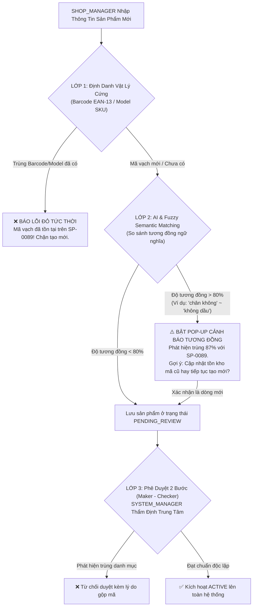
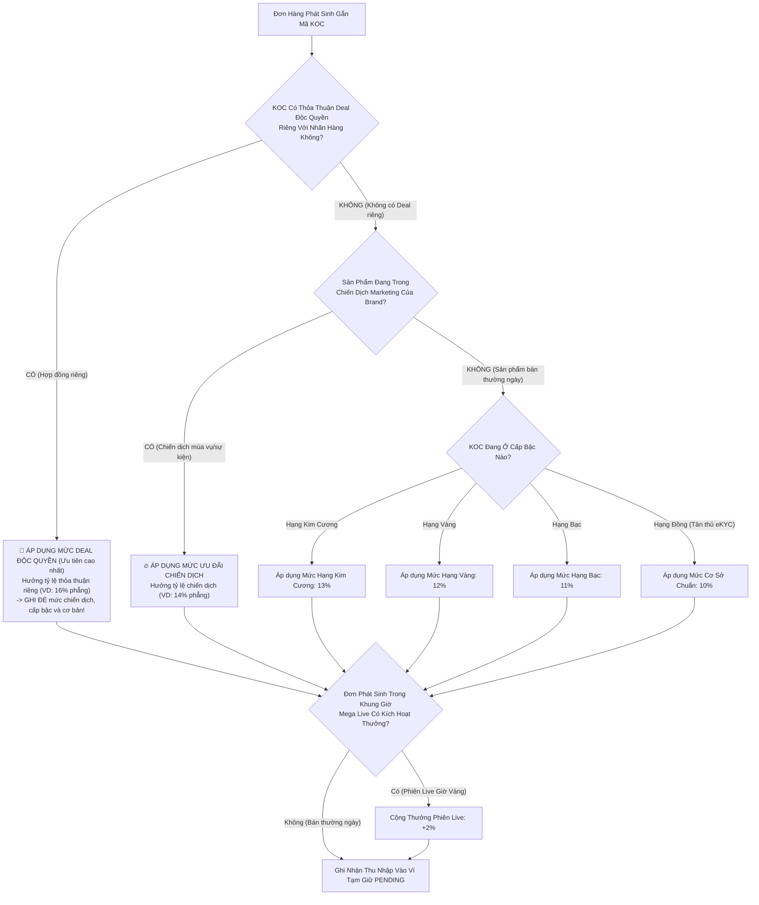
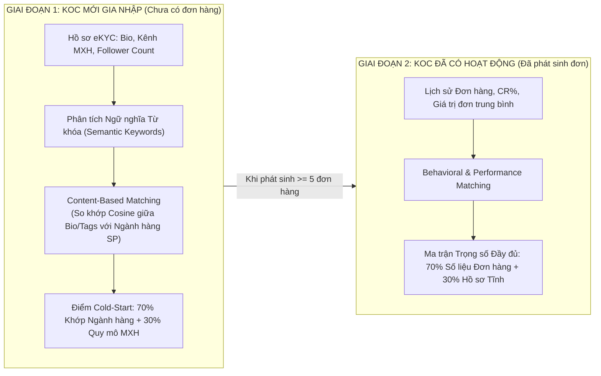

# CẨM NANG TOÀN DIỆN CẢI TỔ ĐỀ TÀI SCANMS
## TỪ BẢN CHẤT DOANH NGHIỆP, CHIẾN LƯỢC CỬA HÀNG, CƠ CHẾ THÙ LAO MỚI ĐẾN 5 MAIN FLOWS CHUẨN MỰC BẢO VỆ HỘI ĐỒNG

> [!IMPORTANT]
> **Định hướng chiến lược thống nhất từ Mentor (ThS. Tôn Thất Hoàng Minh):**  
> 1. **Bản chất hệ thống:** SCANMS là *Hệ thống Quản trị Đội ngũ Đối tác Tiếp thị & Đại sứ Bán hàng* của một **Doanh nghiệp Bán lẻ / D2C Đa Ngành sở hữu**, không phải cái chợ TMĐT tự do (Shopee/Lazada). "Shop là của mình, Cộng tác viên là bên ngoài".
> 2. **Vị trí của Phân hệ Livestream:** Livestream được định vị là **"Phân hệ Bổ trợ / Giá trị Gia tăng (Value-Added Bonus Feature)"** hỗ trợ KOC trong các sự kiện bán hàng giờ vàng (Mega Live), không bắt buộc đưa vào 5 Main Flows chính để giữ thời lượng demo tập trung và đúng trọng tâm quản trị B2B.
> 3. **Cơ chế Thù lao Mới (Quy tắc Ưu đãi Tốt nhất - Best-Benefit Precedence Rule):** Áp dụng **Thứ bậc Ưu tiên (Ghi đè - Override)** minh bạch cho từng đơn hàng $\max(\text{Deal VIP}, \text{Chiến dịch}, \text{Cấp bậc}, \text{Cơ bản 10\%})$, kết hợp thưởng phiên Live giờ vàng (+2%) và Thưởng cán mốc doanh số tháng (FR-09) độc lập cuối kỳ.
> 4. **Cấp bậc Khởi điểm:** KOC mới duyệt eKYC được xếp hạng **ĐỒNG (Bronze - 0% bonus)**, chỉ hưởng mức cơ bản 10%. Khi đạt mốc doanh số sạch mới thăng hạng Bạc (11%), Vàng (12%), Kim Cương (13%).

---

# PHẦN 1: BẢN CHẤT HỆ THỐNG & CHIẾN LƯỢC DANH MỤC CỬA HÀNG

### 1.1. Bản chất Doanh nghiệp sở hữu SCANMS
SCANMS không phải là sàn chợ trung gian. SCANMS là nền tảng công nghệ thuộc sở hữu của một **Tập đoàn Bán lẻ Đa Ngành / Doanh nghiệp D2C Đa Thương hiệu (House of Brands / Multi-Category Retail Conglomerate)** tương tự mô hình *Thế Giới Di Động (MWG - chia Thegioididong, Dienmayxanh, An Khang, AVAKids)* hoặc *Coolmate D2C (chia Coolmate, 84RISING, CM24)*.

### 1.2. Kịch bản 4 Cửa hàng (Store) Trực thuộc Hệ thống

| Nhãn hàng / Ngành hàng (`Store`) | Danh mục & Sản phẩm Chủ lực | Biên chiết khấu cơ sở KOC | Tệp KOC / CTV Tiếp thị Mục tiêu |
| :--- | :--- | :---: | :--- |
| **Store 1: Sora Skincare & Cosmetics**<br>*(Khối Mỹ phẩm & Chăm sóc da chuyên sâu)* | • Serum Vitamin C 15% Dưỡng Sáng Mờ Thâm (450.000₫)<br>• Kem Chống Nắng Phổ Rộng SPF50+ PA++++ (380.000₫)<br>• Nước Tẩy Trang Rau Má Centella Làm Dịu Da (220.000₫) | **10%**<br>*(Tập trung mua lại đều đặn)* | KOC Beauty, Skincare Reviewers, Dược mỹ phẩm Bloggers, KOC Makeup biến hình. |
| **Store 2: Aura Activewear & Lifestyle**<br>*(Khối Thời trang & Thể thao Đa năng)* | • Áo khoác dù chống nước thông hơi (350.000₫)<br>• Quần thể thao Jogger co giãn 4 chiều (280.000₫)<br>• Balo du lịch đa ngăn chống trộm (420.000₫) | **10%**<br>*(Dễ chốt đơn theo xu hướng)* | KOC Thời trang Gen Z, Vận động viên/Gymer, KOC nhảy nhót biến hình, Lifestyle Influencers. |
| **Store 3: GreenBio Health & Wellness**<br>*(Khối Dinh dưỡng & Sức khỏe Thiên nhiên)* | • Hạt Granola nướng mật ong hoa rừng (185.000₫)<br>• Trà thảo mộc thanh lọc giảm stress (260.000₫)<br>• Bột Collagen thủy phân vị đào (520.000₫) | **10%**<br>*(Biên lãi tốt, kích thích tư vấn sâu)* | KOC Dinh dưỡng Eat-clean, Huấn luyện viên Yoga/Pilates, Bác sĩ/Dược sĩ cộng đồng, Mẹ bỉm sữa. |
| **Store 4: Lumière Smart Living**<br>*(Khối Thiết bị Gia dụng & Đồ bếp Thông minh)* | • Nồi chiên không dầu điện tử 5.5L (1.450.000₫)<br>• Máy ép chậm trục xoắn công nghệ lạnh (1.890.000₫)<br>• Chảo chống dính vân đá đáy từ (390.000₫) | **10%**<br>*(Tập trung giá trị đơn hàng AOV cao)* | KOC Gia đình, Kênh review đồ bếp thông minh, Food Bloggers, Mẹ đảm đang nội trợ. |

### 1.3. Hàng hóa có được trùng lặp giữa các Cửa hàng không?
> **TUYỆT ĐỐI KHÔNG ĐƯỢC TRÙNG HÀNG!**
* **Nguyên nhân 1 - Chống tự ăn thịt lẫn nhau (Cannibalization):** Cùng 1 công ty mẹ, không thể để Store 1 và Store 2 cùng bán chung 1 mẫu Nồi chiên không dầu. Nếu trùng, hai Brand Manager sẽ tranh giành KOC và dìm giá lẫn nhau.
* **Nguyên nhân 2 - Khác biệt về Biên lợi nhuận & Chính sách chiến dịch:** Mỗi ngành hàng có biên lợi nhuận khác nhau, chính sách đãi ngộ khác nhau. Trùng hàng sẽ làm loạn thuật toán tính thù lao.

### 1.4. Cơ chế 3 Lớp Chống Trùng Hàng (Dù nhân viên nhập khác từ ngữ)
Nếu nhân viên quên sản phẩm đã có rồi tạo lại với tên khác (ví dụ: *"Nồi chiên không dầu Lock&Lock 5L"* vs *"Nồi chiên chân không Lock&Lock 5 lít"*):



---

### 1.5. Cơ Chế Khóa Ngành Hàng Cố Định Khi Thêm Sản Phẩm Mới (Category Lock Enforcement)
* **Bản chất nghiệp vụ:** Mỗi Cửa hàng trực thuộc hệ thống SCANMS đại diện cho một Đơn vị Kinh doanh / Nhãn hàng chuyên biệt. Do đó, sản phẩm của Cửa hàng bắt buộc phải gắn liền với **Ngành hàng độc quyền của Cửa hàng đó (`primaryCategory`)**.
* **Cơ chế Khóa tại Giao diện (`ProductManagementPage.tsx`):**
  * Khi `SHOP_MANAGER` tạo sản phẩm mới, ô nhập liệu "Ngành hàng / Danh mục" tự động gán theo ngành hàng của Store phụ trách và **bị khóa cứng (Disabled / Readonly)**.
  * Nhân sự quản lý không được phép chọn hay thay đổi sang danh mục khác.
* **Cơ chế Chặn tại Backend (`products.service.ts`):**
  * Backend tự động ép `categoryName = store.category`.
  * Nếu phát hiện payload gửi danh mục khác ngành hàng của Store, hệ thống lập tức ném lỗi `400 Bad Request: "Sản phẩm không thuộc ngành hàng được ủy quyền của gian hàng này"`.

---

### 1.6. Phân Tích, Đánh Giá & So Sánh Nghiệp Vụ Với Các Hệ Thống Lớn

| Nền tảng Quốc tế | Cơ chế Quản lý Ngành hàng | Phân tích Nghiệp vụ & Kỹ thuật | So sánh & Bài học Áp dụng cho SCANMS |
| :--- | :--- | :--- | :--- |
| **TikTok Shop (Seller Center)** | **Category Whitelisting & Qualification Matrix** | TikTok Shop áp dụng cơ chế kiểm soát danh mục rất nghiêm ngặt (*Restricted Categories*). Người bán đăng ký ngành hàng nào (ví dụ *Beauty & Personal Care*) thì chỉ được cấp quyền đăng sản phẩm trong đúng cây danh mục đó. Muốn bán thêm ngành hàng khác, shop phải nộp hồ sơ chứng nhận độc lập (*Category Qualification*) để được mở quyền. | **Cực kỳ tối ưu cho Affiliate Marketing:** TikTok hiểu sâu sắc rằng Nhà sáng tạo nội dung (Creator/KOC) nhận link và xin mẫu thử theo sở trường (Niche). Việc khóa ngành hàng giúp KOC Beauty không bao giờ gặp phải chảo chống dính hay áo quần trong kho sản phẩm của shop mỹ phẩm. SCANMS áp dụng trực tiếp cơ chế này. |
| **Shopee Mall & LazMall** | **Authorized Brand Category Bound** | Gian hàng chính hãng (Mall) chỉ được phép mở bán các SKU thuộc đúng thương hiệu và danh mục đã được cấp phép theo hợp đồng phân phối độc quyền. Sàn khóa chặt danh mục bằng thỏa thuận pháp lý B2B. | **Kiểm soát Chất lượng & Pháp lý:** Mỗi ngành hàng có điều kiện kiểm định y tế, tem nhãn phụ và chính sách đổi trả khác nhau (Mỹ phẩm cần bảo quản tem seal, thời trang cần chính sách đổi size). Khóa ngành hàng giúp SCANMS bảo vệ uy tín thương hiệu công ty và đồng nhất quy trình logistics. |
| **Amazon (Brand Registry)** | **Product Classifier & Single-Vertical Stores** | Amazon yêu cầu mỗi thương hiệu phải xác lập mã phân loại hàng hóa (*Product Classifier*). Các nhãn hàng D2C trên Amazon tạo *Brand Storefront* chuyên biệt cho từng dòng sản phẩm. | **Tối ưu Hóa AI Matching:** Amazon định vị khách hàng tìm sản phẩm theo nhãn hàng chuyên sâu. SCANMS học hỏi cách phân bổ để thuật toán AI gợi ý (FR-30) so khớp chuẩn xác KOC theo thế mạnh ngành hàng. |
| **Tập đoàn Bán lẻ Đa Thương hiệu (House of Brands - Masan, Vinamilk, Coolmate)** | **Single-Vertical Business Units** | Doanh nghiệp chia tách các Brand con thành từng đơn vị độc lập: Coolmate chuyên đồ nam, 84RISING chuyên đồ nữ, CM24 chuyên mỹ phẩm nam. Không bao giờ bán chung chạ lộn xộn. | **Chuẩn mực Bản sắc Đề tài:** SCANMS là nền tảng quản trị của một Doanh nghiệp Bán lẻ Đa Ngành. Mỗi Store đại diện cho 1 Nhãn hàng D2C chuyên biệt của tập đoàn. |

---

### 1.7. Quy Trình Khởi Tạo Cửa Hàng Mới & Nguyên Tắc Bất Biến 1 Role `SHOP_MANAGER`
1. **Khắc Phục Lỗ Hổng Cơ Sở Dữ Liệu:**
   * Bảng `stores` trước đây chỉ có 1 trường `owner_id`. Khi Admin bổ nhiệm Manager mới sẽ ghi đè và làm mất quyền của Manager cũ.
   * Giải pháp: Bổ sung liên kết `storeId` trên model `User` (`storeId String? @db.Uuid`).
   * Quyền quản trị Shop của `SHOP_MANAGER`: Kiểm tra `store.ownerId === user.id || user.storeId === store.id`.
2. **Nguyên Tắc Bất Biến 5 Roles (Không Sinh Thêm Role Phụ):**
   * Hệ thống tuân thủ nghiêm ngặt **5 Roles cốt lõi**: `CUSTOMER`, `COLLABORATOR`, `SHOP_MANAGER`, `SYSTEM_MANAGER`, `SYSTEM_ADMIN`.
   * **Nhiều nhân sự cùng quản trị 1 Store:** Cả 2 hoặc 3 nhân sự đều mang **cùng role là `SHOP_MANAGER`**, và đều có `storeId` trỏ về cùng một Store. Cả hai cùng điều hành toàn diện nghiệp vụ nhãn hàng mà **không cần tạo thêm bất kỳ role phụ nào**, giữ vững ma trận phân quyền đã chốt cho Review 2.
3. **Quy Trình Tạo Gian Hàng Mới Của Super Admin (`AdminStoresModal`):**
   * Super Admin vào giao diện Quản trị Cửa hàng, mở modal "+ Tạo Gian Hàng Mới":
     * Nhập Tên Shop & Mã định danh (`slug`).
     * Chọn **1 Ngành hàng cố định duy nhất** (`primaryCategory`).
     * Nhập **Địa chỉ Kho xuất hàng GHN (Pickup Warehouse)** gồm Tỉnh/Thành, Quận/Huyện, Phường/Xã để GHN đến lấy hàng.
     * Cấu hình hoa hồng cơ sở $10\%$ và chỉ định Shop Manager phụ trách đầu tiên.

---

### 1.8. Kế Hoạch Thay Thế Toàn Diện Bộ Seed Data Cũ Bằng Bộ Dữ Liệu MarTech / Affiliate Chuẩn Mực
1. **Đánh Giá Nhược Điểm Dữ Liệu Cũ:** Dữ liệu seed cũ có quá nhiều shop ảo không rõ bản sắc, sản phẩm thiếu tính liên kết tiếp thị, thiếu biến thể chuẩn và thiếu quy cách vận chuyển GHN.
2. **Bộ Seed Data Mới Tinh Gọn (4 Cửa Hàng Trực Thuộc Chuyên Sâu):**
   * 🏪 **Store 1: Sora Skincare & Cosmetics** (Ngành hàng: `Mỹ phẩm & Chăm sóc da chuyên sâu` | Kho mát GMP Thủ Đức) $\rightarrow$ Tệp KOC: Beauty & Skincare Reviewers.
   * 🏪 **Store 2: Aura Activewear & Apparel** (Ngành hàng: `Thời trang & May mặc thể thao năng động` | Kho may mặc Tân Bình) $\rightarrow$ Tệp KOC: Fashion TikTokers, Gymer.
   * 🏪 **Store 3: GreenBio Health & Nutrition** (Ngành hàng: `Dinh dưỡng, Thảo mộc & Sức khỏe thiên nhiên` | Kho dược liệu Tân Phú) $\rightarrow$ Tệp KOC: Eat-Clean, Yoga, Dược sĩ.
   * 🏪 **Store 4: Lumière Smart Living** (Ngành hàng: `Thiết bị gia dụng & Đồ bếp thông minh` | Kho tổng thiết bị KCN Tân Bình) $\rightarrow$ Tệp KOC: Food Bloggers, Mẹ đảm đang.
3. **Tiêu Chuẩn Sản Phẩm Affiliate:** Mỗi sản phẩm có đầy đủ 6 khối logic, barcode EAN-13, 2 tầng biến thể, quy cách đóng gói GHN, tài nguyên Media Hub (ảnh studio, video review) và chính sách cấp mẫu thử 14 ngày SLA.

---

### 1.9. Bảng Đối Chiếu Đa Chiều Toàn Diện: Cách Làm Cũ (Sàn Chợ Mở) vs Cách Làm Mới (Hệ Thống Doanh Nghiệp)

| STT | Khía Cạnh Nghiệp Vụ | **CÁCH LÀM CŨ (Mô hình Sàn Chợ Mở - Shopee Clone)** | **CÁCH LÀM MỚI (Mô hình Doanh Nghiệp In-House - MarTech SaaS)** | Nguyên Nhân Sâu Xa & Ảnh Hưởng Kỹ Thuật |
| :---: | :--- | :--- | :--- | :--- |
| **1** | **Đăng ký vai trò Shop** | Khách hàng vãng lai sau khi đăng nhập có thể truy cập `PartnerUpgradeTab.tsx`, chọn tab "Đăng ký Shop", nhập giấy phép kinh doanh cá nhân để tự tạo gian hàng. | **Loại bỏ 100% form đăng ký Shop công khai.** `SHOP_MANAGER` là nhân sự nội bộ, được `SYSTEM_ADMIN` cấp tài khoản và gán trực tiếp vào Store phụ trách qua trang `AdminPersonnelPage.tsx`. | Ngăn chặn triệt để tình trạng người ngoài tự ý tạo cửa hàng rác, bán hàng cạnh tranh với doanh nghiệp hoặc đưa hàng kém chất lượng vào hệ thống. |
| **2** | **Cấu trúc Kho bãi (Warehouse)** | Mỗi shop tự đăng ký một địa chỉ kho riêng lẻ như người bán tự do, sàn không quản lý điều kiện kho bãi. | Doanh nghiệp triển khai **Multi-Warehouse Fulfillment (Kho vệ tinh theo đặc thù ngành hàng)**: Kho mát thực phẩm/dược liệu, kho gia dụng cồng kềnh, kho thời trang may mặc. | Đáp ứng chuẩn mực bảo quản hàng hóa thực tế và tích hợp API GHN chuẩn xác (`from_district_id`, `from_ward_code`) để shipper lấy hàng đúng kho. |
| **3** | **Kiểm duyệt Sản phẩm (Product Moderation)** | Sàn kiểm duyệt shop ngoài đăng bán theo dạng "kiểm duyệt nội dung cộng đồng", dễ phát sinh tiêu cực hoặc chậm trễ. | Quy trình kiểm soát nội bộ chuẩn mực **Maker - Checker (Người tạo - Người duyệt pháp chế)**: Shop Manager nhập liệu $\rightarrow$ System Manager pháp chế kiểm tra tính pháp lý trước khi mở bán. | Đảm bảo 100% sản phẩm có giấy công bố y tế/mỹ phẩm hợp pháp, kiểm soát giá bán niêm yết và chống trùng lặp mã vạch EAN-13 giữa các ngành hàng. |
| **4** | **Dòng tiền Bán hàng (Cash Inflow)** | Tiền khách thanh toán bị giam ở tài khoản trung gian của sàn chợ. | Toàn bộ $100\%$ tiền thanh toán (VietQR, PayOS, COD shipper GHN) chảy thẳng vào **Tài Khoản Doanh Nghiệp Tập Trung (Corporate Master Account)**. | Doanh nghiệp chủ động nắm giữ dòng tiền kinh doanh tập trung, phục vụ hạch toán tài chính và luân chuyển vốn. |
| **5** | **Yêu cầu Rút tiền (Payout Outflow)** | Shop bán xong có số dư ví trên sàn và phải tạo lệnh gửi Admin sàn xin duyệt rút tiền về tài khoản ngân hàng của chủ shop. | **Shop Manager KHÔNG RÚT TIỀN**. Tiền bán hàng là của doanh nghiệp. **CHỈ CÓ KOC MỚI THỰC HIỆN LỆNH RÚT TIỀN (Payout)** để nhận hoa hồng tiếp thị sau 7 ngày Escrow (khấu trừ 10% thuế TNCN). | Tháo gỡ mâu thuẫn vô lý khi nhân sự công ty lại phải "làm đơn xin công ty cho rút tiền doanh thu". |
| **6** | **Báo cáo Tài chính của Shop** | Shop nhìn vào số dư ví cá nhân để rút tiền lẻ tẻ như một hộ kinh doanh cá thể. | Shop Manager xem **Báo Cáo Doanh Thu & Chi Phí Tiếp Thị (Store P&L & Commission Expenses)**: Doanh thu Net, Giá vốn (COGS), Chi phí hoa hồng KOC, Lợi nhuận đóng góp. | Cung cấp góc nhìn quản trị kinh doanh cho từng Brand Manager, giúp đánh giá hiệu quả chiến dịch tiếp thị liên kết (Affiliate ROI). |
| **7** | **Hệ thống Ví Người Dùng** | Hệ thống duy trì ví cho Khách hàng, ví cho KOC, và cả ví số dư cho từng Shop (`StoreWallet`). | **Chỉ duy trì 2 loại ví thực tế:**<br>1. Ví Khách Hàng (`Customer Wallet`): Nhận tiền hoàn khi đổi trả.<br>2. Ví KOC (`Collaborator Wallet`): Tích lũy hoa hồng bán hàng. | Đơn giản hóa cấu trúc cơ sở dữ liệu kế toán, loại bỏ các giao dịch ví ảo không có thật giữa nội bộ công ty với nhau. |
| **8** | **Quy trình Đổi trả / Hoàn tiền** | Khách hàng kiện Shop, Sàn đứng ra phân xử như Tòa án dân sự trung gian giữa 2 người ngoài xa lạ. | Quy trình **Chăm sóc Khách hàng (CSKH) nội bộ**: Khách khiếu nại $\rightarrow$ Thu hồi hàng về kho Store $\rightarrow$ Tự động **ĐÓNG BĂNG/HỦY HOA HỒNG KOC** trên đơn hàng bị trả. | Bảo vệ doanh nghiệp không bị thất thoát tiền hoa hồng khi khách hàng đã trả lại hàng và nhận tiền hoàn. |
| **9** | **Chính sách Hàng Mẫu (Samples)** | Shop tự phát hàng mẫu không theo dõi, KOC nhận mẫu xong không đăng bài cũng không bị xử lý. | Mẫu thử được hạch toán vào **Ngân sách Marketing thử nghiệm** của từng Store. KOC cam kết đăng video review trong 14 ngày. Vi phạm sẽ bị đưa vào **Blacklist toàn sàn**. | Tối ưu hóa chi phí hàng mẫu, nâng cao tỷ lệ chuyển đổi từ việc gửi mẫu sang doanh số bán hàng thực tế. |
| **10** | **Đàm phán Deal Độc quyền** | Thỏa thuận tự do giữa người bán ngoài và KOC, không có sự kiểm soát của chủ thương hiệu. | Là sự **phân bổ ngân sách hoa hồng chiến lược** giữa Trưởng nhãn hàng (`SHOP_MANAGER`) và Top KOC để đạt KPI doanh số lớn trong tháng. | Đảm bảo mức hoa hồng ưu đãi đặc biệt ($15\% - 18\%$) được cấp đúng người, đúng thời điểm và có cam kết doanh số rõ ràng. |
| **11** | **Động cơ Tính Thù lao (Commission)** | Cộng dồn vô lý 4-5 loại tỷ lệ hoa hồng (`Base 10% + Tier 3% + Deal 5% + Live 3% = 21%`), gây thủng biên lợi nhuận của doanh nghiệp. | Áp dụng **Quy Tắc Ưu Tiên Mức Cao Nhất (Best-Benefit Precedence Rule)**: $\max(\text{Deal}, \text{Campaign}, \text{Tier}, \text{Base}) + \text{Live Bonus}$. Thưởng tháng (FR-09) tính độc lập cuối kỳ. | Đảm bảo tính minh bạch, KOC luôn được hưởng mức quyền lợi cao nhất mà vẫn bảo vệ an toàn biên lợi nhuận tài chính của doanh nghiệp. |
| **12** | **Kiểm soát Gian lận Click (Anti-Fraud)** | Bỏ qua việc kiểm soát click ảo vì nghĩ rằng mô hình CPS chỉ tính tiền trên đơn hàng thành công. | Kích hoạt bộ lọc **Redis Sliding-Window Rate Limit** chống Click Flooding nhằm bảo vệ mẫu số tỷ lệ chuyển đổi $\text{CR\%}$ cho AI Smart Matcher và chống Cookie Stuffing. | Bảo vệ tính toàn vẹn của thuật toán AI xếp hạng đối tác và ngăn chặn bot làm nghẽn cơ sở dữ liệu PostgreSQL. |
| **13** | **Chính sách Tự Mua (Self-Referral)** | KOC tự tạo đơn hàng qua liên kết của chính mình để vừa dùng voucher giảm giá vừa nhận hoa hồng kép. | **Nghiêm cấm KOC tự mua qua link chính mình**: Hệ thống đối soát trùng `customerId`, SĐT, địa chỉ, tài khoản ngân hàng $\rightarrow$ Hủy $0\%$ hoa hồng; hướng KOC sang luồng Mượn Mẫu. | Ngăn chặn việc KOC trục lợi chính sách giá sỉ trá hình và bảo vệ tính công bằng của chương trình tiếp thị. |
| **14** | **Phân hệ Livestream** | Livestream được xem là phân hệ bắt buộc của mọi cửa hàng, gây loãng 5 Main Flows bảo vệ tốt nghiệp. | Định vị Livestream là **"Tính Năng Giá Trị Gia Tăng (Bonus / Value-Added Feature)"** phục vụ các phiên Mega Live giờ vàng của doanh nghiệp. | Giữ nguyên vẹn toàn bộ mã nguồn WebRTC/Socket.IO nhưng tập trung trọng tâm bảo vệ vào năng lực quản trị Affiliate MarTech. |

---

### 1.10. Tháo Gỡ 2 Nút Thắt Trọng Yếu: Kho Bãi/Duyệt Sản Phẩm & Dòng Tiền Tài Chính

#### A. Nút Thắt 1: Quản Lý Kho Bãi & Kiểm Duyệt Sản Phẩm Đa Ngành Hàng
1. **Multi-Warehouse Logistics (4 Kho Bãi Phân Loại Theo Đặc Thù Ngành Hàng):**
   * `Sora Skincare & Cosmetics`: Kho Mát Mỹ Phẩm GMP, Khu Công Nghệ Cao, TP.Thủ Đức (`from_district_id: 1442`, `from_ward_code: 20109`). Nhiệt độ mát < 25°C, chống ánh nắng trực tiếp.
   * `Aura Activewear & Apparel`: Kho May Mặc Thời Trang, 128/4 Hoàng Hoa Thám, P.12, Tân Bình, TP.HCM (`from_district_id: 1444`, `from_ward_code: 20708`). Giá treo chống ẩm, túi niêm phong PE.
   * `GreenBio Health & Nutrition`: Kho Dược Liệu & Thực Phẩm Sức Khỏe, Tân Phú, TP.HCM (`from_district_id: 1452`, `from_ward_code: 21011`). Kiểm soát độ ẩm nghiêm ngặt, dán tem chống hàng giả.
   * `Lumière Smart Living`: Kho Tổng Thiết Bị & Đồ Bếp, Lô B4 KCN Tân Bình, Tây Thạnh, Tân Phú, TP.HCM (`from_district_id: 1452`, `from_ward_code: 21011`). Pallet chịu tải nặng, bốc xếp hàng cồng kềnh (Nồi chiên 5.5L, máy ép chậm).
   * *Tích hợp GHN:* Tự động truyền địa chỉ kho xuất phát điểm tương ứng theo Store của sản phẩm khi khách đặt hàng để GHN tính cước chính xác.
2. **Quy trình Maker - Checker:** Shop Manager (`Maker`) nhập liệu form 6 khối chuẩn TMĐT (Thông tin cơ bản bị khóa theo ngành hàng Store, Media, Ma trận biến thể 2 tầng, Đóng gói vận chuyển, Chính sách KOL 10% & Suất mẫu, Pháp lý) $\rightarrow$ System Manager (`Checker / Compliance Lead`) thẩm định 3 tiêu chí cốt lõi:
   * Giấy công bố y tế/mỹ phẩm/thực phẩm hợp pháp.
   * Trần hoa hồng KOC ($10\%$ Base + Suất mẫu) đúng ngân sách tài chính.
   * Mã vạch EAN-13 không trùng lặp danh mục khác trong tập đoàn.

#### B. Nút Thắt 2: Dòng Tiền Tập Trung & Tại Sao Shop Không Rút Tiền?
1. **Tài khoản Doanh nghiệp tập trung:** Toàn bộ $100\%$ tiền mua hàng của khách (VietQR / PayOS / COD) chảy trực tiếp về **Tài khoản Doanh nghiệp SCANMS (Corporate Master Account)**.
2. **Shop Manager KHÔNG RÚT TIỀN:** Shop Manager là nhân sự nội bộ công ty (hưởng lương/KPI), không phải người bán tự do. Do đó, loại bỏ hoàn toàn tính năng Shop rút tiền và tab rút tiền Shop. Thay vào đó, Shop Manager theo dõi **Báo Cáo Doanh Thu & Chi Phí Tiếp Thị (Store P&L & Commission Expenses)**:
   $$\text{Doanh Thu Thuần} = \text{Tổng Doanh Số} - \text{Hàng Đổi Trả}$$
   $$\text{Lợi Nhuận Đóng Góp Store} = \text{Doanh Thu Thuần} - \text{Giá Vốn (COGS)} - \text{Hoa Hồng KOC} - \text{Chi Phí Hàng Mẫu}$$
3. **CHỈ CÓ KOC MỚI RÚT TIỀN (Payout):** Tiền hoa hồng phát sinh từ đơn hàng thành công nằm trong Ví KOC ở trạng thái Escrow 7 ngày (tránh rủi ro đổi trả). Hết 7 ngày, KOC bấm Payout về ngân hàng cá nhân; Admin duyệt chi và tự động **khấu trừ 10% Thuế TNCN**.
4. **Hệ thống chỉ còn 2 loại Ví thực tế:** Ví Khách Hàng (nhận tiền hoàn đổi trả) và Ví KOC (tích lũy hoa hồng).

---

### 1.11. Các Nghiệp Vụ Chuyển Đổi Khác
* **Quy trình Đổi trả:** Là nghiệp vụ CSKH nội bộ; thu hồi sản phẩm về kho Store $\rightarrow$ Tự động **ĐÓNG BĂNG/HỦY HOA HỒNG KOC** trên đơn bị trả để tránh thất thoát ngân sách.
* **Ngân sách Hàng mẫu (Sample Requests):** Tính vào chi phí Marketing thử nghiệm của Brand; KOC cam kết 14 ngày đăng video review; vi phạm bị đưa vào **Blacklist toàn sàn**.
* **Đàm phán Deal Độc quyền:** Thỏa thuận nội bộ giữa Trưởng nhãn hàng và Top KOC để tối ưu KPI doanh số.
* **Tái cấu trúc UI Cổng Đăng Ký KOC (`PartnerUpgradeTab.tsx`):** Bỏ tab Shop; áp dụng **60/40 Split Layout** (Trái: Form eKYC 3 bước; Phải: Thẻ Đặc Quyền Đối Tác & Timeline 24h) với bảng màu Warm Sand & Brand Gold `#FAF8F5`, `#F3EFE6`, `#C59B58`, đảm bảo UI không xấu và không bị trống.
* **Tạo Shop Manager tại Admin Console:** Bổ sung trang `AdminPersonnelPage.tsx` tại `/admin/personnel` cho `SYSTEM_ADMIN` tạo nhân sự nội bộ và phân bổ Store phụ trách qua API `POST /api/v1/users/internal-staff`.

---

# PHẦN 2: CƠ CHẾ THÙ LAO MỚI CHUẨN DOANH NGHIỆP
*(Quy tắc Mức Ưu Đãi Tốt Nhất – Minh Bạch & Kiểm Soát Ngân Sách)*

### 2.1. Bản chất: Quy tắc Mức Ưu Đãi Tốt Nhất (Best-Benefit Precedence Rule)
Hệ thống áp dụng **Quy tắc Ghi đè theo Thứ bậc Ưu tiên (Override Hierarchy)**:

$$\text{Tỷ lệ Chiết khấu Đơn hàng} = \max\Big(\text{Deal Độc quyền VIP},\; \text{Ưu đãi Chiến dịch},\; \text{Mức Theo Cấp bậc},\; \text{Mức Cơ bản 10\%}\Big) + \text{Thưởng Phiên Live (Nếu có)}$$



### 2.2. Chi tiết 4 Mức Thù Lao Chính & 2 Khoản Thưởng Bổ Trợ

1. **Mức 1: Chiết khấu Cơ sở (Standard Base Rate - Cố định 10%)**
   * Dành cho KOC mới tham gia (Hạng Đồng). Hưởng đúng tỷ lệ chuẩn của nhãn hàng.
2. **Mức 2: Chiết khấu Theo Cấp bậc Năng lực (Performance Tier Rates)**
   * Dành cho KOC gắn bó lâu dài, thăng hạng tự động khi đạt doanh số tích lũy:
     * **Hạng Đồng (Bronze):** Khởi điểm khi vừa duyệt eKYC $\rightarrow$ **10%** (0% bonus).
     * **Hạng Bạc (Silver):** Doanh số tích lũy $\ge 20$ triệu $\rightarrow$ **11%**.
     * **Hạng Vàng (Gold):** Doanh số tích lũy $\ge 50$ triệu $\rightarrow$ **12%**.
     * **Hạng Kim Cương (Diamond):** Doanh số tích lũy $\ge 100$ triệu $\rightarrow$ **13%**.
3. **Mức 3: Mức Ưu Đãi Chiến Dịch (Campaign Promotion Rate - Ví dụ: 14%)**
   * Khi Nhãn hàng tung Chiến dịch tiếp thị mùa vụ (VD: *Chiến dịch Mua sắm Mùa Hè*), toàn bộ CTV tham gia quảng bá nhóm sản phẩm trong chiến dịch đều được hưởng mức ưu đãi (14%), bất kể đang ở hạng Đồng hay Bạc.
4. **Mức 4: Thỏa thuận Hợp đồng Độc quyền (Exclusive Deal Override - Ví dụ: 16% - Ưu tiên cao nhất)**
   * Ký hợp đồng KPI riêng giữa Giám đốc Nhãn hàng và Top KOC qua Chat Socket.IO (cam kết doanh số, trả bài review). Khi đã ký Deal riêng $\rightarrow$ **Hợp đồng Deal ghi đè toàn bộ các mức trên**.
5. **Khoản Thưởng Phiên Live Bổ Trợ (Live Event Accelerator - Bonus +2%):**
   * Trong các phiên bán hàng giờ vàng (Mega Live), đơn hàng phát sinh trong phiên Live được cộng thêm **+2%** như một khoản thưởng thúc đẩy doanh số tức thời.
6. **Khoản Thưởng Cán Mốc Doanh Số Chu Kỳ (Monthly Milestone Bonus - FR-09):**
   * Không tính vào % từng đơn hàng. Đây là **khoản thưởng định kỳ độc lập (Kickback Incentive)** được hệ thống tự động quét và kết chuyển thêm vào Ví KOC vào ngày cuối cùng của tháng nếu đạt mốc doanh số sạch (VD: Đạt 50 triệu thưởng thêm 1.000.000₫ hoặc 2% kickback).

---

# PHẦN 3: 5 MAIN FLOWS LIÊN HOÀN ĐA VAI TRÒ CHUẨN MỰC HỆ THỐNG DOANH NGHIỆP
*(Kịch bản Vận hành Thực chiến 5 Giai đoạn dành cho Hội đồng Chấm thi: 4 Trình duyệt Song song – 5 Roles Phối hợp Nhịp nhàng)*

---

### 3.0. Chiến Lược Tổ Chức Demo Thực Chiến Trước Hội Đồng (Live Multi-Role Choreography)
Để thể hiện trọn vẹn sức mạnh của một nền tảng MarTech phân quyền chuyên sâu, buổi demo bảo vệ tốt nghiệp (thời lượng 40–50 phút) cần được tổ chức bằng **4 Profile Trình duyệt ẩn danh mở song song** để chứng minh các tương tác thời gian thực:
* 🖥️ **Tab 1: Quản Trị Trung Ương (`SYSTEM_ADMIN` & `SYSTEM_MANAGER`)** — Bổ nhiệm nhân sự, duyệt eKYC, thẩm định sản phẩm Maker-Checker, duyệt chi trả tài chính và giám sát AI Fraud Sentinel.
* 🖥️ **Tab 2: Giám Đốc Nhãn Hàng (`SHOP_MANAGER` - Ví dụ: *Sora Skincare*)** — Nhập sản phẩm khóa ngành hàng, tìm KOC bằng AI Matchmaker, đàm phán deal VIP qua Chat Socket.IO, duyệt xuất kho mẫu thử GHN 0đ.
* 🖥️ **Tab 3: Nhà Sáng Tạo Nội Dung (`COLLABORATOR` - Ví dụ: *Thảo Nhi Beauty*)** — Nộp eKYC, nhận deal VIP, mượn mẫu thử SLA 14 ngày, nộp link video nghiệm thu, sinh Smart Link/QR và rút tiền hoa hồng.
* 🖥️ **Tab 4: Người Mua Hàng (`CUSTOMER`)** — Bấm link tiếp thị, quét Dynamic QR, thanh toán VietQR/PayOS, theo dõi hành trình đơn hàng GHN.

---

## 🔹 MAIN FLOW 1: Khởi Tạo Nhãn Hàng, Tuyển Mộ Đối Tác, Thẩm Định eKYC & Phân Cấp Bậc Hạng ĐỒNG
*(Store Setup, Creator Onboarding, eKYC Verification & Initial Tier Assignment)*

* **Thời lượng demo chuẩn:** 8 – 10 phút.
* **Các Role & Màn hình tham gia:**
  * `SYSTEM_ADMIN`: Trang Quản trị Nhân sự & Gian hàng ([`/admin/personnel`](file:///c:/HW/CAPSTONE/frontend/src/pages/admin/AdminPersonnelPage.tsx)).
  * `CUSTOMER`: Cổng Đăng ký Đối tác Sáng tạo ([`/customer/portal`](file:///c:/HW/CAPSTONE/frontend/src/pages/customer/PartnerUpgradeTab.tsx)).
  * `SYSTEM_MANAGER`: Trung tâm Thẩm định eKYC ([`/admin/kyc`](file:///c:/HW/CAPSTONE/frontend/src/pages/admin/KycApprovalPage.tsx)).
  * `COLLABORATOR`: Bảng điều khiển Đối tác ([`/collaborator/dashboard`](file:///c:/HW/CAPSTONE/frontend/src/pages/collaborator/KolDashboardPage.tsx)).

```
┌─────────────────┐       ┌─────────────────┐       ┌─────────────────┐       ┌─────────────────┐
│  SYSTEM_ADMIN   │       │    CUSTOMER     │       │ SYSTEM_MANAGER  │       │  COLLABORATOR   │
│ (Quản trị Viên) │       │ (Khách Mua Hàng)│       │ (Chuyên Viên)   │       │ (KOC Tiếp Thị)  │
└────────┬────────┘       └────────┬────────┘       └────────┬────────┘       └────────┬────────┘
         │                         │                         │                         │
         │ 1. Tạo Store & Kho GHN  │                         │                         │
         │    Bổ nhiệm Manager     │                         │                         │
         │────────────────────────>│                         │                         │
         │                         │ 2. Đăng ký & Nộp eKYC   │                         │
         │                         │    (CCCD, STK, TikTok)  │                         │
         │                         │────────────────────────>│                         │
         │                         │                         │ 3. Soi chiếu CCCD/STK   │
         │                         │                         │    Bấm Phê Duyệt        │
         │                         │                         │────────────────────────>│
         │                         │                         │                         │ 4. Nhận Hạng ĐỒNG
         │                         │                         │                         │    Mở khóa Media Hub
```

### 1. Kịch Bản Thao Tác Chi Tiết Từng Bước (Live Action Walkthrough)
* **Bước 1.1 (`SYSTEM_ADMIN` - Tab 1):**
  * Đăng nhập tài khoản Super Admin, điều hướng vào trang Quản lý Nhân sự ([`/admin/personnel`](file:///c:/HW/CAPSTONE/frontend/src/pages/admin/AdminPersonnelPage.tsx)).
  * Bấm nút vàng **"+ Bổ nhiệm nhân sự mới"** để mở modal `AppointStaffModal`.
  * Nhập thông tin nhân sự: Họ tên *Trần Quản Lý*, Email `brand.sora@scanms.vn`, SĐT `0901234567`, Mật khẩu `MatKhau123@`.
  * Chọn vai trò `SHOP_MANAGER` và chọn Cửa hàng phụ trách: **Sora Skincare & Cosmetics** (đã được cấu hình kho mát GMP Thủ Đức `district_id: 1442`). Bấm **"Xác nhận bổ nhiệm"**.
  * *Hệ thống:* Gọi API `POST /api/v1/users/internal-staff`, lưu tài khoản với role `SHOP_MANAGER` và gán `storeId`.
* **Bước 1.2 (`CUSTOMER` - Tab 2):**
  * Người dùng vãng lai vào trang chủ, bấm Đăng ký tài khoản (`/register`), điền `thaonhi.beauty@gmail.com`, xác thực OTP.
  * Sau khi đăng nhập, truy cập Cổng Đối tác Tiếp thị ([`/customer/portal`](file:///c:/HW/CAPSTONE/frontend/src/pages/customer/PartnerUpgradeTab.tsx)).
  * **Điểm nhấn bảo vệ:** Cho Hội đồng thấy bố cục chia đôi **60/40 Executive Terms Layout** (Bên trái: Form eKYC 3 bước; Bên phải: Thẻ Đặc Quyền Đối Tác & Cam kết phê duyệt 24h).
  * **Bước eKYC 1:** Điền kênh mạng xã hội chính: Chọn nền tảng `TIKTOK`, Handle `@thaonhi.beauty`, Số người theo dõi `50,000`, Ngành hàng thế mạnh `Mỹ phẩm & Chăm sóc da`.
  * **Bước eKYC 2:** Nhập số CCCD `079199001234`, tải lên ảnh 2 mặt CCCD rõ nét.
  * **Bước eKYC 3:** Chọn ngân hàng thụ hưởng `MB Bank`, nhập STK `0987654321`, Tên chủ thẻ `NGUYEN THI THAO NHI`.
  * Bấm nút vàng **"Gửi hồ sơ thẩm định"** (`POST /api/v1/kyc/apply-kol`). Trạng thái chuyển sang `PENDING_VERIFICATION`, các tính năng tạo link tiếp thị và rút tiền bị khóa an toàn.
* **Bước 1.3 (`SYSTEM_MANAGER` - Tab 1):**
  * Chuyên viên pháp chế đăng nhập, vào Trung tâm Phê duyệt eKYC ([`/admin/kyc`](file:///c:/HW/CAPSTONE/frontend/src/pages/admin/KycApprovalPage.tsx)).
  * Thấy hồ sơ KOC Nguyễn Thị Thảo Nhi vừa nộp ở đầu bảng.
  * Bấm nút **"Xem hồ sơ"** mở modal thẩm định: Kiểm tra ảnh CCCD thật, đối chiếu họ tên CCCD khớp từng ký tự với tên chủ thẻ ngân hàng MB Bank.
  * Nhập nhận xét: *"Hồ sơ định danh đầy đủ, kênh TikTok đúng đối tượng mỹ phẩm"* $\rightarrow$ Bấm nút xanh **"Phê duyệt đối tác (`VERIFIED`)"** (`PATCH /api/v1/kyc/review-kol/:id`).
* **Bước 1.4 (`COLLABORATOR` - Tab 2):**
  * KOC Thảo Nhi F5 tải lại trang. Hệ thống tự động chuyển hướng vào **Bảng Điều Khiển KOC (`/collaborator/dashboard`)**.
  * **Minh chứng Database:**
    * Cấp bậc khởi điểm tự động hiển thị: **Hạng ĐỒNG (Bronze - 0% Bonus)**, hoa hồng cơ bản sàn $10\%$.
    * Mã tiếp thị cá nhân được sinh tự động: `thaonhi10`.
    * Ví KOC (`Wallet`) khởi tạo với số dư 0đ.
    * Mở khóa menu Kho Tài nguyên Số (`Media Hub`) và Bộ công cụ tiếp thị.

### 2. Điểm Nhấn Phản Biện Kỹ Thuật Trước Hội Đồng
* **Chống giả mạo nhân sự:** Không cho phép người dùng tự phong `SHOP_MANAGER` hay tự mở shop ngoài; chỉ có `SYSTEM_ADMIN` cấp tài khoản nội bộ.
* **Tuân thủ Ngân hàng & Thuế:** Đối soát tên tài khoản ngân hàng khớp 100% với CCCD để đảm bảo khi KOC rút tiền ở Flow 5, hệ thống khấu trừ $10\%$ thuế TNCN chính xác về mặt định danh pháp lý.
* **Cấp bậc chuẩn mực:** KOC mới bắt buộc bắt đầu từ **Hạng Đồng (Bronze)**, không được vượt cấp lên Bạc hay Vàng khi chưa phát sinh doanh số thực tế.

---

## 🔹 MAIN FLOW 2: Khóa Ngành Hàng Sản Phẩm, Động Cơ AI Đối Sánh KOC & Khai Thác Media Hub
*(Store-Category Lock Enforcement, AI Product-Creator Matching & Media Hub Assets)*

* **Thời lượng demo chuẩn:** 8 – 10 phút.
* **Các Role & Màn hình tham gia:**
  * `SHOP_MANAGER`: Quản lý Sản phẩm ([`/merchant/products`](file:///c:/HW/CAPSTONE/frontend/src/pages/merchant/ProductManagementPage.tsx)) & Trung tâm KOC ([`/merchant/kols`](file:///c:/HW/CAPSTONE/frontend/src/pages/merchant/ShopKolHubPage.tsx)).
  * `SYSTEM_MANAGER`: Kiểm duyệt Sản phẩm Maker-Checker ([`/admin/products/moderation`](file:///c:/HW/CAPSTONE/frontend/src/pages/admin/ProductReviewModal.tsx)).
  * `COLLABORATOR`: Kho Tài nguyên Đa phương tiện ([`/collaborator/media-hub`](file:///c:/HW/CAPSTONE/frontend/src/pages/collaborator/MediaResourceHubPage.tsx)).

```
┌─────────────────┐       ┌─────────────────┐       ┌─────────────────┐       ┌─────────────────┐
│  SHOP_MANAGER   │       │ SYSTEM_MANAGER  │       │  AI MATCHMAKER  │       │  COLLABORATOR   │
│ (Brand Manager) │       │ (Pháp Chế Sàn)  │       │ (Động Cơ AI)    │       │ (KOC Tiếp Thị)  │
└────────┬────────┘       └────────┬────────┘       └────────┬────────┘       └────────┬────────┘
         │                         │                         │                         │
         │ 1. Tạo SP 6 khối        │                         │                         │
         │    (Khóa Cứng Category) │                         │                         │
         │────────────────────────>│                         │                         │
         │                         │ 2. Duyệt ACTIVE         │                         │
         │                         │    (Maker-Checker)      │                         │
         │<────────────────────────│                         │                         │
         │                         │                         │                         │
         │ 3. Chọn SP cần đẩy số   │                         │                         │
         │    Bấm "AI Matchmaker"  │                         │                         │
         │──────────────────────────────────────────────────>│                         │
         │                         │                         │ 4. Quét 4 Trục Radar    │
         │                         │                         │    Trả về Top 94%       │
         │<──────────────────────────────────────────────────│                         │
         │                         │                         │                         │
         │ 5. Đăng tải Banner HD,  │                         │                         │
         │    Video mẫu review     │                         │                         │
         │────────────────────────────────────────────────────────────────────────────>│
         │                         │                         │                         │ 6. Tải Media HD
         │                         │                         │                         │    về dựng video
```

### 1. Kịch Bản Thao Tác Chi Tiết Từng Bước (Live Action Walkthrough)
* **Bước 2.1 (`SHOP_MANAGER` - Tab 1):**
  * Giám đốc nhãn hàng Sora Skincare đăng nhập vào phân hệ quản trị (`/merchant/products`), bấm nút **"+ Thêm sản phẩm mới"**.
  * **Điểm bảo vệ đắt giá:** Chỉ cho Hội đồng thấy ô **"Ngành hàng / Danh mục" đã tự động điền 'Mỹ phẩm & Chăm sóc da' và bị KHÓA CỨNG (Readonly)**. Shop Manager không thể tự ý chuyển sang bán quần áo hay nồi chiên.
  * Điền tuần tự 6 khối chuẩn:
    * *Khối 1 (Định danh):* Tên `Serum Vitamin C 15% Dưỡng Sáng Mờ Thâm`, SKU cha `SORA-SR-VTC`.
    * *Khối 2 (Media):* Upload ảnh bìa tỷ lệ 1:1, ảnh chi tiết góc chụp studio.
    * *Khối 3 (Ma trận biến thể 2 tầng):* Tạo biến thể theo Dung tích: Lọ `30ml` (Giá 450.000₫, Tồn kho 200) và Lọ `50ml` (Giá 680.000₫, Tồn kho 150). Hệ thống tự sinh SKU con `SORA-VTC-30ML` và tính tổng tồn kho 350.
    * *Khối 4 (Vận chuyển GHN):* Cân nặng đóng gói `350g`, kích thước `15 x 8 x 8 cm`.
    * *Khối 5 (Chính sách KOC):* Tỷ lệ hoa hồng sàn chuẩn $10\%$, tích chọn **"Mở nhận mượn mẫu thử (Sample Enabled)"**, cấp tối đa `15` suất mẫu thử.
    * *Khối 6 (Pháp lý):* Nhập Số công bố mỹ phẩm `1234/24/CBMP-HCM`, mã vạch EAN-13 `8938500123456`.
  * Bấm nút **"Gửi hồ sơ kiểm duyệt"** (`POST /api/v1/products`). Trạng thái sản phẩm lưu: `PENDING_REVIEW`.
* **Bước 2.2 (`SYSTEM_MANAGER` - Tab 1):**
  * Chuyên viên vận hành mở trang Kiểm duyệt sản phẩm Maker-Checker.
  * Xem xét số công bố y tế và đối chiếu mã vạch EAN-13 không trùng danh mục khác.
  * Bấm nút **"Phê duyệt phát hành (`ACTIVE`)"** (`PATCH /api/v1/products/:id/moderation`). Sản phẩm chính thức xuất hiện trên sàn.
* **Bước 2.3 (`SHOP_MANAGER` - Tab 1 - Khớp nối KOC bằng AI):**
  * Vào Trung tâm Đối tác KOC ([`/merchant/kols`](file:///c:/HW/CAPSTONE/frontend/src/pages/merchant/ShopKolHubPage.tsx)).
  * Chọn sản phẩm `Serum Vitamin C 15%`, bấm nút xanh **"Phân tích & Tìm KOC phù hợp bằng AI"** (`GET /api/v1/ai/recommend/kols?productId=...`).
  * Động cơ AI quét danh sách KOC, tính ma trận trọng số 4 chiều và trả về:
    * KOC Nguyễn Thị Thảo Nhi đạt **$94\%$ Tương thích (Top Match)**.
    * **Biểu đồ Radar 4 Trục:** Ngành hàng (100%), Giá trị đơn AOV (92%), Tệp khán giả TikTok (95%), Điểm uy tín (90%).
    * **Đoạn văn giải trình AI (*Explainable AI*):** *"Thảo Nhi chuyên review mỹ phẩm dưỡng sáng da, tệp fan nữ 18-28 tuổi, giá đơn trung bình 400.000₫ - 550.000₫ hoàn toàn trùng khớp với mức giá 450.000₫ của Serum"*.
* **Bước 2.4 (`COLLABORATOR` - Tab 2 - Khai thác Media Hub):**
  * Thảo Nhi mở Kho Tài nguyên Số ([`/collaborator/media-hub`](file:///c:/HW/CAPSTONE/frontend/src/pages/collaborator/MediaResourceHubPage.tsx)).
  * Thấy bộ tài nguyên do Sora Skincare đăng tải: Banner quảng cáo chuẩn Story/Reels, File vector thành phần hoạt tính, Clip quay cận cảnh giọt serum thấm vào da.
  * Bấm **"Tải bộ tài nguyên HD"** về máy để chuẩn bị làm video review.

---

## 🔹 MAIN FLOW 3: Thiết Lập Chiến Dịch, Đàm Phán Hợp Đồng VIP Qua Chat Realtime & Tài Trợ Hàng Mẫu SLA 14 Ngày
*(Campaign Setup, VIP Deal Negotiation via WebSocket & Sample Sponsorship SLA)*

* **Thời lượng demo chuẩn:** 10 – 12 phút.
* **Các Role & Màn hình tham gia:**
  * `SHOP_MANAGER` & `COLLABORATOR`: Khung Chat Trực tuyến Realtime ([`/chat`](file:///c:/HW/CAPSTONE/frontend/src/pages/chat/ChatBoxPage.tsx)).
  * `COLLABORATOR`: Quản lý Hàng Mẫu Đối Tác ([`/collaborator/samples`](file:///c:/HW/CAPSTONE/frontend/src/pages/collaborator/CollaboratorSamplesPage.tsx)).
  * `SHOP_MANAGER`: Quản lý Cấp Mẫu Nhãn Hàng ([`/merchant/samples`](file:///c:/HW/CAPSTONE/frontend/src/pages/merchant/SamplesManagementPage.tsx)).

```
┌─────────────────────────┐                               ┌─────────────────────────┐
│      SHOP_MANAGER       │                               │      COLLABORATOR       │
│ (Trưởng Nhãn Hàng Sora) │                               │  (KOC Thảo Nhi Beauty)  │
└────────────┬────────────┘                               └────────────┬────────────┘
             │                                                         │
             │ 1. Mở Chat Socket.IO, gửi Thẻ Mời Deal Độc Quyền VIP    │
             │    (Hoa hồng riêng 16%, cam kết KPI 30 triệu doanh số)  │
             │────────────────────────────────────────────────────────>│
             │                                                         │ 2. Nhận thiệp realtime
             │                                                         │    Bấm "Ký Chấp Thuận"
             │<────────────────────────────────────────────────────────│
             │                                                         │ 3. Deal ACTIVE, sinh
             │                                                         │    mã coupon THAONHI16
             │                                                         │
             │                                                         │ 4. Đăng ký mượn mẫu
             │                                                         │    thử Serum 0đ
             │<────────────────────────────────────────────────────────│
             │ 5. Duyệt cấp mẫu & Tạo vận đơn GHN                      │
             │    xuất từ Kho Mát GMP Thủ Đức                          │
             │────────────────────────────────────────────────────────>│
             │                                                         │ 6. GHN giao hàng
             │                                                         │    Đồng hồ SLA 14 ngày
             │                                                         │    đếm ngược kích hoạt
             │                                                         │
             │                                                         │ 7. Đăng clip TikTok,
             │                                                         │    nộp link nghiệm thu
             │<────────────────────────────────────────────────────────│
             │ 8. Xem video review, bấm "Nghiệm Thu COMPLETED"         │
             │    (Cộng điểm uy tín, hoàn tất cam kết SLA)             │
             │────────────────────────────────────────────────────────>│
```

### 1. Kịch Bản Thao Tác Chi Tiết Từng Bước (Live Action Walkthrough)
* **Bước 3.1 (`SHOP_MANAGER` & `COLLABORATOR` - Chat Socket.IO Realtime):**
  * Cả 2 mở trang Chat ([`/chat`](file:///c:/HW/CAPSTONE/frontend/src/pages/chat/ChatBoxPage.tsx)) trên 2 cửa sổ cạnh nhau.
  * Shop Manager bấm nút **"Mời Chiến dịch Độc quyền"** (`InviteDealModal`):
    * Chọn sản phẩm `Serum Vitamin C 15%`.
    * Cấu hình mức hoa hồng VIP: **$16\%$** (thay vì mức sàn 10%).
    * Đặt cam kết: Doanh số tối thiểu 30 triệu, thời hạn hợp đồng 30 ngày, cam kết trả 1 video review.
    * Bấm **"Gửi Thẻ Đề Xuất Hợp Tác"** (`POST /api/v1/exclusive-deals/propose`).
* **Bước 3.2 (`COLLABORATOR` - Ký hợp đồng trong khung chat):**
  * Khung chat của Thảo Nhi lập tức hiển thị một **Thẻ Đề Xuất Hợp Tác Sang Trọng (Rich Deal Card)** với đầy đủ điều khoản và nút bấm tương tác realtime không cần F5 (nhờ WebSocket Gateway).
  * Thảo Nhi đọc điều khoản và bấm nút xanh **"Ký Chấp Thuận Deal"** (`PATCH /api/v1/exclusive-deals/:id/respond`).
  * Trạng thái Deal chuyển thành `ACTIVE`. Hệ thống tự động kích hoạt mã giảm giá độc quyền riêng của KOC: `THAONHI16` (giảm 10% cho khách mua, hoa hồng cho KOC là 16%).
* **Bước 3.3 (`COLLABORATOR` - Đăng ký mượn mẫu thử):**
  * Thảo Nhi vào menu Hàng Mẫu ([`/collaborator/samples`](file:///c:/HW/CAPSTONE/frontend/src/pages/collaborator/CollaboratorSamplesPage.tsx)), tìm sản phẩm Serum Vitamin C.
  * Bấm nút **"Đăng ký Nhận Mẫu Thử"** (`POST /api/v1/sample-requests`). Điền địa chỉ nhận hàng cá nhân tại TP.HCM. Trạng thái yêu cầu: `PENDING_APPROVAL`.
* **Bước 3.4 (`SHOP_MANAGER` - Duyệt xuất kho GHN 0đ):**
  * Shop Manager mở trang Quản lý Hàng Mẫu ([`/merchant/samples`](file:///c:/HW/CAPSTONE/frontend/src/pages/merchant/SamplesManagementPage.tsx)), thấy yêu cầu của Thảo Nhi (KOC Hạng Đồng, Điểm uy tín 100).
  * Bấm nút **"Phê duyệt & Tạo vận đơn GHN"**:
    * Modal hiển thị thông tin bưu cục gửi: *Kho Mát GMP Sora Skincare, TP.Thủ Đức*.
    * Bấm **"Xác nhận xuất kho"** (`POST /api/v1/shipping/ghn/create-order`).
    * Hệ thống kết nối API GHN, sinh mã vận đơn thật `GHN-SMP-883921` với cước phí 0đ đối với KOC (Shop chịu chi phí marketing hàng mẫu).
* **Bước 3.5 (`Hệ thống` - Đồng hồ đếm ngược SLA 14 Ngày):**
  * Khi bưu tá GHN cập nhật trạng thái đơn mẫu là `DELIVERED` (Đã giao hàng), hệ thống tự động kích hoạt **Đồng Hồ Đếm Ngược SLA 14 Ngày**.
  * Trên giao diện KOC xuất hiện thanh tiến độ đếm ngược: *"Bạn còn 13 ngày 23 giờ để đăng tải video review sản phẩm. Nếu quá hạn, điểm uy tín sẽ bị trừ và khóa quyền mượn mẫu trong 60 ngày"*.
* **Bước 3.6 (`COLLABORATOR` & `SHOP_MANAGER` - Nghiệm thu hoàn tất):**
  * Thảo Nhi dựng clip review, đăng lên kênh TikTok `@thaonhi.beauty`, sau đó vào hệ thống dán link video vào ô **"Nộp Bằng chứng Nghiệm thu"** (`POST /api/v1/sample-requests/:id/submit-video`).
  * Shop Manager nhận thông báo, mở xem video đúng sản phẩm, bấm nút **"Nghiệm thu Đạt (`COMPLETED`)"** (`PATCH /api/v1/sample-requests/:id/accept-review`).
  * Hệ thống cộng +10 điểm uy tín cho KOC và giải tỏa hoàn toàn trách nhiệm cam kết mẫu thử.

---

## 🔹 MAIN FLOW 4: Bắt Dấu Vết Đơn Hàng (Attribution), Phòng Chống Gian Lận (AI Fraud) & Tự Động Tính Thù Lao Đa Tầng
*(Sales Attribution, Anti-Fraud Protection & Automated Commission Remuneration)*

* **Thời lượng demo chuẩn:** 8 – 10 phút.
* **Các Role & Màn hình tham gia:**
  * `COLLABORATOR`: Bộ công cụ Tiếp thị ([`/collaborator/marketing-toolkit`](file:///c:/HW/CAPSTONE/frontend/src/pages/collaborator/MarketingToolkitPage.tsx)).
  * `CUSTOMER`: Trình duyệt khách hàng, Trang thanh toán ([`/checkout`](file:///c:/HW/CAPSTONE/frontend/src/pages/cart/CartPage.tsx)).
  * `SYSTEM_MANAGER`: Bảng Điều Khiển AI Chống Gian Lận ([`/admin/fraud-sentinel`](file:///c:/HW/CAPSTONE/frontend/src/pages/admin/AiFraudSentinelPage.tsx)).
  * `SHOP_MANAGER`: Quản lý Đơn hàng Nhãn hàng ([`/merchant/orders`](file:///c:/HW/CAPSTONE/frontend/src/pages/merchant/OrdersManagementPage.tsx)).

```
┌──────────────────┐       ┌──────────────────┐       ┌──────────────────┐       ┌──────────────────┐
│   COLLABORATOR   │       │     CUSTOMER     │       │  AI SENTINEL /   │       │   SHOP_MANAGER   │
│ (KOC Tiếp Thị)   │       │ (Khách Mua Hàng) │       │ REMUNERATION ENG │       │ (Quản Lý Nhãn)   │
└────────┬─────────┘       └────────┬─────────┘       └────────┬─────────┘       └────────┬─────────┘
         │                          │                          │                          │
         │ 1. Sinh Smart Link & QR  │                          │                          │
         │    (gắn mã thaonhi10)    │                          │                          │
         │─────────────────────────>│                          │                          │
         │                          │ 2. Bấm link tiếp thị     │                          │
         │                          │    (Bắt Cookie 30 ngày)  │                          │
         │                          │─────────────────────────>│                          │
         │                          │                          │ 3. Redis Rate Limit      │
         │                          │                          │    Chặn spam click       │
         │                          │                          │    (HTTP 429 nếu spam)   │
         │                          │                          │                          │
         │                          │ 4. Mua Serum 450.000₫    │                          │
         │                          │    Áp Coupon THAONHI16   │                          │
         │                          │─────────────────────────>│                          │
         │                          │                          │ 5. Động cơ Best-Benefit: │
         │                          │                          │    Áp dụng Deal VIP 16%  │
         │                          │                          │    Ghi PENDING 72.000₫   │
         │<────────────────────────────────────────────────────│                          │
         │                          │                          │                          │ 6. Chuẩn bị hàng
         │                          │                          │                          │    Xuất kho GHN
         │                          │                          │                          │<─────────────────│
```

### 1. Kịch Bản Thao Tác Chi Tiết Từng Bước (Live Action Walkthrough)
* **Bước 4.1 (`COLLABORATOR` - Sinh liên kết & QR):**
  * Thảo Nhi vào Marketing Toolkit, chọn sản phẩm Serum Vitamin C (đã ký Deal 16%).
  * Bấm nút **"Tạo Smart Link"** $\rightarrow$ Hệ thống sinh link rút gọn: `scanms.vn/l/thaonhi-serum`.
  * Bấm nút **"Tải Dynamic QR Code"** $\rightarrow$ Hệ thống xuất ảnh QR vector chuẩn nhúng logo nhãn hàng.
* **Bước 4.2 (`CUSTOMER` - Click link & Cổng điều hướng):**
  * Khách hàng mở Tab 4, click vào đường dẫn `scanms.vn/l/thaonhi-serum`.
  * Cổng điều hướng (`RedirectHandlerPage.tsx`) kích hoạt:
    * Ghi nhận 1 bản ghi `AttributionSession` vào CSDL.
    * Cài đặt **Marketing Cookie thời hạn 30 ngày** theo cơ chế *Last-Click Wins*.
    * Chuyển hướng khách mượt mà vào trang chi tiết sản phẩm ([`ProductDetailPage.tsx`](file:///c:/HW/CAPSTONE/frontend/src/pages/marketplace/ProductDetailPage.tsx)).
* **Bước 4.3 (`SYSTEM_MANAGER` - Demo Phòng thủ Chống gian lận AI Fraud):**
  * **Test Case Click-Spam:** Mở console chạy thử kịch bản spam 15 click liên tiếp từ cùng một IP trong 3 giây.
  * **Kết quả:** Động cơ **Redis Sliding-Window Rate Limit** lập tức can thiệp, khóa tạm thời IP và trả về mã `429 Too Many Requests`. Khách gian lận không thể bơm click ảo để làm sai lệch tỷ lệ chuyển đổi $\text{CR\%}$.
  * **Test Case Tự Mua (Self-Referral):** Thử nghiệm KOC lấy chính tài khoản của mình mua hàng qua link của mình $\rightarrow$ AI Fraud Sentinel phát hiện trùng `customerId` và số tài khoản ngân hàng $\rightarrow$ Đánh dấu cờ đỏ gian lận và hạ hoa hồng về $0\%$.
* **Bước 4.4 (`CUSTOMER` - Đặt hàng thanh toán):**
  * Khách hàng hợp lệ thêm 1 chai Serum Vitamin C giá $450.000₫$ vào giỏ.
  * Tại trang thanh toán, nhập mã giảm giá `THAONHI16`, chọn hình thức **VietQR (PayOS)** hoặc **COD**.
  * Bấm **"Đặt hàng ngay"** (`POST /api/v1/orders`). Đơn hàng `#SCN-99120` được tạo thành công, gắn chặt `attributedCollaboratorId` của Thảo Nhi.
* **Bước 4.5 (`Hệ thống` - Động cơ Thù Lao Ưu Tiên Best-Benefit):**
  * Động cơ tính thù lao tự động bóc tách đơn hàng và thực thi thuật toán so khớp ưu tiên:
    $$\text{Tỷ lệ áp dụng} = \max\Big(\text{Deal VIP } 16\%,\; \text{Chiến dịch } 12\%,\; \text{Tier Đồng } 10\%,\; \text{Base } 10\%\Big) = 16\%$$
  * Tính tiền thù lao: $450.000₫ \times 16\% = 72.000₫$.
  * Bút toán hoa hồng được ghi nhận tức thì vào mục **"Hoa hồng chờ xử lý (`PENDING`)"** trong Ví của Thảo Nhi.
* **Bước 4.6 (`SHOP_MANAGER` - Xử lý đơn hàng):**
  * Shop Manager mở trang Quản lý đơn hàng ([`/merchant/orders`](file:///c:/HW/CAPSTONE/frontend/src/pages/merchant/OrdersManagementPage.tsx)).
  * Thấy đơn `#SCN-99120` ở tab "Chờ lấy hàng".
  * Bấm **"Chuẩn bị hàng & Tạo vận đơn GHN"** $\rightarrow$ Hệ thống gọi API GHN bưu tá sang lấy hàng, tồn kho sản phẩm tự động giảm trừ 1 lọ trên bảng ma trận biến thể.

---

## 🔹 MAIN FLOW 5: Bảo Chứng Escrow 14 Ngày, Thưởng Mốc Doanh Số (FR-09), Khấu Trừ Thuế TNCN & Quyết Toán Payout
*(Adaptive Escrow Guarantee, Clawback Engine, Monthly Milestone Settlement & Tax Compliance Payout)*

* **Thời lượng demo chuẩn:** 10 – 12 phút.
* **Các Role & Màn hình tham gia:**
  * `CUSTOMER`: Khiếu nại / Nhận hàng ([`/customer/orders`](file:///c:/HW/CAPSTONE/frontend/src/pages/customer/CustomerPortalPage.tsx)).
  * `SHOP_MANAGER`: Chốt thưởng tháng FR-09 ([`/merchant/commissions`](file:///c:/HW/CAPSTONE/frontend/src/pages/merchant/ShopPromotionsHubPage.tsx)).
  * `COLLABORATOR`: Ví Thù Lao & Rút Tiền ([`/collaborator/wallet`](file:///c:/HW/CAPSTONE/frontend/src/pages/collaborator/WalletPage.tsx)).
  * `SYSTEM_MANAGER` (Kế toán) & `SYSTEM_ADMIN`: Bảng Duyệt Chi Trả ([`/admin/finance/payouts`](file:///c:/HW/CAPSTONE/frontend/src/pages/admin/AdminFinancePayoutsPage.tsx)).

```
┌──────────────────┐       ┌──────────────────┐       ┌──────────────────┐       ┌──────────────────┐
│   COLLABORATOR   │       │   SHOP_MANAGER   │       │  SYSTEM_MANAGER  │       │   SYSTEM_ADMIN   │
│ (KOC Thảo Nhi)   │       │ (Trưởng Nhãn)    │       │ (Kế Toán Sàn)    │       │ (Quản Trị Tối Cao)│
└────────┬─────────┘       └────────┬─────────┘       └────────┬─────────┘       └────────┬─────────┘
         │                          │                          │                          │
         │                          │ 1. Đơn GHN giao thành    │                          │
         │                          │    công, vào Escrow 7 ng │                          │
         │                          │    (Thu hồi Clawback nếu │                          │
         │                          │     khách hoàn hàng)     │                          │
         │<─────────────────────────│                          │                          │
         │ 2. Hết hạn Escrow        │                          │                          │
         │    Tiền PENDING chuyển   │                          │                          │
         │    thành KHẢ DỤNG        │                          │                          │
         │                          │                          │                          │
         │                          │ 3. Cuối tháng: Bấm chốt  │                          │
         │                          │    thưởng mốc FR-09      │                          │
         │                          │    Doanh số > 50 triệu   │                          │
         │<─────────────────────────│                          │                          │
         │ 4. Nhận thưởng 2 triệu   │                          │                          │
         │    + Thăng HẠNG BẠC      │                          │                          │
         │                          │                          │                          │
         │ 5. Tạo lệnh Rút Tiền     │                          │                          │
         │    (2.072.000₫ về MBBank)│                          │                          │
         │────────────────────────────────────────────────────>│                          │
         │                          │                          │ 6. Khóa dòng DB          │
         │                          │                          │    Khấu trừ 10% thuế TNCN│
         │                          │                          │    Duyệt chi Napas 24/7  │
         │                          │                          │─────────────────────────>│
         │                          │                          │                          │ 7. Ghi Sổ Cái Bất Biến
         │<───────────────────────────────────────────────────────────────────────────────│    Ting ting tiền về STK
```

### 1. Kịch Bản Thao Tác Chi Tiết Từng Bước (Live Action Walkthrough)
* **Bước 5.1 (Bảo chứng Escrow & Thu hồi Clawback khi khách hoàn hàng):**
  * Đơn hàng giao thành công (`DELIVERED`). Khoản hoa hồng $72.000₫$ nằm an toàn trong trạng thái **Tạm giữ Escrow (`PENDING`)** 7 ngày.
  * **Trình diễn Tình huống Rủi ro (Clawback Demo):** Nếu khách gửi khiếu nại đổi trả và kho duyệt thu hồi hàng $\rightarrow$ Động cơ **Clawback Engine** tự động kích hoạt: Xóa khoản $72.000₫$ chờ xử lý về $0₫$, ngăn chặn thất thoát tiền công ty.
  * **Trình diễn Kịch bản Chuẩn:** Khách giữ hàng, hết 7 ngày Escrow $\rightarrow$ Hệ thống tự động giải tỏa $72.000₫$ từ `PENDING` sang **Số dư Khả dụng (`AVAILABLE`)**.
* **Bước 5.2 (`SHOP_MANAGER` - Chốt Thưởng Doanh Số Tháng FR-09 & Thăng Hạng Tier):**
  * Đêm ngày cuối tháng, Shop Manager mở trang Cấu hình Thưởng ([`/merchant/commissions`](file:///c:/HW/CAPSTONE/frontend/src/pages/merchant/ShopPromotionsHubPage.tsx)).
  * Bấm nút **"Quyết toán Mốc Thưởng Tháng (FR-09)"** (`POST /api/v1/commission-rules/settle-monthly`).
  * Động cơ tài chính quét tổng doanh số sạch của Thảo Nhi trong tháng đạt $52.000.000₫$ (vượt mốc chỉ tiêu 50 triệu):
    * Tự động khởi tạo giao dịch cộng thưởng nóng **$2.000.000₫$** vào ví KOC với mã bút toán `MONTHLY_BONUS_REWARD`.
    * Đồng thời, hệ thống tự động **Nâng Hạng KOC từ ĐỒNG lên BẠC (Silver)**, mở khóa quyền hưởng Base Rate $11\%$ từ tháng tiếp theo.
* **Bước 5.3 (`COLLABORATOR` - Tạo lệnh rút tiền Payout):**
  * Thảo Nhi mở Ví Đối Tác ([`/collaborator/wallet`](file:///c:/HW/CAPSTONE/frontend/src/pages/collaborator/WalletPage.tsx)).
  * Tổng số dư khả dụng hiện có: $72.000₫ + 2.000.000₫ = 2.072.000₫$.
  * Bấm nút **"Rút tiền về tài khoản ngân hàng"**, nhập số tiền rút $2.072.000₫$ về STK MB Bank chính chủ đã eKYC.
* **Bước 5.4 (`Hệ thống` - Khóa dòng CSDL & Tự động khấu trừ 10% Thuế TNCN):**
  * Backend thực thi truy vấn an toàn **Khóa dòng CSDL (`SELECT ... FOR UPDATE`)** để loại trừ hoàn toàn nguy cơ click đúp làm âm số dư ví (Double-Spending).
  * Kiểm tra số tiền rút $\ge 2.000.000₫$ theo quy định của Luật Quản lý Thuế Việt Nam đối với thu nhập vãng lai:
    $$\text{Tiền Thuế TNCN Khấu Trừ (10\%)} = 2.072.000₫ \times 10\% = 207.200₫$$
    $$\text{Số Tiền Thực Nhận Giải Ngân} = 2.072.000₫ - 207.200₫ = 1.864.800₫$$
  * Trạng thái lệnh rút ghi nhận: `PENDING_ADMIN_APPROVAL`.
* **Bước 5.5 (`SYSTEM_MANAGER` / `SYSTEM_ADMIN` - Đối soát & Phê duyệt giải ngân):**
  * Kế toán công ty mở trang Quản trị Chi trả ([`/admin/finance/payouts`](file:///c:/HW/CAPSTONE/frontend/src/pages/admin/AdminFinancePayoutsPage.tsx)).
  * Thấy yêu cầu rút tiền của Thảo Nhi hiển thị rõ ràng:
    * *Số tiền yêu cầu:* $2.072.000₫$
    * *Khấu trừ thuế TNCN (10%):* **$207.200₫$**
    * *Số tiền thực chi:* **$1.864.800₫$**
    * *Chỉ số an toàn AI Fraud Sentinel:* **100% An toàn (Xanh)**
  * Kế toán bấm nút **"Duyệt giải ngân Napas 24/7"** (`POST /api/v1/payouts/:id/approve`).
  * Hệ thống chuyển lệnh sang trạng thái `APPROVED`, ghi bút toán kép vào Sổ cái kế toán `FinancialLedger` và nhật ký kiểm toán `AuditLog`. KOC nhận được thông báo ting ting tiền về tài khoản ngân hàng kèm email sao kê chi tiết.

---

# PHẦN 4: ĐÀO SÂU ĐỘNG CƠ AI RECOMMENDATION & BÀI TOÁN COLD-START

### 4.1. Hệ thống Theo dõi Hành vi Mua hàng của Khách như thế nào?
Trong [`ai-recommendation.service.ts`](file:///c:/HW/CAPSTONE/backend/src/modules/ai/ai-recommendation.service.ts#L93-L184), hệ thống truy vấn toàn bộ các đơn hàng đã giao thành công (`DELIVERED`, `COMPLETED`) gắn liền với từng KOC:
1. **Lịch sử Ngành hàng bán chạy (`categoryOrderCounts`):** Thống kê chính xác KOC này đã bán được bao nhiêu sản phẩm Gia dụng, bao nhiêu sản phẩm Thời trang, bao nhiêu sản phẩm Dinh dưỡng.
2. **Hành vi Chi tiêu của Tệp Fan (`Price Fit Score`):** Lấy tổng doanh thu chia cho tổng số lượng món hàng để tìm ra **Giá trị món hàng trung bình (Average Order Value - AOV)** mà tệp fan của KOC này thường chi trả.
3. **Hiệu suất Chuyển đổi thực tế (`Conversion Rate - CR%`):** Lấy tổng đơn chốt thành công chia cho tổng lượt click hợp lệ trong bảng `ClickTrafficLog`.

### 4.2. Công thức Ma Trận Trọng Số Đa Tiêu Chí 4 Trục (Multi-criteria Scoring Matrix)

$$\text{Điểm Tương Thích (Match Score)} = \min\Big(100,\; 0.35 \times S_{\text{category}} + 0.25 \times S_{\text{cr}} + 0.20 \times S_{\text{tier/social}} + 0.20 \times S_{\text{price}}\Big)$$

* **Trục 1 - Trùng khớp Ngành hàng ($S_{\text{category}} - 35\%$):** Khớp giữa ngành hàng sản phẩm với lịch sử đơn hàng và từ khóa trong Bio/MXH của KOC.
* **Trục 2 - Tỷ lệ Chuyển đổi ($S_{\text{cr}} - 25\%$):** $CR \ge 8\%$ đạt 98 điểm, $CR \ge 6\%$ đạt 92 điểm, $CR \ge 4\%$ đạt 84 điểm (có nhân hệ số tự tin theo số lượng click).
* **Trục 3 - Tầm ảnh hưởng & Cấp bậc ($S_{\text{tier/social}} - 20\%$):** Hạng Kim Cương 98 điểm, Vàng 80 điểm, Bạc 70 điểm, Đồng 60 điểm; cộng thêm 3–5 điểm thưởng nếu tổng follower $> 100k - 500k$.
* **Trục 4 - Phù hợp Phân khúc Giá ($S_{\text{price}} - 20\%$):** So sánh giá sản phẩm mục tiêu ($P_{\text{target}}$) với mức giá trung bình fan hay mua ($P_{\text{fan}}$):
  $$S_{\text{price}} = 60 + 38 \times \frac{\min(P_{\text{target}}, P_{\text{fan}})}{\max(P_{\text{target}}, P_{\text{fan}})}$$

### 4.3. Giải quyết Bài toán Khởi đầu Nan (Cold-Start Problem khi mới chạy, ít KOC)



* **Xếp hạng Tương đối (Relative Ranking) khi ít KOC:**
  * Nếu hệ thống chỉ có 5 KOC: Cả 5 bạn đều được chấm điểm cho từng sản phẩm.
  * Bạn chuyên nấu ăn sẽ đứng **Top 1 (92%)** ở Cửa hàng Gia dụng, nhưng đứng **bét (35%)** ở Cửa hàng Thời trang.
  * Bạn chuyên thời trang sẽ đứng **Top 1 (90%)** ở Cửa hàng Thời trang, nhưng đứng **bét (40%)** ở Cửa hàng Gia dụng.
  * Nhờ đó, các nhãn hàng **không bị tranh giành cùng một KOC**, mà mỗi nhãn hàng tự tìm thấy KOC tối ưu nhất cho mình.

---

# PHẦN 5: VỊ TRÍ CỦA PHÂN HỆ LIVESTREAM BỔ TRỢ (VALUE-ADDED FEATURE)

### 5.1. Định vị chuẩn mực của Livestream trong Hệ thống
Livestream không phải là 1 trong 5 Main Flows bắt buộc để chấm điểm, mà được định vị là **Phân hệ Bổ trợ Bán hàng Giờ vàng (Value-Added Extension)**:
* **Giao diện phòng Live (`LiveShoppingRoom.tsx`):** Cho phép nhãn hàng phối hợp cùng KOC ghim trực tiếp các sản phẩm đang có Deal/Chiến dịch hot trong phiên Live.
* **Chính sách Thưởng Giờ Vàng (`liveBonusRate`):** Tự động kích hoạt mức thưởng cộng thêm **+2%** cho các đơn hàng phát sinh trong phiên Live khi phiên có trạng thái `status = LIVE`.
* **Màn hình Kết thúc chuyên nghiệp (Ended Stream Overlay):** Khi phiên Live kết thúc (`ENDED`), hệ thống tự động khóa ghim deal, đóng khung chat và hiển thị tổng kết doanh số phiên Live.

### 5.2. Cách trình bày trước Hội đồng nếu được hỏi:
> *"Dạ thưa Thầy Cô, 5 Main Flows của hệ thống tập trung hoàn toàn vào quy trình nghiệp vụ Quản trị Đối tác Tiếp thị (Tuyển mộ eKYC, AI Matching KOC, Đàm phán Hợp đồng VIP & Hàng mẫu SLA, Bắt dấu vết đơn hàng Attribution và Quyết toán Tài chính Payout).  
> Ngoài ra, hệ thống có phát triển thêm **Phân hệ Livestream Bổ trợ** đóng vai trò là công cụ hỗ trợ ghim deal và thưởng giờ vàng (+2%) cho KOC trong các sự kiện Mega Sale của nhãn hàng."*

---

# PHẦN 6: BẢNG TỪ ĐIỂN THUẬT NGỮ CHUẨN DOANH NGHIỆP
*(Bắt buộc áp dụng trong Báo cáo, Slide và khi Thuyết trình bảo vệ)*

| Thuật ngữ Cũ (Dễ gây hiểu lầm là Sàn TMĐT) | Thuật ngữ Mới CHUẨN DOANH NGHIỆP SCANMS |
| :--- | :--- |
| **Cửa hàng / Shop** | **Nhãn hàng Trực thuộc / Khối Ngành hàng Nội bộ (Brand / Division)** |
| **Chủ Shop (Shop Manager)** | **Giám đốc Nhãn hàng / Quản lý Ngành hàng (Brand Manager)** |
| **Sàn TMĐT** | **Nền tảng Quản trị Mạng lưới Tiếp thị Liên kết (Affiliate Network Management System)** |
| **Cộng tác viên bán dạo / Cò mồi** | **Nhà sáng tạo Nội dung / Đối tác Tiếp thị (Creator / Affiliate Partner)** |
| **Tiền hoa hồng** | **Chiết khấu Bán hàng (Sales Margin) / Thu nhập Tiếp thị (Earnings)** |
| **Chợ hoa hồng** | **Kho Tiếp thị Sản phẩm & Chiến dịch Nhãn hàng (Campaign & Product Hub)** |
| **Xin hàng mẫu miễn phí** | **Thẩm duyệt & Tài trợ Hàng mẫu Trải nghiệm (Sample Sponsorship)** |
| **Phạt bùng hàng mẫu** | **Chế tài Vi phạm Cam kết Truyền thông SLA 14 Ngày (SLA Enforcement)** |
| **Rút tiền hoa hồng** | **Quyết toán Thu nhập & Thưởng Doanh số Đối tác (Partner Earnings Settlement)** |
| **Sàn xử kiện Shop vs Khách** | **Bảo chứng Tạm giữ Escrow & Thu hồi Chiết khấu khi Hoàn hàng (Clawback Engine)** |

---

# PHẦN 7: BẢNG SO SÁNH PHẢN BIỆN TRƯỚC HỘI ĐỒNG

| Tiêu chí | Sàn TMĐT Đa Gian Hàng (Shopee, Lazada, TikTok Shop) | Hệ Thống SCANMS (Sales Collaborator & Affiliate Network) |
| :--- | :--- | :--- |
| **Mục tiêu hệ thống** | Bán lẻ trực tiếp cho khách hàng vãng lai từ hàng triệu người bán tự do ngoài đường. | **Quản trị, đào tạo, cấp tài nguyên và chi trả thu nhập cho Đội ngũ Đối tác Tiếp thị bên ngoài.** |
| **Quyền sở hữu Cửa hàng** | Mọi cá nhân bên ngoài đều tự mở shop tự do. | **Chỉ có Giám đốc công ty (`SYSTEM_ADMIN`) cấp quyền quản lý nhãn hàng nội bộ.** |
| **Người dùng trung tâm** | Người mua hàng vãng lai (`CUSTOMER`). | **Đối tác Tiếp thị (`COLLABORATOR`) và Quản lý Nhãn hàng (`SHOP_MANAGER`).** |
| **Cốt lõi công nghệ** | Giỏ hàng, Cổng thanh toán, Mã voucher giảm giá toàn sàn. | **Định danh eKYC, AI Matchmaker KOC, Bảo chứng Mẫu thử SLA 14 ngày, Động cơ Tính Thù lao Ưu tiên, AI Fraud Sentinel.** |
| **Dòng tiền & Ví** | Sàn giữ tiền của Shop lạ, Shop nộp đơn xin rút tiền từ Sàn. | **Tiền bán hàng về thẳng tài khoản Công ty. Hệ thống chỉ quản lý Ví Thu nhập và Đối soát Thuế TNCN cho CTV.** |

---

# PHẦN 8: PHÂN CÔNG BẢO VỆ CODE CHO 4 THÀNH VIÊN NHÓM FA26SE032

| Thành viên | Main Flow Phụ trách Trình bày & Demo | Trọng tâm Bảo vệ Kỹ thuật & Code (Defense Focus) |
| :--- | :--- | :--- |
| **1. Nguyễn Thành Thắng** *(Leader)* | **Main Flow 1** *(Onboarding, eKYC & Cấp Tier Đồng)* + **Nửa sau Main Flow 5** *(Khóa dòng CSDL, Thuế TNCN 10% & Payout)* | Kiến trúc RBAC 5 Roles, Cấp tài khoản nội bộ vs Đăng ký ngoài, Quy trình thẩm định eKYC, Khóa dòng `SELECT ... FOR UPDATE` chống race-condition rút tiền, Thuật toán tính Thuế TNCN 10% & Sổ cái tài chính bất biến. |
| **2. Phan Xuân Thịnh** | **Main Flow 2** *(AI Matchmaker & Gửi Lời mời)* + **Nửa đầu Main Flow 3** *(Chat Realtime & Thỏa thuận VIP)* | Thuật toán AI Ma trận Trọng số 4 Trục trong `ai-recommendation.service.ts`, Kiến trúc WebSocket Socket.IO đàm phán 2 chiều và gửi Thẻ mời chiến dịch VIP trực tiếp trong khung chat. |
| **3. Nguyễn Đình Tuấn** | **Nửa sau Main Flow 3** *(Đánh giá KPI Deal)* + **Main Flow 4** *(Attribution, Link/QR, Redis Rate Limit & AI Fraud)* | Thuật toán đánh giá KPI `deal-kpi.policy.ts`, Bộ sinh Smart Link / Dynamic QR, Redis Sliding-Window Rate Limit, Động cơ AI Fraud Sentinel phát hiện gian lận click tặc và self-referral. |
| **4. Nguyễn Phú Quý** | **Đồng bộ Đơn Đa kênh cuối Flow 4** *(Web/Webhook/Excel)* + **Nửa đầu Main Flow 5** *(GHN, Escrow 14 ngày & Clawback)* | Tiếp nhận đơn hàng Idempotent qua Webhook Shopee/TikTok & Import Excel, Trừ kho biến thể, Cơ chế Tạm giữ Bảo chứng Escrow thích ứng Lễ/Tết VN, Thuật toán tự động thu hồi chiết khấu `Clawback` khi khách hoàn hàng. |
