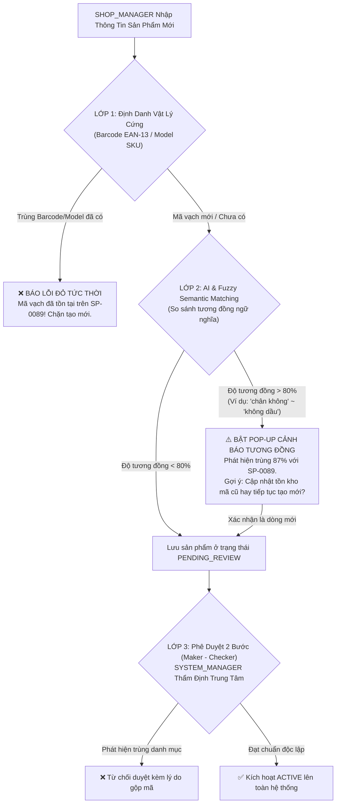
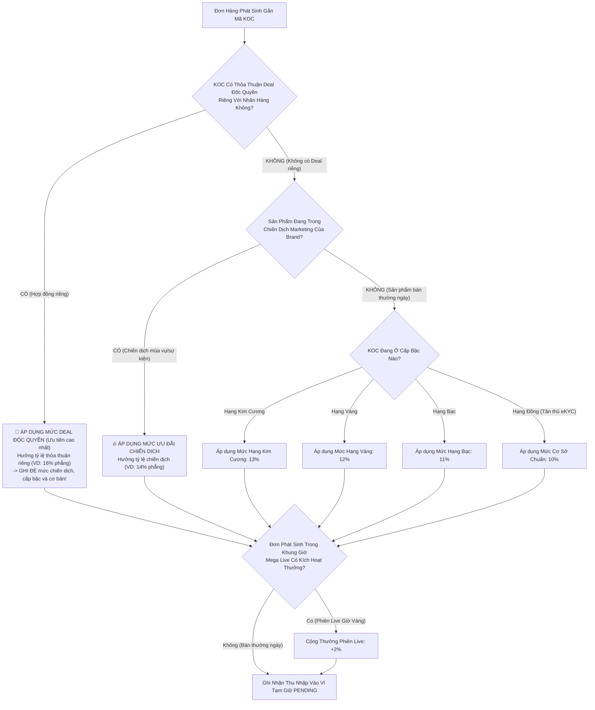
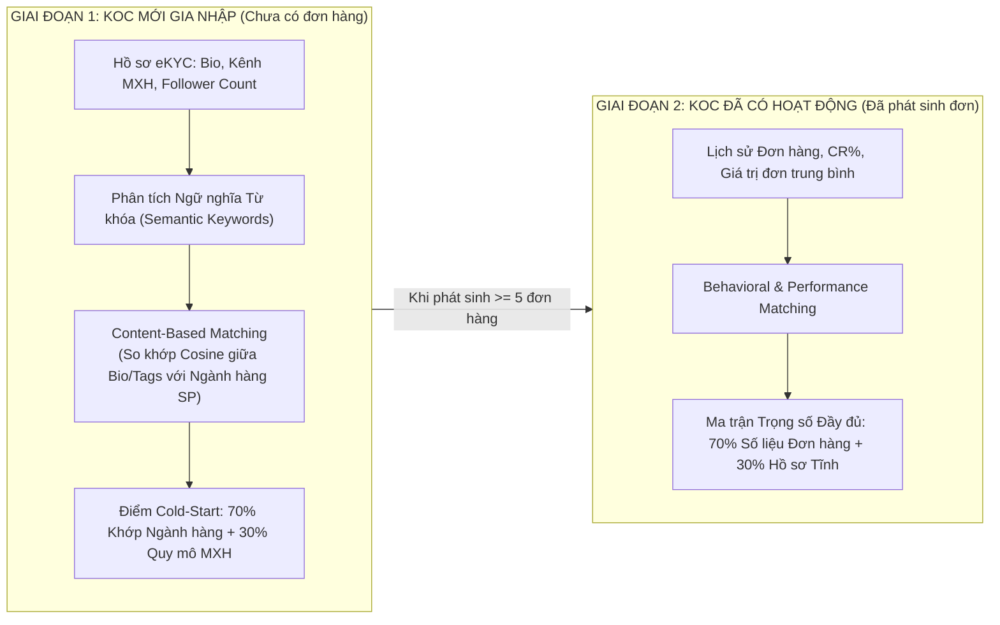

# CẨM NANG TOÀN DIỆN CẢI TỔ ĐỀ TÀI SCANMS
## TỪ BẢN CHẤT DOANH NGHIỆP, CHIẾN LƯỢC CỬA HÀNG, CƠ CHẾ THÙ LAO MỚI ĐẾN 5 MAIN FLOWS CHUẨN MỰC BẢO VỆ HỘI ĐỒNG

> [!IMPORTANT]
> **Định hướng chiến lược thống nhất từ Mentor (ThS. Tôn Thất Hoàng Minh):**  
> 1. **Bản chất hệ thống:** SCANMS là *Hệ thống Quản trị Đội ngũ Đối tác Tiếp thị & Đại sứ Bán hàng* của một **Doanh nghiệp Bán lẻ / D2C Đa Ngành sở hữu**, không phải cái chợ TMĐT tự do (Shopee/Lazada). "Shop là của mình, Cộng tác viên là bên ngoài".
> 2. **Vị trí của Phân hệ Livestream:** Livestream được định vị là **"Phân hệ Bổ trợ / Giá trị Gia tăng (Value-Added Bonus Feature)"** hỗ trợ KOC trong các sự kiện bán hàng giờ vàng (Mega Live), không bắt buộc đưa vào 5 Main Flows chính để giữ thời lượng demo tập trung và đúng trọng tâm quản trị B2B.
> 3. **Cơ chế Thù lao Mới (Quy tắc Ưu đãi Tốt nhất - Best-Benefit Precedence Rule):** Áp dụng **Thứ bậc Ưu tiên (Ghi đè - Override)** minh bạch cho từng đơn hàng $\max(\text{Deal VIP}, \text{Chiến dịch}, \text{Cấp bậc}, \text{Cơ bản 10\%})$, kết hợp thưởng phiên Live giờ vàng (+2%) và Thưởng cán mốc doanh số tháng (FR-09) độc lập cuối kỳ.
> 4. **Cấp bậc Khởi điểm:** KOC mới duyệt eKYC được xếp hạng **ĐỒNG (Bronze - 0% bonus)**, chỉ hưởng mức cơ bản 10%. Khi đạt mốc doanh số sạch mới thăng hạng Bạc (11%), Vàng (12%), Kim Cương (13%).

---

# PHẦN 1: BẢN CHẤT HỆ THỐNG & CHIẾN LƯỢC DANH MỤC CỬA HÀNG

### 1.1. Bản chất Doanh nghiệp sở hữu SCANMS
SCANMS không phải là sàn chợ trung gian. SCANMS là nền tảng công nghệ thuộc sở hữu của một **Tập đoàn Bán lẻ Đa Ngành / Doanh nghiệp D2C Đa Thương hiệu (House of Brands / Multi-Category Retail Conglomerate)** tương tự mô hình *Thế Giới Di Động (MWG - chia Thegioididong, Dienmayxanh, An Khang, AVAKids)* hoặc *Coolmate D2C (chia Coolmate, 84RISING, CM24)*.

### 1.2. Kịch bản 3 Cửa hàng (Store) Trực thuộc Hệ thống

| Nhãn hàng / Ngành hàng (`Store`) | Danh mục & Sản phẩm Chủ lực | Biên chiết khấu cơ sở KOC | Tệp KOC / CTV Tiếp thị Mục tiêu |
| :--- | :--- | :---: | :--- |
| **Store 1: Sora Home & Living**<br>*(Khối Thiết bị & Gia dụng Thông minh)* | • Nồi chiên không dầu điện tử 5L (1.450.000₫)<br>• Máy ép chậm trục xoắn (1.890.000₫)<br>• Chảo chống dính vân đá đáy từ (390.000₫) | **10%**<br>*(Tập trung giá trị đơn hàng cao)* | KOC Gia đình, Kênh review đồ bếp thông minh, Food Bloggers, Mẹ đảm đang nội trợ. |
| **Store 2: Aura Activewear & Lifestyle**<br>*(Khối Thời trang & Thể thao Đa năng)* | • Áo khoác dù chống nước thông hơi (350.000₫)<br>• Quần thể thao Jogger co giãn 4 chiều (280.000₫)<br>• Balo du lịch đa ngăn chống trộm (420.000₫) | **10%**<br>*(Dễ chốt đơn theo xu hướng)* | KOC Thời trang Gen Z, Vận động viên/Gymer, KOC nhảy nhót biến hình, Lifestyle Influencers. |
| **Store 3: GreenBio Health & Wellness**<br>*(Khối Dinh dưỡng & Sức khỏe Thiên nhiên)* | • Hạt Granola nướng mật ong hoa rừng (185.000₫)<br>• Trà thảo mộc thanh lọc giảm stress (260.000₫)<br>• Bột Collagen thủy phân vị đào (520.000₫) | **10%**<br>*(Biên lãi tốt, kích thích tư vấn sâu)* | KOC Dinh dưỡng Eat-clean, Huấn luyện viên Yoga/Pilates, Bác sĩ/Dược sĩ cộng đồng, Mẹ bỉm sữa. |

### 1.3. Hàng hóa có được trùng lặp giữa các Cửa hàng không?
> **TUYỆT ĐỐI KHÔNG ĐƯỢC TRÙNG HÀNG!**
* **Nguyên nhân 1 - Chống tự ăn thịt lẫn nhau (Cannibalization):** Cùng 1 công ty mẹ, không thể để Store 1 và Store 2 cùng bán chung 1 mẫu Nồi chiên không dầu. Nếu trùng, hai Brand Manager sẽ tranh giành KOC và dìm giá lẫn nhau.
* **Nguyên nhân 2 - Khác biệt về Biên lợi nhuận & Chính sách chiến dịch:** Mỗi ngành hàng có biên lợi nhuận khác nhau, chính sách đãi ngộ khác nhau. Trùng hàng sẽ làm loạn thuật toán tính thù lao.

### 1.4. Cơ chế 3 Lớp Chống Trùng Hàng (Dù nhân viên nhập khác từ ngữ)
Nếu nhân viên quên sản phẩm đã có rồi tạo lại với tên khác (ví dụ: *"Nồi chiên không dầu Lock&Lock 5L"* vs *"Nồi chiên chân không Lock&Lock 5 lít"*):



---

### 1.5. Bảng Đối Chiếu Đa Chiều Toàn Diện: Cách Làm Cũ (Sàn Chợ Mở) vs Cách Làm Mới (Hệ Thống Doanh Nghiệp)

| STT | Khía Cạnh Nghiệp Vụ | **CÁCH LÀM CŨ (Mô hình Sàn Chợ Mở - Shopee Clone)** | **CÁCH LÀM MỚI (Mô hình Doanh Nghiệp In-House - MarTech SaaS)** | Nguyên Nhân Sâu Xa & Ảnh Hưởng Kỹ Thuật |
| :---: | :--- | :--- | :--- | :--- |
| **1** | **Đăng ký vai trò Shop** | Khách hàng vãng lai sau khi đăng nhập có thể truy cập `PartnerUpgradeTab.tsx`, chọn tab "Đăng ký Shop", nhập giấy phép kinh doanh cá nhân để tự tạo gian hàng. | **Loại bỏ 100% form đăng ký Shop công khai.** `SHOP_MANAGER` là nhân sự nội bộ, được `SYSTEM_ADMIN` cấp tài khoản và gán trực tiếp vào Store phụ trách qua trang `AdminPersonnelPage.tsx`. | Ngăn chặn triệt để tình trạng người ngoài tự ý tạo cửa hàng rác, bán hàng cạnh tranh với doanh nghiệp hoặc đưa hàng kém chất lượng vào hệ thống. |
| **2** | **Cấu trúc Kho bãi (Warehouse)** | Mỗi shop tự đăng ký một địa chỉ kho riêng lẻ như người bán tự do, sàn không quản lý điều kiện kho bãi. | Doanh nghiệp triển khai **Multi-Warehouse Fulfillment (Kho vệ tinh theo đặc thù ngành hàng)**: Kho mát thực phẩm/dược liệu, kho gia dụng cồng kềnh, kho thời trang may mặc. | Đáp ứng chuẩn mực bảo quản hàng hóa thực tế và tích hợp API GHN chuẩn xác (`from_district_id`, `from_ward_code`) để shipper lấy hàng đúng kho. |
| **3** | **Kiểm duyệt Sản phẩm (Product Moderation)** | Sàn kiểm duyệt shop ngoài đăng bán theo dạng "kiểm duyệt nội dung cộng đồng", dễ phát sinh tiêu cực hoặc chậm trễ. | Quy trình kiểm soát nội bộ chuẩn mực **Maker - Checker (Người tạo - Người duyệt pháp chế)**: Shop Manager nhập liệu $\rightarrow$ System Manager pháp chế kiểm tra tính pháp lý trước khi mở bán. | Đảm bảo 100% sản phẩm có giấy công bố y tế/mỹ phẩm hợp pháp, kiểm soát giá bán niêm yết và chống trùng lặp mã vạch EAN-13 giữa các ngành hàng. |
| **4** | **Dòng tiền Bán hàng (Cash Inflow)** | Tiền khách thanh toán bị giam ở tài khoản trung gian của sàn chợ. | Toàn bộ $100\%$ tiền thanh toán (VietQR, PayOS, COD shipper GHN) chảy thẳng vào **Tài Khoản Doanh Nghiệp Tập Trung (Corporate Master Account)**. | Doanh nghiệp chủ động nắm giữ dòng tiền kinh doanh tập trung, phục vụ hạch toán tài chính và luân chuyển vốn. |
| **5** | **Yêu cầu Rút tiền (Payout Outflow)** | Shop bán xong có số dư ví trên sàn và phải tạo lệnh gửi Admin sàn xin duyệt rút tiền về tài khoản ngân hàng của chủ shop. | **Shop Manager KHÔNG RÚT TIỀN**. Tiền bán hàng là của doanh nghiệp. **CHỈ CÓ KOC MỚI THỰC HIỆN LỆNH RÚT TIỀN (Payout)** để nhận hoa hồng tiếp thị sau 7 ngày Escrow (khấu trừ 10% thuế TNCN). | Tháo gỡ mâu thuẫn vô lý khi nhân sự công ty lại phải "làm đơn xin công ty cho rút tiền doanh thu". |
| **6** | **Báo cáo Tài chính của Shop** | Shop nhìn vào số dư ví cá nhân để rút tiền lẻ tẻ như một hộ kinh doanh cá thể. | Shop Manager xem **Báo Cáo Doanh Thu & Chi Phí Tiếp Thị (Store P&L & Commission Expenses)**: Doanh thu Net, Giá vốn (COGS), Chi phí hoa hồng KOC, Lợi nhuận đóng góp. | Cung cấp góc nhìn quản trị kinh doanh cho từng Brand Manager, giúp đánh giá hiệu quả chiến dịch tiếp thị liên kết (Affiliate ROI). |
| **7** | **Hệ thống Ví Người Dùng** | Hệ thống duy trì ví cho Khách hàng, ví cho KOC, và cả ví số dư cho từng Shop (`StoreWallet`). | **Chỉ duy trì 2 loại ví thực tế:**<br>1. Ví Khách Hàng (`Customer Wallet`): Nhận tiền hoàn khi đổi trả.<br>2. Ví KOC (`Collaborator Wallet`): Tích lũy hoa hồng bán hàng. | Đơn giản hóa cấu trúc cơ sở dữ liệu kế toán, loại bỏ các giao dịch ví ảo không có thật giữa nội bộ công ty với nhau. |
| **8** | **Quy trình Đổi trả / Hoàn tiền** | Khách hàng kiện Shop, Sàn đứng ra phân xử như Tòa án dân sự trung gian giữa 2 người ngoài xa lạ. | Quy trình **Chăm sóc Khách hàng (CSKH) nội bộ**: Khách khiếu nại $\rightarrow$ Thu hồi hàng về kho Store $\rightarrow$ Tự động **ĐÓNG BĂNG/HỦY HOA HỒNG KOC** trên đơn hàng bị trả. | Bảo vệ doanh nghiệp không bị thất thoát tiền hoa hồng khi khách hàng đã trả lại hàng và nhận tiền hoàn. |
| **9** | **Chính sách Hàng Mẫu (Samples)** | Shop tự phát hàng mẫu không theo dõi, KOC nhận mẫu xong không đăng bài cũng không bị xử lý. | Mẫu thử được hạch toán vào **Ngân sách Marketing thử nghiệm** của từng Store. KOC cam kết đăng video review trong 14 ngày. Vi phạm sẽ bị đưa vào **Blacklist toàn sàn**. | Tối ưu hóa chi phí hàng mẫu, nâng cao tỷ lệ chuyển đổi từ việc gửi mẫu sang doanh số bán hàng thực tế. |
| **10** | **Đàm phán Deal Độc quyền** | Thỏa thuận tự do giữa người bán ngoài và KOC, không có sự kiểm soát của chủ thương hiệu. | Là sự **phân bổ ngân sách hoa hồng chiến lược** giữa Trưởng nhãn hàng (`SHOP_MANAGER`) và Top KOC để đạt KPI doanh số lớn trong tháng. | Đảm bảo mức hoa hồng ưu đãi đặc biệt ($15\% - 18\%$) được cấp đúng người, đúng thời điểm và có cam kết doanh số rõ ràng. |
| **11** | **Động cơ Tính Thù lao (Commission)** | Cộng dồn vô lý 4-5 loại tỷ lệ hoa hồng (`Base 10% + Tier 3% + Deal 5% + Live 3% = 21%`), gây thủng biên lợi nhuận của doanh nghiệp. | Áp dụng **Quy Tắc Ưu Tiên Mức Cao Nhất (Best-Benefit Precedence Rule)**: $\max(\text{Deal}, \text{Campaign}, \text{Tier}, \text{Base}) + \text{Live Bonus}$. Thưởng tháng (FR-09) tính độc lập cuối kỳ. | Đảm bảo tính minh bạch, KOC luôn được hưởng mức quyền lợi cao nhất mà vẫn bảo vệ an toàn biên lợi nhuận tài chính của doanh nghiệp. |
| **12** | **Kiểm soát Gian lận Click (Anti-Fraud)** | Bỏ qua việc kiểm soát click ảo vì nghĩ rằng mô hình CPS chỉ tính tiền trên đơn hàng thành công. | Kích hoạt bộ lọc **Redis Sliding-Window Rate Limit** chống Click Flooding nhằm bảo vệ mẫu số tỷ lệ chuyển đổi $\text{CR\%}$ cho AI Smart Matcher và chống Cookie Stuffing. | Bảo vệ tính toàn vẹn của thuật toán AI xếp hạng đối tác và ngăn chặn bot làm nghẽn cơ sở dữ liệu PostgreSQL. |
| **13** | **Chính sách Tự Mua (Self-Referral)** | KOC tự tạo đơn hàng qua liên kết của chính mình để vừa dùng voucher giảm giá vừa nhận hoa hồng kép. | **Nghiêm cấm KOC tự mua qua link chính mình**: Hệ thống đối soát trùng `customerId`, SĐT, địa chỉ, tài khoản ngân hàng $\rightarrow$ Hủy $0\%$ hoa hồng; hướng KOC sang luồng Mượn Mẫu. | Ngăn chặn việc KOC trục lợi chính sách giá sỉ trá hình và bảo vệ tính công bằng của chương trình tiếp thị. |
| **14** | **Phân hệ Livestream** | Livestream được xem là phân hệ bắt buộc của mọi cửa hàng, gây loãng 5 Main Flows bảo vệ tốt nghiệp. | Định vị Livestream là **"Tính Năng Giá Trị Gia Tăng (Bonus / Value-Added Feature)"** phục vụ các phiên Mega Live giờ vàng của doanh nghiệp. | Giữ nguyên vẹn toàn bộ mã nguồn WebRTC/Socket.IO nhưng tập trung trọng tâm bảo vệ vào năng lực quản trị Affiliate MarTech. |

---

### 1.6. Tháo Gỡ 2 Nút Thắt Trọng Yếu: Kho Bãi/Duyệt Sản Phẩm & Dòng Tiền Tài Chính

#### A. Nút Thắt 1: Quản Lý Kho Bãi & Kiểm Duyệt Sản Phẩm Đa Ngành Hàng
1. **Multi-Warehouse Logistics (3 Kho Bãi Phân Loại):**
   * `GreenBio Health`: Kho Mát Tiêu Chuẩn GMP/GSP, Khu Công Nghệ Cao, Tăng Nhơn Phú B, TP.Thủ Đức (`from_district_id: 1442`, `from_ward_code: 20109`). Nhiệt độ < 25°C, độ ẩm < 60%.
   * `Sora Home & Living`: Kho Tổng Gia Dụng, Lô B4 KCN Tân Bình, Tây Thạnh, Tân Phú, TP.HCM (`from_district_id: 1452`, `from_ward_code: 21011`). Pallet chịu tải nặng, bốc xếp hàng cồng kềnh (Nồi chiên, máy ép).
   * `Aura Activewear`: Kho May Mặc Thời Trang, 128/4 Hoàng Hoa Thám, P.12, Tân Bình, TP.HCM (`from_district_id: 1444`, `from_ward_code: 20708`). Giá treo chống ẩm, túi niêm phong PE.
   * *Tích hợp GHN:* Tự động truyền địa chỉ kho xuất phát điểm tương ứng theo Store của sản phẩm khi khách đặt hàng.
2. **Quy trình Maker - Checker:** Shop Manager (`Maker`) nhập liệu form 6 khối chuẩn TMĐT (Thông tin cơ bản, Media, Ma trận biến thể 2 tầng, Đóng gói vận chuyển, Chính sách KOL 10% & Suất mẫu, Pháp lý) $\rightarrow$ System Manager (`Checker / Compliance Lead`) thẩm định 3 tiêu chí cốt lõi:
   * Giấy công bố y tế/mỹ phẩm hợp pháp.
   * Trần hoa hồng KOC ($10\%$ Base + Suất mẫu) đúng ngân sách tài chính.
   * Mã vạch EAN-13 không trùng lặp danh mục khác trong tập đoàn.

#### B. Nút Thắt 2: Dòng Tiền Tập Trung & Tại Sao Shop Không Rút Tiền?
1. **Tài khoản Doanh nghiệp tập trung:** Toàn bộ $100\%$ tiền mua hàng của khách (VietQR / PayOS / COD) chảy trực tiếp về **Tài khoản Doanh nghiệp SCANMS (Corporate Master Account)**.
2. **Shop Manager KHÔNG RÚT TIỀN:** Shop Manager là nhân sự nội bộ công ty (hưởng lương/KPI), không phải người bán tự do. Do đó, loại bỏ hoàn toàn tính năng Shop rút tiền và tab rút tiền Shop. Thay vào đó, Shop Manager theo dõi **Báo Cáo Doanh Thu & Chi Phí Tiếp Thị (Store P&L & Commission Expenses)**:
   $$\text{Doanh Thu Thuần} = \text{Tổng Doanh Số} - \text{Hàng Đổi Trả}$$
   $$\text{Lợi Nhuận Đóng Góp Store} = \text{Doanh Thu Thuần} - \text{Giá Vốn (COGS)} - \text{Hoa Hồng KOC} - \text{Chi Phí Hàng Mẫu}$$
3. **CHỈ CÓ KOC MỚI RÚT TIỀN (Payout):** Tiền hoa hồng phát sinh từ đơn hàng thành công nằm trong Ví KOC ở trạng thái Escrow 7 ngày (tránh rủi ro đổi trả). Hết 7 ngày, KOC bấm Payout về ngân hàng cá nhân; Admin duyệt chi và tự động **khấu trừ 10% Thuế TNCN**.
4. **Hệ thống chỉ còn 2 loại Ví thực tế:** Ví Khách Hàng (nhận tiền hoàn đổi trả) và Ví KOC (tích lũy hoa hồng).

---

### 1.7. Các Nghiệp Vụ Chuyển Đổi Khác
* **Quy trình Đổi trả:** Là nghiệp vụ CSKH nội bộ; thu hồi sản phẩm về kho Store $\rightarrow$ Tự động **ĐÓNG BĂNG/HỦY HOA HỒNG KOC** trên đơn bị trả để tránh thất thoát ngân sách.
* **Ngân sách Hàng mẫu (Sample Requests):** Tính vào chi phí Marketing thử nghiệm của Brand; KOC cam kết 14 ngày đăng video review; vi phạm bị đưa vào **Blacklist toàn sàn**.
* **Đàm phán Deal Độc quyền:** Thỏa thuận nội bộ giữa Trưởng nhãn hàng và Top KOC để tối ưu KPI doanh số.
* **Tái cấu trúc UI Cổng Đăng Ký KOC (`PartnerUpgradeTab.tsx`):** Bỏ tab Shop; áp dụng **60/40 Split Layout** (Trái: Form eKYC 3 bước; Phải: Thẻ Đặc Quyền Đối Tác & Timeline 24h) với bảng màu Warm Sand & Brand Gold `#FAF8F5`, `#F3EFE6`, `#C59B58`, đảm bảo UI không xấu và không bị trống.
* **Tạo Shop Manager tại Admin Console:** Bổ sung trang `AdminPersonnelPage.tsx` tại `/admin/personnel` cho `SYSTEM_ADMIN` tạo nhân sự nội bộ và phân bổ Store phụ trách qua API `POST /api/v1/users/internal-staff`.

---

# PHẦN 2: CƠ CHẾ THÙ LAO MỚI CHUẨN DOANH NGHIỆP
*(Quy tắc Mức Ưu Đãi Tốt Nhất – Minh Bạch & Kiểm Soát Ngân Sách)*

### 2.1. Bản chất: Quy tắc Mức Ưu Đãi Tốt Nhất (Best-Benefit Precedence Rule)
Hệ thống áp dụng **Quy tắc Ghi đè theo Thứ bậc Ưu tiên (Override Hierarchy)**:

$$\text{Tỷ lệ Chiết khấu Đơn hàng} = \max\Big(\text{Deal Độc quyền VIP},\; \text{Ưu đãi Chiến dịch},\; \text{Mức Theo Cấp bậc},\; \text{Mức Cơ bản 10\%}\Big) + \text{Thưởng Phiên Live (Nếu có)}$$



### 2.2. Chi tiết 4 Mức Thù Lao Chính & 2 Khoản Thưởng Bổ Trợ

1. **Mức 1: Chiết khấu Cơ sở (Standard Base Rate - Cố định 10%)**
   * Dành cho KOC mới tham gia (Hạng Đồng). Hưởng đúng tỷ lệ chuẩn của nhãn hàng.
2. **Mức 2: Chiết khấu Theo Cấp bậc Năng lực (Performance Tier Rates)**
   * Dành cho KOC gắn bó lâu dài, thăng hạng tự động khi đạt doanh số tích lũy:
     * **Hạng Đồng (Bronze):** Khởi điểm khi vừa duyệt eKYC $\rightarrow$ **10%** (0% bonus).
     * **Hạng Bạc (Silver):** Doanh số tích lũy $\ge 20$ triệu $\rightarrow$ **11%**.
     * **Hạng Vàng (Gold):** Doanh số tích lũy $\ge 50$ triệu $\rightarrow$ **12%**.
     * **Hạng Kim Cương (Diamond):** Doanh số tích lũy $\ge 100$ triệu $\rightarrow$ **13%**.
3. **Mức 3: Mức Ưu Đãi Chiến Dịch (Campaign Promotion Rate - Ví dụ: 14%)**
   * Khi Nhãn hàng tung Chiến dịch tiếp thị mùa vụ (VD: *Chiến dịch Mua sắm Mùa Hè*), toàn bộ CTV tham gia quảng bá nhóm sản phẩm trong chiến dịch đều được hưởng mức ưu đãi (14%), bất kể đang ở hạng Đồng hay Bạc.
4. **Mức 4: Thỏa thuận Hợp đồng Độc quyền (Exclusive Deal Override - Ví dụ: 16% - Ưu tiên cao nhất)**
   * Ký hợp đồng KPI riêng giữa Giám đốc Nhãn hàng và Top KOC qua Chat Socket.IO (cam kết doanh số, trả bài review). Khi đã ký Deal riêng $\rightarrow$ **Hợp đồng Deal ghi đè toàn bộ các mức trên**.
5. **Khoản Thưởng Phiên Live Bổ Trợ (Live Event Accelerator - Bonus +2%):**
   * Trong các phiên bán hàng giờ vàng (Mega Live), đơn hàng phát sinh trong phiên Live được cộng thêm **+2%** như một khoản thưởng thúc đẩy doanh số tức thời.
6. **Khoản Thưởng Cán Mốc Doanh Số Chu Kỳ (Monthly Milestone Bonus - FR-09):**
   * Không tính vào % từng đơn hàng. Đây là **khoản thưởng định kỳ độc lập (Kickback Incentive)** được hệ thống tự động quét và kết chuyển thêm vào Ví KOC vào ngày cuối cùng của tháng nếu đạt mốc doanh số sạch (VD: Đạt 50 triệu thưởng thêm 1.000.000₫ hoặc 2% kickback).

---

# PHẦN 3: 5 MAIN FLOWS CHUẨN MỰC HỆ THỐNG DOANH NGHIỆP
*(Chuỗi vòng đời khép kín 5 giai đoạn: Nhập môn $\rightarrow$ Chuẩn bị vũ khí $\rightarrow$ Ký hợp đồng & Cấp mẫu $\rightarrow$ Bán hàng & Bắt vết đơn $\rightarrow$ Đối soát & Giải ngân)*

---

## 🔹 MAIN FLOW 1: Tuyển Mộ, Thẩm Định Năng Lực (eKYC) & Phân Cấp Bậc Đối Tác Tiếp Thị
*(Creator Onboarding, eKYC Verification & Initial Tier Assignment)*

```
[Khách hàng / KOC Tự do] 
    --(1. Đăng ký & Nộp hồ sơ CTV: CCCD, STK Ngân hàng, Kênh MXH TikTok/FB)--> 
[Hệ thống SCANMS: Khóa quyền tạo link/rút tiền, chờ thẩm định] 
    --(2. Thẩm định tính pháp lý CCCD & Đối chiếu kênh MXH)--> 
[SYSTEM_MANAGER: Chuyên viên Pháp chế & Vận hành sàn] 
    --(3. Phê duyệt hồ sơ VERIFIED)--> 
[Hệ thống: Cấp Mã định danh CTV + Gán Cấp bậc ĐỒNG (0% Bonus) + Mở khóa Media Hub]
```

### 1. Phân tích Bước thực hiện (`->`)
* **Bước 1:** `System Admin` (Giám đốc công ty) tạo sẵn 3 Nhãn hàng trực thuộc và cấp tài khoản nội bộ cho các `Shop Manager` và `System Manager` (không mở form đăng ký shop bừa bãi).
* **Bước 2:** KOC bên ngoài vào `/register`, chọn **"Đăng ký Đối tác Tiếp thị (Collaborator)"**, điền email/mật khẩu (mã hóa Argon2id), xác thực OTP.
* **Bước 3:** KOC vào trang Hồ sơ ([`CreatorProfilePage.tsx`](file:///c:/HW/CAPSTONE/frontend/src/pages/collaborator/CreatorProfilePage.tsx)), liên kết kênh MXH (TikTok, FB, YouTube kèm lượng follower & ngành hàng thế mạnh) và nộp eKYC (ảnh 2 mặt CCCD, STK ngân hàng chính chủ).
* **Bước 4:** Hồ sơ rơi vào trạng thái `PENDING_VERIFICATION`. Hệ thống khóa quyền tạo link và rút tiền.
* **Bước 5:** `System Manager` vào [`KycApprovalPage.tsx`](file:///c:/HW/CAPSTONE/frontend/src/pages/admin/KycApprovalPage.tsx), kiểm tra tính hợp pháp, đối chiếu tên CCCD khớp STK ngân hàng. Nếu ảnh mờ $\rightarrow$ Bấm từ chối kèm lý do. Nếu chuẩn $\rightarrow$ Bấm **Phê duyệt (`VERIFIED`)**.
* **Bước 6:** Backend tự động:
  1. Cập nhật `UserRole = COLLABORATOR`.
  2. Tạo Ví `Wallet` (0đ).
  3. Sinh mã `affiliateCode` duy nhất.
  4. Gán Cấp bậc khởi điểm **ĐỒNG (Bronze - 0% Bonus)** trong bảng `CollaboratorTier`.
  5. Mở khóa toàn bộ Kho tài nguyên số ([`MediaResourceHubPage.tsx`](file:///c:/HW/CAPSTONE/frontend/src/pages/collaborator/MediaResourceHubPage.tsx)).

### 2. Kiểm toán Codebase & Cải tiến
* **Code đã có sẵn:**
  * Frontend: [`RegisterPage.tsx`](file:///c:/HW/CAPSTONE/frontend/src/pages/auth/RegisterPage.tsx), [`PartnerUpgradeTab.tsx`](file:///c:/HW/CAPSTONE/frontend/src/pages/customer/PartnerUpgradeTab.tsx), [`KycApprovalPage.tsx`](file:///c:/HW/CAPSTONE/frontend/src/pages/admin/KycApprovalPage.tsx), [`CreatorProfilePage.tsx`](file:///c:/HW/CAPSTONE/frontend/src/pages/collaborator/CreatorProfilePage.tsx).
  * Backend: [`kyc.controller.ts`](file:///c:/HW/CAPSTONE/backend/src/modules/kyc/kyc.controller.ts), [`users.controller.ts`](file:///c:/HW/CAPSTONE/backend/src/modules/users/users.controller.ts), [`tiers.controller.ts`](file:///c:/HW/CAPSTONE/backend/src/modules/tiers/tiers.controller.ts).
* **Cần cải thiện:**
  * Đảm bảo khi duyệt KYC xong, hệ thống gán đúng hạng khởi điểm là `BRONZE` (thưởng 0%), không gán nhầm sang Silver.
* **Chuẩn hóa Ngôn từ:**
  * ❌ *Cũ:* "Đăng ký mở gian hàng", "Duyệt shop bán lẻ", "Xin làm cộng tác viên".
  * ✅ *Mới:* **"Gia nhập Đội ngũ Đối tác Tiếp thị (Creator Onboarding)"**, **"Thẩm định Hồ sơ Định danh & Năng lực Tiếp thị (eKYC Verification)"**, **"Cấp Quyền Đại sứ Thương hiệu"**.
* **Dư thừa vs Thiếu:**
  * ❌ *Dư thừa:* Tab "Duyệt Gian hàng" và form đăng ký mở shop tự do cho khách vãng lai.
  * ➕ *Thiếu:* Ô nhập số lượng người theo dõi (Follower Count) và ngành hàng thế mạnh khi nộp KYC để nạp dữ liệu cho AI.

---

## 🔹 MAIN FLOW 2: Động Cơ AI Đối Sánh KOC – Sản Phẩm & Khai Thác Kho Tài Nguyên Tiếp Thị (Media Hub)
*(AI Product-Creator Matching & Marketing Media Toolkit)*

```
[SHOP_MANAGER: Giám đốc Brand] 
    --(1. Chọn sản phẩm chủ đạo, bấm "Phân tích & Khớp nối KOC bằng AI")--> 
[AI Recommendation Engine: Quét Tag, Bio, Lịch sử bán hàng, Tệp Fan, Phân khúc giá] 
    --(2. Trả về Danh sách xếp hạng + Radar Chart 4 chiều + Affinity Score %)--> 
[SHOP_MANAGER] 
    --(3. Gửi Lời mời Hợp tác Bán sản phẩm trực tiếp cho Top KOC)--> 
[COLLABORATOR] 
    --(4. Nhận thông báo mời, vào Media Hub lấy Banner/Video chuẩn hãng & Link tracking)-->
```

### 1. Phân tích Bước thực hiện (`->`)
* **Bước 1:** `Shop Manager` đăng nhập vào phân hệ Nhãn hàng mình phụ trách ([`ShopKolHubPage.tsx`](file:///c:/HW/CAPSTONE/frontend/src/pages/merchant/ShopKolHubPage.tsx)), chọn một sản phẩm chủ đạo cần đẩy số (VD: *Nồi chiên không dầu 5L*).
* **Bước 2:** Bấm nút **"Gợi ý KOC phù hợp bằng AI"** (`GET /api/v1/ai/recommend/kols?productId=...`).
* **Bước 3:** Động cơ AI quét toàn bộ KOC đã được duyệt eKYC, tính toán ma trận tương thích và trả về danh sách kèm **Biểu đồ Radar 4 Trục** (Ngành hàng, Lịch sử chuyển đổi, Tầm ảnh hưởng MXH, Phân khúc giá).
* **Bước 4:** `Shop Manager` chọn KOC đạt 92% (Top Pick), xem bản giải trình AI (Explainable AI: *"KOC có tệp fan chuyên gia đình, giá đơn trung bình khớp sản phẩm"*), bấm **"Gửi Lời mời Hợp tác Bán sản phẩm"** ([`POST /store-collaborators/invite`](file:///c:/HW/CAPSTONE/backend/src/modules/commission-rules/store-collaborators.controller.ts#L53)).
* **Bước 5:** `Collaborator` nhận thông báo trong hệ thống, bấm **Chấp nhận**.
* **Bước 6:** `Collaborator` mở **Kho Tài nguyên Tiếp thị (Media Hub)** tải hình ảnh, video HD đã được công ty kiểm duyệt sẵn, bấm 1-click tạo Smart Link / Dynamic QR mang đi tiếp thị.

### 2. Kiểm toán Codebase & Cải tiến
* **Code đã có sẵn:**
  * Frontend: [`ShopKolHubPage.tsx`](file:///c:/HW/CAPSTONE/frontend/src/pages/merchant/ShopKolHubPage.tsx), [`MarketingToolkitPage.tsx`](file:///c:/HW/CAPSTONE/frontend/src/pages/collaborator/MarketingToolkitPage.tsx), [`MediaResourceHubPage.tsx`](file:///c:/HW/CAPSTONE/frontend/src/pages/collaborator/MediaResourceHubPage.tsx).
  * Backend: [`ai-recommendation.service.ts`](file:///c:/HW/CAPSTONE/backend/src/modules/ai/ai-recommendation.service.ts#L28-L473), [`media-resources.controller.ts`](file:///c:/HW/CAPSTONE/backend/src/modules/media-resources/media-resources.controller.ts), [`affiliate-links.controller.ts`](file:///c:/HW/CAPSTONE/backend/src/modules/affiliate-links/affiliate-links.controller.ts).
* **Cần cải thiện:**
  * `ShopKolHubPage.tsx` đang có bảng 4 đơn hàng tĩnh và toggle "Đang bật số liệu mẫu". Cần gỡ bỏ toggle mẫu, nối trực tiếp vào API `getRecommendedKols` để hiển thị thẻ KOC thật và Radar Chart.
* **Chuẩn hóa Ngôn từ:**
  * ❌ *Cũ:* "Khám phá chiến dịch", "Chợ hoa hồng", "Danh sách kiếm tiền", "Lấy link bán dạo".
  * ✅ *Mới:* **"Động cơ Đối sánh KOC – Sản phẩm bằng AI (AI Product-Creator Matching)"**, **"Kho Tài nguyên Tiếp thị Nhãn hàng (Media Hub)"**, **"Bộ Công cụ Tiếp thị Đa kênh (Marketing Toolkit)"**.
* **Dư thừa vs Thiếu:**
  * ❌ *Dư thừa:* Nút bật/tắt dữ liệu giả trên UI.
  * ➕ *Thiếu:* Modal hiển thị giải trình AI (AI Reasoning pop-up) khi click vào từng KOC.

---

## 🔹 MAIN FLOW 3: Thiết Lập Chiến Dịch, Đàm Phán Hợp Đồng VIP Qua Chat Realtime & Tài Trợ Hàng Mẫu SLA 14 Ngày
*(Campaign Setup, VIP Deal Negotiation & Sample Sponsorship SLA)*

```
[SHOP_MANAGER: Giám đốc Brand] 
    --(1. Thiết lập Chiến dịch Tiếp thị mùa vụ & Mở phòng Chat Realtime)--> 
[COLLABORATOR / SHOP_MANAGER] 
    --(2. Đàm phán Thỏa thuận VIP qua Chat Socket.IO: Chiết khấu riêng 16% & Cam kết KPI)--> 
[Phía còn lại: Phê duyệt thỏa thuận] 
    --(3. Ký thỏa thuận hợp tác (Active Deal) & Cấp Coupon độc quyền)--> 
[COLLABORATOR] 
    --(4. Gửi Yêu cầu Nhận Hàng mẫu Trải nghiệm)--> 
[SHOP_MANAGER] 
    --(5. Duyệt cấp mẫu & Tạo vận đơn giao hàng 0đ qua GHN)--> 
[Hệ thống: Kích hoạt Đồng hồ Đếm ngược SLA 14 ngày] 
    --(6. KOC nộp Link Video Review -> Shop nghiệm thu hoàn tất cam kết)-->
```

### 1. Phân tích Bước thực hiện (`->`)
* **Bước 1:** `Shop Manager` tạo Chiến dịch Tiếp thị mùa vụ tại [`ShopPromotionsHubPage.tsx`](file:///c:/HW/CAPSTONE/frontend/src/pages/merchant/ShopPromotionsHubPage.tsx) (cấu hình thời gian, ngân sách và mức ưu đãi chiến dịch).
* **Bước 2 (Đàm phán Deal 2 chiều Realtime):**
  * `Shop Manager` và `Collaborator` mở phòng Chat Socket.IO ([`ChatBoxPage.tsx`](file:///c:/HW/CAPSTONE/frontend/src/pages/chat/ChatBoxPage.tsx)).
  * KOC gửi đề xuất: Xin mức thù lao riêng **16%** cho dòng *Nồi chiên không dầu* trong 30 ngày, cam kết đạt doanh số 50 triệu và trả 2 video review.
  * Hoặc Shop Manager gửi Thẻ mời chiến dịch VIP trực tiếp vào chat ([`POST /campaigns/chat/:conversationId/invite`](file:///c:/HW/CAPSTONE/backend/src/modules/campaigns/campaigns.controller.ts#L106)).
* **Bước 3:** Đối phương bấm **Chấp thuận Deal** (`APPROVED`). Hệ thống kích hoạt trạng thái `ACTIVE`, tự sinh mã giảm giá riêng (VD: `TRANGHOME10`) gắn tên KOC.
* **Bước 4:** `Collaborator` vào mục Hàng mẫu ([`CollaboratorSamplesPage.tsx`](file:///c:/HW/CAPSTONE/frontend/src/pages/collaborator/CollaboratorSamplesPage.tsx)), bấm **"Đăng ký Nhận Mẫu Thử"**.
* **Bước 5:** `Shop Manager` kiểm tra lịch sử uy tín của KOC, bấm **Duyệt cấp mẫu** $\rightarrow$ Hệ thống gọi API vận chuyển giao kiện hàng mẫu 0đ đến nhà KOC.
* **Bước 6:** Khi đơn giao thành công, hệ thống kích hoạt **Đồng hồ đếm ngược 14 ngày (SLA Review)**.
* **Bước 7:** KOC làm video trải nghiệm, đăng lên TikTok/YouTube, dán link vào mục **"Nộp Bằng chứng Nghiệm thu"** ([`POST /sample-requests/:id/video`](file:///c:/HW/CAPSTONE/backend/src/modules/samples/samples.controller.ts#L79)).
* **Bước 8:** `Shop Manager` xem video, bấm **Nghiệm thu Đạt (`COMPLETED`)** $\rightarrow$ Hệ thống cộng điểm uy tín cho KOC.
  * *Xử lý vi phạm SLA:* Quá 14 ngày không nộp video $\rightarrow$ Hệ thống tự đánh dấu `OVERDUE`, trừ 20 điểm uy tín, khóa quyền xin mẫu thử trong 60 ngày.

### 2. Kiểm toán Codebase & Cải tiến
* **Code đã có sẵn:**
  * Frontend: [`SamplesManagementPage.tsx`](file:///c:/HW/CAPSTONE/frontend/src/pages/merchant/SamplesManagementPage.tsx), [`CollaboratorSamplesPage.tsx`](file:///c:/HW/CAPSTONE/frontend/src/pages/collaborator/CollaboratorSamplesPage.tsx), [`ExclusiveDealProposalModal.tsx`](file:///c:/HW/CAPSTONE/frontend/src/components/merchant/ExclusiveDealProposalModal.tsx), [`ChatBoxPage.tsx`](file:///c:/HW/CAPSTONE/frontend/src/pages/chat/ChatBoxPage.tsx).
  * Backend: [`affiliate-deals.controller.ts`](file:///c:/HW/CAPSTONE/backend/src/modules/affiliate-deals/affiliate-deals.controller.ts), [`deal-kpi.policy.ts`](file:///c:/HW/CAPSTONE/backend/src/modules/affiliate-deals/deal-kpi.policy.ts), [`samples.controller.ts`](file:///c:/HW/CAPSTONE/backend/src/modules/samples/samples.controller.ts).
* **Cần cải thiện:**
  * Gỡ bỏ các chữ "SIMULATOR / Tự sinh mã" trên modal tạo vận đơn gửi mẫu, hiển thị form thông tin giao nhận chuyên nghiệp.
* **Chuẩn hóa Ngôn từ:**
  * ❌ *Cũ:* "Xin mẫu miễn phí", "Bùng hàng mẫu", "Kèo hoa hồng riêng".
  * ✅ *Mới:* **"Thẩm duyệt & Tài trợ Hàng mẫu Trải nghiệm (Sample Sponsorship)"**, **"Thỏa thuận Hợp tác Độc quyền (Exclusive Campaign Deal)"**, **"Nghiệm thu Cam kết Truyền thông (Content Review Fulfillment)"**.
* **Dư thừa vs Thiếu:**
  * ❌ *Dư thừa:* Cho phép xin mẫu tự do không giới hạn số lượng.
  * ➕ *Thiếu:* Thanh tiến độ trực quan đếm ngược 14 ngày trên Dashboard của KOC.

---

## 🔹 MAIN FLOW 4: Bắt Dấu Vết Đơn Hàng (Attribution), Phòng Chống Gian Lận (AI Fraud) & Tự Động Tính Thù Lao
*(Order Attribution, Click Fraud Detection & Automated Commission Calculation)*

```
[Khách mua hàng] 
    --(1. Bấm Smart Link / Quét QR / Nhập Coupon của KOC để đặt hàng)--> 
[Cổng Điều Hướng: Ghi nhận AttributionSession & Cài Cookie Last-Click 30 ngày] 
    --(2. Phòng tuyến 2 tầng: Redis Rate Limit chặn click tặc + AI Fraud bắt self-referral)--> 
[Hệ thống: Ghi nhận Đơn hàng gắn mã KOC & Trừ kho thời gian thực] 
    --(3. Đơn giao thành công & Hết hạn đổi trả)--> 
[Động cơ Thù Lao: Áp dụng Mức Ưu Đãi Cao Nhất] 
    --(Rate = max(Deal VIP, Chiến dịch, Cấp bậc, Cơ sở 10%))--> 
[Ví CTV: Ghi nhận thu nhập vào số dư TẠM GIỮ (Pending Balance)]
```

### 1. Phân tích Bước thực hiện (`->`)
* **Bước 1:** Khách hàng lướt TikTok/FB thấy video của KOC $\rightarrow$ Bấm vào Smart Link hoặc quét mã QR $\rightarrow$ Đi qua cổng điều hướng [`RedirectHandlerPage.tsx`](file:///c:/HW/CAPSTONE/frontend/src/pages/public/RedirectHandlerPage.tsx). Hệ thống ghi log phiên truy cập (`AttributionSession`), cài **Marketing Cookie 30 ngày** theo luật Last-Click Wins.
* **Bước 2 (Bảo vệ Chống Gian lận 2 Tầng):**
  * *Tầng 1 (Tức thời):* **Redis Sliding-Window Rate Limit** chặn đứng bot spam click từ 1 IP (trả mã `429`).
  * *Tầng 2 (AI Fraud Sentinel):* Quét các dấu hiệu gian lận: KOC tự dùng link của mình mua hàng (Self-referral), đơn hàng có cùng IP mạng giữa người giới thiệu và người mua.
* **Bước 3:** Khách đặt mua sản phẩm trên Website công ty hoặc đơn được đồng bộ từ đa kênh (Shopee/TikTok Webhook hoặc Import Excel). Bắt buộc đăng nhập tài khoản nhanh (không mất giỏ hàng) để gắn định danh khách hàng.
* **Bước 4:** Đơn hàng được gắn `collaboratorId` hợp lệ.
* **Bước 5:** **Động cơ Tính Thù Lao (Remuneration Engine)** bóc tách từng sản phẩm, tự động so khớp và lấy mức ưu đãi cao nhất:
  $$\text{Tỷ lệ Chiết khấu} = \max\Big(\text{Deal VIP},\; \text{Chiến dịch},\; \text{Cấp bậc Tier},\; \text{Cơ sở 10\%}\Big)$$
* **Bước 6:** Số tiền thù lao tương ứng được ghi nhận ngay vào **Số dư Tạm giữ (`PENDING`)** trong Ví của KOC.

### 2. Kiểm toán Codebase & Cải tiến
* **Code đã có sẵn:**
  * Frontend: [`OrdersManagementPage.tsx`](file:///c:/HW/CAPSTONE/frontend/src/pages/merchant/OrdersManagementPage.tsx), [`CollaboratorOrderTrackingPage.tsx`](file:///c:/HW/CAPSTONE/frontend/src/pages/collaborator/CollaboratorOrderTrackingPage.tsx), [`AiFraudSentinelPage.tsx`](file:///c:/HW/CAPSTONE/frontend/src/pages/admin/AiFraudSentinelPage.tsx).
  * Backend: [`orders.controller.ts`](file:///c:/HW/CAPSTONE/backend/src/modules/orders/orders.controller.ts), [`commissions.controller.ts`](file:///c:/HW/CAPSTONE/backend/src/modules/commissions/commissions.controller.ts), [`commission-rules.controller.ts`](file:///c:/HW/CAPSTONE/backend/src/modules/commission-rules/commission-rules.controller.ts), [`ai-fraud.controller.ts`](file:///c:/HW/CAPSTONE/backend/src/modules/ai/ai-fraud.controller.ts).
* **Cần cải thiện:**
  * Bổ sung Tab "Chờ thanh toán (Unpaid)" trên `OrdersManagementPage.tsx` để tách riêng các đơn VietQR chưa nhận được tiền với đơn COD/đã thanh toán.
* **Chuẩn hóa Ngôn từ:**
  * ❌ *Cũ:* "Tiếp thị đa kênh", "Bắn tiền hoa hồng", "Ăn chia hoa hồng", "Cắt phế đơn".
  * ✅ *Mới:* **"Bắt Dấu Vết Đơn Hàng (Sales Attribution)"**, **"Động cơ Tính toán Thù lao Tự động (Remuneration Engine)"**, **"Giám sát Rủi ro & Gian lận Lưu lượng (Fraud Sentinel)"**.
* **Dư thừa vs Thiếu:**
  * ❌ *Dư thừa:* Mua hàng ẩn danh không tài khoản (làm đứt gãy luồng tracking KOC).
  * ➕ *Thiếu:* Tab "Đơn Trả hàng / Hoàn tiền" trên thanh quản lý đơn hàng.

---

## 🔹 MAIN FLOW 5: Bảo Chứng Escrow 14 Ngày (Thu Hồi Clawback Khi Hoàn Hàng), Thưởng Mốc Doanh Số & Quyết Toán Thu Nhập (Payout)
*(Escrow Guarantee, Clawback Engine, Monthly Milestone Bonus & Payout Settlement)*

```
[Đơn giao thành công GHN] 
    --(1. Kích hoạt Bảo chứng Escrow 7-14 ngày thích ứng Lễ/Tết VN)--> 
[Nhánh Rủi ro: Khách hoàn hàng] --(Hệ thống kích hoạt Clawback: Thu hồi 100% tiền tạm giữ)-->
[Nhánh Thành công: Hết hạn hoàn] --(Tiền chuyển từ PENDING sang KHẢ DỤNG (Available))--> 
[Cuối tháng: Động cơ FR-09 quét tổng doanh số sạch] 
    --(2. Đạt mốc doanh số -> Tự động cộng THƯỞNG THÁNG vào Ví & Xét Thăng hạng Tier)--> 
[COLLABORATOR] 
    --(3. Tạo lệnh Quyết toán Thu nhập về STK đã eKYC)--> 
[Hệ thống: Khóa dòng SELECT FOR UPDATE + Tự động khấu trừ 10% Thuế TNCN] 
    --(4. SYSTEM_MANAGER đối soát an toàn -> Duyệt giải ngân Napas 24/7 / VietQR)--> 
[Sổ cái tài chính bất biến: Ghi nhận giao dịch, gửi email sao kê cho CTV]
```

### 1. Phân tích Bước thực hiện (`->`)
* **Bước 1 (Bảo chứng Escrow & Thu hồi Clawback khi hoàn hàng):**
  * Khi đơn giao thành công (`DELIVERED`), hệ thống giữ tiền ở trạng thái `PENDING` trong 7–14 ngày (thích ứng theo lịch nghỉ Lễ/Tết Việt Nam).
  * *Nếu khách hoàn hàng:* Bộ phận Kho duyệt hoàn tiền $\rightarrow$ Hệ thống tự động kích hoạt **Thu hồi Chiết khấu (Clawback Engine)**: Hủy bút toán chiết khấu của đơn đó về 0đ, công ty không mất oan tiền.
  * *Nếu qua thời hạn hoàn hàng:* Tiền tự động giải tỏa từ `PENDING` sang **Khả dụng (`AVAILABLE`)**.
* **Bước 2 (Chốt Thưởng Mốc Doanh Số Tháng - FR-09 & Thăng hạng):**
  * Đêm ngày cuối tháng, `Shop Manager` mở bảng Tiến độ KPI ([`CommissionRulesPage.tsx`](file:///c:/HW/CAPSTONE/frontend/src/pages/merchant/CommissionRulesPage.tsx)), bấm **Chốt thưởng mốc doanh số tháng (`settle-all`)**.
  * Hệ thống tính tổng doanh số sạch (đã trừ đơn hoàn), đối chiếu bậc thang thưởng (VD: đạt 50tr thưởng thêm 2%, đạt 100tr thưởng thêm 3.5%) $\rightarrow$ Tự động cộng tiền thưởng vào Ví KOC; đồng thời tự động xét **Thăng hạng Cấp bậc** (Bạc $\rightarrow$ Vàng $\rightarrow$ Kim Cương).
* **Bước 3 (Yêu cầu Quyết toán Thu nhập):**
  * KOC có số dư khả dụng $\ge 200.000₫$ vào [`CollaboratorWalletPage.tsx`](file:///c:/HW/CAPSTONE/frontend/src/pages/collaborator/CollaboratorWalletPage.tsx) tạo lệnh Rút tiền.
* **Bước 4 (Khóa dòng & Thuế TNCN):**
  * Hệ thống thực thi **Khóa dòng CSDL (`SELECT ... FOR UPDATE`)** chống lỗi rút đúp âm ví.
  * Tự động tính và khấu trừ **10% Thuế Thu Nhập Cá Nhân (TNCN)** đối với các giao dịch từ 2.000.000₫ trở lên theo đúng Luật Quản lý Thuế Việt Nam.
* **Bước 5 (Đối soát Kế toán Doanh nghiệp & Giải ngân):**
  * `System Manager` (Kế toán công ty) vào trang Đối soát ([`AdminFinancePayoutsPage.tsx`](file:///c:/HW/CAPSTONE/frontend/src/pages/admin/AdminFinancePayoutsPage.tsx)), kiểm tra báo cáo rủi ro AI Fraud Sentinel.
  * Nếu an toàn: Bấm **"Xuất file Lô thanh toán VietQR / Napas 24/7"** hoặc phê duyệt giải ngân $\rightarrow$ Cập nhật trạng thái `APPROVED`, ghi vết bất biến vào `FinancialLedger` và `AuditLog`.

### 2. Kiểm toán Codebase & Cải tiến
* **Code đã có sẵn:**
  * Frontend: [`AdminFinancePayoutsPage.tsx`](file:///c:/HW/CAPSTONE/frontend/src/pages/admin/AdminFinancePayoutsPage.tsx), [`CollaboratorWalletPage.tsx`](file:///c:/HW/CAPSTONE/frontend/src/pages/collaborator/CollaboratorWalletPage.tsx), [`CommissionRulesPage.tsx`](file:///c:/HW/CAPSTONE/frontend/src/pages/merchant/CommissionRulesPage.tsx).
  * Backend: [`payouts.controller.ts`](file:///c:/HW/CAPSTONE/backend/src/modules/payouts/payouts.controller.ts), [`wallets.controller.ts`](file:///c:/HW/CAPSTONE/backend/src/modules/wallets/wallets.controller.ts), [`tiers.controller.ts`](file:///c:/HW/CAPSTONE/backend/src/modules/tiers/tiers.controller.ts).
* **Cần cải thiện:**
  * Trong `AdminFinancePayoutsPage.tsx`: Xóa bỏ hoàn toàn đoạn code sinh mã ngân hàng giả `MBB...` khi API lỗi. Bắt buộc thông báo lỗi đỏ và giữ nguyên trạng thái `PENDING` nếu backend chưa hoàn tất.
* **Chuẩn hóa Ngôn từ:**
  * ❌ *Cũ:* "Bấm nút rút tiền hoa hồng", "Admin duyệt chi tiền", "Tiền tươi thóc thật".
  * ✅ *Mới:* **"Quyết toán Thu nhập & Thưởng Doanh số Đối tác (Partner Earnings Settlement)"**, **"Đối soát Tài chính & Quản trị Thuế TNCN (Financial Reconciliation & Tax Compliance)"**, **"Cơ chế Tạm giữ Bảo chứng Đổi trả (Adaptive Escrow & Clawback)"**.
* **Dư thừa vs Thiếu:**
  * ❌ *Dư thừa:* Tab rút tiền của Shop (`merchant` tab trong AdminFinancePayoutsPage). Shop là nội bộ công ty, doanh thu chảy thẳng vào tài khoản tập đoàn, không có chuyện shop rút tiền từ sàn.
  * ➕ *Thiếu:* Cột hiển thị số tiền Thuế TNCN tạm tính khấu trừ trên bảng kê duyệt chi trả.

---

# PHẦN 4: ĐÀO SÂU ĐỘNG CƠ AI RECOMMENDATION & BÀI TOÁN COLD-START

### 4.1. Hệ thống Theo dõi Hành vi Mua hàng của Khách như thế nào?
Trong [`ai-recommendation.service.ts`](file:///c:/HW/CAPSTONE/backend/src/modules/ai/ai-recommendation.service.ts#L93-L184), hệ thống truy vấn toàn bộ các đơn hàng đã giao thành công (`DELIVERED`, `COMPLETED`) gắn liền với từng KOC:
1. **Lịch sử Ngành hàng bán chạy (`categoryOrderCounts`):** Thống kê chính xác KOC này đã bán được bao nhiêu sản phẩm Gia dụng, bao nhiêu sản phẩm Thời trang, bao nhiêu sản phẩm Dinh dưỡng.
2. **Hành vi Chi tiêu của Tệp Fan (`Price Fit Score`):** Lấy tổng doanh thu chia cho tổng số lượng món hàng để tìm ra **Giá trị món hàng trung bình (Average Order Value - AOV)** mà tệp fan của KOC này thường chi trả.
3. **Hiệu suất Chuyển đổi thực tế (`Conversion Rate - CR%`):** Lấy tổng đơn chốt thành công chia cho tổng lượt click hợp lệ trong bảng `ClickTrafficLog`.

### 4.2. Công thức Ma Trận Trọng Số Đa Tiêu Chí 4 Trục (Multi-criteria Scoring Matrix)

$$\text{Điểm Tương Thích (Match Score)} = \min\Big(100,\; 0.35 \times S_{\text{category}} + 0.25 \times S_{\text{cr}} + 0.20 \times S_{\text{tier/social}} + 0.20 \times S_{\text{price}}\Big)$$

* **Trục 1 - Trùng khớp Ngành hàng ($S_{\text{category}} - 35\%$):** Khớp giữa ngành hàng sản phẩm với lịch sử đơn hàng và từ khóa trong Bio/MXH của KOC.
* **Trục 2 - Tỷ lệ Chuyển đổi ($S_{\text{cr}} - 25\%$):** $CR \ge 8\%$ đạt 98 điểm, $CR \ge 6\%$ đạt 92 điểm, $CR \ge 4\%$ đạt 84 điểm (có nhân hệ số tự tin theo số lượng click).
* **Trục 3 - Tầm ảnh hưởng & Cấp bậc ($S_{\text{tier/social}} - 20\%$):** Hạng Kim Cương 98 điểm, Vàng 80 điểm, Bạc 70 điểm, Đồng 60 điểm; cộng thêm 3–5 điểm thưởng nếu tổng follower $> 100k - 500k$.
* **Trục 4 - Phù hợp Phân khúc Giá ($S_{\text{price}} - 20\%$):** So sánh giá sản phẩm mục tiêu ($P_{\text{target}}$) với mức giá trung bình fan hay mua ($P_{\text{fan}}$):
  $$S_{\text{price}} = 60 + 38 \times \frac{\min(P_{\text{target}}, P_{\text{fan}})}{\max(P_{\text{target}}, P_{\text{fan}})}$$

### 4.3. Giải quyết Bài toán Khởi đầu Nan (Cold-Start Problem khi mới chạy, ít KOC)



* **Xếp hạng Tương đối (Relative Ranking) khi ít KOC:**
  * Nếu hệ thống chỉ có 5 KOC: Cả 5 bạn đều được chấm điểm cho từng sản phẩm.
  * Bạn chuyên nấu ăn sẽ đứng **Top 1 (92%)** ở Cửa hàng Gia dụng, nhưng đứng **bét (35%)** ở Cửa hàng Thời trang.
  * Bạn chuyên thời trang sẽ đứng **Top 1 (90%)** ở Cửa hàng Thời trang, nhưng đứng **bét (40%)** ở Cửa hàng Gia dụng.
  * Nhờ đó, các nhãn hàng **không bị tranh giành cùng một KOC**, mà mỗi nhãn hàng tự tìm thấy KOC tối ưu nhất cho mình.

---

# PHẦN 5: VỊ TRÍ CỦA PHÂN HỆ LIVESTREAM BỔ TRỢ (VALUE-ADDED FEATURE)

### 5.1. Định vị chuẩn mực của Livestream trong Hệ thống
Livestream không phải là 1 trong 5 Main Flows bắt buộc để chấm điểm, mà được định vị là **Phân hệ Bổ trợ Bán hàng Giờ vàng (Value-Added Extension)**:
* **Giao diện phòng Live (`LiveShoppingRoom.tsx`):** Cho phép nhãn hàng phối hợp cùng KOC ghim trực tiếp các sản phẩm đang có Deal/Chiến dịch hot trong phiên Live.
* **Chính sách Thưởng Giờ Vàng (`liveBonusRate`):** Tự động kích hoạt mức thưởng cộng thêm **+2%** cho các đơn hàng phát sinh trong phiên Live khi phiên có trạng thái `status = LIVE`.
* **Màn hình Kết thúc chuyên nghiệp (Ended Stream Overlay):** Khi phiên Live kết thúc (`ENDED`), hệ thống tự động khóa ghim deal, đóng khung chat và hiển thị tổng kết doanh số phiên Live.

### 5.2. Cách trình bày trước Hội đồng nếu được hỏi:
> *"Dạ thưa Thầy Cô, 5 Main Flows của hệ thống tập trung hoàn toàn vào quy trình nghiệp vụ Quản trị Đối tác Tiếp thị (Tuyển mộ eKYC, AI Matching KOC, Đàm phán Hợp đồng VIP & Hàng mẫu SLA, Bắt dấu vết đơn hàng Attribution và Quyết toán Tài chính Payout).  
> Ngoài ra, hệ thống có phát triển thêm **Phân hệ Livestream Bổ trợ** đóng vai trò là công cụ hỗ trợ ghim deal và thưởng giờ vàng (+2%) cho KOC trong các sự kiện Mega Sale của nhãn hàng."*

---

# PHẦN 6: BẢNG TỪ ĐIỂN THUẬT NGỮ CHUẨN DOANH NGHIỆP
*(Bắt buộc áp dụng trong Báo cáo, Slide và khi Thuyết trình bảo vệ)*

| Thuật ngữ Cũ (Dễ gây hiểu lầm là Sàn TMĐT) | Thuật ngữ Mới CHUẨN DOANH NGHIỆP SCANMS |
| :--- | :--- |
| **Cửa hàng / Shop** | **Nhãn hàng Trực thuộc / Khối Ngành hàng Nội bộ (Brand / Division)** |
| **Chủ Shop (Shop Manager)** | **Giám đốc Nhãn hàng / Quản lý Ngành hàng (Brand Manager)** |
| **Sàn TMĐT** | **Nền tảng Quản trị Mạng lưới Tiếp thị Liên kết (Affiliate Network Management System)** |
| **Cộng tác viên bán dạo / Cò mồi** | **Nhà sáng tạo Nội dung / Đối tác Tiếp thị (Creator / Affiliate Partner)** |
| **Tiền hoa hồng** | **Chiết khấu Bán hàng (Sales Margin) / Thu nhập Tiếp thị (Earnings)** |
| **Chợ hoa hồng** | **Kho Tiếp thị Sản phẩm & Chiến dịch Nhãn hàng (Campaign & Product Hub)** |
| **Xin hàng mẫu miễn phí** | **Thẩm duyệt & Tài trợ Hàng mẫu Trải nghiệm (Sample Sponsorship)** |
| **Phạt bùng hàng mẫu** | **Chế tài Vi phạm Cam kết Truyền thông SLA 14 Ngày (SLA Enforcement)** |
| **Rút tiền hoa hồng** | **Quyết toán Thu nhập & Thưởng Doanh số Đối tác (Partner Earnings Settlement)** |
| **Sàn xử kiện Shop vs Khách** | **Bảo chứng Tạm giữ Escrow & Thu hồi Chiết khấu khi Hoàn hàng (Clawback Engine)** |

---

# PHẦN 7: BẢNG SO SÁNH PHẢN BIỆN TRƯỚC HỘI ĐỒNG

| Tiêu chí | Sàn TMĐT Đa Gian Hàng (Shopee, Lazada, TikTok Shop) | Hệ Thống SCANMS (Sales Collaborator & Affiliate Network) |
| :--- | :--- | :--- |
| **Mục tiêu hệ thống** | Bán lẻ trực tiếp cho khách hàng vãng lai từ hàng triệu người bán tự do ngoài đường. | **Quản trị, đào tạo, cấp tài nguyên và chi trả thu nhập cho Đội ngũ Đối tác Tiếp thị bên ngoài.** |
| **Quyền sở hữu Cửa hàng** | Mọi cá nhân bên ngoài đều tự mở shop tự do. | **Chỉ có Giám đốc công ty (`SYSTEM_ADMIN`) cấp quyền quản lý nhãn hàng nội bộ.** |
| **Người dùng trung tâm** | Người mua hàng vãng lai (`CUSTOMER`). | **Đối tác Tiếp thị (`COLLABORATOR`) và Quản lý Nhãn hàng (`SHOP_MANAGER`).** |
| **Cốt lõi công nghệ** | Giỏ hàng, Cổng thanh toán, Mã voucher giảm giá toàn sàn. | **Định danh eKYC, AI Matchmaker KOC, Bảo chứng Mẫu thử SLA 14 ngày, Động cơ Tính Thù lao Ưu tiên, AI Fraud Sentinel.** |
| **Dòng tiền & Ví** | Sàn giữ tiền của Shop lạ, Shop nộp đơn xin rút tiền từ Sàn. | **Tiền bán hàng về thẳng tài khoản Công ty. Hệ thống chỉ quản lý Ví Thu nhập và Đối soát Thuế TNCN cho CTV.** |

---

# PHẦN 8: PHÂN CÔNG BẢO VỆ CODE CHO 4 THÀNH VIÊN NHÓM FA26SE032

| Thành viên | Main Flow Phụ trách Trình bày & Demo | Trọng tâm Bảo vệ Kỹ thuật & Code (Defense Focus) |
| :--- | :--- | :--- |
| **1. Nguyễn Thành Thắng** *(Leader)* | **Main Flow 1** *(Onboarding, eKYC & Cấp Tier Đồng)* + **Nửa sau Main Flow 5** *(Khóa dòng CSDL, Thuế TNCN 10% & Payout)* | Kiến trúc RBAC 5 Roles, Cấp tài khoản nội bộ vs Đăng ký ngoài, Quy trình thẩm định eKYC, Khóa dòng `SELECT ... FOR UPDATE` chống race-condition rút tiền, Thuật toán tính Thuế TNCN 10% & Sổ cái tài chính bất biến. |
| **2. Phan Xuân Thịnh** | **Main Flow 2** *(AI Matchmaker & Gửi Lời mời)* + **Nửa đầu Main Flow 3** *(Chat Realtime & Thỏa thuận VIP)* | Thuật toán AI Ma trận Trọng số 4 Trục trong `ai-recommendation.service.ts`, Kiến trúc WebSocket Socket.IO đàm phán 2 chiều và gửi Thẻ mời chiến dịch VIP trực tiếp trong khung chat. |
| **3. Nguyễn Đình Tuấn** | **Nửa sau Main Flow 3** *(Đánh giá KPI Deal)* + **Main Flow 4** *(Attribution, Link/QR, Redis Rate Limit & AI Fraud)* | Thuật toán đánh giá KPI `deal-kpi.policy.ts`, Bộ sinh Smart Link / Dynamic QR, Redis Sliding-Window Rate Limit, Động cơ AI Fraud Sentinel phát hiện gian lận click tặc và self-referral. |
| **4. Nguyễn Phú Quý** | **Đồng bộ Đơn Đa kênh cuối Flow 4** *(Web/Webhook/Excel)* + **Nửa đầu Main Flow 5** *(GHN, Escrow 14 ngày & Clawback)* | Tiếp nhận đơn hàng Idempotent qua Webhook Shopee/TikTok & Import Excel, Trừ kho biến thể, Cơ chế Tạm giữ Bảo chứng Escrow thích ứng Lễ/Tết VN, Thuật toán tự động thu hồi chiết khấu `Clawback` khi khách hoàn hàng. |
