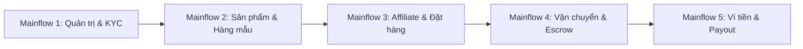

# 📋 KẾ HOẠCH CHUẨN BỊ TOÀN DIỆN CHO ĐỢT REVIEW 2 & HỘI ĐỒNG 1.1
## DỰ ÁN CAPSTONE: SCANMS (FA26SE032)
**Sales Collaborator and Affiliate Network Management System**  
*(Hệ thống Quản lý Mạng lưới Tiếp thị liên kết & Cộng tác viên bán hàng Đa Gian Hàng)*

---

- **Mã đề tài:** FA26SE032  
- **Bộ môn:** Kỹ thuật Phần mềm (Software Engineering - SE), Đại học FPT TP.HCM  
- **Giảng viên Hướng dẫn (Supervisor):** ThS. Tôn Thất Hoàng Minh (`MinhTTH5@fe.edu.vn`)  
- **Đội ngũ thực hiện (4 thành viên chính thức):**
  1. **Nguyễn Thành Thắng** - MSSV: `SE184251` *(Trưởng nhóm - Team Leader)*
  2. **Nguyễn Đình Tuấn** - MSSV: `SE180104` *(Thành viên)*
  3. **Nguyễn Phú Quý** - MSSV: `SE180104` *(Thành viên)*
  4. **Phan Xuân Thịnh** - MSSV: `SE184527` *(Thành viên)*
- **Cột mốc mục tiêu:** Vượt qua thẩm định của **GV Review 2** với kết quả **"PASS TO 1.1"** làm căn cứ pháp lý vững chắc bước vào **Hội đồng 1.1**.

---

## PHẦN 1: BỐI CẢNH AI MỚI & PHÂN TÍCH THAY ĐỔI TRONG PHIẾU ĐÁNH GIÁ (RUBRIC)

### 1.1. Bối cảnh bùng nổ của AI và sự thay đổi trong cách thẩm định của Nhà trường
Trong giai đoạn hiện nay, với sự trợ giúp của các công cụ AI tạo sinh (GenAI, Agentic Coding, LLMs), việc tạo ra mã nguồn hay soạn thảo tài liệu diễn ra với tốc độ nhanh gấp nhiều lần. Tuy nhiên, điều này cũng đặt ra thách thức lớn cho Hội đồng đánh giá và Giảng viên thẩm định:
- **Nguy cơ "Sản phẩm ảo / Mock data":** Sinh viên có thể tạo ra giao diện rất đẹp nhưng thực chất bên trong là dữ liệu tĩnh (hardcoded), không có kết nối cơ sở dữ liệu thực sự hoặc API bị "nuốt lỗi" (`catch { return mock }`).
- **Nguy cơ "Không hiểu code":** Sinh viên sử dụng AI sinh code nhưng không nắm được bản chất thuật toán, cấu trúc luồng dữ liệu, tính an toàn giao dịch (transaction isolation) và giải pháp xử lý tranh chấp (concurrency/race condition).
- **Hiện tượng "Mượn bóng thành viên":** Tình trạng 1-2 bạn gánh team trong khi các thành viên còn lại không giải trình được phần việc mình làm.

### 1.2. Sự thay đổi cốt lõi trong Quy trình & Phiếu đánh giá của GV Review 2
Vì Review 2 là **căn cứ quyết định danh sách sinh viên được ra Hội đồng 1.1** (quy chế: *Fail cá nhân hoặc Fail toàn đội*), phiếu đánh giá của GV Review 2 chuyển dịch mạnh mẽ theo 4 tiêu chuẩn mới:

```
┌───────────────────────────────────────────────────────────────────────────────────────────────┐
│                        4 TRỤ CỘT THẨM ĐỊNH MỚI CỦA GV REVIEW 2                                │
├────────────────────────────────┬──────────────────────────────────────────────────────────────┤
│ 1. REAL WORKING SOFTWARE       │ Hệ thống chạy thật 100% (PostgreSQL, Redis, NestJS, React). │
│    (Sản phẩm vận hành thực tế) │ Không chấp nhận video dựng sẵn, không chấp nhận mock data.   │
├────────────────────────────────┼──────────────────────────────────────────────────────────────┤
│ 2. INDIVIDUAL CODE OWNERSHIP   │ Vấn đáp chuyên sâu từng cá nhân về đoạn code, file service,  │
│    (Làm chủ mã nguồn cá nhân)  │ câu lệnh SQL và quyết định kiến trúc mà cá nhân đó phụ trách. │
├────────────────────────────────┼──────────────────────────────────────────────────────────────┤
│ 3. END-TO-END FLOW SYNERGY     │ Các mắt xích giữa 4 thành viên phải khớp nối trơn tru:       │
│    (Tính thông suốt đa vai trò)│ Shop tạo sp -> KOL xin mẫu -> Khách mua -> Hoa hồng nhảy ví. │
├────────────────────────────────┼──────────────────────────────────────────────────────────────┤
│ 4. TEST CASES & EDGE DEFENSE   │ Nhóm phải chứng minh hệ thống chịu được lỗi (Edge cases,     │
│    (Độ bao phủ kiểm thử thực tế│ Race condition, Chống gian lận, Xác thực dữ liệu chặt chẽ).  │
└────────────────────────────────┴──────────────────────────────────────────────────────────────┘
```

---

## PHẦN 2: KẾ HOẠCH DEMO CHI TIẾT (5 MAINFLOWS CHỦ ĐẠO)

> ⏱️ **Tổng thời lượng phân bổ demo:** **18 – 22 phút** (Mỗi thành viên demo trực tiếp 4 – 5 phút theo luồng nghiệp vụ của mình, sau đó là 10 – 15 phút Q&A phản biện với GV Review 2).



---

### 🌐 MAINFLOW 1: QUẢN TRỊ SÀN, PHÂN QUYỀN RBAC & ĐỊNH DANH KYC ĐA CẤP
- **Người trình bày chính:** **Phan Xuân Thịnh** & **Nguyễn Thành Thắng**
- **Thời lượng dự kiến:** 4 phút
- **Tài khoản sử dụng:** `admin@scanms.vn`, `manager@scanms.vn`, `shop@techstore.vn`, `kol1@scanms.vn`
- **Kịch bản thực thi:**
  1. **Đăng nhập an toàn & RBAC Guard:**
     - Đăng nhập bằng Google 1-Click hoặc email/password.
     - Chứng minh cơ chế phân quyền RBAC: Tài khoản `CUSTOMER` không vào được trang quản trị `/merchant` hay `/admin`; tài khoản `SHOP_MANAGER` không thể xem menu cấu hình an ninh của `SYSTEM_ADMIN`.
  2. **Quy trình nộp & thẩm định hồ sơ KYC 2 luồng (Nghị định 85/2021/NĐ-CP):**
     - KOL `kol1@scanms.vn` nộp hồ sơ KYC cá nhân: Ảnh CCCD 2 mặt, Mã số thuế TNCN để phục vụ khấu trừ thuế, Số tài khoản ngân hàng thụ hưởng.
     - Shop `shop@techstore.vn` nộp hồ sơ Pháp nhân Doanh nghiệp: Giấy phép ĐKKD, Mã số thuế DN, Địa chỉ kho hàng lấy trả.
     - Đăng nhập `manager@scanms.vn` (Vận hành & Tuân thủ): Mở hàng đợi `KycApprovalPage.tsx`, kiểm tra tính hợp lệ của tài liệu, bấm Duyệt hồ sơ ➔ Trạng thái chuyển tức thời sang `VERIFIED`, kích hoạt đầy đủ quyền hạn nhận hoa hồng và xuất kho.

---

### 📦 MAINFLOW 2: QUẢN LÝ SẢN PHẨM, CẤP MẪU THỬ 4 BƯỚC & ĐÀM PHÁN HOA HỒNG
- **Người trình bày chính:** **Nguyễn Phú Quý** & **Nguyễn Đình Tuấn**
- **Thời lượng dự kiến:** 4.5 phút
- **Tài khoản sử dụng:** `shop@techstore.vn`, `kol1@scanms.vn`
- **Kịch bản thực thi:**
  1. **Shop đăng tải sản phẩm chuẩn cấu trúc 6 khối TMĐT:**
     - Shop mở form `ProductManagementPage.tsx`: Nhập thông tin sản phẩm, tải ảnh tỉ lệ 1:1, cấu hình ma trận biến thể (Size/Dung tích), trọng lượng đóng gói và chính sách hoa hồng 2 chiều (% hoặc VNĐ).
     - Sản phẩm được lưu với cơ chế Soft-delete (`is_deleted = false`).
  2. **Quy trình xin hàng mẫu dùng thử 4 bước (Sample Request Flow):**
     - KOL `kol1` vào kho hàng sàn, chọn sản phẩm và bấm "Xin sản phẩm mẫu". Nhập thông tin nhận hàng và cam kết trả video review trong vòng 14 ngày.
     - Phía Shop: Mở tab `ShopSampleManagementTab.tsx`, nhận thông báo yêu cầu mẫu mới, kiểm tra hồ sơ uy tín của KOL ➔ Bấm **Duyệt cấp mẫu**.
     - Shop kích hoạt tính năng **Shipping Simulator**: Tự động sinh mã vận đơn chuẩn TMĐT (`GHN-SMP-XXXXX`), in phiếu giao hàng A6 có mã vạch Barcode.
     - KOL xác nhận đã nhận hàng ➔ Hệ thống kích hoạt đồng hồ đếm ngược 14 ngày yêu cầu nộp link video nghiệm thu.
  3. **Đàm phán hoa hồng 2 tầng (Open Offer vs Exclusive Deal):**
     - Mức cơ bản: 10% sàn công khai ai cũng được hưởng.
     - Shop mở chat realtime với KOL ➔ Gửi thẻ mời chiến dịch độc quyền VIP (Exclusive Deal 18% hoa hồng riêng).

---

### 🔗 MAINFLOW 3: CHIẾN DỊCH TIẾP THỊ AFFILIATE, SMART TRACKING & MUA HÀNG
- **Người trình bày chính:** **Nguyễn Đình Tuấn** & **Phan Xuân Thịnh**
- **Thời lượng dự kiến:** 4 phút
- **Tài khoản sử dụng:** `kol1@scanms.vn`, Khách hàng mua sắm (`customer@gmail.com`)
- **Kịch bản thực thi:**
  1. **Tạo công cụ tiếp thị (Marketing Toolkit):**
     - KOL tạo link rút gọn định danh `scanms.vn/r/thangvip`, tải ảnh Dynamic QR Code và kích hoạt mã giảm giá độc quyền `THANGVIP10`.
  2. **Động cơ Tracking & Chống click tặc:**
     - Khách hàng bấm vào link tiếp thị ➔ Endpoint `/api/r/:code` ghi nhận Click traffic log, cấp Cookie lưu trữ 30 ngày theo quy tắc Last-Click.
     - Mô phỏng spam click liên tục từ 1 IP ➔ Redis Sliding Window Rate Limit kích hoạt, chặn đứng request thứ 11 trong 1 giây để bảo vệ server.
  3. **Mua sắm & Giỏ hàng đồng bộ Database (PostgreSQL):**
     - Khách hàng đăng nhập (Google 1-Click hoặc SMS/Email), chọn phân loại biến thể, thêm vào giỏ hàng. Giỏ hàng đồng bộ tức thời trên Database, chuyển sang thiết bị/tab khác vẫn giữ nguyên.
     - Tiến hành thanh toán (Checkout): Hệ thống tự động nhận diện mã giới thiệu từ Cookie hoặc mã giảm giá `THANGVIP10` (-10%).
     - Đặt hàng thành công ➔ Trừ tồn kho tức thời (Stock Deduction), ghi nhận đơn hàng trạng thái `PENDING_CONFIRMATION`.

---

### 🚚 MAINFLOW 4: VẬN CHUYỂN, BẢO CHỨNG ESCROW 14 NGÀY & ĐỔI TRẢ/HOÀN TIỀN
- **Người trình bày chính:** **Nguyễn Phú Quý** & **Phan Xuân Thịnh**
- **Thời lượng dự kiến:** 4 phút
- **Tài khoản sử dụng:** `shop@techstore.vn`, `customer@gmail.com`, `admin@scanms.vn`
- **Kịch bản thực thi:**
  1. **Đóng gói & Chuyển phát bưu kiện:**
     - Shop xác nhận đơn, in phiếu đóng gói A6 có Barcode Code-128 và bàn giao bưu tá bưu cục GHN/GHTK.
     - Chuyển trạng thái đơn sang `SHIPPED` ➔ Khách hàng dùng trang Tra cứu đơn hàng `/tracking` bằng SĐT để theo dõi timeline hành trình bưu kiện thời gian thực.
  2. **Giao hàng thành công & Kích hoạt Quỹ Escrow 14 ngày:**
     - Bưu cục cập nhật `DELIVERED` ➔ Hoa hồng KOL được tính toán tự động nhưng tạm giữ ở **Ví Chờ (Pending Escrow)** trong 14 ngày nhằm bảo vệ rủi ro người mua khiếu nại.
     - Khách hàng mở quyền viết Đánh giá sản phẩm (Verified Buyer Gate).
  3. **Xử lý Đổi trả / Hoàn tiền & Thu hồi hoa hồng (Clawback Engine):**
     - *Kịch bản khiếu nại:* Khách hàng gửi yêu cầu trả hàng, bắt buộc đính kèm video mở hộp bóc bưu kiện.
     - Shop thẩm định bằng chứng qua giao diện phân xử tranh chấp (Split-View đối soát).
     - Khi đơn được chấp thuận hoàn trả: Hệ thống kích hoạt cơ chế Clawback thu hồi 100% hoa hồng tạm giữ về 0đ và hoàn trả tiền về ví của khách, không để thất thoát tài chính của sàn.

---

### 💰 MAINFLOW 5: VÍ TIỀN ĐỐI TÁC, PESSIMISTIC LOCK, THUẾ TNCN & BATCH PAYOUT
- **Người trình bày chính:** **Nguyễn Thành Thắng**
- **Thời lượng dự kiến:** 4.5 phút
- **Tài khoản sử dụng:** `kol1@scanms.vn`, `shop@techstore.vn`, `admin@scanms.vn`
- **Kịch bản thực thi:**
  1. **Tự động chuyển số dư khả dụng sau 14 ngày:**
     - Chứng minh Cronjob quét các đơn hàng hoàn tất quá thời hạn đối soát 14 ngày an toàn ➔ Chuyển tiền từ Ví Chờ sang **Ví Khả Dụng (Available Balance)**.
  2. **Yêu cầu rút tiền & Khóa dòng CSDL (Pessimistic Locking):**
     - KOL tạo lệnh rút tiền về tài khoản ngân hàng đã KYC.
     - Trình bày trực tiếp đoạn code `SELECT ... FOR UPDATE`: Chứng minh khi có nhiều request đồng thời (Double-spending attack), CSDL lập tức khóa dòng ví của tài khoản đó, ngăn chặn tuyệt đối tình trạng ví bị âm tiền.
     - Ghi nhận biến động vào Sổ cái tài chính bất biến (`Financial Ledger` - Append-Only).
  3. **Khấu trừ 10% thuế TNCN theo luật định:**
     - Với các lệnh rút $\ge 2.000.000$ VNĐ: Hệ thống tự động trích lập 10% thuế TNCN và tách riêng dòng tiền thuế vào báo cáo nghĩa vụ tài chính nhà nước.
  4. **Quyết toán lô VietQR Napas 24/7:**
     - Shop/Admin mở màn hình duyệt rút tiền, kiểm tra chứng từ KYC.
     - Bấm nút **"Xuất file VietQR Napas247"**: Hệ thống xuất file Excel đạt chuẩn chuyển tiền lô liên ngân hàng. Shop tải ảnh bill ủy nhiệm chi hoàn tất lệnh.
  5. **Cập nhật Bảng vinh danh Top KOL (Leaderboard):**
     - Doanh thu tiếp thị tự động tích lũy, cập nhật thứ hạng trên Leaderboard Top 10 và xét nâng bậc (Đồng $\rightarrow$ Bạc $\rightarrow$ Vàng $\rightarrow$ Kim Cương).

---

## PHẦN 3: MA TRẬN PHÂN CÔNG TRÁCH NHIỆM & CODE DEFENSE CÁ NHÂN

Bảng phân chia trách nhiệm minh bạch, độc lập, đồng đều 25% cho 4 thành viên, là cơ sở để GV Review 2 thẩm định từng người:

```
┌──────────────────────────────────────────────────────────────────────────────────────────────────┐
│                           BẢNG TRÁCH NHIỆM & CAM KẾT CODE DEFENSE                                │
├──────────────────────────────────────────────────────────────────────────────────────────────────┤
│ 1. NGUYỄN THÀNH THẮNG (Leader - SE184251) | Tỷ trọng đóng góp: 25%                               │
│ - Trách nhiệm: Kiến trúc hệ thống, Escrow 14 ngày, Ví tiền & Pessimistic Lock, Payout VietQR,    │
│   Sổ cái tài chính Append-Only, Khấu trừ thuế TNCN 10%, Đồng bộ Design System Vàng Be.          │
│ - Màn hình UI: WalletPage.tsx, PayoutApprovalPage.tsx, LoginPage.tsx, MarketplacePage.tsx       │
│ - Backend & API: modules/wallets/, modules/commissions/, modules/payouts/, modules/auth/         │
│ - CSDL: wallets, wallet_transactions, financial_ledgers, payout_requests, commission_rules       │
│ - Điểm phản biện sống còn: Chứng minh cú pháp SELECT FOR UPDATE trong TypeORM/Prisma chống race  │
│   condition ví; Giải thuật tính Escrow 14 ngày thích ứng ngày lễ Tết Việt Nam.                   │
├──────────────────────────────────────────────────────────────────────────────────────────────────┤
│ 2. NGUYỄN ĐÌNH TUẤN (Thành viên - SE180104) | Tỷ trọng đóng góp: 25%                            │
│ - Trách nhiệm: Phân hệ Tiếp thị liên kết (Affiliate Tracking), Sinh link rút gọn HMAC, Dynamic   │
│   QR Canvas, Cookie 30 ngày, Redis Sliding Window Rate Limit chống click ảo, Hoa hồng 2 tầng.    │
│ - Màn hình UI: ReferralLinksPage.tsx, KolCouponsPage.tsx, PublicHeader.tsx, SearchPage.tsx      │
│ - Backend & API: modules/referral-links/, modules/tracking/, modules/coupons/                    │
│ - CSDL: referral_links, click_traffic_logs, coupons, user_coupons                               │
│ - Điểm phản biện sống còn: Thuật toán mã hóa short_code; Cơ chế ghi nhận cookie Last-Click;      │
│   Cấu hình Redis In-Memory hạn chế tải server khi bị ddos/click tặc.                             │
├──────────────────────────────────────────────────────────────────────────────────────────────────┤
│ 3. NGUYỄN PHÚ QUÝ (Thành viên - SE180104) | Tỷ trọng đóng góp: 25%                               │
│ - Trách nhiệm: Quản trị Gian hàng (Merchant Ops), CRUD Sản phẩm 6 khối logic, Quản lý tồn kho    │
│   thời gian thực, Shipping Simulator in phiếu giao hàng A6 Barcode, Quy trình hàng mẫu 4 bước.   │
│ - Màn hình UI: ProductManagementPage.tsx, ShopSampleManagementTab.tsx, ShippingLabel.tsx         │
│ - Backend & API: modules/products/, modules/samples/, modules/orders/ (Shipping)                 │
│ - CSDL: products, product_variants, sample_requests, stores, categories                         │
│ - Điểm phản biện sống còn: Thuật toán trừ kho tức thời chống over-selling; Chuẩn hóa phiếu in    │
│   Barcode Code-128 tương thích máy in nhiệt bưu điện; Trạng thái vòng đời hàng mẫu 14 ngày.     │
├──────────────────────────────────────────────────────────────────────────────────────────────────┤
│ 4. PHAN XUÂN THỊNH (Thành viên - SE184527) | Tỷ trọng đóng góp: 25%                              │
│ - Trách nhiệm: Cổng Khách Hàng (Customer Portal), Giỏ hàng đồng bộ Database PostgreSQL, Quy trình│
│   khiếu nại đổi trả 14 ngày kèm video mở hộp, Đánh giá thật Verified Review Gate, Chat tư vấn.   │
│ - Màn hình UI: CustomerPortalPage.tsx, CartDrawer.tsx, ReturnDisputeModal.tsx, KycApprovalPage   │
│ - Backend & API: modules/customer/, modules/returns/, modules/reviews/, modules/kyc/             │
│ - CSDL: cart_items, return_requests, product_reviews, kyc_profiles, customer_addresses          │
│ - Điểm phản biện sống còn: Cơ chế đồng bộ giỏ hàng đa thiết bị qua DB; Quy trình kiểm soát video │
│   mở hộp chống gian lận tráo hàng hoàn; Điều kiện chỉ đơn DELIVERED/COMPLETED mới được review.   │
└──────────────────────────────────────────────────────────────────────────────────────────────────┘
```

---

## PHẦN 4: MA TRẬN TEST CASES CHO CÁC MAINFLOWS DEMO (TEST COVERAGE)

Bộ Test Cases chuẩn mực bao phủ cả **Happy Path**, **Edge Case** và **Security Case** để sẵn sàng show log khi GV Review 2 yêu cầu:

| Mã TC | Mainflow & Tên Ca Kiểm Thử | Điều Kiện Tiên Quyết | Dữ Liệu Đầu Vào | Các Bước Thực Hiện | Kết Quả Mong Đợi (Expected) | Phân Loại | Người Phụ Trách |
| :--- | :--- | :--- | :--- | :--- | :--- | :--- | :--- |
| **TC-MF1-01** | Kiểm tra chặn quyền truy cập trái phép (RBAC Guard) | Đăng nhập tài khoản role `CUSTOMER` | Truy cập trực tiếp URL `/merchant/products` hoặc `/admin/analytics` | Gõ URL vào trình duyệt hoặc bấm link quản trị | Bị chặn ngay lập tức, chuyển hướng về `/` hoặc hiển thị thông báo lỗi 403 Forbidden | Security Case | **Phan Xuân Thịnh** |
| **TC-MF1-02** | Thẩm duyệt hồ sơ KYC cá nhân của KOL | KOL đã nộp CCCD, MST, STK ngân hàng | Tài khoản `manager@scanms.vn` thẩm định | 1. Mở hàng đợi KYC<br>2. Xem thông tin & giấy tờ<br>3. Bấm "Phê duyệt" | Trạng thái chuyển sang `VERIFIED`. KOL được phép nhận hoa hồng và tạo lệnh rút tiền | Happy Path | **Phan Xuân Thịnh** |
| **TC-MF2-01** | Trừ tồn kho tức thời khi đặt hàng thành công | Sản phẩm có `stock = 5` | Khách đặt mua số lượng `2` | Khách xác nhận đơn hàng thành công | Tồn kho sản phẩm trong CSDL giảm chính xác còn `3`. Nếu khách đặt `6` sản phẩm thì hệ thống báo lỗi không đủ hàng | Edge Case | **Nguyễn Phú Quý** |
| **TC-MF2-02** | Quy trình cấp hàng mẫu & sinh mã vận đơn A6 | KOL gửi yêu cầu xin mẫu thử thành công | Shop bấm "Duyệt gửi mẫu" | 1. Duyệt yêu cầu<br>2. Nhập đơn vị GHN<br>3. Bấm tạo phiếu A6 | Sinh mã vận đơn `GHN-SMP-XXXXX`, hiển thị modal in phiếu chuẩn Barcode Code-128. Bắt đầu đếm ngược hạn 14 ngày | Happy Path | **Nguyễn Phú Quý** |
| **TC-MF3-01** | Chống click tặc spam qua Redis Rate Limit | Link rút gọn `scanms.vn/r/thangvip` đang hoạt động | 15 lượt click liên tiếp trong vòng 1 giây từ cùng 1 địa chỉ IP | Chạy script hoặc click dồn dập vào link rút gọn | 10 click đầu được ghi nhận bình thường; từ click thứ 11 trả về mã lỗi `429 Too Many Requests`, không làm treo hệ thống | Security / Edge | **Nguyễn Đình Tuấn** |
| **TC-MF3-02** | Ghi nhận Cookie 30 ngày & Áp dụng mã giảm giá KOL | Khách click qua link tiếp thị của KOL | Thêm sản phẩm vào giỏ và mở Checkout | Mở modal đặt hàng và kiểm tra mã giảm giá | Hệ thống tự động nhận diện cookie attribution và điền sẵn mã ưu đãi của KOL (-10% tổng đơn hàng) | Happy Path | **Nguyễn Đình Tuấn** |
| **TC-MF4-01** | Ràng buộc đánh giá sản phẩm (Verified Review Gate) | Khách hàng có đơn hàng trạng thái `PROCESSING` hoặc `SHIPPED` | Khách bấm viết review cho sản phẩm | Truy cập mục đánh giá sản phẩm | Nút đánh giá bị vô hiệu hóa hoặc báo lỗi: *"Bạn chỉ có thể đánh giá sau khi đã nhận hàng thành công (DELIVERED)"* | Boundary Case | **Phan Xuân Thịnh** |
| **TC-MF4-02** | Thu hồi hoa hồng (Clawback) khi khách hoàn trả hàng | Đơn hàng phát sinh hoa hồng 50.000đ đang ở trạng thái `PENDING` (Escrow) | Khách nộp video mở hộp, Shop duyệt trả hàng | 1. Shop bấm "Chấp thuận trả hàng"<br>2. CSDL cập nhật trạng thái đơn | Hoa hồng của KOL lập tức bị thu hồi về `0đ` (trạng thái `CANCELLED`), hoàn trả toàn bộ tiền về ví khách hàng | Business Critical | **Nguyễn Thành Thắng** |
| **TC-MF5-01** | Chống âm ví khi rút tiền đồng thời (Pessimistic Lock) | KOL có số dư khả dụng `1.000.000đ` | Gửi cùng lúc 2 request rút `1.000.000đ` (cách nhau 5ms) | Thực thi 2 request đồng thời qua kịch bản kiểm thử | Request 1 thành công (khóa dòng `SELECT FOR UPDATE`), ví còn `0đ`. Request 2 bị từ chối với thông báo *"Số dư không đủ"* | High Security | **Nguyễn Thành Thắng** |
| **TC-MF5-02** | Tự động trích lập 10% thuế TNCN cho lệnh rút $\ge 2$ triệu | Ví KOL có `3.000.000đ` | KOL nhập số tiền rút `2.500.000đ` | Bấm xác nhận tạo lệnh rút tiền | Hệ thống tự động tách: Tiền thực nhận `2.250.000đ`, Thuế TNCN khấu trừ `250.000đ` (10%), ghi nhận rõ ràng vào Sổ cái tài chính | Regulatory Case | **Nguyễn Thành Thắng** |
| **TC-MF5-03** | Xuất danh sách thanh toán theo định dạng VietQR Napas247 | Có 3 yêu cầu rút tiền đang chờ duyệt | Shop/Admin bấm "Xuất file VietQR Napas247" | Tải file Excel và mở đối chiếu | File XLSX chứa đầy đủ: STK, Mã ngân hàng (BIN), Tên người thụ hưởng, Số tiền thực chuyển và Nội dung chuyển khoản chuẩn Napas | Integration Case | **Nguyễn Thành Thắng** |

---

## PHẦN 5: CHECKLIST CHUẨN BỊ KỸ THUẬT & QUẢN TRỊ RỦI RO TRƯỚC GIỜ G

### 5.1. Checklist Kỹ thuật & Môi trường chạy Demo
- [ ] **Reset Dữ liệu Mẫu (Clean Master Seed):** Tạo sẵn 1 script chạy nhanh `npm run seed` để đưa toàn bộ dữ liệu CSDL về trạng thái chuẩn chỉ trong **10 giây** nếu cần làm mới giữa các lượt demo.
- [ ] **Mở sẵn các Profile Trình duyệt độc lập:**
  - Cửa sổ 1 (Chế độ thường): Đăng nhập `shop@techstore.vn` (Gian hàng Sora Skin).
  - Cửa sổ 2 (Chế độ ẩn danh 1): Đăng nhập `kol1@scanms.vn` (KOL Nguyễn Thành Thắng).
  - Cửa sổ 3 (Chế độ ẩn danh 2): Đăng nhập `manager@scanms.vn` (Vận hành & Tuân thủ).
  - Cửa sổ 4 (Chế độ riêng tư khác): Khách hàng mua sắm `customer@gmail.com`.
- [ ] **Kiểm tra Logs & Network Console:** Đảm bảo không còn `console.error` đỏ rực trên tab F12 trình duyệt; ẩn các log debug thừa để giao diện DevTools sạch sẽ, chuyên nghiệp.
- [ ] **Chuẩn bị Docker & Dịch vụ phụ trợ:** Khởi động sẵn PostgreSQL và Redis In-Memory container, đảm bảo kết nối ổn định không bị timeout.

### 5.2. Quản trị Rủi ro & Phương án Dự phòng (Fallback Plan)
1. **Rủi ro mạng chập chờn / mất Internet:**
   - Hệ thống được thiết kế chạy hoàn toàn trên môi trường Localhost (`localhost:5173` & `localhost:3000`), không phụ thuộc vào kết nối mạng bên ngoài để demo các luồng chính.
2. **Rủi ro dịch vụ bên thứ ba (Bưu cục GHN/GHTK, Cổng thanh toán) bị lỗi:**
   - Toàn bộ cơ chế giao vận và chuyển khoản đã được tích hợp bộ mô phỏng doanh nghiệp (`Shipping Simulator` & `VietQR Batch Generator`), cam kết demo trơn tru 100% không bị tắc nghẽn ở bước xác nhận đối tác ngoại vi.
3. **Chiến thuật trả lời câu hỏi vấn đáp của GV Review 2:**
   - Khi được hỏi về một tính năng, người phụ trách chính **trả lời thẳng vào bản chất kỹ thuật**: *Dùng bảng nào trong DB, câu query gì, xử lý ngoại lệ ở file service nào*, sau đó mở đúng file code đó lên chứng minh trực tiếp trong 15 giây.
   - Luôn nhấn mạnh vào tính **thực chứng, trung thực**: Giải thích rõ lý do tại sao hệ thống áp dụng cơ chế này (ví dụ: *Tại sao phải dùng Escrow 14 ngày thay vì trả tiền ngay? Tại sao phải bắt buộc đăng nhập thay vì cho mua ẩn danh?*).

---

## PHẦN 6: BỘ HỒ SƠ THIẾT KẾ KỸ THUẬT UML & ARTIFACTS REVIEW 2

Toàn bộ tài liệu phân tích thiết kế hệ thống SCANMS phục vụ Thẩm định Review 2 và Hội đồng 1.1 đã được số hóa và kết xuất đầy đủ tại thư mục `docs/review 2/`:

```
┌──────────────────────────────────────────────────────────────────────────────────────────────────┐
│                      DANH MỤC HỒ SƠ THIẾT KẾ KỸ THUẬT PHỤC VỤ REVIEW 2 & HỘI ĐỒNG 1.1            │
├──────────────────────────────────────────────────────────────────────────────────────────────────┤
│ 1. ĐẶC TẢ CLASS & SEQUENCE DIAGRAMS (32 FRs - 65 SƠ ĐỒ UML 2.5):                                 │
│    - Đặc tả chi tiết: docs/review 2/SCANMS_Class_Sequence_Diagrams_Specification.md              │
│    - File Master Draw.io (65 Tabs): docs/review 2/SCANMS_All_Class_Sequence_Diagrams.drawio       │
│    - Kho ảnh Vector SVG & PNG 2x: docs/review 2/diagrams/ (65 CD + 65 SQ + Context)              │
├──────────────────────────────────────────────────────────────────────────────────────────────────┤
│ 2. ĐẶC TẢ CƠ SỞ DỮ LIỆU ERD 3 CẤP ĐỘ (CONCEPTUAL - LOGICAL 3NF - PHYSICAL):                     │
│    - Đặc tả chi tiết: docs/review 2/SCANMS_ERD_Conceptual_Logical_Physical_Specification.md      │
│    - File Master Draw.io: docs/review 2/SCANMS_ERD_All_Tiers.drawio (24 entities -> 61 tables)   │
│    - File mã nguồn DBML: docs/review 2/scanms_physical_erd.dbml                                  │
├──────────────────────────────────────────────────────────────────────────────────────────────────┤
│ 3. ĐẶC TẢ 6 STATE MACHINES VÒNG ĐỜI NGHIỆP VỤ CỐT LÕI (UML STATE MACHINE 2.5):                  │
│    - File Master Draw.io: docs/review 2/SCANMS_State_Machines_All.drawio                          │
│    - 6 Vòng đời: Đơn hàng, Đổi trả hoàn tiền, Payout hoa hồng, Hàng mẫu, Duyệt sản phẩm, KYC.    │
└──────────────────────────────────────────────────────────────────────────────────────────────────┘
```

---

## 🏁 KẾT LUẬN & CAM KẾT HÀNH ĐỘNG CỦA NHÓM

Kế hoạch này là **kim chỉ nam hành động** cho toàn bộ 4 thành viên nhóm SCANMS (FA26SE032). Nhóm cam kết:
1. Nắm vững 100% kịch bản demo và phân công trách nhiệm của mình.
2. Không đọc slide lý thuyết suông; tập trung toàn lực vào **Live Product Demo** và **Code Defense**.
3. Sẵn sàng mọi tài liệu, test cases và minh chứng kỹ thuật để GV Review 2 thẩm định và phê duyệt điều kiện bước vào **Hội đồng 1.1** với kết quả xuất sắc nhất!

