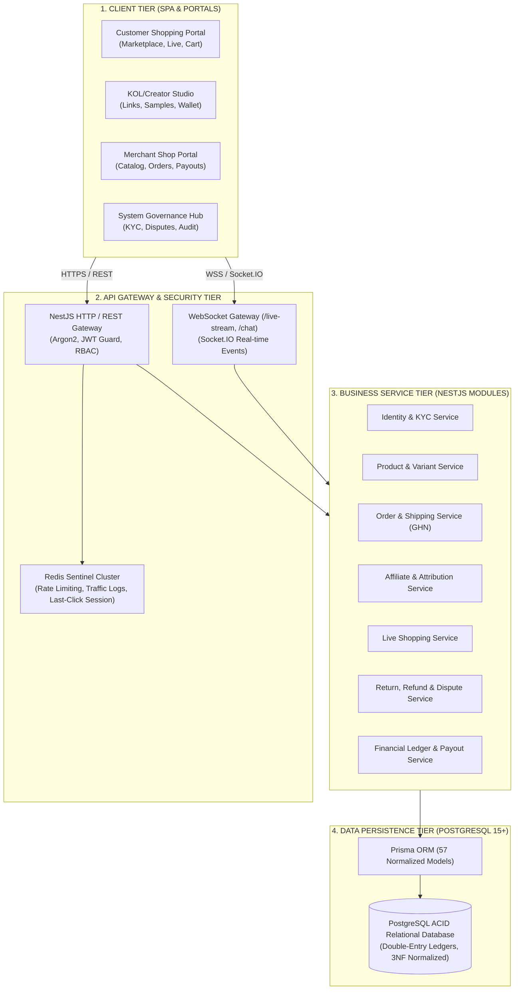
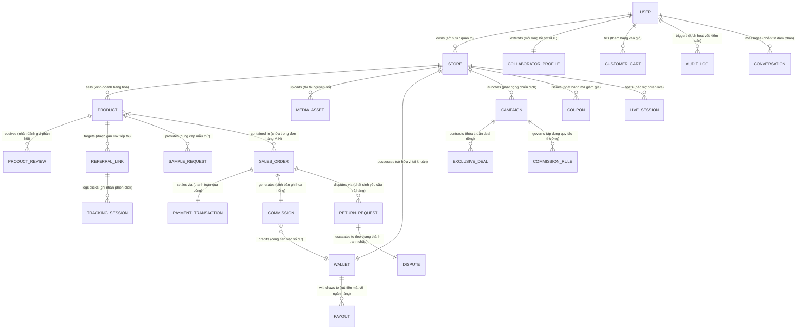

# ĐẶC TẢ THIẾT KẾ ERD 3 CẤP ĐỘ CHUẨN QUỐC TẾ: CONCEPTUAL - LOGICAL - PHYSICAL
## DỰ ÁN: SCANMS - SÀN THƯƠNG MẠI TIẾP THỊ LIÊN KẾT & MẠNG LƯỚI GIAN HÀNG ĐỐI TÁC
**Mã đề tài:** FA26SE032 | **Team Leader:** Nguyễn Thành Thắng  
**Tiêu chuẩn áp dụng:** DAMA-DMBOK, BABOK, UML 2.5, Crow's Foot Notation, Chuẩn hóa 3NF, PostgreSQL Physical DDL  
**Tài liệu tham chiếu & đối soát:** `c_m_nang_thi_t_k_state_machine_v_erd_chu_n_qu_c_t.md` & `ERD_Conceptual_Logical_Physical_Guide.docx`

---

## MỤC LỤC
1. [Nghiên cứu & Đánh giá so sánh 2 tài liệu hướng dẫn](#1-nghiên-cứu--đánh-giá-so-sánh-2-tài-liệu-hướng-dẫn)
2. [Tổng quan kiến trúc toàn diện SCANMS (Frontend - Backend - Database)](#2-tổng-quan-kiến-trúc-toàn-diện-scanms-frontend---backend---database)
3. [Quy chuẩn ký hiệu Chân chim (Crow's Foot Notation) & Quy tắc chuyển đổi 3 cấp độ](#3-quy-chuẩn-ký-hiệu-chân-chim-crows-foot-notation--quy-tắc-chuyển-đổi-3-cấp-độ)
4. [Cấp độ 1: Mô hình thực thể khái niệm (Conceptual ERD)](#4-cấp-độ-1-mô-hình-thực-thể-khái-niệm-conceptual-erd)
5. [Cấp độ 2: Mô hình dữ liệu logic & Rà soát chuẩn hóa 3NF (Logical ERD)](#5-cấp-độ-2-mô-hình-dữ-liệu-logic--rà-soát-chuẩn-hóa-3nf-logical-erd)
6. [Cấp độ 3: Mô hình vật lý triển khai PostgreSQL (Physical ERD & DDL)](#6-cấp-độ-3-mô-hình-vật-lý-triển-khai-postgresql-physical-erd--ddl)
7. [Mã nguồn DBML trực quan (Dùng trên dbdiagram.io)](#7-mã-nguồn-dbml-trực-quan-dùng-trên-dbdiagramio)
8. [Checklist kiểm tra trước khi bảo vệ trước Hội đồng](#8-checklist-kiểm-tra-trước-khi-bảo-vệ-trước-hội-đồng)

---

## 1. NGHIÊN CỨU & ĐÁNH GIÁ SO SÁNH 2 TÀI LIỆU HƯỚNG DẪN

Hệ thống đã tiến hành phân tích chuyên sâu hai tài liệu hướng dẫn thiết kế được cung cấp:
- **Tài liệu A:** `c_m_nang_thi_t_k_state_machine_v_erd_chu_n_qu_c_t.md`
- **Tài liệu B:** `ERD_Conceptual_Logical_Physical_Guide.docx`

### 1.1. Bảng đối chiếu so sánh chuyên sâu

| Tiêu chí đánh giá | Tài liệu A (`.md`) | Tài liệu B (`.docx`) | Đánh giá & Quyết định giải pháp cho SCANMS |
| :--- | :--- | :--- | :--- |
| **Tính chuẩn tắc lý thuyết (Standardization)** | **Rất cao (Xuất sắc):** Định nghĩa chuẩn mực DAMA-DMBOK/BABOK; phân biệt rạch ròi 3 tầng; quy định bắt buộc về việc giữ/phá vỡ quan hệ $M:N$; phân biệt đường nét liền (Identifying) và đường nét đứt (Non-identifying). | **Khá tốt:** Nêu đúng bản chất 3 tầng và các bước tuần tự từ nghiệp vụ đến triển khai; có checklist rà soát lỗi thường bị hội đồng bắt bẻ. | **Lấy nền tảng lý thuyết và quy chuẩn ký hiệu từ Tài liệu A:** Đảm bảo tính khoa học chặt chẽ, không bị giảng viên hay hội đồng phản biện bắt bẻ về mặt hình thức. |
| **Quy chuẩn ký hiệu Chân chim (Crow's Foot)** | **Rất chi tiết:** Bảng phân tích cấu trúc 2 ký hiệu đi liền (Minimum Cardinality: `0`, `|` và Maximum Cardinality: `|`, `<`), giải thích đầy đủ 4 trạng thái: `||`, `o|`, `|<`, `o<`. | **Cơ bản:** Liệt kê các ký hiệu `||`, `o|`, `o<`, `|<` ở mức mô tả ngắn gọn. | **Áp dụng bảng tra cứu ký hiệu của Tài liệu A** cho toàn bộ sơ đồ 3 cấp độ của SCANMS. |
| **Sự phù hợp với Ngữ cảnh Nghiệp vụ (Domain Relevance)** | **Thấp:** Dùng ví dụ về Web Bán Game tích hợp Quét Virus (ClamAV / VirusTotal), không phản ánh nghiệp vụ sàn TMĐT tiếp thị liên kết. | **Rất cao (Trùng khớp 100%):** Xây dựng trên chính bài toán Quản lý Shop, KOL, Chiến dịch đẩy số, Đơn hàng, Voucher, Hoa hồng và Quyết toán Payout. | **Lấy ngữ cảnh nghiệp vụ cốt lõi từ Tài liệu B**, sau đó mở rộng theo cơ sở dữ liệu thực tế 57 thực thể của SCANMS. |
| **Hỗ trợ công cụ vẽ tự động (Tooling / Automation)** | **Rất cao:** Cung cấp mã DBML hoàn chỉnh để dán vào `dbdiagram.io` kết xuất sơ đồ tức thì. | **Khá tốt:** Hướng dẫn quy trình dựng 3 trang trên `diagrams.net` (draw.io) và nhóm theo màu sắc nghiệp vụ. | **Kết hợp cả hai:** Cung cấp file `.drawio` đa trang (cho draw.io) và mã nguồn DBML (cho dbdiagram.io) cùng mã Mermaid hiển thị ngay trong Markdown. |

### 1.2. Kết luận Chiến lược Thiết kế (Synthesis Strategy)
> **Quyết định:** Sử dụng **phương pháp lai (Hybrid Synthesis)** kết hợp ưu điểm vượt trội của cả hai tài liệu:
> 1. **Quy chuẩn hình thức & Tính khoa học:** Tuân thủ 100% quy tắc phân tầng, ký hiệu chân chim, phân định nét liền/nét đứt và mã DBML từ **Tài liệu A**.
> 2. **Kiến trúc nghiệp vụ & Bài toán thực tế:** Khai thác toàn bộ luồng nghiệp vụ Shop - KOL - Đơn hàng - Hoa hồng - Voucher từ **Tài liệu B**, đồng thời mở rộng khớp nối chính xác với kiến trúc kỹ thuật hiện tại của dự án SCANMS (NestJS, Prisma ORM, PostgreSQL, Redis, Socket.IO).

---

## 2. TỔNG QUAN KIẾN TRÚC TOÀN DIỆN SCANMS (FRONTEND - BACKEND - DATABASE)

Hệ thống SCANMS (Sales Collaborator & Affiliate Network Management System) được thiết kế theo mô hình kiến trúc phân lớp hướng module (Modular Clean Architecture), đáp ứng năng lực xử lý lưu lượng lớn, giao dịch tài chính minh bạch và độ trễ thấp.



### 2.1. Phân hệ Frontend (Client Tier)
- **Công nghệ:** React 18, TypeScript, Vite, Tailwind CSS (Hệ màu Warm Sand Gold `#C59B58`, `#FAF8F5`, `#1A1612`), React Query, Socket.IO Client.
- **Trải nghiệm nghiệp vụ:**
  - *Customer:* Xem hàng, săn sale, chốt deal trên Livestream, thanh toán VietQR / PayOS, yêu cầu đổi trả hàng minh bạch.
  - *Collaborator (KOL/KOC):* Tạo link tiếp thị rút gọn, tạo mã QR, yêu cầu sản phẩm mẫu, theo dõi hoa hồng thời gian thực, rút tiền về tài khoản ngân hàng.
  - *Merchant (Shop Manager):* Quản lý sản phẩm đa biến thể, duyệt mẫu thử, xử lý đơn hàng, theo dõi hiệu quả tiếp thị của từng KOL, đối soát hoa hồng và chi trả.
  - *System Admin/Manager:* Kiểm duyệt hồ sơ KYC, trọng tài xử lý tranh chấp đổi trả, kiểm toán giao dịch (Audit Logs) và phòng chống gian lận traffic (AI Sentinel).

### 2.2. Phân hệ Backend (Application Service Tier)
- **Công nghệ:** NestJS (Node.js LTS), TypeScript, Prisma Client, Socket.IO Gateway, BullMQ / Redis Task Queue.
- **Bảo mật & Hiệu năng:**
  - Mã hóa mật khẩu Argon2, cơ chế xác thực JWT kép (Access Token ngắn hạn + Refresh Token xoay vòng).
  - Phân quyền theo vai trò (RBAC) với 5 cấp: `SYSTEM_ADMIN`, `SYSTEM_MANAGER`, `SHOP_MANAGER`, `COLLABORATOR`, `CUSTOMER`.
  - Redis Token Bucket ngăn chặn click-spam gian lận traffic, bảo vệ thuật toán Attribution Last-Click 30 ngày.

### 2.3. Phân hệ Cơ sở dữ liệu (Database Tier - Toàn bộ 61 Bảng Nghiệp Vụ)
- **Công nghệ:** PostgreSQL v15+ (Supabase Cloud Hosted) kết hợp Prisma ORM.
- **Quy mô thực tế:** **61 bảng vật lý** (gồm 57 Domain Models được định nghĩa trong `schema.prisma` và 4 bảng mở rộng vận chuyển & khuyến mãi cộng dồn trên PostgreSQL) được tổ chức thành 10 phân hệ nghiệp vụ hoàn chỉnh:
  1. *Định danh, Hồ sơ & Bảo mật (7 bảng):* `users`, `customer_identities`, `collaborator_profiles`, `collaborator_tiers`, `collaborator_social_channels`, `customer_addresses`, `audit_logs`.
  2. *Gian hàng, Quản trị Shop & Giao tiếp (8 bảng):* `stores`, `store_collaborators`, `store_follows`, `store_wallets`, `media_assets`, `conversations`, `chat_messages`, `notifications`.
  3. *Danh mục, Sản phẩm Đa Biến thể & Giỏ hàng (5 bảng):* `products`, `product_variants`, `product_reviews`, `customer_wishlists`, `customer_cart_items`.
  4. *Chiến dịch Đẩy số, Bậc Thưởng & Deal Riêng (7 bảng):* `campaigns`, `campaign_participants`, `campaign_products`, `exclusive_deal_proposals`, `commission_rules`, `monthly_bonus_results`, `bonus_adjustments`.
  5. *Theo dõi Tiếp thị & Phân bổ Last-Click (4 bảng):* `referral_links`, `click_traffic_logs`, `attribution_sessions`, `attribution_adjustments`.
  6. *Mẫu thử Trải nghiệm & Livestream Tương tác (7 bảng):* `sample_product_requests`, `sample_request_events`, `sample_shipping_charges`, `live_shopping_sessions`, `live_session_products`, `live_session_claims`, `live_session_viewers`.
  7. *Khuyến mãi, Mã Ưu đãi & Ví Voucher (6 bảng):* `coupons`, `coupon_products`, `coupon_categories`, `coupon_redemptions`, `customer_saved_coupons`, `stacked_voucher_redemptions`.
  8. *Thương mại, Đơn hàng & Vận đơn (5 bảng):* `orders`, `order_items`, `payment_transactions`, `order_refunds`, `ghn_tracking_records`.
  9. *Khiếu nại, Đổi trả & Tranh chấp (6 bảng):* `return_requests`, `return_items`, `return_shipments`, `return_refunds`, `return_events`, `return_disputes`.
  10. *Tài chính, Hoa hồng & Sổ cái Kép (6 bảng):* `commissions`, `wallets`, `wallet_top_ups`, `financial_ledgers`, `payout_requests`, `payout_batches`.
- **Quy chuẩn hiển thị sơ đồ:**
  - **100% Đen Trắng (Pure Monochrome B&W):** Nền trắng (`#FFFFFF`), viền đen (`#000000`), chữ đen (`#000000`), không sử dụng các màu vàng/cam/be gây rối mắt hoặc sai chuẩn in ấn học thuật của Hội đồng.
  - Sử dụng chuẩn ký hiệu Draw.io ERD Shape (`swimlane`, `table`), các đầu nối chân chim (`||`, `|<`, `o|`, `o<`), phân biệt rạch ròi đường nét liền (Identifying) và đường nét đứt (Non-identifying).

---

## 3. QUY CHUẨN KÝ HIỆU CHÂN CHIM (CROW'S FOOT NOTATION) & QUY TẮC CHUYỂN ĐỔI 3 CẤP ĐỘ

Theo tiêu chuẩn quốc tế DAMA-DMBOK và BABOK, mỗi đầu mối quan hệ trong sơ đồ ERD được xác định bởi 2 thành phần: **Số lượng tối thiểu (Minimum Cardinality)** và **Số lượng tối đa (Maximum Cardinality)**.

### 3.1. Bảng ký hiệu Chân chim chuẩn mực

| Ký hiệu | Tên gọi chuẩn | Ý nghĩa nghiệp vụ | Ứng dụng thực tế trong SCANMS |
| :---: | :--- | :--- | :--- |
| **`\|\|`** | **Mandatory One** (Bắt buộc duy nhất một) | Phải có ít nhất 1 và không được vượt quá 1. | Một `Order` bắt buộc thuộc về **duy nhất 1** `Store`. |
| **`o\|`** | **Optional One** (Không hoặc một) | Có thể chưa có (0), nếu có thì tối đa là 1. | Một `User` có thể **chưa có hoặc có tối đa 1** `CollaboratorProfile`. |
| **`\|<`** | **Mandatory Many** (Một hoặc nhiều) | Bắt buộc có ít nhất 1 và có thể có nhiều. | Một `Order` hợp lệ bắt buộc có **ít nhất 1 đến nhiều** `OrderItem`. |
| **`o<`** | **Optional Many** (Không hoặc nhiều) | Có thể chưa có (0) hoặc có thể có nhiều. | Một `Store` mới mở có thể có **0 hoặc nhiều** `Product`. |

### 3.2. Quy tắc đường nét liền (Identifying) và đường nét đứt (Non-identifying)
1. **Đường nét liền (Identifying Relationship):**
   - Áp dụng khi bảng con là **Thực thể phụ thuộc (Weak / Associative Entity)** và khóa chính của bảng cha tham gia vào cấu thành **Khóa chính kết hợp (Composite PK)** của bảng con.
   - *Ví dụ trong SCANMS:* Bảng `coupon_products` có PK ghép là `(coupon_id, product_id)`.
2. **Đường nét đứt (Non-identifying Relationship):**
   - Áp dụng khi bảng con có **Khóa chính độc lập riêng** (`UUID PK`), và khóa chính của bảng cha chỉ truyền sang đóng vai trò là **Khóa ngoại (`FK`)** thông thường.
   - *Ví dụ trong SCANMS:* Bảng `orders` có PK riêng là `id`, trường `store_id` là khóa ngoại tham chiếu đến `stores(id)`.

### 3.3. Bảng phân định ranh giới 3 cấp độ ERD

| Thuộc tính so sánh | 1. Conceptual ERD (Khái niệm) | 2. Logical ERD (Logic) | 3. Physical ERD (Vật lý) |
| :--- | :--- | :--- | :--- |
| **Mục đích chính** | Xác lập phạm vi bài toán và quy tắc nghiệp vụ cấp cao. | Chuẩn hóa cấu trúc dữ liệu, giải quyết triệt để quan hệ đa trị. | Đặc tả kỹ thuật để sinh DDL trực tiếp trên PostgreSQL. |
| **Đối tượng tiếp nhận** | Giảng viên hướng dẫn, Product Owner, Doanh nghiệp đối tác. | Business Analyst (BA), Solution Architect. | Database Administrator (DBA), Backend Developer. |
| **Hiển thị thuộc tính** | **Không hiển thị** bất kỳ thuộc tính nào. | **Hiển thị đầy đủ** danh sách thuộc tính nghiệp vụ. | **Hiển thị tên cột chuẩn SQL** (`snake_case`). |
| **Khóa (PK / FK)** | **Không có.** | **Xác định rõ ràng** `[PK]`, `[FK]`, `[UQ]`. | **Đầy đủ** `PK`, `FK`, `INDEX`, `DEFAULT`, `CHECK`. |
| **Kiểu dữ liệu** | **Không có.** | Kiểu logic tổng quát (`Text`, `Number`, `Money`, `DateTime`). | Kiểu vật lý PostgreSQL (`UUID`, `VARCHAR`, `DECIMAL(15,2)`). |
| **Quan hệ Nhiều - Nhiều ($M:N$)** | **ĐƯỢC PHÉP GIỮ NGUYÊN** đường nối $M:N$. | **BẮT BUỘC PHÁ BỎ** bằng Thực thể trung gian. | Đã triển khai thành Bảng trung gian vật lý hoàn chỉnh. |

---

## 4. CẤP ĐỘ 1: MÔ HÌNH THỰC THỂ KHÁI NIỆM (CONCEPTUAL ERD)

### 4.1. Nguyên tắc thiết kế (DAMA-DMBOK / BABOK Framework)
- **Chỉ bao gồm Tên Thực thể Cấp cao (Business Entities):** Tuyệt đối không đưa thuộc tính, kiểu dữ liệu hay khóa kỹ thuật (`PK`, `FK`, `UUID`) vào sơ đồ nhằm duy trì tính độc lập hoàn toàn với công nghệ cài đặt.
- **Giữ nguyên các mối quan hệ Nhiều - Nhiều ($M:N$):** Thể hiện sự tương tác nghiệp vụ tự nhiên giữa các thực thể kinh doanh (ví dụ: `PRODUCT` được chứa trong nhiều `SALES_ORDER`, một đơn hàng chứa nhiều sản phẩm; `STORE` cấp nhiều `COUPON` áp dụng cho nhiều `PRODUCT`).
- **Động từ kết nối rõ nghĩa (Semantic Relationship Verbs):** Mỗi đường liên kết gắn nhãn động từ đặc tả rõ bản chất quy trình kinh doanh (`sở hữu`, `kinh doanh`, `phát động`, `ghi nhận click`, `phát sóng live`, `chốt đơn`, `sinh hoa hồng`, `khiếu nại`, `trọng tài`).
- **Bao quát toàn diện 10 Phân hệ:** Đảm bảo không bỏ sót bất kỳ mảng vận hành nào của sàn thương mại tiếp thị liên kết đa gian hàng.

### 4.2. Danh mục 24 Thực thể Khái niệm Trọng tâm (10 Phân hệ Vận hành)

| STT | Thực thể Khái niệm | Phân hệ Nghiệp vụ | Vai trò & Ý nghĩa trong Nền tảng SCANMS |
| :---: | :--- | :--- | :--- |
| 1 | **`USER`** | 1. Định danh & Bảo mật | Chủ thể người dùng toàn sàn (Khách hàng, KOL/KOC, Chủ Shop, Quản trị viên). |
| 2 | **`COLLABORATOR_PROFILE`** | 1. Định danh & Bảo mật | Hồ sơ năng lực, kênh mạng xã hội và thông tin định danh KYC của KOL/KOC. |
| 3 | **`CUSTOMER_CART`** | 1. Định danh & Bảo mật | Giỏ hàng cá nhân hóa lưu trữ sản phẩm dự định mua của khách hàng. |
| 4 | **`AUDIT_LOG`** | 1. Định danh & Bảo mật | Bản ghi kiểm toán dấu vết thao tác, bảo vệ an toàn thông tin toàn sàn. |
| 5 | **`STORE`** | 2. Gian hàng & Hợp tác | Gian hàng đối tác D2C kinh doanh sản phẩm và phát động chương trình tiếp thị. |
| 6 | **`MEDIA_ASSET`** | 2. Gian hàng & Hợp tác | Kho tài nguyên số tập trung (hình ảnh, video) chia sẻ cho KOL quảng bá. |
| 7 | **`CONVERSATION`** | 2. Gian hàng & Hợp tác | Kênh đàm phán hợp tác thương mại trực tiếp giữa Shop, KOL và Khách hàng. |
| 8 | **`WALLET`** | 2. Gian hàng & Hợp tác | Ví điện tử lưu giữ số dư khả dụng và chờ xử lý theo nguyên lý bút toán kép. |
| 9 | **`PRODUCT`** | 3. Danh mục & Tiếp thị | Hàng hóa kinh doanh trên sàn kèm chính sách hoa hồng cơ sở 10% chuẩn mực. |
| 10 | **`PRODUCT_REVIEW`** | 3. Danh mục & Tiếp thị | Đánh giá, phản hồi và chấm điểm chất lượng sản phẩm từ người mua thực tế. |
| 11 | **`REFERRAL_LINK`** | 3. Danh mục & Tiếp thị | Đường liên kết tiếp thị rút gọn gắn mã định danh cá nhân của từng KOL. |
| 12 | **`COMMISSION`** | 3. Danh mục & Tiếp thị | Khoản hoa hồng kinh doanh ghi nhận tự động cho KOL từ đơn hàng thành công. |
| 13 | **`CAMPAIGN`** | 4. Chiến dịch & Quyết toán | Chiến dịch đẩy số doanh thu do Shop phát động với ngân sách thưởng riêng. |
| 14 | **`EXCLUSIVE_DEAL`** | 4. Chiến dịch & Quyết toán | Thỏa thuận mức hoa hồng đặc quyền dành riêng cho từng KOL có sức ảnh hưởng lớn. |
| 15 | **`COMMISSION_RULE`** | 4. Chiến dịch & Quyết toán | Bộ quy tắc phân cấp bậc thưởng doanh số theo tháng (Tier Bonus Matrix). |
| 16 | **`PAYOUT`** | 4. Chiến dịch & Quyết toán | Lệnh quyết toán chi trả tiền mặt từ ví SCANMS về tài khoản ngân hàng của đối tác. |
| 17 | **`SAMPLE_REQUEST`** | 5. Trải nghiệm & Thanh toán | Yêu cầu xin cấp sản phẩm mẫu miễn phí của KOL để sản xuất nội dung review. |
| 18 | **`LIVE_SESSION`** | 5. Trải nghiệm & Thanh toán | Phiên phát sóng trực tiếp (Livestream) bán hàng tương tác kèm deal sốc độc quyền. |
| 19 | **`TRACKING_SESSION`** | 5. Trải nghiệm & Thanh toán | Phiên theo dõi hành vi truy cập và thuật toán phân bổ Last-Click 30 ngày. |
| 20 | **`PAYMENT_TRANSACTION`** | 5. Trải nghiệm & Thanh toán | Giao dịch cổng thanh toán điện tử (VietQR, PayOS, Thẻ quốc tế, Ví điện tử). |
| 21 | **`COUPON`** | 6. Đơn hàng & Tranh chấp | Mã giảm giá ưu đãi do Shop hoặc Sàn phát hành (Shop Voucher, Platform Voucher). |
| 22 | **`SALES_ORDER`** | 6. Đơn hàng & Tranh chấp | Đơn hàng mua sắm chính thức ràng buộc giữa Khách hàng, Shop và KOL tiếp thị. |
| 23 | **`RETURN_REQUEST`** | 6. Đơn hàng & Tranh chấp | Yêu cầu đổi trả hàng - hoàn tiền xuất phát từ người mua khi có lỗi sản phẩm. |
| 24 | **`DISPUTE`** | 6. Đơn hàng & Tranh chấp | Tranh chấp khiếu nại leo thang cần sự can thiệp và phân xử của Trọng tài Sàn. |

### 4.3. Sơ đồ Conceptual ERD (Mermaid Notation)



### 4.4. Sơ đồ Thực thể Khái niệm Trực quan (Conceptual ERD Visual Diagram)

> **Tiêu chuẩn thiết kế:** 100% Đen trắng (Pure Monochrome B&W), 100% Tiếng Anh học thuật chuẩn DAMA-DMBOK, không chứa thuộc tính hay khóa kỹ thuật thừa, khổ ngang rộng (2650 x 1000 px), các đường nối trực giao (orthogonal) cách ly hoàn toàn qua hệ thống 4 hành lang nằm ngang và 6 hành lang thẳng đứng, nhãn động từ quan hệ có viền bảo vệ chống đè, đầu nối chân chim xác định rõ tính bắt buộc/tùy chọn.


- **Tệp Vector SVG:** [SCANMS_ERD_01_Conceptual.svg](file:///c:/HW/CAPSTONE/docs/review%202/SCANMS_ERD_01_Conceptual.svg)
- **Tệp Nguồn Draw.io:** [SCANMS_ERD_01_Conceptual.drawio](file:///c:/HW/CAPSTONE/docs/review%202/SCANMS_ERD_01_Conceptual.drawio)

---

## 5. CẤP ĐỘ 2: MÔ HÌNH DỮ LIỆU LOGIC & RÀ SOÁT CHUẨN HÓA 3NF (LOGICAL ERD)

### 5.1. Phá vỡ triệt để các quan hệ Nhiều - Nhiều ($M:N$)
Để chuyển từ mô hình Khái niệm sang mô hình Logic, toàn bộ các quan hệ $M:N$ bắt buộc phải được chuẩn hóa thông qua các Thực thể kết hợp (Associative Entities) độc lập:

1. **`CAMPAIGN` $M:N$ `COLLABORATOR`** $
ightarrow$ Tách thành thực thể **`CAMPAIGN_PARTICIPANTS`**:
   - Lưu trữ: Ngày tham gia, mức hoa hồng cam kết riêng, trạng thái lời mời (`INVITED`, `ACCEPTED`, `REJECTED`).
2. **`CAMPAIGN` $M:N$ `PRODUCT`** $
ightarrow$ Tách thành thực thể **`CAMPAIGN_PRODUCTS`**:
   - Xác định danh sách mặt hàng được đẩy số riêng trong chiến dịch.
3. **`SALES_ORDER` $M:N$ `PRODUCT_VARIANT`** $
ightarrow$ Tách thành thực thể **`ORDER_ITEMS`**:
   - Lưu trữ: Số lượng mua, đơn giá tại thời điểm đặt, biến thể sản phẩm (SKU/Color/Size), tỷ lệ hoa hồng chốt tại thời điểm mua.
4. **`COUPON` $M:N$ `PRODUCT`** $
ightarrow$ Tách thành thực thể **`COUPON_PRODUCTS`**:
   - Xác định danh sách sản phẩm được phép áp dụng voucher ưu đãi.
5. **`COUPON` $M:N$ `CATEGORY`** $
ightarrow$ Tách thành thực thể **`COUPON_CATEGORIES`**:
   - Xác định toàn bộ danh mục hàng hóa được hưởng khuyến mãi.
6. **`COUPON` $M:N$ `CUSTOMER`** $
ightarrow$ Tách thành thực thể **`CUSTOMER_SAVED_COUPONS`**:
   - Quản lý ví voucher cá nhân của khách hàng đã thu thập mã.
7. **`COUPON` $M:N$ `SALES_ORDER`** $
ightarrow$ Tách thành **`COUPON_REDEMPTIONS`** & **`STACKED_VOUCHER_REDEMPTIONS`**:
   - Ghi nhận lịch sử khấu trừ voucher đơn lẻ và cơ chế cộng dồn (Shop Voucher + Platform Voucher).
8. **`LIVE_SESSION` $M:N$ `PRODUCT_VARIANT`** $
ightarrow$ Tách thành thực thể **`LIVE_SESSION_PRODUCTS`**:
   - Lưu trữ: Thứ tự ghim giới thiệu (`pinned_order`), giá sốc độc quyền phiên live, tồn kho cấp riêng cho live.
9. **`LIVE_SESSION` $M:N$ `CUSTOMER`** $
ightarrow$ Tách thành **`LIVE_SESSION_VIEWERS`** & **`LIVE_SESSION_CLAIMS`**:
   - Quản lý lượt người xem thực tế, thời lượng xem và lịch sử săn deal chốt đơn trong phòng live.
10. **`CUSTOMER` $M:N$ `PRODUCT_VARIANT`** $
ightarrow$ Tách thành **`CUSTOMER_CART_ITEMS`** & **`CUSTOMER_WISHLISTS`**:
    - Quản lý chi tiết giỏ hàng và danh sách sản phẩm yêu thích của người mua.
11. **`STORE` $M:N$ `COLLABORATOR`** $
ightarrow$ Tách thành thực thể **`STORE_COLLABORATORS`**:
    - Quản lý mối quan hệ hợp tác trực tiếp giữa Merchant và KOL được duyệt.
12. **`RETURN_REQUEST` $M:N$ `ORDER_ITEM`** $
ightarrow$ Tách thành thực thể **`RETURN_ITEMS`**:
    - Ghi nhận chi tiết từng mặt hàng và số lượng người mua yêu cầu hoàn trả trong một đơn hàng.

### 5.2. Rà soát chuẩn hóa dữ liệu 1NF - 2NF - 3NF

| Dạng chuẩn hóa | Tiêu chí kiểm định | Minh chứng thực tế trong thiết kế Logic SCANMS |
| :--- | :--- | :--- |
| **1NF (First Normal Form)** | - Mọi thuộc tính đều mang giá trị nguyên tố (Atomic values).<br>- Không chứa mảng danh sách hay lặp nhóm cột. | - Tách riêng bảng `collaborator_social_channels` để lưu từng kênh MXH (TikTok, Facebook, YouTube) thay vì nhồi chuỗi phân cách trong User.<br>- Tách riêng `order_items` để lưu từng mặt hàng trong đơn thay vì gộp chung chuỗi JSON. |
| **2NF (Second Normal Form)** | - Đã đạt 1NF.<br>- Toàn bộ các thuộc tính không khóa phải phụ thuộc hàm đầy đủ vào Khóa chính (loại bỏ phụ thuộc một phần vào khóa ghép). | - Trong bảng `order_items`, thuộc tính `unit_price`, `quantity`, `applied_commission_rate` phụ thuộc hoàn toàn vào cặp khóa ghép `(order_id, product_variant_id)`.<br>- Tên sản phẩm, mô tả không lưu lặp trong `order_items` mà tham chiếu về `products`. |
| **3NF (Third Normal Form)** | - Đã đạt 2NF.<br>- Không tồn tại phụ thuộc bắc cầu (Transitive Dependency) giữa các thuộc tính không khóa. | - Trong bảng `orders`, không lưu trực tiếp thông tin Ngân hàng của Shop mà chỉ lưu `store_id`.<br>- Thuộc tính cấp bậc thưởng hoa hồng được tách riêng vào bảng `collaborator_tiers` thay vì ghi trực tiếp vào `collaborator_profiles`. |

### 5.3. Bảng quy đổi Kiểu dữ liệu Logic Chuẩn hóa (DAMA-DMBOK)

Trong mô hình Logic, toàn bộ kiểu dữ liệu được trừu tượng hóa thành các Kiểu dữ liệu Logic Độc lập Công nghệ (Technology-Independent Logical Types), hoàn toàn không phụ thuộc vào cú pháp riêng của PostgreSQL, MySQL hay Oracle:

| Kiểu dữ liệu Logic | Ý nghĩa Nghiệp vụ | Ví dụ thuộc tính trong SCANMS | Ánh xạ Vật lý (PostgreSQL) |
| :--- | :--- | :--- | :--- |
| **`Identifier`** | Khóa chính, khóa ngoại định danh thực thể duy nhất | `id`, `user_id`, `store_id`, `order_id` | `UUID` (hoặc `VARCHAR(36)`) |
| **`Text`** | Chuỗi ký tự mô tả, tên gọi, địa chỉ, URL | `full_name`, `title`, `description`, `destination_url` | `VARCHAR(255)`, `TEXT` |
| **`Category`** | Trạng thái, vai trò, loại hình, phân loại cố định | `role`, `status`, `payment_method`, `carrier` | `ENUM`, `VARCHAR(50)` |
| **`Money`** | Giá trị tài chính, doanh số, số dư ví, giá tiền | `base_price`, `total_amount`, `balance_available` | `DECIMAL(15,2)` |
| **`Percent`** | Tỷ lệ phần trăm hoa hồng, chiết khấu, thuế | `applied_commission_rate`, `discount_rate` | `DECIMAL(5,2)` |
| **`Integer`** | Số lượng đếm được, thứ tự, tồn kho, lượt click | `quantity`, `stock_quantity`, `click_count` | `INTEGER`, `BIGINT` |
| **`Boolean`** | Cờ nhị phân mang giá trị Đúng/Sai | `is_active`, `is_verified`, `is_read` | `BOOLEAN` |
| **`DateTime`** | Mốc thời gian nghiệp vụ có độ chính xác cao | `created_at`, `starts_at`, `ordered_at` | `TIMESTAMPTZ` |
| **`JSON`** | Cấu trúc dữ liệu mở rộng, lịch sử sự kiện | `attributes`, `social_links_json`, `events` | `JSONB` |

### 5.4. Danh mục 61 Thực thể Dữ liệu Logic (10 Cột Phân hệ Nghiệp vụ Chuẩn 3NF)

Toàn bộ **61 Thực thể Logic** được chuẩn hóa phân bổ trên 10 phân hệ nghiệp vụ, loại bỏ 100% quan hệ $M:N$ và đảm bảo tính toàn vẹn tham chiếu chặt chẽ:

1. **Phân hệ 1: Định danh, Hồ sơ & Bảo mật (7 thực thể)**
   - `USERS`: Tài khoản người dùng toàn sàn với mã định danh `Identifier`, vai trò `Category`.
   - `CUSTOMER_IDENTITIES`: Hồ sơ định danh bổ sung cho khách mua hàng.
   - `COLLABORATOR_PROFILES`: Hồ sơ năng lực đối tác KOL/KOC, định danh KYC, thông tin thuế.
   - `COLLABORATOR_TIERS`: Cấp bậc đối tác và tỷ lệ thưởng bổ sung (`extra_bonus_percentage : Percent`).
   - `COLLABORATOR_SOCIAL_CHANNELS`: Kênh mạng xã hội liên kết (TikTok, YouTube, Facebook, Instagram).
   - `CUSTOMER_ADDRESSES`: Sổ địa chỉ nhận hàng của khách hàng.
   - `AUDIT_LOGS`: Nhật ký kiểm toán bảo mật, địa chỉ IP và dấu vết thao tác toàn hệ thống.

2. **Phân hệ 2: Gian hàng, Quản trị Shop & Giao tiếp (8 thực thể)**
   - `STORES`: Gian hàng đối tác D2C, tỷ lệ hoa hồng mặc định, cửa sổ phân bổ 30 ngày.
   - `STORE_COLLABORATORS`: Danh sách KOL được gian hàng chấp thuận hợp tác chính thức.
   - `STORE_FOLLOWS`: Khách hàng theo dõi cập nhật sản phẩm của gian hàng.
   - `STORE_WALLETS`: Ví số dư tài khoản của gian hàng.
   - `MEDIA_ASSETS`: Kho hình ảnh, video sản phẩm dùng chung phục vụ tiếp thị.
   - `CONVERSATIONS`: Kênh trò chuyện, thương lượng giữa Shop, KOL và Khách.
   - `CHAT_MESSAGES`: Nội dung tin nhắn trao đổi thời gian thực.
   - `NOTIFICATIONS`: Trung tâm thông báo đẩy cho từng chủ thể.

3. **Phân hệ 3: Danh mục, Sản phẩm Đa Biến thể & Giỏ hàng (5 thực thể)**
   - `PRODUCTS`: Thông tin sản phẩm cơ sở, thương hiệu, danh mục, kiểm duyệt sàn.
   - `PRODUCT_VARIANTS`: Biến thể quy cách Màu/Size, SKU con, đơn giá và tồn kho riêng.
   - `PRODUCT_REVIEWS`: Đánh giá chất lượng và điểm sao từ người mua đã xác thực.
   - `CUSTOMER_WISHLISTS`: Danh sách sản phẩm lưu vào mục yêu thích của khách hàng.
   - `CUSTOMER_CART_ITEMS`: Các biến thể sản phẩm đang nằm trong giỏ hàng chờ thanh toán.

4. **Phân hệ 4: Chiến dịch Đẩy số, Bậc Thưởng & Deal Riêng (7 thực thể)**
   - `CAMPAIGNS`: Chiến dịch khuyến mãi, đẩy số hoa hồng theo mùa vụ của Shop.
   - `CAMPAIGN_PARTICIPANTS`: Đối tác KOL tham gia chiến dịch kèm tỷ lệ cam kết riêng.
   - `CAMPAIGN_PRODUCTS`: Danh mục sản phẩm được đẩy mạnh trong chiến dịch.
   - `EXCLUSIVE_DEAL_PROPOSALS`: Đề xuất thỏa thuận hoa hồng đặc quyền giữa Shop và KOL.
   - `COMMISSION_RULES`: Bộ quy tắc thưởng hoa hồng bậc thang theo hạn mức doanh thu tháng.
   - `MONTHLY_BONUS_RESULTS`: Kết quả tính thưởng doanh số hàng tháng của từng KOL.
   - `BONUS_ADJUSTMENTS`: Các bút toán điều chỉnh thưởng phát sinh do khiếu nại hoặc đối soát.

5. **Phân hệ 5: Theo dõi Tiếp thị & Phân bổ Last-Click (4 thực thể)**
   - `REFERRAL_LINKS`: Đường link tiếp thị rút gọn kèm mã QR do KOL tạo.
   - `CLICK_TRAFFIC_LOGS`: Nhật ký chi tiết từng lượt click chuột, IP, User-Agent, thiết bị.
   - `ATTRIBUTION_SESSIONS`: Phiên phân bổ theo dõi thời hạn 30 ngày theo cơ chế Last-Click.
   - `ATTRIBUTION_ADJUSTMENTS`: Biên bản điều chỉnh phân bổ hoa hồng khi phát hiện gian lận traffic.

6. **Phân hệ 6: Mẫu thử Trải nghiệm & Livestream Tương tác (7 thực thể)**
   - `SAMPLE_PRODUCT_REQUESTS`: Đơn xin cấp sản phẩm mẫu miễn phí của KOL.
   - `SAMPLE_REQUEST_EVENTS`: Nhật ký sự kiện duyệt mẫu, đóng gói và gửi hàng mẫu.
   - `SAMPLE_SHIPPING_CHARGES`: Cước phí vận chuyển mẫu thử do Shop chi trả.
   - `LIVE_SHOPPING_SESSIONS`: Phiên phát sóng trực tiếp Livestream bán hàng tương tác.
   - `LIVE_SESSION_PRODUCTS`: Danh mục sản phẩm được ghim bán kèm giá độc quyền trong live.
   - `LIVE_SESSION_CLAIMS`: Danh sách voucher sốc được người xem săn trong phiên live.
   - `LIVE_SESSION_VIEWERS`: Nhật ký người xem, thời lượng theo dõi phiên livestream.

7. **Phân hệ 7: Khuyến mãi, Mã Ưu đãi & Ví Voucher (6 thực thể)**
   - `COUPONS`: Mã giảm giá ưu đãi do Shop hoặc Sàn phát hành.
   - `COUPON_PRODUCTS`: Giới hạn sản phẩm áp dụng mã giảm giá.
   - `COUPON_CATEGORIES`: Giới hạn danh mục sản phẩm áp dụng mã giảm giá.
   - `COUPON_REDEMPTIONS`: Lịch sử sử dụng mã giảm giá theo từng đơn hàng.
   - `CUSTOMER_SAVED_COUPONS`: Ví lưu trữ voucher đã thu thập của khách hàng.
   - `STACKED_VOUCHER_REDEMPTIONS`: Ghi nhận khấu trừ voucher cộng dồn nhiều tầng.

8. **Phân hệ 8: Thương mại, Đơn hàng & Vận đơn (5 thực thể)**
   - `ORDERS`: Đơn đặt hàng thương mại, tổng tiền, phí ship, trạng thái đơn.
   - `ORDER_ITEMS`: Chi tiết mặt hàng, số lượng, đơn giá và hoa hồng chốt tại thời điểm mua.
   - `PAYMENT_TRANSACTIONS`: Giao dịch thanh toán điện tử qua cổng trung gian.
   - `ORDER_REFUNDS`: Bút toán hoàn tiền đơn hàng bị hủy hoặc trả hàng.
   - `GHN_TRACKING_RECORDS`: Bản ghi đồng bộ trạng thái vận đơn từ hãng vận chuyển Giao Hàng Nhanh.

9. **Phân hệ 9: Khiếu nại, Đổi trả & Tranh chấp (6 thực thể)**
   - `RETURN_REQUESTS`: Yêu cầu trả hàng - hoàn tiền xuất phát từ khách mua.
   - `RETURN_ITEMS`: Danh sách các mặt hàng cụ thể được yêu cầu hoàn trả.
   - `RETURN_SHIPMENTS`: Vận đơn gửi hàng trả ngược về kho của Merchant.
   - `RETURN_REFUNDS`: Lệnh hoàn tiền cho đơn trả hàng sau khi kiểm tra thành công.
   - `RETURN_EVENTS`: Dòng thời gian ghi nhận các bước xử lý đổi trả.
   - `RETURN_DISPUTES`: Hồ sơ tranh chấp leo thang cần Trọng tài sàn phán quyết.

10. **Phân hệ 10: Tài chính, Hoa hồng & Sổ cái Kép (6 thực thể)**
    - `COMMISSIONS`: Bản ghi hoa hồng tiếp thị theo đơn hàng của từng KOL.
    - `WALLETS`: Ví điện tử lưu giữ số dư khả dụng và số dư chờ duyệt.
    - `WALLET_TOP_UPS`: Giao dịch nạp tiền vào ví của chủ gian hàng.
    - `FINANCIAL_LEDGERS`: Sổ cái ghi chép biến động số dư theo nguyên lý Bút toán kép.
    - `PAYOUT_REQUESTS`: Lệnh yêu cầu rút tiền mặt về tài khoản ngân hàng của đối tác.
    - `PAYOUT_BATCHES`: Đợt thanh toán gộp ngân hàng do Quản trị viên duyệt hàng loạt.

### 5.5. Sơ đồ Dữ liệu Logic Chuẩn hóa 3NF (Logical ERD Visual Diagram)

> **Tiêu chuẩn thiết kế:** Toàn bộ 61 Thực thể Logic phân bổ cân bằng trên 10 Cột nghiệp vụ độc lập, phá vỡ 100% quan hệ $M:N$ thành thực thể kết hợp, 126 đường quan hệ chân chim có luồng dây cách ly độc lập trên các hành lang giữa các cột, không cắt xuyên qua bất kỳ bảng nào, 100% Tiếng Anh, chuẩn đen trắng doanh nghiệp theo khuyến nghị DAMA-DMBOK.


- **Tệp Vector SVG:** [SCANMS_ERD_02_Logical.svg](file:///c:/HW/CAPSTONE/docs/review%202/SCANMS_ERD_02_Logical.svg)
- **Tệp Nguồn Draw.io:** [SCANMS_ERD_02_Logical.drawio](file:///c:/HW/CAPSTONE/docs/review%202/SCANMS_ERD_02_Logical.drawio)

---
## 6. CẤP ĐỘ 3: MÔ HÌNH VẬT LÝ TRIỂN KHAI POSTGRESQL (PHYSICAL ERD & DDL)

Mô hình vật lý đặc tả chính xác tên bảng, kiểu dữ liệu native trên PostgreSQL 15, giá trị mặc định, chỉ mục (Index) và các ràng buộc khóa ngoại (Foreign Key Constraints) kèm chính sách `ON DELETE / ON UPDATE`.

### 6.1. Chi tiết Bảng Vật Lý Cốt Lõi (PostgreSQL DDL)

```sql
-- ====================================================================
-- 1. EXTENSIONS & SCHEMAS
-- ====================================================================
CREATE EXTENSION IF NOT EXISTS "uuid-ossp";
CREATE EXTENSION IF NOT EXISTS "pgcrypto";

-- ====================================================================
-- 2. ENUM TYPES
-- ====================================================================
CREATE TYPE user_role AS ENUM (
  'SYSTEM_ADMIN', 'SYSTEM_MANAGER', 'SHOP_MANAGER', 'COLLABORATOR', 'CUSTOMER'
);

CREATE TYPE order_status AS ENUM (
  'PENDING', 'SHIPPING', 'DELIVERED', 'COMPLETED', 'CANCELLED', 'RETURN_REQUESTED', 'DISPUTED', 'RETURNED'
);

CREATE TYPE commission_status AS ENUM (
  'PENDING', 'APPROVED', 'PAID', 'REVERSED'
);

CREATE TYPE payout_status AS ENUM (
  'PENDING', 'PROCESSING', 'APPROVED', 'REJECTED'
);

CREATE TYPE return_request_status AS ENUM (
  'REQUESTED', 'SHOP_APPROVED', 'PICKUP_BOOKED', 'SHOP_REJECTED', 'RETURN_SHIPPED', 
  'RETURN_RECEIVED', 'INSPECTING', 'REFUND_PENDING', 'COMPLETED', 'DISPUTED', 'CLOSED'
);

-- ====================================================================
-- 3. CORE TABLES (PHYSICAL SPECIFICATION)
-- ====================================================================

-- Bảng 1: users
CREATE TABLE users (
  id UUID PRIMARY KEY DEFAULT gen_random_uuid(),
  email VARCHAR(255) NOT NULL,
  password_hash VARCHAR(255) NOT NULL,
  role user_role NOT NULL DEFAULT 'CUSTOMER',
  full_name VARCHAR(150) NOT NULL,
  phone_number VARCHAR(20),
  avatar_url TEXT,
  is_active BOOLEAN NOT NULL DEFAULT true,
  is_deleted BOOLEAN NOT NULL DEFAULT false,
  deleted_at TIMESTAMPTZ(6),
  created_at TIMESTAMPTZ(6) NOT NULL DEFAULT CURRENT_TIMESTAMP,
  updated_at TIMESTAMPTZ(6) NOT NULL DEFAULT CURRENT_TIMESTAMP,
  CONSTRAINT uq_users_email UNIQUE (email)
);
CREATE INDEX idx_users_role_status ON users (role, is_active) WHERE is_deleted = false;

-- Bảng 2: stores
CREATE TABLE stores (
  id UUID PRIMARY KEY DEFAULT gen_random_uuid(),
  owner_id UUID NOT NULL,
  name VARCHAR(200) NOT NULL,
  slug VARCHAR(200) NOT NULL,
  logo_url TEXT,
  description TEXT,
  website_url VARCHAR(255),
  default_commission_rate DECIMAL(5,2) NOT NULL DEFAULT 10.00,
  attribution_window_days INT NOT NULL DEFAULT 30,
  min_payout_amount DECIMAL(15,2) NOT NULL DEFAULT 200000.00,
  is_active BOOLEAN NOT NULL DEFAULT true,
  is_verified BOOLEAN NOT NULL DEFAULT false,
  is_deleted BOOLEAN NOT NULL DEFAULT false,
  deleted_at TIMESTAMPTZ(6),
  created_at TIMESTAMPTZ(6) NOT NULL DEFAULT CURRENT_TIMESTAMP,
  updated_at TIMESTAMPTZ(6) NOT NULL DEFAULT CURRENT_TIMESTAMP,
  CONSTRAINT uq_stores_slug UNIQUE (slug),
  CONSTRAINT fk_stores_owner FOREIGN KEY (owner_id) REFERENCES users(id) ON DELETE CASCADE,
  CONSTRAINT chk_stores_commission_rate CHECK (default_commission_rate >= 0 AND default_commission_rate <= 100)
);
CREATE INDEX idx_stores_owner ON stores (owner_id);

-- Bảng 3: products
CREATE TABLE products (
  id UUID PRIMARY KEY DEFAULT gen_random_uuid(),
  store_id UUID NOT NULL,
  sku VARCHAR(100) NOT NULL,
  title VARCHAR(255) NOT NULL,
  description TEXT,
  image_url TEXT,
  price DECIMAL(15,2) NOT NULL DEFAULT 0.00,
  original_price DECIMAL(15,2),
  stock_quantity INT NOT NULL DEFAULT 0,
  is_active BOOLEAN NOT NULL DEFAULT true,
  is_deleted BOOLEAN NOT NULL DEFAULT false,
  deleted_at TIMESTAMPTZ(6),
  created_at TIMESTAMPTZ(6) NOT NULL DEFAULT CURRENT_TIMESTAMP,
  updated_at TIMESTAMPTZ(6) NOT NULL DEFAULT CURRENT_TIMESTAMP,
  CONSTRAINT fk_products_store FOREIGN KEY (store_id) REFERENCES stores(id) ON DELETE CASCADE,
  CONSTRAINT chk_products_price CHECK (price >= 0),
  CONSTRAINT chk_products_stock CHECK (stock_quantity >= 0)
);
CREATE INDEX idx_products_store_active ON products (store_id, is_active) WHERE is_deleted = false;

-- Bảng 4: product_variants
CREATE TABLE product_variants (
  id UUID PRIMARY KEY DEFAULT gen_random_uuid(),
  product_id UUID NOT NULL,
  sku VARCHAR(100) NOT NULL,
  title VARCHAR(150) NOT NULL,
  price DECIMAL(15,2) NOT NULL,
  stock_quantity INT NOT NULL DEFAULT 0,
  option_attributes JSONB,
  is_active BOOLEAN NOT NULL DEFAULT true,
  created_at TIMESTAMPTZ(6) NOT NULL DEFAULT CURRENT_TIMESTAMP,
  updated_at TIMESTAMPTZ(6) NOT NULL DEFAULT CURRENT_TIMESTAMP,
  CONSTRAINT fk_variants_product FOREIGN KEY (product_id) REFERENCES products(id) ON DELETE CASCADE,
  CONSTRAINT chk_variants_stock CHECK (stock_quantity >= 0)
);
CREATE INDEX idx_variants_product ON product_variants (product_id);

-- Bảng 5: orders
CREATE TABLE orders (
  id UUID PRIMARY KEY DEFAULT gen_random_uuid(),
  order_code VARCHAR(50) NOT NULL,
  store_id UUID NOT NULL,
  customer_id UUID,
  attributed_collaborator_id UUID,
  total_amount DECIMAL(15,2) NOT NULL,
  shipping_fee DECIMAL(15,2) NOT NULL DEFAULT 0.00,
  discount_amount DECIMAL(15,2) NOT NULL DEFAULT 0.00,
  final_amount DECIMAL(15,2) NOT NULL,
  status order_status NOT NULL DEFAULT 'PENDING',
  payment_method VARCHAR(50) NOT NULL,
  payment_status VARCHAR(50) NOT NULL DEFAULT 'PENDING',
  shipping_address JSONB NOT NULL,
  tracking_number VARCHAR(100),
  ordered_at TIMESTAMPTZ(6) NOT NULL DEFAULT CURRENT_TIMESTAMP,
  completed_at TIMESTAMPTZ(6),
  created_at TIMESTAMPTZ(6) NOT NULL DEFAULT CURRENT_TIMESTAMP,
  updated_at TIMESTAMPTZ(6) NOT NULL DEFAULT CURRENT_TIMESTAMP,
  CONSTRAINT uq_orders_code UNIQUE (order_code),
  CONSTRAINT fk_orders_store FOREIGN KEY (store_id) REFERENCES stores(id) ON DELETE RESTRICT,
  CONSTRAINT fk_orders_customer FOREIGN KEY (customer_id) REFERENCES users(id) ON DELETE SET NULL,
  CONSTRAINT fk_orders_collaborator FOREIGN KEY (attributed_collaborator_id) REFERENCES users(id) ON DELETE SET NULL
);
CREATE INDEX idx_orders_store_status ON orders (store_id, status);
CREATE INDEX idx_orders_collaborator ON orders (attributed_collaborator_id) WHERE attributed_collaborator_id IS NOT NULL;

-- Bảng 6: order_items
CREATE TABLE order_items (
  id UUID PRIMARY KEY DEFAULT gen_random_uuid(),
  order_id UUID NOT NULL,
  product_id UUID NOT NULL,
  variant_id UUID,
  product_title VARCHAR(255) NOT NULL,
  unit_price DECIMAL(15,2) NOT NULL,
  quantity INT NOT NULL,
  total_price DECIMAL(15,2) NOT NULL,
  created_at TIMESTAMPTZ(6) NOT NULL DEFAULT CURRENT_TIMESTAMP,
  CONSTRAINT fk_items_order FOREIGN KEY (order_id) REFERENCES orders(id) ON DELETE CASCADE,
  CONSTRAINT fk_items_product FOREIGN KEY (product_id) REFERENCES products(id) ON DELETE RESTRICT,
  CONSTRAINT fk_items_variant FOREIGN KEY (variant_id) REFERENCES product_variants(id) ON DELETE SET NULL,
  CONSTRAINT chk_items_qty CHECK (quantity > 0)
);
CREATE INDEX idx_items_order ON order_items (order_id);

-- Bảng 7: commissions
CREATE TABLE commissions (
  id UUID PRIMARY KEY DEFAULT gen_random_uuid(),
  order_id UUID NOT NULL,
  collaborator_id UUID NOT NULL,
  store_id UUID NOT NULL,
  order_amount DECIMAL(15,2) NOT NULL,
  commission_rate DECIMAL(5,2) NOT NULL,
  commission_amount DECIMAL(15,2) NOT NULL,
  status commission_status NOT NULL DEFAULT 'PENDING',
  hold_until TIMESTAMPTZ(6),
  approved_at TIMESTAMPTZ(6),
  paid_at TIMESTAMPTZ(6),
  created_at TIMESTAMPTZ(6) NOT NULL DEFAULT CURRENT_TIMESTAMP,
  updated_at TIMESTAMPTZ(6) NOT NULL DEFAULT CURRENT_TIMESTAMP,
  CONSTRAINT uq_commissions_order UNIQUE (order_id),
  CONSTRAINT fk_commissions_order FOREIGN KEY (order_id) REFERENCES orders(id) ON DELETE RESTRICT,
  CONSTRAINT fk_commissions_collaborator FOREIGN KEY (collaborator_id) REFERENCES users(id) ON DELETE RESTRICT,
  CONSTRAINT fk_commissions_store FOREIGN KEY (store_id) REFERENCES stores(id) ON DELETE RESTRICT
);
CREATE INDEX idx_commissions_collaborator_status ON commissions (collaborator_id, status);

-- Bảng 8: wallets & financial_ledgers (Double-Entry Ledger)
CREATE TABLE wallets (
  id UUID PRIMARY KEY DEFAULT gen_random_uuid(),
  user_id UUID NOT NULL,
  balance_available DECIMAL(15,2) NOT NULL DEFAULT 0.00,
  balance_pending DECIMAL(15,2) NOT NULL DEFAULT 0.00,
  total_withdrawn DECIMAL(15,2) NOT NULL DEFAULT 0.00,
  created_at TIMESTAMPTZ(6) NOT NULL DEFAULT CURRENT_TIMESTAMP,
  updated_at TIMESTAMPTZ(6) NOT NULL DEFAULT CURRENT_TIMESTAMP,
  CONSTRAINT uq_wallets_user UNIQUE (user_id),
  CONSTRAINT fk_wallets_user FOREIGN KEY (user_id) REFERENCES users(id) ON DELETE CASCADE,
  CONSTRAINT chk_wallets_balances CHECK (balance_available >= 0 AND balance_pending >= 0)
);

CREATE TABLE financial_ledgers (
  id UUID PRIMARY KEY DEFAULT gen_random_uuid(),
  wallet_id UUID NOT NULL,
  reference_type VARCHAR(50) NOT NULL,
  reference_id UUID,
  entry_type VARCHAR(20) NOT NULL, -- 'CREDIT' hoặc 'DEBIT'
  amount DECIMAL(15,2) NOT NULL,
  balance_before DECIMAL(15,2) NOT NULL,
  balance_after DECIMAL(15,2) NOT NULL,
  description TEXT,
  created_at TIMESTAMPTZ(6) NOT NULL DEFAULT CURRENT_TIMESTAMP,
  CONSTRAINT fk_ledgers_wallet FOREIGN KEY (wallet_id) REFERENCES wallets(id) ON DELETE RESTRICT
);
CREATE INDEX idx_ledgers_wallet_date ON financial_ledgers (wallet_id, created_at DESC);

-- Bảng 9: payout_requests
CREATE TABLE payout_requests (
  id UUID PRIMARY KEY DEFAULT gen_random_uuid(),
  collaborator_id UUID NOT NULL,
  amount DECIMAL(15,2) NOT NULL,
  bank_name VARCHAR(100) NOT NULL,
  bank_account_number VARCHAR(50) NOT NULL,
  bank_account_name VARCHAR(150) NOT NULL,
  status payout_status NOT NULL DEFAULT 'PENDING',
  approved_by_id UUID,
  rejection_reason VARCHAR(500),
  external_transaction_id VARCHAR(100),
  requested_at TIMESTAMPTZ(6) NOT NULL DEFAULT CURRENT_TIMESTAMP,
  processed_at TIMESTAMPTZ(6),
  CONSTRAINT fk_payouts_collaborator FOREIGN KEY (collaborator_id) REFERENCES users(id) ON DELETE RESTRICT,
  CONSTRAINT fk_payouts_approver FOREIGN KEY (approved_by_id) REFERENCES users(id) ON DELETE SET NULL,
  CONSTRAINT chk_payouts_amount CHECK (amount >= 50000.00)
);
CREATE INDEX idx_payouts_status ON payout_requests (status);

-- Bảng 10: return_requests
CREATE TABLE return_requests (
  id UUID PRIMARY KEY DEFAULT gen_random_uuid(),
  order_id UUID NOT NULL,
  customer_id UUID NOT NULL,
  store_id UUID NOT NULL,
  reason VARCHAR(50) NOT NULL,
  customer_note TEXT,
  evidence_images JSONB,
  status return_request_status NOT NULL DEFAULT 'REQUESTED',
  refund_amount DECIMAL(15,2),
  shop_response_note TEXT,
  requested_at TIMESTAMPTZ(6) NOT NULL DEFAULT CURRENT_TIMESTAMP,
  resolved_at TIMESTAMPTZ(6),
  CONSTRAINT fk_returns_order FOREIGN KEY (order_id) REFERENCES orders(id) ON DELETE RESTRICT,
  CONSTRAINT fk_returns_customer FOREIGN KEY (customer_id) REFERENCES users(id) ON DELETE RESTRICT,
  CONSTRAINT fk_returns_store FOREIGN KEY (store_id) REFERENCES stores(id) ON DELETE RESTRICT
);
CREATE INDEX idx_returns_order ON return_requests (order_id);
```

### 6.2. Sơ đồ Cơ sở Dữ liệu Vật lý PostgreSQL (Physical ERD Visual Diagram)

> **Tiêu chuẩn thiết kế:** Master Physical ERD quy mô khổ lớn (3385 x 2199 @ 1.5x scale, độ phân giải 5K) hiển thị trọn vẹn toàn bộ **61 Bảng vật lý** đang vận hành trên PostgreSQL 15 & Prisma ORM của hệ thống SCANMS. Bố cục 10 cột tương ứng 10 phân hệ nghiệp vụ cân đối, hiển thị đầy đủ tên cột, kiểu dữ liệu native (`UUID`, `VARCHAR`, `DECIMAL(15,2)`, `TIMESTAMPTZ`, `BOOLEAN`, `INTEGER`, `TEXT`, `JSONB`), nhãn khóa `PK`, `FK`, `[UQ]`, đường phân cách khóa chính, các đường nối chân chim nét liền (Identifying) và nét đứt (Non-identifying) chính xác, 0 lỗi va chạm hình học, tối ưu in ấn khổ lớn A0/A1 hoặc trình chiếu trước Hội đồng.


- **Tệp Vector SVG:** [SCANMS_ERD_03_Physical.svg](file:///c:/HW/CAPSTONE/docs/review%202/SCANMS_ERD_03_Physical.svg)
- **Tệp Nguồn Draw.io:** [SCANMS_ERD_03_Physical.drawio](file:///c:/HW/CAPSTONE/docs/review%202/SCANMS_ERD_03_Physical.drawio)

---

## 7. MÃ NGUỒN DBML TRỰC QUAN (DÙNG TRÊN DBDATABASE.IO)

> **Hướng dẫn xuất ảnh / file trực quan:**
> 1. Truy cập: [https://dbdiagram.io/d](https://dbdiagram.io/d)
> 2. Copy toàn bộ đoạn mã DBML dưới đây và dán vào cửa sổ bên trái.
> 3. Hệ thống sẽ tự động vẽ sơ đồ Physical ERD Crow's Foot hoàn chỉnh với đầy đủ mối nối và màu sắc trực quan.
> 4. Nhấn **Export** $\rightarrow$ **Export to PNG / PDF** để chèn vào báo cáo đồ án Capstone.

```dbml
// ====================================================================
// PROJECT: SCANMS - MULTI-MERCHANT AFFILIATE & KOL NETWORK (FA26SE032)
// STANDARD: DAMA-DMBOK MASTER PHYSICAL ERD (CROW'S FOOT NOTATION)
// TARGET DBMS: POSTGRESQL 15+ (PRISMA ORM & REAL DB BACKED)
// TOTAL PHYSICAL TABLES: 61 TABLES (10 INTEGRATED SUBSYSTEMS)
// IMPORT CODE INTO: https://dbdiagram.io/d
// ====================================================================

// --------------------------------------------------------------------
// 1. IDENTITY & PROFILES
// --------------------------------------------------------------------
Table users {
  id uuid [pk]
  email varchar(255)
  password_hash varchar(255)
  full_name varchar(150)
  phone_number varchar(20)
  is_active boolean
  is_deleted boolean
  deleted_at timestamptz(6)
  created_at timestamptz(6)
  updated_at timestamptz(6)
  role userrole
  avatar_url text
}

Table customer_identities {
  user_id uuid [pk]
  full_name varchar(150)
  id_card_number varchar(12)
  address varchar(200)
  verification_method varchar(30)
  verified_at timestamptz(6)
  created_at timestamptz(6)
  updated_at timestamptz(6)
}

Table collaborator_profiles {
  id uuid [pk]
  user_id uuid [unique]
  tier_id uuid
  avatar_url text
  bio text
  id_card_number varchar(50)
  tax_code varchar(50)
  bank_name varchar(100)
  bank_account_number varchar(50)
  bank_account_name varchar(150)
  social_links_json jsonb
  total_followers integer
  total_earned_commission decimal(15,2)
  total_orders_referred integer
  created_at timestamptz(6)
  updated_at timestamptz(6)
  kyc_status kycstatus
  sample_requests_blocked_at timestamptz(6)
  sample_requests_block_reason varchar(500)
}

Table collaborator_tiers {
  id uuid [pk]
  name varchar(50)
  min_revenue_threshold decimal(15,2)
  extra_bonus_percentage decimal(5,2)
  created_at timestamptz(6)
}

Table collaborator_social_channels {
  id uuid [pk]
  collaborator_id uuid
  channel_name varchar(150)
  channel_url text
  follower_count integer
  is_primary boolean
  created_at timestamptz(6)
  platform_name socialplatform
}

Table customer_addresses {
  id uuid [pk]
  user_id uuid
  full_name varchar(150)
  phone_number varchar(20)
  province_code varchar(50)
  province_name varchar(100)
  district_code varchar(50)
  district_name varchar(100)
  ward_code varchar(50)
  ward_name varchar(100)
  detail_address varchar(255)
  is_default boolean
  created_at timestamptz(6)
  updated_at timestamptz(6)
  latitude decimal(10,7)
  longitude decimal(10,7)
}

// --------------------------------------------------------------------
// 2. STORES & ASSETS
// --------------------------------------------------------------------
Table stores {
  id uuid [pk]
  owner_id uuid
  name varchar(200)
  slug varchar(200)
  logo_url text
  description text
  website_url varchar(255)
  default_commission_rate decimal(5,2)
  attribution_window_days integer
  min_payout_amount decimal(15,2)
  is_deleted boolean
  deleted_at timestamptz(6)
  created_at timestamptz(6)
  updated_at timestamptz(6)
  is_active boolean
  is_verified boolean
  policy_return text
  policy_warranty varchar(500)
  policy_shipping varchar(500)
  onboarding_status shoponboardingstatus
  onboarding_data jsonb
  onboarding_submitted_at timestamptz(6)
  onboarding_reviewed_at timestamptz(6)
  onboarding_review_note varchar(1000)
  onboarding_reviewed_by_id uuid
  return_warehouse jsonb
  live_restriction_until timestamptz(6)
  live_cooperation_blocked boolean
}

Table store_collaborators {
  id uuid [pk]
  store_id uuid
  collaborator_id uuid
  status storecollaboratorstatus
  approved_at timestamptz(6)
  note varchar(255)
  created_at timestamptz(6)
  updated_at timestamptz(6)
}

Table store_follows {
  id uuid [pk]
  store_id uuid
  user_id uuid
  created_at timestamptz(6)
}

Table store_wallets {
  id uuid [pk]
  wallet_id uuid
  store_id uuid
  available_balance decimal(15,2)
  pending_balance decimal(15,2)
  version integer
  updated_at timestamptz(6)
}

Table media_assets {
  id uuid [pk]
  store_id uuid
  product_id uuid
  title varchar(255)
  url_or_content text
  is_deleted boolean
  deleted_at timestamptz(6)
  created_at timestamptz(6)
  asset_type assettype
  collaborator_id uuid
  status mediaassetstatus
  reviewed_by uuid
  reviewed_at timestamptz(6)
  rejection_reason varchar(500)
  is_featured boolean
  poster_url text
  caption text
  updated_at timestamptz(6)
  sample_request_id uuid
}

// --------------------------------------------------------------------
// 3. CATALOG & PRODUCTS
// --------------------------------------------------------------------
Table products {
  id uuid [pk]
  store_id uuid
  sku varchar(100)
  title varchar(255)
  category_name varchar(100)
  description text
  image_url text
  original_price decimal(15,2)
  price decimal(15,2)
  custom_commission_rate decimal(5,2)
  stock_quantity integer
  is_active boolean
  is_deleted boolean
  deleted_at timestamptz(6)
  created_at timestamptz(6)
  updated_at timestamptz(6)
  is_affiliate_enabled boolean
  sample_enabled boolean
  sample_quota integer
  sample_granted_count integer
  moderation_status productmoderationstatus
  moderation_reason varchar(1000)
  moderated_at timestamptz(6)
  moderated_by_id uuid
  ingredients text
  origin varchar(255)
  label_info text
}

Table product_variants {
  id uuid [pk]
  product_id uuid
  sku varchar(100) [unique]
  name varchar(150)
  price decimal(15,2)
  stock_quantity integer
  is_active boolean
  created_at timestamptz(6)
  updated_at timestamptz(6)
  sample_enabled boolean
  sample_quota integer
  sample_granted_count integer
  image_url text
  attributes jsonb
}

Table product_reviews {
  id uuid [pk]
  product_id uuid
  order_id uuid
  customer_name varchar(150)
  rating integer
  comment text
  review_image_url text
  is_approved boolean
  created_at timestamptz(6)
  status reviewstatus
  reviewed_by uuid
  reviewed_at timestamptz(6)
  rejection_reason varchar(500)
  images array
  video_url text
}

Table customer_wishlists {
  id uuid [pk]
  user_id uuid
  product_id uuid
  created_at timestamptz(6)
}

// --------------------------------------------------------------------
// 4. AFFILIATE & LAST-CLICK
// --------------------------------------------------------------------
Table campaigns {
  id uuid [pk]
  store_id uuid
  name varchar(200)
  bonus_commission_rate decimal(5,2)
  start_date timestamptz(6)
  end_date timestamptz(6)
  is_active boolean
  created_at timestamptz(6)
  bonus_budget_total decimal(15,2)
  bonus_budget_used decimal(15,2)
}

Table campaign_participants {
  id uuid [pk]
  campaign_id uuid
  collaborator_id uuid
  status campaignparticipantstatus
  joined_at timestamptz(6)
  created_at timestamptz(6)
}

Table campaign_products {
  id uuid [pk]
  campaign_id uuid
  product_id uuid
  created_at timestamptz(6)
}

Table referral_links {
  id uuid [pk]
  collaborator_id uuid
  product_id uuid
  short_code varchar(50)
  custom_coupon_code varchar(50)
  qr_code_url text
  total_clicks integer
  total_orders integer
  deleted_at timestamptz(6)
  created_at timestamptz(6)
  store_id uuid
  campaign_id uuid
  channel socialplatform
  destination_path varchar(255)
  disabled_at timestamptz(6)
  disabled_by uuid
  disabled_reason varchar(255)
  expires_at timestamptz(6)
  label varchar(150)
  last_accessed_at timestamptz(6)
  status referrallinkstatus
  unique_clicks integer
  updated_at timestamptz(6)
  utm_campaign varchar(100)
  utm_content varchar(100)
  utm_medium varchar(100)
  utm_source varchar(100)
  qr_download_count integer
  exclusive_deal_id uuid
}

Table click_traffic_logs {
  id uuid [pk]
  referral_link_id uuid
  ip_address varchar(45)
  user_agent text
  device_fingerprint varchar(255)
  created_at timestamptz(6)
  device_type varchar(50)
  is_valid boolean
  referrer varchar(255)
  rejection_reason varchar(150)
  session_id varchar(100)
  utm_campaign varchar(100)
  utm_medium varchar(100)
  utm_source varchar(100)
  access_method accessmethod
  event_id varchar(64)
  store_id uuid
  collaborator_id uuid
  product_id uuid
  campaign_id uuid
  ip_hash varchar(64)
  fingerprint_hash varchar(64)
  is_unique boolean
  risk_reason varchar(150)
  request_id varchar(64)
  received_at timestamptz(6)
}

Table attribution_sessions {
  id uuid [pk]
  store_id uuid
  collaborator_id uuid
  referral_link_id uuid
  visitor_id_hash varchar(64)
  fingerprint_hash varchar(64)
  latest_click_id uuid
  first_clicked_at timestamptz(6)
  last_clicked_at timestamptz(6)
  expires_at timestamptz(6)
  version integer
  status varchar(20)
  created_at timestamptz(6)
  updated_at timestamptz(6)
}

Table attribution_adjustments {
  id uuid [pk]
  order_id uuid
  admin_id uuid
  previous_collaborator_id uuid
  new_collaborator_id uuid
  reason varchar(255)
  evidence_url text
  adjusted_at timestamptz(6)
  created_at timestamptz(6)
  previous_commission_id uuid
  new_commission_id uuid
}

Table commission_rules {
  id uuid [pk]
  store_id uuid
  name varchar(150)
  min_monthly_revenue decimal(15,2)
  bonus_percentage decimal(5,2)
  is_deleted boolean
  deleted_at timestamptz(6)
  created_at timestamptz(6)
  updated_at timestamptz(6)
  effective_from timestamptz(6)
  effective_to timestamptz(6)
  version integer
  description text
  achievement_bonus decimal(15,2)
  is_active boolean
  created_by uuid
  updated_by uuid
}

Table exclusive_deal_proposals {
  id uuid [pk]
  collaborator_id uuid
  store_id uuid
  product_id uuid
  conversation_id uuid
  proposed_commission_rate decimal(5,2)
  approved_commission_rate decimal(5,2)
  sales_commitment varchar(1000)
  status exclusivedealstatus
  shop_response varchar(1000)
  reviewer_id uuid
  reviewed_at timestamptz(6)
  created_at timestamptz(6)
  updated_at timestamptz(6)
}

Table monthly_bonus_results {
  id uuid [pk]
  store_id uuid
  collaborator_id uuid
  year_month varchar(7)
  valid_revenue decimal(15,2)
  applied_rule_id uuid
  applied_rule_name varchar(150)
  bonus_percentage decimal(5,2)
  bonus_amount decimal(15,2)
  rule_snapshot jsonb
  status commissionstatus
  settled_at timestamptz(6)
  created_at timestamptz(6)
  achievement_bonus decimal(15,2)
  approved_at timestamptz(6)
  paid_at timestamptz(6)
  wallet_transaction_id uuid
  updated_at timestamptz(6)
}

Table bonus_adjustments {
  id uuid [pk]
  store_id uuid
  collaborator_id uuid
  original_settlement_id uuid
  refund_id uuid
  target_year_month varchar(7)
  adjustment_amount decimal(15,2)
  reason text
  status varchar(50)
  created_at timestamptz(6)
}

// --------------------------------------------------------------------
// 5. KOL SAMPLE REQUESTS
// --------------------------------------------------------------------
Table sample_product_requests {
  id uuid [pk]
  collaborator_id uuid
  product_id uuid
  shipping_address text
  tracking_number varchar(100)
  created_at timestamptz(6)
  updated_at timestamptz(6)
  status samplerequeststatus
  social_channel_id uuid
  content_type varchar(500)
  expected_video_at timestamptz(6)
  accepted_terms_at timestamptz(6)
  carrier varchar(50)
  rejected_reason varchar(500)
  received_at timestamptz(6)
  deadline_at timestamptz(6)
  reminder_sent_at timestamptz(6)
  overdue_at timestamptz(6)
  video_url varchar(2000)
  video_title varchar(255)
  video_submitted_at timestamptz(6)
  video_rejection_reason varchar(500)
  product_variant_id uuid
  recipient_name varchar(150)
  recipient_phone varchar(30)
  granted_at timestamptz(6)
  social_platform_snapshot varchar(50)
  social_channel_name_snapshot varchar(150)
  social_channel_url_snapshot varchar(1000)
  social_follower_snapshot integer
  expected_reminder_sent_at timestamptz(6)
  shop_reminder_sent_at timestamptz(6)
  revision_deadline_at timestamptz(6)
  revision_reminder_sent_at timestamptz(6)
  revision_shop_reminder_sent_at timestamptz(6)
  ghn_province_id integer
  ghn_district_id integer
  ghn_ward_code varchar(20)
}

Table sample_request_events {
  id uuid [pk]
  sample_request_id uuid
  actor_id uuid
  action varchar(100)
  details jsonb
  created_at timestamptz(6)
}

Table sample_shipping_charges {
  id uuid [pk]
  sample_request_id uuid
  store_id uuid
  carrier varchar(30) [unique]
  environment varchar(10) [unique]
  tracking_number varchar(100) [unique]
  amount decimal(15,2)
  payer varchar(10)
  cod_amount integer
  status varchar(30)
  recorded_at timestamptz(6)
}

// --------------------------------------------------------------------
// 6. COUPONS & PROMOTIONS
// --------------------------------------------------------------------
Table coupons {
  id uuid [pk]
  code_normalized varchar(20)
  display_code varchar(20)
  collaborator_id uuid
  store_id uuid
  campaign_id uuid
  status couponstatus
  discount_type discounttype
  discount_value decimal(15,2)
  minimum_order_amount decimal(15,2)
  maximum_discount_amount decimal(15,2)
  usage_limit_total integer
  usage_limit_per_customer integer
  usage_count integer
  budget_total decimal(15,2)
  budget_used decimal(15,2)
  starts_at timestamptz(6)
  expires_at timestamptz(6)
  scope_type couponscope
  funding_source couponfundingsource
  shop_funding_rate decimal(5,2)
  platform_funding_rate decimal(5,2)
  stackable_with_product_discount boolean
  stackable_with_shop_voucher boolean
  stackable_with_platform_voucher boolean
  approved_by uuid
  approved_at timestamptz(6)
  rejected_reason varchar(255)
  blocked_reason varchar(255)
  deleted_by uuid
  delete_reason varchar(255)
  deleted_at timestamptz(6)
  created_at timestamptz(6)
  updated_at timestamptz(6)
  live_session_id uuid
  benefit_type couponbenefittype
  status_before_block couponstatus
}

Table coupon_products {
  id uuid [pk]
  coupon_id uuid
  product_id uuid
  created_at timestamptz(6)
}

Table coupon_categories {
  id uuid [pk]
  coupon_id uuid
  category_name varchar(100)
  created_at timestamptz(6)
}

Table coupon_redemptions {
  id uuid [pk]
  coupon_id uuid
  order_id uuid
  collaborator_id uuid
  store_id uuid
  customer_id uuid
  customer_phone varchar(20)
  status couponredemptionstatus
  discount_amount decimal(15,2)
  shop_funded_amount decimal(15,2)
  platform_funded_amount decimal(15,2)
  eligible_subtotal decimal(15,2)
  coupon_code_snapshot varchar(20)
  discount_type_snapshot discounttype
  discount_value_snapshot decimal(15,2)
  created_at timestamptz(6)
  updated_at timestamptz(6)
}

Table customer_saved_coupons {
  user_id uuid [pk]
  coupon_id uuid [pk]
  saved_at timestamptz(6)
}

Table stacked_voucher_redemptions {
  order_id uuid [pk]
  coupon_id uuid [pk]
  customer_phone varchar(20)
  benefit_type couponbenefittype
  status couponredemptionstatus
  discount_amount decimal(15,2)
  shop_funded_amount decimal(15,2)
  platform_funded_amount decimal(15,2)
  created_at timestamptz(6)
}

// --------------------------------------------------------------------
// 7. LIVE SHOPPING
// --------------------------------------------------------------------
Table live_shopping_sessions {
  id uuid [pk]
  store_id uuid
  creator_id uuid
  created_by uuid
  title varchar(200)
  cover_image_url text
  description text
  platform livesessionplatform
  live_url varchar(1000)
  starts_at timestamptz(6)
  ends_at timestamptz(6)
  status livesessionstatus
  invite_status livesessioninvitestatus
  responded_at timestamptz(6)
  commission_rate decimal(5,2)
  created_at timestamptz(6)
  updated_at timestamptz(6)
  external_channels jsonb
  governance jsonb
}

Table live_session_products {
  id uuid [pk]
  session_id uuid
  product_id uuid
  variant_id uuid
  created_at timestamptz(6)
}

Table live_session_claims {
  id uuid [pk]
  session_id uuid
  claim_key varchar(100)
  user_id uuid
  claimed_at timestamptz(6)
}

Table live_session_viewers {
  session_id uuid [pk]
  client_id varchar(100) [pk]
  first_seen_at timestamptz(6)
  last_seen_at timestamptz(6)
  left_at timestamptz(6)
}

// --------------------------------------------------------------------
// 8. COMMERCE & ORDERS
// --------------------------------------------------------------------
Table customer_cart_items {
  id uuid [pk]
  user_id uuid
  product_id uuid
  variant_id uuid
  variant_key varchar(36)
  quantity integer
  created_at timestamptz(6)
  updated_at timestamptz(6)
}

Table orders {
  id uuid [pk]
  store_id uuid
  external_order_sn varchar(100)
  attributed_collaborator_id uuid
  customer_name varchar(150)
  customer_phone varchar(20)
  shipping_address text
  subtotal_amount decimal(15,2)
  discount_amount decimal(15,2)
  final_amount decimal(15,2)
  created_at timestamptz(6)
  updated_at timestamptz(6)
  attribution_method attributionmethod
  status orderstatus
  shipping_fee decimal(12,2)
  completed_at timestamptz(6)
  refunded_amount decimal(15,2)
  referral_link_id uuid
  coupon_code_snapshot varchar(20)
  coupon_discount_amount decimal(15,2)
  coupon_id uuid
  original_attribution_method attributionmethod
  original_collaborator_id uuid
  override_reason varchar(255)
  idempotency_key varchar(100)
  cancellation_token varchar(100)
  attribution_session_id uuid
  click_id uuid
  attribution_confidence varchar(20)
  attribution_snapshot jsonb
  attributed_at timestamptz(6)
  clicked_at timestamptz(6)
  source_platform ordersourceplatform
  raw_payload jsonb
  source_updated_at timestamptz(6)
  customer_email varchar(254)
  customer_id uuid
  policy_accepted_at timestamptz(6)
  policy_snapshot jsonb
  delivered_at timestamptz(6)
}

Table order_items {
  id uuid [pk]
  order_id uuid
  product_id uuid
  quantity integer
  unit_price decimal(15,2)
  applied_commission_rate decimal(5,2)
  calculated_commission_amount decimal(15,2)
  created_at timestamptz(6)
  referral_link_id uuid
  commission_snapshot_at timestamptz(6)
  variant_id uuid
  regular_commission_rate decimal(5,2)
  regular_commission_amount decimal(15,2)
}

Table payment_transactions {
  id uuid [pk]
  order_id uuid
  transaction_id varchar(100)
  amount decimal(15,2)
  currency varchar(10)
  payment_method varchar(50)
  payment_proof text
  status varchar(20)
  created_at timestamptz(6)
}

Table order_refunds {
  id uuid [pk]
  order_id uuid
  amount decimal(15,2)
  reason text
  status varchar(50)
  refunded_at timestamptz(6)
  created_at timestamptz(6)
}

Table ghn_tracking_records {
  id uuid [pk]
  environment varchar(10) [unique]
  order_code varchar(100) [unique]
  status varchar(40)
  events jsonb
  shipper_name varchar(150)
  shipper_phone varchar(30)
  contact_updated_at timestamptz(6)
  status_updated_at timestamptz(6)
  observed_at timestamptz(6)
}

// --------------------------------------------------------------------
// 9. RETURNS & DISPUTES
// --------------------------------------------------------------------
Table return_requests {
  id uuid [pk]
  order_id uuid
  customer_id uuid
  reason returnreason
  details varchar(1000)
  image_urls array
  unboxing_video_url text
  status returnrequeststatus
  deadline_at timestamptz(6)
  shop_response varchar(1000)
  shop_responded_at timestamptz(6)
  submitted_at timestamptz(6)
  updated_at timestamptz(6)
  original_order_status orderstatus
  ship_by_at timestamptz(6)
  return_address varchar(500)
  return_instructions varchar(1000)
  resolution returnresolution
  inspection_notes varchar(2000)
  received_at timestamptz(6)
  inspection_started_at timestamptz(6)
  inspection_completed_at timestamptz(6)
  inspection_escalated_at timestamptz(6)
  completed_at timestamptz(6)
  pickup_contact jsonb
}

Table return_items {
  id uuid [pk]
  return_request_id uuid [unique]
  order_item_id uuid [unique]
  quantity integer
  unit_price decimal(15,2)
}

Table return_shipments {
  id uuid [pk]
  return_request_id uuid [unique]
  direction returnshipmentdirection [unique]
  carrier_name varchar(100)
  tracking_number varchar(100)
  receipt_image_url varchar(1000)
  version integer
  shipped_at timestamptz(6)
  received_at timestamptz(6)
  provider varchar(30)
  provider_status varchar(50)
  client_order_code varchar(50)
  fee_amount integer
  booked_at timestamptz(6)
  picked_up_at timestamptz(6)
}

Table return_refunds {
  id uuid [pk]
  return_request_id uuid [unique]
  amount decimal(15,2)
  method varchar(50)
  provider varchar(50)
  provider_reference varchar(150) [unique]
  idempotency_key varchar(150) [unique]
  status returnrefundstatus
  failure_reason varchar(1000)
  processed_at timestamptz(6)
  created_at timestamptz(6)
  updated_at timestamptz(6)
}

Table return_events {
  id uuid [pk]
  return_request_id uuid
  actor_id uuid
  type varchar(80)
  data jsonb
  created_at timestamptz(6)
}

Table return_disputes {
  id uuid [pk]
  return_request_id uuid [unique]
  reason varchar(100)
  details varchar(2000)
  status returndisputestatus
  ruling varchar(50)
  resolution_notes varchar(3000)
  resolved_by_id uuid
  opened_at timestamptz(6)
  resolved_at timestamptz(6)
}

// --------------------------------------------------------------------
// 10. FINANCE, WALLETS & SYSTEM
// --------------------------------------------------------------------
Table commissions {
  id uuid [pk]
  order_id uuid
  collaborator_id uuid
  commission_amount decimal(15,2)
  approved_at timestamptz(6)
  created_at timestamptz(6)
  status commissionstatus
  store_wallet_tracked boolean
  eligible_at timestamptz(6)
  available_at timestamptz(6)
  reversed_at timestamptz(6)
}

Table wallets {
  id uuid [pk]
  collaborator_id uuid [unique]
  available_balance decimal(15,2)
  pending_balance decimal(15,2)
  version integer
  updated_at timestamptz(6)
}

Table wallet_top_ups {
  id uuid [pk]
  user_id uuid
  order_code bigint
  amount decimal(15,2)
  status varchar(20)
  payment_link_id text
  checkout_url text
  qr_code text
  bin text
  account_number text
  account_name text
  description text
  expires_at timestamptz(6)
  paid_at timestamptz(6)
  next_check_at timestamptz(6)
  created_at timestamptz(6)
  updated_at timestamptz(6)
}

Table financial_ledgers {
  id uuid [pk]
  wallet_id uuid
  amount decimal(15,2)
  balance_before decimal(15,2)
  balance_after decimal(15,2)
  reference_id uuid
  created_at timestamptz(6)
  transaction_type transactiontype
  balance_bucket walletbalancebucket
  reference_type varchar(30)
  store_balance_after decimal(15,2)
  store_balance_before decimal(15,2)
  store_id uuid
}

Table payout_requests {
  id uuid [pk]
  collaborator_id uuid
  amount decimal(15,2)
  bank_ref_code varchar(100)
  proof_image_url text
  rejected_reason text
  processed_at timestamptz(6)
  created_at timestamptz(6)
  status payoutstatus
  bank_account_name varchar(150)
  bank_account_number varchar(50)
  bank_name varchar(100)
  net_amount decimal(15,2)
  tax_amount decimal(15,2)
  store_id uuid
  approved_by_id uuid
  batch_id uuid
  proof_image_format varchar(10)
  proof_image_public_id text
  proof_image_sha256 varchar(64)
}

Table payout_batches {
  id uuid [pk]
  store_id uuid
  created_by_id uuid
  created_at timestamptz(6)
  file_data bytea
}

Table conversations {
  id uuid [pk]
  store_id uuid
  collaborator_id uuid
  last_message_at timestamptz(6)
  created_at timestamptz(6)
  customer_id uuid
}

Table chat_messages {
  id uuid [pk]
  conversation_id uuid
  sender_id uuid
  message_text text
  media_url text
  is_read boolean
  created_at timestamptz(6)
  media_type varchar(20)
  media_name varchar(255)
}

Table notifications {
  id uuid [pk]
  user_id uuid
  title varchar(255)
  message text
  type varchar(50)
  data jsonb
  is_read boolean
  created_at timestamptz(6)
}

Table audit_logs {
  id uuid [pk]
  user_id uuid
  action varchar(100)
  details jsonb
  ip_address varchar(45)
  created_at timestamptz(6)
  event_id uuid
}

// --------------------------------------------------------------------
// FOREIGN KEY CONSTRAINTS & RELATIONSHIPS
// --------------------------------------------------------------------
Ref: customer_identities.user_id > users.id
Ref: collaborator_profiles.user_id > users.id
Ref: collaborator_profiles.tier_id > collaborator_tiers.id
Ref: collaborator_social_channels.collaborator_id > users.id
Ref: customer_addresses.user_id > users.id
Ref: stores.owner_id > users.id
Ref: stores.onboarding_reviewed_by_id > users.id
Ref: store_collaborators.store_id > stores.id
Ref: store_collaborators.collaborator_id > users.id
Ref: store_follows.store_id > stores.id
Ref: store_follows.user_id > users.id
Ref: store_wallets.wallet_id > wallets.id
Ref: store_wallets.store_id > stores.id
Ref: media_assets.store_id > stores.id
Ref: media_assets.product_id > products.id
Ref: media_assets.collaborator_id > users.id
Ref: media_assets.reviewed_by > users.id
Ref: media_assets.sample_request_id > sample_product_requests.id
Ref: products.store_id > stores.id
Ref: product_variants.product_id > products.id
Ref: product_reviews.product_id > products.id
Ref: product_reviews.order_id > orders.id
Ref: customer_wishlists.user_id > users.id
Ref: customer_wishlists.product_id > products.id
Ref: campaigns.store_id > stores.id
Ref: campaign_participants.campaign_id > campaigns.id
Ref: campaign_participants.collaborator_id > users.id
Ref: campaign_products.campaign_id > campaigns.id
Ref: campaign_products.product_id > products.id
Ref: referral_links.collaborator_id > users.id
Ref: referral_links.product_id > products.id
Ref: referral_links.exclusive_deal_id > exclusive_deal_proposals.id
Ref: referral_links.store_id > stores.id
Ref: referral_links.campaign_id > campaigns.id
Ref: click_traffic_logs.referral_link_id > referral_links.id
Ref: attribution_sessions.collaborator_id > users.id
Ref: attribution_sessions.referral_link_id > referral_links.id
Ref: attribution_sessions.store_id > stores.id
Ref: attribution_adjustments.new_commission_id > commissions.id
Ref: attribution_adjustments.order_id > orders.id
Ref: attribution_adjustments.admin_id > users.id
Ref: attribution_adjustments.previous_commission_id > commissions.id
Ref: commission_rules.store_id > stores.id
Ref: exclusive_deal_proposals.reviewer_id > users.id
Ref: exclusive_deal_proposals.collaborator_id > users.id
Ref: exclusive_deal_proposals.store_id > stores.id
Ref: exclusive_deal_proposals.product_id > products.id
Ref: exclusive_deal_proposals.conversation_id > conversations.id
Ref: monthly_bonus_results.store_id > stores.id
Ref: monthly_bonus_results.collaborator_id > users.id
Ref: monthly_bonus_results.applied_rule_id > commission_rules.id
Ref: bonus_adjustments.refund_id > order_refunds.id
Ref: bonus_adjustments.original_settlement_id > monthly_bonus_results.id
Ref: sample_product_requests.collaborator_id > users.id
Ref: sample_product_requests.product_id > products.id
Ref: sample_product_requests.social_channel_id > collaborator_social_channels.id
Ref: sample_product_requests.product_variant_id > product_variants.id
Ref: sample_request_events.sample_request_id > sample_product_requests.id
Ref: sample_request_events.actor_id > users.id
Ref: sample_shipping_charges.sample_request_id > sample_product_requests.id
Ref: sample_shipping_charges.store_id > stores.id
Ref: coupons.collaborator_id > users.id
Ref: coupons.store_id > stores.id
Ref: coupons.campaign_id > campaigns.id
Ref: coupons.approved_by > users.id
Ref: coupons.live_session_id > live_shopping_sessions.id
Ref: coupon_products.product_id > products.id
Ref: coupon_products.coupon_id > coupons.id
Ref: coupon_categories.coupon_id > coupons.id
Ref: coupon_redemptions.coupon_id > coupons.id
Ref: coupon_redemptions.order_id > orders.id
Ref: customer_saved_coupons.user_id > users.id
Ref: customer_saved_coupons.coupon_id > coupons.id
Ref: stacked_voucher_redemptions.order_id > orders.id
Ref: stacked_voucher_redemptions.coupon_id > coupons.id
Ref: live_shopping_sessions.store_id > stores.id
Ref: live_shopping_sessions.creator_id > users.id
Ref: live_shopping_sessions.created_by > users.id
Ref: live_session_products.session_id > live_shopping_sessions.id
Ref: live_session_products.product_id > products.id
Ref: live_session_products.variant_id > product_variants.id
Ref: live_session_claims.session_id > live_shopping_sessions.id
Ref: live_session_claims.user_id > users.id
Ref: live_session_viewers.session_id > live_shopping_sessions.id
Ref: customer_cart_items.user_id > users.id
Ref: customer_cart_items.product_id > products.id
Ref: customer_cart_items.variant_id > product_variants.id
Ref: orders.referral_link_id > referral_links.id
Ref: orders.store_id > stores.id
Ref: orders.attributed_collaborator_id > users.id
Ref: orders.coupon_id > coupons.id
Ref: orders.customer_id > users.id
Ref: order_items.referral_link_id > referral_links.id
Ref: order_items.order_id > orders.id
Ref: order_items.product_id > products.id
Ref: order_items.variant_id > product_variants.id
Ref: payment_transactions.order_id > orders.id
Ref: order_refunds.order_id > orders.id
Ref: return_requests.order_id > orders.id
Ref: return_requests.customer_id > users.id
Ref: return_items.return_request_id > return_requests.id
Ref: return_items.order_item_id > order_items.id
Ref: return_shipments.return_request_id > return_requests.id
Ref: return_refunds.return_request_id > return_requests.id
Ref: return_events.return_request_id > return_requests.id
Ref: return_disputes.return_request_id > return_requests.id
Ref: return_disputes.resolved_by_id > users.id
Ref: commissions.order_id > orders.id
Ref: commissions.collaborator_id > users.id
Ref: wallets.collaborator_id > users.id
Ref: wallet_top_ups.user_id > users.id
Ref: financial_ledgers.wallet_id > wallets.id
Ref: financial_ledgers.store_id > stores.id
Ref: payout_requests.collaborator_id > users.id
Ref: payout_requests.store_id > stores.id
Ref: payout_requests.approved_by_id > users.id
Ref: payout_requests.batch_id > payout_batches.id
Ref: payout_batches.store_id > stores.id
Ref: payout_batches.created_by_id > users.id
Ref: conversations.store_id > stores.id
Ref: conversations.collaborator_id > users.id
Ref: conversations.customer_id > users.id
Ref: chat_messages.conversation_id > conversations.id
Ref: chat_messages.sender_id > users.id
Ref: notifications.user_id > users.id
Ref: audit_logs.user_id > users.id
```

---

## 8. CHECKLIST KIỂM TRA TRƯỚC KHI BẢO VỆ TRƯỚC HỘI ĐỒNG

- [x] **Mức 1 - Conceptual ERD (24 Thực thể Khái niệm):**
  - [x] Không có bất kỳ thuộc tính kỹ thuật hay cột SQL nào (chỉ có Tên thực thể cấp cao).
  - [x] Không có khóa chính `PK` hay khóa ngoại `FK`.
  - [x] Các quan hệ $M:N$ được giữ nguyên tự nhiên (`CAMPAIGN` $M:N$ `COLLABORATOR`, `ORDER` $M:N$ `PRODUCT`).
  - [x] Ký hiệu chân chim có đầy đủ tính tối thiểu/tối đa ở cả 2 đầu (`||`, `|<`, `o|`, `o<`).
  - [x] Đầy đủ 24 động từ quan hệ nghiệp vụ thể hiện bản sắc sàn đa gian hàng và mạng lưới tiếp thị liên kết.
- [x] **Mức 2 - Logical ERD (61 Thực thể Chuẩn 3NF):**
  - [x] Đã phá vỡ 100% quan hệ $M:N$ bằng 12 Thực thể kết hợp trung gian (`order_items`, `campaign_participants`, `coupon_products`, `live_session_products`, `customer_cart_items`,...).
  - [x] Thuộc tính thể hiện bằng ngôn ngữ logic độc lập hệ quản trị (`Identifier`, `Text`, `Category`, `Money`, `DateTime`, `Percent`, `Integer`, `Boolean`, `JSON`).
  - [x] Đạt chuẩn hóa 1NF, 2NF và 3NF (không còn trùng lặp hay phụ thuộc bắc cầu).
  - [x] Đầy đủ 61 thực thể khớp 1:1 với phạm vi mô hình vật lý.
- [x] **Mức 3 - Physical ERD (61 Bảng PostgreSQL DDL):**
  - [x] Khớp 100% với hệ cơ sở dữ liệu PostgreSQL 15 trên Supabase và schema Prisma của SCANMS.
  - [x] Toàn bộ giá trị tiền tệ dùng `DECIMAL(15,2)` (không dùng `FLOAT` gây sai số).
  - [x] Phân biệt rõ đường nét liền (Identifying) và đường nét đứt (Non-identifying).
  - [x] Có đầy đủ chỉ mục (Indexes), ràng buộc kiểm tra (`CHECK`), giá trị mặc định (`DEFAULT`) và toàn vẹn tham chiếu (`ON DELETE RESTRICT/CASCADE`).

---

## 9. DANH MỤC TỆP NGUỒN DRAW.IO & ĐỒ HỌA TRỰC QUAN

Toàn bộ các tệp sơ đồ ERD của hệ thống SCANMS được lưu trữ tại thư mục `docs/review 2/` với các định dạng tiêu chuẩn:

| Cấp độ ERD | Quy mô Mô hình | Tệp Hình ảnh Sắc nét (PNG) | Tệp Vector Gốc (SVG) | Tệp Thiết kế Draw.io Độc lập |
| :--- | :--- | :--- | :--- | :--- |
| **01. Conceptual ERD** | **24 Thực thể Khái niệm** | [SCANMS_ERD_01_Conceptual.png](file:///c:/HW/CAPSTONE/docs/review%202/SCANMS_ERD_01_Conceptual.png) | [SCANMS_ERD_01_Conceptual.svg](file:///c:/HW/CAPSTONE/docs/review%202/SCANMS_ERD_01_Conceptual.svg) | [SCANMS_ERD_01_Conceptual.drawio](file:///c:/HW/CAPSTONE/docs/review%202/SCANMS_ERD_01_Conceptual.drawio) |
| **02. Logical ERD (3NF)** | **61 Thực thể Logic (10 Cột)** | [SCANMS_ERD_02_Logical.png](file:///c:/HW/CAPSTONE/docs/review%202/SCANMS_ERD_02_Logical.png) | [SCANMS_ERD_02_Logical.svg](file:///c:/HW/CAPSTONE/docs/review%202/SCANMS_ERD_02_Logical.svg) | [SCANMS_ERD_02_Logical.drawio](file:///c:/HW/CAPSTONE/docs/review%202/SCANMS_ERD_02_Logical.drawio) |
| **03. Physical ERD (PostgreSQL)** | **61 Bảng Vật lý (10 Cột, 126 FKs)** | [SCANMS_ERD_03_Physical.png](file:///c:/HW/CAPSTONE/docs/review%202/SCANMS_ERD_03_Physical.png) | [SCANMS_ERD_03_Physical.svg](file:///c:/HW/CAPSTONE/docs/review%202/SCANMS_ERD_03_Physical.svg) | [SCANMS_ERD_03_Physical.drawio](file:///c:/HW/CAPSTONE/docs/review%202/SCANMS_ERD_03_Physical.drawio) |

### ⭐ Tệp Tổng hợp Đa Tab (All-in-One Master Draw.io):
- **Tệp:** [SCANMS_ERD_All_Tiers.drawio](file:///c:/HW/CAPSTONE/docs/review%202/SCANMS_ERD_All_Tiers.drawio)
- **Cấu trúc Tab tích hợp:**
  1. `Tab 1: 01 - Conceptual ERD (Master 24 Entities)` (24 Thực thể trọng tâm, quan hệ $M:N$ nghiệp vụ)
  2. `Tab 2: 02 - Logical ERD (Master 61 Entities)` (61 Bảng 3NF, 10 Cột cân bằng, kiểu dữ liệu logic chuẩn DAMA-DMBOK)
  3. `Tab 3: 03 - Physical ERD (Master 61 Tables)` (61 Bảng PostgreSQL DDL types, 10 Phân hệ phân cột cân bằng, 126 ràng buộc PK/FK/[UQ])
- **Cách mở & chỉnh sửa:**
  - Mở trực tiếp trên web: [https://app.diagrams.net/](https://app.diagrams.net/) $
ightarrow$ Chọn *Open Existing Diagram* $
ightarrow$ Chọn file `.drawio`.
  - Mở trực tiếp trong VS Code: Cài Extension *Draw.io Integration* (`hediet.vscode-drawio`) để xem và chỉnh sửa đồ họa tương tác ngay trong IDE.
