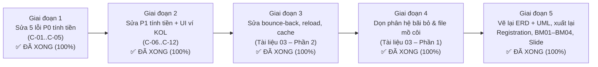

# 00 — MỤC LỤC BỘ TÀI LIỆU TÁI THIẾT KẾ SAU REVIEW 2 & LỘ TRÌNH THỰC HIỆN

> **Đề tài (bất biến):** **Hệ thống quản lý đội ngũ cộng tác viên bán hàng và tiếp thị liên kết** — **Sales Collaborator and Affiliate Network Management System** (`SCANMS` — `FA26SE032`)  
> **Phạm vi:** Bộ tài liệu phân tích & kế hoạch (không chỉnh sửa mã nguồn). Các quy tắc bất biến đã được ghi vĩnh viễn vào [GEMINI.md](file:///c:/HW/CAPSTONE/GEMINI.md), [AGENTS.md](file:///c:/HW/CAPSTONE/AGENTS.md) và [kol-merchant-governance/SKILL.md](file:///c:/HW/CAPSTONE/.agents/skills/kol-merchant-governance/SKILL.md).

## 1. Danh mục 4 tài liệu

| # | Tài liệu | Trả lời câu hỏi nào của Leader |
| :---: | :--- | :--- |
| 01 | [01_DINH_HUONG_BAT_BIEN_VA_QUY_TAC_NGHIEP_VU_SCANMS.md](file:///c:/HW/CAPSTONE/docs/review2_redesign/01_DINH_HUONG_BAT_BIEN_VA_QUY_TAC_NGHIEP_VU_SCANMS.md) | Lưu trữ định hướng; hệ thống nội bộ hay nền tảng; so sánh với Impact.com, PartnerStack, Refersion, Coolmate/Haravan; danh mục chức năng bãi bỏ / cốt lõi / phụ trợ. |
| 02 | [02_KIEM_TOAN_CO_CHE_TINH_TIEN_SO_CAI_VA_MINH_BACH_UI_DA_VAI_TRO.md](file:///c:/HW/CAPSTONE/docs/review2_redesign/02_KIEM_TOAN_CO_CHE_TINH_TIEN_SO_CAI_VA_MINH_BACH_UI_DA_VAI_TRO.md) | Cách tính tiền đã đủ cứng chưa (12 lỗ hổng `C-01`..`C-12`); KOL có thấy rõ từng giỏ tiền không; Shop Manager / Kế toán / CEO đối soát thế nào. |
| 03 | [03_RA_SOAT_CHUC_NANG_DU_THUA_DEAD_CODE_VA_CHAN_DOAN_LAG_DIEU_HUONG.md](file:///c:/HW/CAPSTONE/docs/review2_redesign/03_RA_SOAT_CHUC_NANG_DU_THUA_DEAD_CODE_VA_CHAN_DOAN_LAG_DIEU_HUONG.md) | Chức năng có code nhưng không dùng (Media, 39 file mồ côi, mock/404 ngầm); nguyên nhân giật lag, reload, bấm chức năng mới bị trả về chức năng cũ. |
| 04 | [04_KE_HOACH_CHINH_SUA_HO_SO_REVIEW2_BM01_BM04_ERD_VA_5_MAIN_FLOWS.md](file:///c:/HW/CAPSTONE/docs/review2_redesign/04_KE_HOACH_CHINH_SUA_HO_SO_REVIEW2_BM01_BM04_ERD_VA_5_MAIN_FLOWS.md) | Xử lý 9 nhận xét Hội đồng; ERD mới; 5 workflow (1 người/1 flow); kế hoạch sửa từng mục Registration, BM01–BM04, Slide. |

## 2. Lộ trình thực hiện & Tiến độ nghiệm thu thực tế

| Giai đoạn | Trọng tâm & Nội dung chi tiết | Trạng thái nghiệm thu | Báo cáo & Minh chứng |
| :---: | :--- | :---: | :--- |
| **Lộ trình 1** | Khắc phục triệt để 5 lỗi P0 chí mạng: Postgres Enum `QUALIFIED`, tách giỏ Clawback hoàn tiền, sync StoreWallet chống khóa ví, chốt chặn cổng 14 ngày, phân luồng đơn non-deal bypass. | **ĐÃ HOÀN THÀNH (100%)** | • [05_BAO_CAO_NGHIEM_THU_LO_TRINH_1.md](file:///c:/HW/CAPSTONE/docs/review2_redesign/05_BAO_CAO_NGHIEM_THU_LO_TRINH_1.md) • 566 Unit tests PASS + 5/5 Live DB tests PASS • 5 ảnh chụp live Chrome |
| **Lộ trình 2** | Khắc phục các lỗi P1 (C-06 đến C-12): sửa KPI revenue, chuẩn hóa non-stacking top sản phẩm, khóa cứng SoD duyệt chi trả chỉ dành cho Admin/Manager, 2 tầng bảo vệ giá sàn `floorPrice`, nâng cấp ví KOL lên 4 thẻ độc lập, xóa progress bar ảo 68%, gắn huy hiệu hoàn trả thu hồi 0₫ trên dashboard. | **ĐÃ HOÀN THÀNH (100%)** | • [06_BAO_CAO_NGHIEM_THU_LO_TRINH_2.md](file:///c:/HW/CAPSTONE/docs/review2_redesign/06_BAO_CAO_NGHIEM_THU_LO_TRINH_2.md) • 9/9 Automated tests PASS • 5 ảnh chụp live Chrome sắc nét |
| **Lộ trình 3** | Khắc phục lỗi giật lag, bounce-back, tab reload khi bấm chức năng khác, phân tách bộ nhớ đệm TanStack Query giữa các trang (`ShopKolHubPage`, `ReferralLinksPage`). | **ĐÃ HOÀN THÀNH (100%)** | • [07_BAO_CAO_NGHIEM_THU_LO_TRINH_3.md](file:///c:/HW/CAPSTONE/docs/review2_redesign/07_BAO_CAO_NGHIEM_THU_LO_TRINH_3.md) • 5/5 Live Chrome Navigation Tests PASS • 5 ảnh chụp live Chrome sắc nét |
| **Lộ trình 4** | Dọn dẹp các phân hệ bãi bỏ (chiến dịch cũ, voucher sàn/shop công khai) và cô lập 27 file mã nguồn mồ côi mà không làm ảnh hưởng tính ổn định hệ thống. | **ĐÃ HOÀN THÀNH (100%)** | • [08_BAO_CAO_NGHIEM_THU_LO_TRINH_4.md](file:///c:/HW/CAPSTONE/docs/review2_redesign/08_BAO_CAO_NGHIEM_THU_LO_TRINH_4.md) • 23 Unit tests Frontend + 9 Jest Backend PASS • 2 ảnh chụp live Chrome sắc nét |
| **Lộ trình 5** | Cập nhật hồ sơ BM01–BM04, vẽ lại Conceptual ERD & Context Diagram, xuất lại Slide PPTX và giải quyết triệt để 9/9 nhận xét Hội đồng Review 2. | **ĐÃ HOÀN THÀNH (100%)** | • [09_BAO_CAO_NGHIEM_THU_LO_TRINH_5.md](file:///c:/HW/CAPSTONE/docs/review2_redesign/09_BAO_CAO_NGHIEM_THU_LO_TRINH_5.md) • 5 Hồ sơ DOCX đã cập nhật chuẩn • Slide PPTX đã nhúng ERD mới & 100 test cases |

## 3. Các quyết định cốt lõi đã được Leader chốt chặt

1. **Thuế TNCN 10%:** Khấu trừ 10% trên toàn bộ mọi khoản rút tiền không có ngoại lệ (`0 ₫` threshold).
2. **Livestream:** Giữ nguyên vai trò tính năng phụ trợ (`+2%` Live bonus, trần tuyệt đối không vượt quá `25%`), không tách thành workflow chính độc lập.
3. **Thời điểm chốt thưởng mốc tháng:** Cố định vào ngày 15 của tháng kế tiếp để chờ hết thời hạn 14 ngày bảo chứng đổi trả của các đơn phát sinh cuối tháng.
4. **Quy tắc không cộng dồn:** Thỏa thuận Deal độc quyền (`Exclusive Deal%`) tuyệt đối không cộng dồn với Bậc KOL; phần ký quỹ Deal chỉ bằng đúng `Deal% - (10% + Tier%)`.
