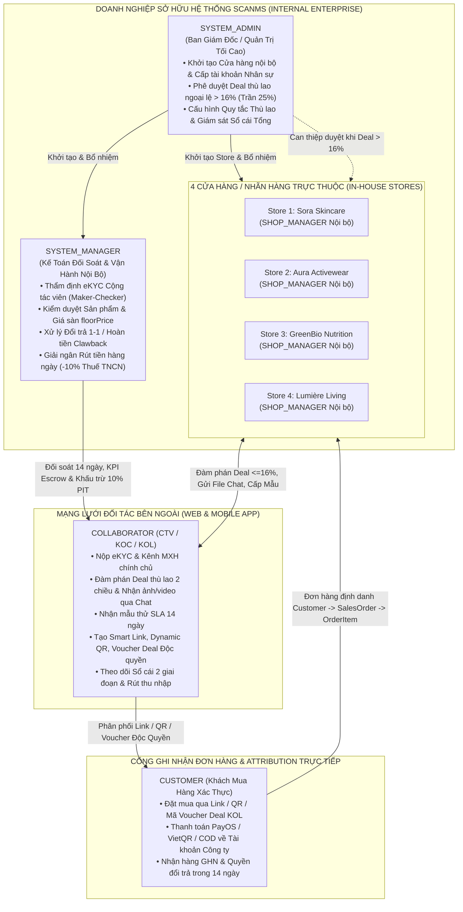
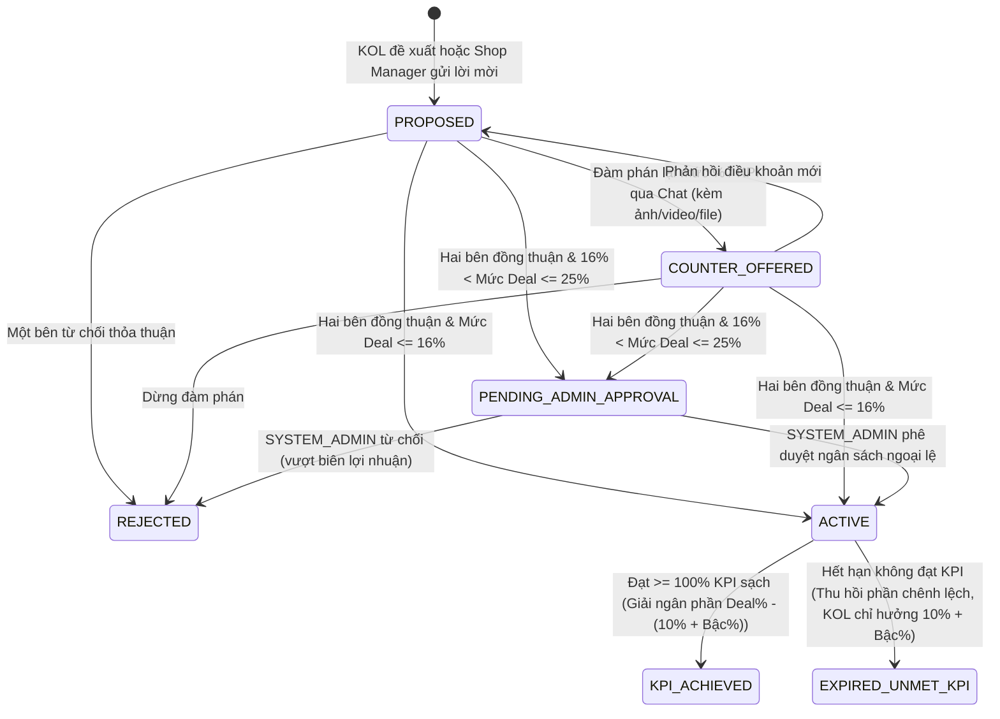

# TÀI LIỆU 01: ĐỊNH HƯỚNG BẤT BIẾN, ĐỐI SÁNH HỆ THỐNG THỰC TẾ & QUY TẮC NGHIỆP VỤ CỐT LÕI SCANMS (POST-REVIEW 2)

> **Mã dự án:** `FA26SE032` (`SCANMS`)  
> **Tên đề tài tiếng Việt (Bất biến):** **Hệ thống quản lý đội ngũ cộng tác viên bán hàng và tiếp thị liên kết**  
> **Tên đề tài tiếng Anh (Bất biến):** **Sales Collaborator and Affiliate Network Management System**  
> **Giảng viên hướng dẫn:** ThS. Tôn Thất Hoàng Minh (`minhtth5@fpt.edu.vn`)  
> **Nhóm thực hiện:** Nguyễn Thành Thắng (`SE184251` - Leader), Nguyễn Đình Tuấn (`SE182540`), Nguyễn Phú Quý (`SE180104`), Phan Xuân Thịnh (`SE184527`)  
> **Phạm vi tài liệu:** Xác lập kim chỉ nam kiến trúc nghiệp vụ sau buổi chấm Review 2, định vị chính xác bản chất **Hệ thống Quản lý Nội bộ Đa Cửa Hàng Trực Thuộc**, đối sánh chuyên sâu với các hệ thống Quản trị Đối tác & Tiếp thị Liên kết hàng đầu thế giới/Việt Nam, chuẩn hóa bộ quy tắc thù lao 2 giai đoạn và hệ thống thiết kế Enterprise B2B SaaS.

---

## 1. BẢN SẮC ĐỀ TÀI BẤT BIẾN & GIẢI QUYẾT TRIỆT ĐỂ ĐỘ LỆCH NHẬN DIỆN TẠI REVIEW 2

### 1.1. Nguyên nhân cốt lõi khiến Hội đồng Review 2 đặt câu hỏi về Mô hình Hệ thống
Tại buổi bảo vệ Review 2, Hội đồng phản biện (`longt5`, `ThinhDP2`) đã chỉ ra hai nhận xét nền tảng đầu tiên:
1. *"Cần xác định rõ mô hình hoạt động là hệ thống quản lý nội bộ hay nền tảng kết nối nhiều cửa hàng, bảo đảm thống nhất với tên và phạm vi đề tài."*
2. *"Cần xem xét lại tính hợp lý của nghiệp vụ hoa hồng khi chuyển từ mô hình nền tảng sang hệ thống."*

Khi đối chiếu lại Phiếu đăng ký đề tài gốc ([FA26SE032_SALES_COLLABORATOR_AND_AFFILIATE_NETWORK_minhtth5.docx](file:///c:/HW/CAPSTONE/FA26SE032_SALES_COLLABORATOR_AND_AFFILIATE_NETWORK_minhtth5.docx)) với bộ hồ sơ nộp Review 2 ngày `29/10/2026` ([SWP490_FA26SE032_R2_Registration.pdf](file:///c:/HW/CAPSTONE/docs/SWP490_R2_BM04_Review2-Document/SWP490_FA26SE032_R2_Registration.pdf)) và Slide báo cáo ([FA26SE032_R2_Slide.pdf](file:///c:/HW/CAPSTONE/docs/review%202/FA26SE032_R2_Slide.pdf)), nguyên nhân gây mâu thuẫn nằm ở 4 điểm "trượt phạm vi" sang Sàn Thương mại Điện tử (E-Commerce Marketplace Drift):
- **Thứ nhất — Sai lệch về chủ thể sở hữu cửa hàng:** Tên đề tài là **Hệ thống quản lý đội ngũ cộng tác viên bán hàng và tiếp thị liên kết** (*Management System*), tức một hệ thống phần mềm quản trị phục vụ một tổ chức/doanh nghiệp quản lý mạng lưới CTV/KOL bán hàng cho mình. Tuy nhiên, trong quá trình phát triển trước đây, hệ thống lại mở luồng cho người dùng tự đăng ký mở Shop ngoài (`/customer/upgrade/shop`), nộp KYC mở gian hàng, thậm chí trên Slide 14 của buổi Review 2 còn xuất hiện ô *"Shop Manager tạo yêu cầu rút tiền doanh thu"*. Điều này biến hệ thống thành một "chợ trung gian thu phí" kiểu Shopee/Lazada.
- **Thứ hai — Lạm dụng cơ chế khuyến mãi bán lẻ đại trà:** Việc đưa vào Voucher toàn sàn, Voucher công khai của cửa hàng, tài trợ chênh lệch giá sàn làm luồng thanh toán và đối soát bị kéo nặng về bài toán khuyến mãi bán lẻ B2C thay vì bài toán **Attribution (Ghi nhận công trạng tiếp thị)** và **Partner Remuneration (Quyết toán thù lao đối tác)**.
- **Thứ ba — Dư thừa các phân hệ trùng lặp công năng:** Tồn tại những phân hệ gom nhóm khuyến mãi đại trà hoặc kho chứa tệp tĩnh rời rạc, trong khi bản chất làm việc thực tế giữa Quản lý cửa hàng và KOL là **đàm phán thỏa thuận trực tiếp 1-1 (`Exclusive Deal`)** và **gửi trực tiếp hình ảnh, video, tài liệu sản phẩm qua luồng tin nhắn trao đổi (`Realtime Chat`)**.
- **Thứ tư — Công thức hoa hồng cộng dồn thiếu kiểm soát ngân sách:** Khi chuyển về mô hình **Hệ thống quản lý nội bộ của doanh nghiệp**, toàn bộ doanh thu bán hàng chảy về tài khoản tập trung của doanh nghiệp và toàn bộ thù lao trả cho KOL là chi phí bán hàng trực tiếp trích từ biên lợi nhuận của sản phẩm. Nếu cộng dồn bậc KOL lên trên mức thỏa thuận độc quyền hoặc giải ngân toàn bộ mức thỏa thuận ngay cả khi KOL không đạt cam kết doanh số (KPI), doanh nghiệp sẽ bị thủng biên lợi nhuận.

---

### 1.2. Định vị Chuẩn xác & Thống nhất 100% với Tên Đề tài

> [!IMPORTANT]
> **TUYÊN NGÔN ĐỊNH VỊ KIẾN TRÚC NGHIỆP VỤ CỦA SCANMS:**  
> **Hệ thống quản lý đội ngũ cộng tác viên bán hàng và tiếp thị liên kết (`Sales Collaborator and Affiliate Network Management System` — `SCANMS`)** là **Hệ thống Quản trị Nội bộ cấp Doanh nghiệp Đa Cửa Hàng Trực Thuộc (Enterprise In-House Multi-Store Collaborator & Affiliate Management System)**.  
> Hệ thống thuộc quyền sở hữu và vận hành của **một Doanh nghiệp / Tập đoàn Bán lẻ Đa Nhãn Hàng (Multi-Brand D2C Retail Enterprise)** nhằm tuyển mộ, định danh, phân bậc, giao chỉ tiêu thỏa thuận, cấp công cụ tiếp thị định danh và quyết toán thù lao tự động cho đội ngũ **Cộng tác viên bán hàng / KOC / KOL bên ngoài**.

#### Giải thích vì sao SCANMS vừa có "Nhiều Cửa Hàng (`Multi-Store`)" vừa là "Hệ Thống Quản Lý Nội Bộ (`Internal System`)":
Trong thực tiễn doanh nghiệp bán lẻ hiện đại tại Việt Nam và quốc tế (như **Tập đoàn Thế Giới Di Động MWG** sở hữu *Thế Giới Di Động, Điện Máy Xanh, TopZone, AVAKids*; hay **Coolmate Group** sở hữu *Coolmate, 84RISING, CM24*; hay **L'Oréal D2C Division** sở hữu *La Roche-Posay, CeraVe, Vichy*), một doanh nghiệp không dồn mọi mặt hàng khác biệt (mỹ phẩm bảo quản lạnh, quần áo thể thao, thực phẩm bảo vệ sức khỏe, đồ gia dụng nặng) vào chung một giỏ quản lý hỗn độn. Doanh nghiệp tổ chức thành **các Cửa hàng / Khối Nhãn hàng chuyên biệt (`Store`)**, mỗi cửa hàng có:
1. **Một Quản lý Cửa hàng nội bộ (`SHOP_MANAGER`):** Là nhân viên hưởng lương của công ty do `SYSTEM_ADMIN` tạo tài khoản và phân công, chịu trách nhiệm quản lý danh mục sản phẩm thuộc đúng ngành hàng được khóa cứng (`Category Lock`), tuyển chọn KOC phù hợp chuyên môn ngành hàng đó (ví dụ KOC Dược mỹ phẩm làm việc với *Sora Skincare*, Gymer làm việc với *Aura Activewear*) và điều phối kho xuất hàng GHN tương ứng.
2. **Một Dòng tiền Tập trung Duy nhất (`Corporate Master Treasury`):** Khách hàng mua sản phẩm của bất kỳ cửa hàng nội bộ nào thì tiền thanh toán (PayOS / VietQR / COD GHN) đều chảy trực tiếp về tài khoản doanh nghiệp. `SHOP_MANAGER` **không có ví tiền riêng và không bao giờ rút tiền doanh thu** — họ chỉ theo dõi báo cáo hiệu quả kinh doanh (GMV tạo ra từ kênh CTV so với chi phí thù lao phải trả).
3. **Một Cổng Mua Hàng Ghi Nhận Chuyển Đổi Trực Tiếp (`First-Party Attribution Checkout`):** Khác với các mạng tiếp thị trung gian bên thứ ba (như Accesstrade phải gắn script theo dõi gián tiếp và chờ đối soát file CSV cuối tháng rất dễ thất thoát đơn), SCANMS sở hữu cổng đặt hàng trực tiếp cho `CUSTOMER` trên cùng cơ sở dữ liệu PostgreSQL. Nhờ đó, ngay giây phút khách hàng bấm Smart Link, quét Dynamic QR hoặc nhập mã Voucher độc quyền của KOL để đặt đơn, hệ thống ghi nhận tức thời mối quan hệ khép kín: `Customer` $\rightarrow$ `SalesOrder` $\rightarrow$ `OrderItem` $\rightarrow$ `ProductVariant` $\rightarrow$ `Commission` $\rightarrow$ `WalletTransaction`.

---

## 2. ĐỐI SÁNH CHUYÊN SÂU VỚI CÁC HỆ THỐNG QUẢN LÝ CTV & TIẾP THỊ LIÊN KẾT HÀNG ĐẦU

Để chứng minh thiết kế của SCANMS tuân thủ chuẩn mực công nghiệp của dòng phần mềm **Partner & Affiliate Relationship Management (PRM / ARM)** chứ không phải bản sao sàn TMĐT, bảng dưới đây đối sánh trực tiếp SCANMS với 4 nền tảng tiêu biểu trên thế giới và tại Việt Nam:
- **Impact.com** *(Nền tảng quản trị đối tác & KOC số 1 thế giới cho các tập đoàn đa nhãn hàng như L'Oréal, Adidas, Lenovo)*
- **PartnerStack** *(Hệ thống quản lý cộng tác viên bán hàng & đối tác phân phối chuẩn B2B với sổ cái thuế và thưởng bậc tự động)*
- **Refersion** *(Hệ thống quản trị Affiliate nội bộ chuyên cho chuỗi thương hiệu D2C với cơ chế Exclusive Influencer Coupon)*
- **Coolmate Affiliate / Haravan CTV** *(Mô hình quản lý đội ngũ CTV bán hàng nội bộ thực tế tại thị trường Việt Nam)*

| Tiêu chí Kiến trúc & Nghiệp vụ | Impact.com (Global Enterprise ARM) | PartnerStack (Partner Lifecycle & Ledger) | Refersion / Coolmate CTV (D2C In-House Affiliate) | Sàn TMĐT Mở (Shopee / Lazada - Đối chứng) | **SCANMS (`FA26SE032` - Thiết kế Chuẩn hóa)** |
| :--- | :--- | :--- | :--- | :--- | :--- |
| **1. Chủ thể sở hữu hàng hóa & Cửa hàng** | Doanh nghiệp / Tập đoàn đa nhãn hàng (Brands nội bộ) | Doanh nghiệp sở hữu sản phẩm | Thương hiệu D2C nội bộ (kho hàng của công ty) | Hàng vạn người bán vãng lai tự đăng ký mở shop | **100% Cửa hàng nội bộ doanh nghiệp (`SYSTEM_ADMIN` khởi tạo `Store` & `SHOP_MANAGER`)** |
| **2. Luồng tuyển mộ & Định danh CTV (eKYC)** | Duyệt hồ sơ đối tác + Xác minh kênh truyền thông + Hồ sơ thuế | Đăng ký đối tác + Duyệt hồ sơ + Khai báo ngân hàng | Đăng ký CTV + Duyệt thông tin CCCD & STK nhận thưởng | Bất kỳ ai bấm 1 nút cũng gắn giỏ hàng đại trà | **Định danh eKYC đa lớp (CCCD, STK Ngân hàng, Kênh MXH chính chủ) do `SYSTEM_MANAGER` duyệt Maker-Checker** |
| **3. Cơ chế Thỏa thuận Thù lao Riêng (`Contracting`)** | *Dynamic Contracting*: Đàm phán hợp đồng riêng kèm điều kiện KPI | *Custom Partner Deals*: Nhóm đối tác chiến lược có mức thưởng riêng | Thỏa thuận riêng cho KOL lớn qua quản lý nhãn hàng | Chủ yếu chạy hoa hồng đại trà hoặc quảng cáo đấu thầu | **Thỏa thuận Deal Độc quyền 2 chiều (`<=16%` Shop Manager tự duyệt; `>16%` đến trần `25%` bắt buộc `SYSTEM_ADMIN` duyệt)** |
| **4. Công cụ Ghi nhận Đơn hàng (`Attribution`)** | Tracking Link + Deep Link + Mã Promo Code định danh KOC | Referral Link + Định danh khách hàng đăng ký | Link giới thiệu + Mã giảm giá riêng tên KOL | Phụ thuộc nặng vào giỏ hàng & hàng loạt voucher chồng chéo | **Bộ 3 Attribution: Smart Link (`?ref=`), Dynamic QR & Voucher Deal Độc quyền gắn chặt KOL (`THAONHI16`)** |
| **5. Chính sách Voucher & Kiểm soát Giá Sàn** | Chỉ cấp Promo Code gắn độc quyền từng Creator, khóa biên giá | Không có voucher chợ bán lẻ | Mã ưu đãi KOL kiểm soát chặt theo biên lợi nhuận gốc | Voucher sàn + Voucher shop + Freeship + Xu chồng chéo | **Xóa bỏ 100% voucher sàn & voucher shop đại trà; chỉ giữ Voucher Deal KOL có kiểm soát Giá Sàn (`floorPrice`)** |
| **6. Trao đổi Học liệu Quảng bá Sản phẩm** | Nhắn tin trực tiếp kèm tệp đính kèm trong phòng trao đổi hợp đồng | Tin nhắn đối tác & gửi tài liệu trực tiếp | Gửi ảnh/video thực tế qua kênh chat quản lý CTV | Không có kênh chat đàm phán trực tiếp chuẩn quy trình | **Tích hợp gửi Ảnh HD, Video, Tài liệu trực tiếp trong Chat Realtime Socket.IO (Loại bỏ kho tệp tĩnh dư thừa)** |
| **7. Thời gian Tạm giữ Chờ Đổi Trả (`Action Locking`)** | *Action Locking Period* (14–30 ngày chờ hết hạn trả hàng) | *Hold Period* trước khi chuyển sang *Available to Withdraw* | Đối soát đơn giao thành công sau 14 ngày không hoàn trả | Giữ tiền người bán & affiliate theo chu kỳ sàn | **Tạm giữ chính xác 14 ngày kể từ `DELIVERED` cho phần `10% Gốc + Bậc KOL` để khớp hạn trả hàng 14 ngày** |
| **8. Giải ngân Thưởng Hợp đồng KPI (Chống Trả Thừa)** | Giữ phần thưởng vượt trội cho tới khi đạt ngưỡng doanh số hợp đồng | Mở khóa thưởng KPI khi hoàn thành mục tiêu cam kết | Chỉ thưởng thêm khi CTV cán đủ chỉ tiêu cam kết | Không tách bạch phần gốc + bậc với phần chênh lệch KPI | **Chia 2 rổ rõ ràng: Trả trước `10% + Bậc` sau 14 ngày; Treo phần chênh lệch `Deal% - (10% + Bậc)` tới khi đạt đủ KPI** |
| **9. Xử lý Đổi hàng Lỗi vs Trả hàng Hoàn tiền** | *Modification vs Reversal*: Hoàn tiền thì thu hồi hoa hồng | Tự động ghi âm (*Clawback*) trên sổ cái khi đơn hoàn tiền | Đơn hoàn trả bị trừ khỏi doanh số thực nhận | Trừ hoa hồng tự động nhưng hộp đen, KOC khó hiểu lý do | **Đổi mới 1-1 (lỗi GHN/xưởng) bảo lưu 100% thù lao; Hoàn tiền kích hoạt `Clawback` thu hồi về `0₫` có bút toán đối ứng** |
| **10. Thuế TNCN & Khóa Dòng Chống Rút Trùng** | Khấu trừ thuế tại nguồn (*Tax Withholding*) + Sổ cái kép | Tự động tách thuế trước khi chuyển khoản Stripe/Bank | Khấu trừ **10% Thuế TNCN** theo luật thuế Việt Nam | Khấu trừ thuế tự động theo kỳ đối soát | **Khóa dòng `SELECT ... FOR UPDATE`, tách bạch `Gross`, `10% Thuế TNCN` và `90% Thực nhận` khi `SYSTEM_MANAGER` duyệt chi** |
| **11. Đa nền tảng cho Cộng tác viên (`Web + Mobile`)** | Web Dashboard + Ứng dụng Mobile Creator | Web Portal | Web + App di động lấy link/xem số dư nhanh | Nặng về App mua sắm giải trí | **Web Portal quản trị toàn diện + Ứng dụng Mobile (`React Native / Expo`) chuyên biệt cho CTV & tra cứu đơn** |

### Bài học rút ra từ Đối sánh Thực tế áp dụng thẳng vào SCANMS:
1. **Từ Impact.com (*Action Locking & Performance Differential*):** Giải thích hoàn hảo tính hợp lý của cơ chế **Giải ngân 2 giai đoạn** trong SCANMS. Trong quản trị đối tác chuyên nghiệp, phần thù lao cơ bản theo cấp bậc (`10% + Tier%`) là quyền lợi tiêu chuẩn của mỗi đơn hàng sạch sau thời gian khóa đổi trả 14 ngày (*Action Locking*); trong khi phần vượt trội do thỏa thuận riêng (`Deal% - (10% + Tier%)`) là **Performance Retainer** (khoản giữ lại theo hiệu suất), chỉ chi trả khi đối tác hoàn thành nghĩa vụ KPI đã ký kết.
2. **Từ Refersion & Coolmate Affiliate (*Zero Marketplace Noise*):** Một hệ thống quản lý CTV nội bộ tuyệt đối không tồn tại khái niệm "Voucher toàn sàn" hay "Voucher cửa hàng phát đại trà". Mỗi mã giảm giá sinh ra trên hệ thống đều phải gắn chặt 1-1 với một KOL và một thỏa thuận cụ thể để vừa kiểm soát biên lợi nhuận trên từng đơn vị sản phẩm (`floorPrice`), vừa đảm bảo khách hàng nhập mã là hệ thống định danh ngay lập tức người giới thiệu.
3. **Từ PartnerStack & Stripe Ledger (*Radical Financial Transparency*):** Lý do lớn nhất khiến CTV/KOL rời bỏ một mạng lưới tiếp thị là **không hiểu vì sao số tiền được rút khác với tổng doanh số nhân phần trăm**. Do đó, giao diện Ví của KOL và Sổ cái của Kế toán (`SYSTEM_MANAGER`) / Tổng giám đốc (`SYSTEM_ADMIN`) phải bóc tách tường minh từng đồng vào các rổ trạng thái độc lập, có phương trình cân bằng kế toán kiểm chứng được bất kỳ lúc nào.

---

## 3. CẤU TRÚC PHẠM VI MỚI: CÁC HẠNG MỤC TINH GỌN, CỐT LÕI VÀ PHỤ TRỢ

Nhằm giữ vững trọng tâm đề tài **Hệ thống quản lý đội ngũ cộng tác viên bán hàng và tiếp thị liên kết**, toàn bộ chức năng của hệ thống được phân định dứt khoát thành 3 nhóm:

### 3.1. Nhóm Chức năng Đã Bãi bỏ Vĩnh viễn để Chống Lệch sang Sàn TMĐT
| STT | Hạng mục bị bãi bỏ hoàn toàn | Lý do loại bỏ về mặt Kiến trúc & Nghiệp vụ | Cơ chế Chuẩn hóa Thay thế trong SCANMS |
| :---: | :--- | :--- | :--- |
| **1** | **Đăng ký / Nâng cấp tài khoản làm Quản lý Cửa hàng (`Shop Registration / Upgrade`)** | Gây hiểu lầm nghiêm trọng rằng người ngoài có thể mở gian hàng kinh doanh như sàn TMĐT. | Chỉ duy nhất `SYSTEM_ADMIN` có quyền tạo `Store` nội bộ và cấp tài khoản nhân sự `SHOP_MANAGER` tại phân hệ Quản trị Nhân sự. |
| **2** | **Voucher toàn sàn & Voucher công khai của Cửa hàng (`Platform & Public Store Vouchers`)** | Làm nhiễu loạn luồng thanh toán thành bài toán săn sale TMĐT, gây nguy cơ cộng dồn mã làm thủng giá vốn và làm mất vai trò định danh đơn hàng của KOL. | Chỉ duy nhất **Voucher Thỏa thuận Độc quyền gắn với KOL (`KOL Exclusive Deal Coupon`)** được phép tồn tại, gắn chặt với `collaboratorId` và kiểm tra chặn dưới bởi `floorPrice`. |
| **3** | **Cơ chế gom đợt khuyến mãi đại trà chồng chéo** | Dư thừa hoàn toàn về mặt nghiệp vụ: việc nâng thù lao đã do **Thỏa thuận Thù lao Độc quyền (`Exclusive Deal`)** đảm nhiệm, còn việc điều chỉnh giá bán sản phẩm đã do **Quản trị Giá bán & Giá sàn (`floorPrice`)** đảm nhiệm. | Ký kết trực tiếp **Thỏa thuận Thù lao Độc quyền 2 chiều** giữa `SHOP_MANAGER` và `COLLABORATOR` (có ngưỡng kiểm soát `16%` và trần `25%`). |
| **4** | **Kho lưu trữ tài nguyên số tĩnh rời rạc (`Standalone Media Library`)** | Dư thừa thao tác và tách rời khỏi ngữ cảnh trao đổi hợp tác thực tế; trên thực tế người dùng trao đổi tư liệu ngay trong cuộc hội thoại làm việc. | Gửi trực tiếp **Ảnh HD, Video mẫu, Tài liệu hướng dẫn sản phẩm (PDF/Doc/Media)** ngay trong khung **Tin nhắn Chat Realtime (`Socket.IO`)** giữa `SHOP_MANAGER` và `COLLABORATOR`. |

---

### 3.2. Nhóm 6 Quy tắc Nghiệp vụ Cốt lõi Bất biến (Core Business Rules)

#### Quy tắc 1: Quản trị Cửa hàng Nội bộ, Khóa Ngành hàng (`Category Lock`) & Chống Trùng Sản phẩm
- Mỗi `Store` đại diện cho một ngành hàng độc lập của doanh nghiệp (`primaryCategory`).
- Khi `SHOP_MANAGER` tạo sản phẩm (`Product`) và ma trận biến thể 2 cấp (`ProductVariant`: ví dụ *Màu sắc x Kích cỡ* hoặc *Hoạt chất x Dung tích*), trường ngành hàng tự động khóa theo `Store.primaryCategory`.
- Mọi biến thể sản phẩm bắt buộc có mã `SKU` định danh duy nhất liên kết trực tiếp vào từng dòng chi tiết đơn hàng (`ProductVariant` `1 — N` `OrderItem` `N — 1` `SalesOrder`), giải quyết triệt để nhận xét của Hội đồng Review 2 về truy vết biến thể trong đơn hàng.

#### Quy tắc 2: Cơ chế Giá Sàn Thấp Nhất (`floorPrice` / Minimum Protected Price)
- Mỗi sản phẩm và biến thể (`ProductVariant`) khi đưa lên hệ thống bắt buộc khai báo **Giá niêm yết (`price`)** và **Giá sàn thấp nhất (`floorPrice`)** do doanh nghiệp ấn định dựa trên cấu trúc chi phí an toàn:
  $$\text{Giá thực thu tối thiểu sau ưu đãi} \ge \text{floorPrice}$$
- **Chốt chặn kép tại Backend:**
  1. *Khi `SHOP_MANAGER` điều chỉnh giảm giá bán sản phẩm:* Hệ thống kiểm tra tức thời `newSellingPrice >= floorPrice`. Mọi thao tác nhập giá thấp hơn `floorPrice` bị từ chối ngay lập tức (`400 Bad Request - Vi phạm ngưỡng giá sàn bảo vệ biên lợi nhuận`), trừ khi gửi yêu cầu ngoại lệ được `SYSTEM_ADMIN` phê duyệt.
  2. *Khi tạo và áp dụng Voucher Deal Độc quyền của KOL:* Giả sử sản phẩm có giá bán $500.000₫$ và `floorPrice` là $430.000₫$, thì mức giảm tối đa của Voucher Deal KOL không được vượt quá $70.000₫$ ($14\%$). Lúc khách hàng đặt đơn (`Checkout`), hệ thống tái kiểm tra giá thanh toán ròng từng `OrderItem` đảm bảo không bao giờ xuyên thủng `floorPrice`.

#### Quy tắc 3: Cấp bậc Cộng tác viên (`Collaborator Tier`) & Thù lao Gốc 10%
- Toàn bộ `COLLABORATOR` sau khi được `SYSTEM_MANAGER` duyệt hồ sơ eKYC đều khởi điểm minh bạch ở **Bậc Đồng (`BRONZE`)** với mức thù lao tiêu chuẩn **10%**.
- Hệ thống tự động nâng bậc dựa trên **Doanh số Sạch Tích lũy (`Clean Settled GMV` — chỉ tính các đơn hàng đã giao thành công và vượt qua trọn vẹn 14 ngày không trả hàng hoàn tiền)** theo bảng quy tắc cấu hình trong `CommissionRule`:

| Cấp bậc Cộng tác viên (`Tier`) | Ngưỡng Doanh số Sạch Tích lũy | Thù lao Gốc (`Base`) | Cộng thêm Cấp bậc (`Tier Bonus`) | Tổng Tỷ lệ Tiêu chuẩn (`Standard Rate`) | Thời điểm Mở khóa Rút tiền |
| :--- | :---: | :---: | :---: | :---: | :--- |
| **Bậc Đồng (`BRONZE`)** | Khởi điểm sau duyệt eKYC ($0₫$) | `10%` | `+0%` | **`10%`** | Hết hạn **14 ngày** trả hàng kể từ `DELIVERED` |
| **Bậc Bạc (`SILVER`)** | $\ge 20.000.000₫$ | `10%` | `+1%` | **`11%`** | Hết hạn **14 ngày** trả hàng kể từ `DELIVERED` |
| **Bậc Vàng (`GOLD`)** | $\ge 50.000.000₫$ | `10%` | `+2%` | **`12%`** | Hết hạn **14 ngày** trả hàng kể từ `DELIVERED` |
| **Bậc Kim Cương (`DIAMOND`)** | $\ge 100.000.000₫$ | `10%` | `+3%` | **`13%`** | Hết hạn **14 ngày** trả hàng kể từ `DELIVERED` |

#### Quy tắc 4: Thỏa thuận Thù lao Độc quyền 2 Chiều (`Exclusive Deal`) & Ngưỡng Can thiệp `16%` / Trần `25%`
- Quy trình thỏa thuận diễn ra linh hoạt **2 chiều** giữa `SHOP_MANAGER` và `COLLABORATOR` (tích hợp cùng gợi ý AI Matching 4 trục và phòng Chat đính kèm ảnh/video/file):
  - *Chiều 1 (Inbound):* KOL xem sản phẩm của cửa hàng và gửi đề xuất mức thù lao mong muốn + cam kết doanh số/số đơn KPI (`targetRevenue` / `targetOrders`) + thời hạn thực hiện.
  - *Chiều 2 (Outbound):* `SHOP_MANAGER` dùng AI tìm KOL phù hợp ngành hàng và gửi thẻ đề xuất thỏa thuận trực tiếp qua Chat.
- **Ma trận Thẩm quyền Phê duyệt 3 Mức:**
  1. **$R_{\text{deal}} \le (10\% + R_{\text{tier}})$:** Hệ thống cảnh báo không cần tạo Deal thấp hơn hoặc bằng mức bậc hiện hữu của KOL (trừ khi tạo mã Voucher ưu đãi riêng cho tệp khách của KOL đó).
  2. **$(10\% + R_{\text{tier}}) < R_{\text{deal}} \le 16\%$:** Nằm trong **Khung tự quyết của `SHOP_MANAGER`**. Khi cả `SHOP_MANAGER` và `COLLABORATOR` đồng thuận xác nhận, Deal chuyển thẳng sang trạng thái `ACTIVE`, tự động sinh Smart Link VIP và Voucher Deal độc quyền gắn với KOL.
  3. **$16\% < R_{\text{deal}} \le 25\%$:** Vượt ngưỡng tự quyết của cửa hàng! Khi `SHOP_MANAGER` và `COLLABORATOR` thống nhất điều khoản, thỏa thuận bắt buộc chuyển sang trạng thái **`PENDING_ADMIN_APPROVAL`**. Chỉ khi **`SYSTEM_ADMIN` (Ban Giám Đốc)** thẩm định tính khả thi của KPI và bấm phê duyệt ngân sách, thỏa thuận mới chuyển sang `ACTIVE`.
  4. **$R_{\text{deal}} > 25\%$:** **Bị chặn cứng tuyệt đối (`Hard Ceiling = 25%`)** ở cả giao diện nhập liệu lẫn tầng Validation/Service của Backend.

#### Quy tắc 5: Nguyên tắc Vàng về Chia tách Tiền Thù lao 2 Giai đoạn (Không Cộng Dồn Deal với Bậc)
Đây là quy tắc tài chính trung tâm bảo vệ sự chính xác tuyệt đối cho đồ án:
- **Không cộng dồn:** Mức `Deal%` là **tổng mức thù lao mục tiêu trọn gói** của thỏa thuận đó (đã bao hàm phần gốc 10% và quyền lợi bậc hiện tại của KOL). Tuyệt đối không lấy `Deal% + Tier%`.
- **Trả trước phần chắc chắn (`10% + Tier%`) sau 14 ngày hết hạn trả hàng:** KOL không phải chờ đến hết kỳ hạn hợp đồng KPI dài ngày mới có thu nhập. Cứ mỗi đơn hàng giao thành công qua **14 ngày** không hoàn trả, KOL nhận ngay `10% + Tier%` vào ví khả dụng để rút tiền chi tiêu.
- **Giữ lại chính xác phần thưởng chênh lệch (`Deal% - (10% + Tier%)`) chờ KPI:** Phần còn lại được giữ trong giỏ `KPI Deal Escrow` bắt buộc phải **trừ đi cả 10% gốc lẫn phần trăm Bậc của KOL** đã tính ở giai đoạn 1. Chỉ khi KOL hoàn thành đủ cam kết KPI của Deal và các đơn hàng cấu thành KPI đều đã qua 14 ngày không trả hàng, hệ thống mới kết chuyển phần chênh lệch này vào ví khả dụng.

#### Quy tắc 6: Phân định Rạch ròi giữa Luồng Chính (Core Main Flows) và Tính năng Phụ trợ (Auxiliary Features)
Để buổi bảo vệ đồ án tập trung 100% vào bài toán quản trị đội ngũ cộng tác viên & quyết toán thù lao phức tạp theo góp ý của Hội đồng Review 2:
- **5 Luồng Nghiệp vụ Chính (Main Workflows):** Bao quát trọn vẹn vòng đời từ Khởi tạo cửa hàng nội bộ & Tuyển mộ/eKYC CTV $\rightarrow$ Quản trị sản phẩm/Giá sàn & Đàm phán Deal thù lao 2 chiều (`<=16%` / `>16%`) $\rightarrow$ Cấp mẫu thử SLA 14 ngày, Công cụ Attribution (Link/QR/Voucher KOL) & Ghi nhận đơn hàng Web/Mobile $\rightarrow$ Giao vận GHN, Đổi mới 1-1 vs Hoàn tiền Clawback 14 ngày $\rightarrow$ Quyết toán sổ cái 2 giai đoạn (`10% + Bậc` & `KPI Deal`), Rút tiền khóa dòng khấu trừ 10% Thuế TNCN & Đối soát Kế toán/CEO.
- **2 Tính năng Phụ trợ (`Auxiliary / Value-Added Features` — Chỉ giới thiệu bổ trợ, KHÔNG đặt làm Main Flow):**
  1. **Thưởng mốc doanh số tháng (`Monthly Milestone Bonus`):** Khoản thưởng khích lệ định kỳ cuối tháng khi tổng doanh số sạch trong tháng của CTV vượt mốc cấu hình trong `CommissionRule` (ví dụ đạt mốc doanh số tháng được thưởng thêm khoản tiền thưởng mốc độc lập vào ví).
  2. **Bán hàng trực tiếp qua Livestream (`Live Commerce Support`):** Kênh phát sóng trực tiếp bổ trợ giúp KOL giới thiệu sản phẩm trực quan trong khung giờ phát sóng (hỗ trợ cộng phụ trợ tối đa `+2%` nhưng tổng tỷ lệ không bao giờ vượt trần cứng `25%`).

---

## 4. TIÊU CHUẨN HỆ THỐNG THIẾT KẾ GIAO DIỆN ENTERPRISE B2B SAAS (DESIGN GOVERNANCE)

Áp dụng đồng bộ bộ quy chuẩn thiết kế chuyên nghiệp từ các kỹ năng hệ thống ([better-colors](file:///c:/HW/CAPSTONE/.agents/skills/better-colors/SKILL.md), [better-typography](file:///c:/HW/CAPSTONE/.agents/skills/better-typography/SKILL.md), [better-layout](file:///c:/HW/CAPSTONE/.agents/skills/better-layout/SKILL.md), [better-ui](file:///c:/HW/CAPSTONE/.agents/skills/better-ui/SKILL.md)) để giao diện SCANMS toát lên đúng bản chất **Hệ thống Phần mềm Quản trị Doanh nghiệp & Tài chính Đối tác** thay vì giao diện bán lẻ màu mè:

### 4.1. Kiến trúc Màu sắc Ngữ nghĩa (`Warm Sand & Brand Gold` — Tương phản Chuẩn WCAG AA/AAA)
- **Nền phân lớp có chiều sâu (Surface Elevation Hierarchy):**
  - Lớp 0 (`--canvas: #FAF8F5`): Nền trang tổng thể ấm dịu, chống mỏi mắt khi kế toán và CTV làm việc với bảng số liệu nhiều giờ liền.
  - Lớp 1 (`--surface-sand: #F3EFE6`): Thanh điều hướng bên trái (Sidebar), thanh chuyển tab trạng thái sổ cái, vùng tiêu đề bảng dữ liệu (`thead`).
  - Lớp 2 (`--surface: #FFFFFF` kèm viền mảnh `1px solid #EAE4D7`): Thẻ KPI tài chính, bảng giao dịch chi tiết, hộp thoại đàm phán thỏa thuận.
- **Màu nhấn & Trạng thái Tài chính Không Gây Nhiễu:**
  - CTA chính dùng duy nhất `--brand: #C59B58` (hover `#B88E4F`), nút hành động quản trị cấp cao dùng `--brand-dark: #231D15`.
  - Trạng thái tiền tệ phân biệt bằng sắc độ ngữ nghĩa tinh tế:
    - *Khả dụng rút được (`Available`):* Chữ đậm `#1A1612` kèm chấm trạng thái xanh xác nhận nhỏ `#059669`.
    - *Đang tạm giữ 14 ngày / Đang chờ KPI (`Escrow Hold`):* Nhãn nền vàng nhạt `#FBF5EB`, viền `#EEDFC6`, chữ hổ phách đậm `#B45309` / `#D97706`.
    - *Thu hồi do hoàn hàng (`Clawback / Forfeited`):* Nhãn nền đỏ nhạt `#FEF2F2`, chữ đỏ kế toán `#DC2626` kèm dấu trừ rõ ràng (`-120.000₫`).

### 4.2. Chuẩn Mực Typography Số Liệu Tài Chính (`Tabular Numerals` & Optical Hierarchy)
- **Bắt buộc bật `font-variant-numeric: tabular-nums`** trên 100% thành phần hiển thị tiền tệ (`₫`), tỷ lệ phần trăm (`%`), đồng hồ đếm ngược 14 ngày, mã đơn hàng và bảng đối soát sổ cái. Khi các con số có độ rộng bằng nhau tuyệt đối, hàng chục dòng giao dịch trong sổ cái của KOL và Kế toán sẽ thẳng hàng từ hàng đơn vị đến hàng triệu, giúp phát hiện chênh lệch bằng mắt thường trong tích tắc.
- **Quy tắc hiển thị phương trình minh bạch (Inline Formula Disclosure):** Thay vì chỉ hiện một con số khô khan khiến người dùng thắc mắc, mọi dòng thù lao có Deal độc quyền đều hiển thị công thức bóc tách trực quan ngay bên dưới hoặc trong ngăn chi tiết mở rộng (*Progressive Disclosure*):
  > `Tổng Deal 18% (180.000₫) = Trả sau 14 ngày 12% [10% Gốc + 2% Bậc Vàng] (120.000₫) + Giữ chờ KPI 6% [18% - 12%] (60.000₫)`

### 4.3. Bố cục Quản trị Tập trung & Loại bỏ Yếu tố Chợ Bán Lẻ
- **Trên trang chủ & thanh điều hướng:** Hiển thị rõ định danh hệ thống **SCANMS — Hệ thống Quản lý Cộng tác viên & Tiếp thị Liên kết**, không đặt banner flash-sale nhấp nháy, không đặt pop-up săn mã giảm giá toàn sàn, không đặt nút "Kênh người bán / Đăng ký mở Shop".
- **Bố cục Progressive Disclosure cho Sổ cái Đa vai trò:** Tầng trên cùng là các thẻ tổng hợp đối xứng (Tổng thu nhập khả dụng | Đang chờ 14 ngày đổi trả | Đang giữ chờ KPI Deal | Đang khóa chờ giải ngân | Đã khấu trừ thuế & rút thành công); tầng ngay dưới là bộ lọc nhanh theo từng loại nguồn tiền để KOL, Quản lý cửa hàng, Kế toán và Tổng giám đốc kiểm tra chéo khớp từng đồng.
