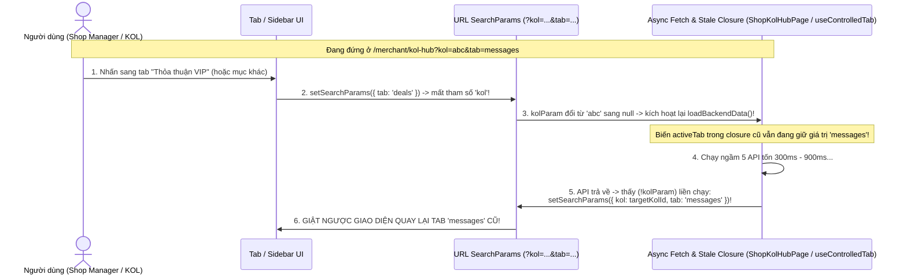

# TÀI LIỆU 03: RÀ SOÁT CHỨC NĂNG DƯ THỪA / CODE MỒ CÔI (DEAD CODE AUDIT) & CHẨN ĐOÁN TẬN GỐC LỖI GIẬT LAG, RELOAD, NHẢY NGƯỢC CHỨC NĂNG TRÊN UI

> **Mã dự án:** `FA26SE032` (`SCANMS`)  
> **Tên đề tài tiếng Việt (Bất biến):** **Hệ thống quản lý đội ngũ cộng tác viên bán hàng và tiếp thị liên kết**  
> **Tên đề tài tiếng Anh (Bất biến):** **Sales Collaborator and Affiliate Network Management System**  
> **Mục tiêu tài liệu:**  
> 1. Truy quét toàn bộ kho mã nguồn (`backend/`, `frontend/`, `Mobile/`, `schema.prisma`) để bóc tách **những chức năng có code nhưng không hiển thị/không sử dụng trên UI**, những màn hình đang chạy **dữ liệu giả (mock/hardcode) hoặc gọi nhầm API 404 ngầm**, và lập danh mục dọn dẹp an toàn cho các phân hệ đã bãi bỏ.  
> 2. Chẩn đoán chính xác đến từng dòng code nguyên nhân gây ra hiện tượng **nhấn sang chức năng/tab mới lại bị giật trả ngược về chức năng trước đó (`Navigation Bounce-Back`)**, tự động **reload trắng trang**, và **độ trễ/giật lag** khi thao tác.

---

## PHẦN 1: KIỂM TOÁN CHỨC NĂNG "CÓ CODE NHƯNG KHÔNG DÙNG TRÊN UI", CODE MỒ CÔI & CÁC PHÂN HỆ CẦN DỌN SẠCH

### 1.1. Xác minh Nghi vấn của Leader về Phân hệ `Media` (Chính xác 100% — Có Code nhưng Đứng Chết, kèm Cảnh báo Bẫy Dùng Chung Bảng!)

Đúng như nhận định của Leader, kiểm tra xuyên suốt từ giao diện xuống cơ sở dữ liệu cho thấy **chức năng Kho Media độc lập hiện đang có code ở cả Frontend lẫn Backend nhưng hoàn toàn không được gắn vào bất kỳ màn hình sống nào**, trong khi việc gửi tệp qua Chat đã hoạt động độc lập 100%:

1. **Bằng chứng Code Media Độc lập Đang "Chết" (`0` Live UI Callers):**
   - **Frontend:** File [StoreMediaLibrary.tsx](file:///c:/HW/CAPSTONE/frontend/src/components/media/StoreMediaLibrary.tsx) và file tiện ích [store-media-library.ts](file:///c:/HW/CAPSTONE/frontend/src/utils/store-media-library.ts) tồn tại trong mã nguồn nhưng **không được import vào bất kỳ Page đang chạy nào** (chỉ được gọi bởi file test đơn vị). Đường dẫn `/collaborator/media-hub` trong [AppRoutes.tsx](file:///c:/HW/CAPSTONE/frontend/src/routes/AppRoutes.tsx#L263) chỉ chuyển hướng sang `?tab=media` vốn không còn hiển thị kho media độc lập.
   - **Backend:** Trong [media.controller.ts](file:///c:/HW/CAPSTONE/backend/src/modules/media/media.controller.ts) và [media.service.ts](file:///c:/HW/CAPSTONE/backend/src/modules/media/media.service.ts), các API `POST /media` (`createAsset`), `GET /media/stats`, `GET /media/store/:storeId` có **`0` lời gọi từ giao diện người dùng thật**.

2. **Xác minh Luồng Gửi Ảnh, Video & Tài liệu Qua Tin nhắn Chat Hoạt động Độc lập 100%:**
   - **Backend:** Endpoint `POST /chat/conversations/:conversationId/attachments` ([chat.controller.ts](file:///c:/HW/CAPSTONE/backend/src/modules/chat/chat.controller.ts#L79-L102)) gọi `ChatService.uploadAttachment()` ([chat.service.ts](file:///c:/HW/CAPSTONE/backend/src/modules/chat/chat.service.ts#L986-L1010)) và bộ kiểm tra chữ ký byte thật [chat-attachment.utils.ts](file:///c:/HW/CAPSTONE/backend/src/modules/chat/chat-attachment.utils.ts#L1-L143), hỗ trợ đầy đủ 3 định dạng:
     - **Hình ảnh (`IMAGE`):** `png`, `jpg`, `jpeg` (tối đa `5 MB`) $\rightarrow$ tải lên Cloudinary & hiển thị trực tiếp trong bong bóng chat.
     - **Video (`VIDEO`):** `mp4`, `mov`, `webm` (tối đa `50 MB`) $\rightarrow$ phát trực tiếp trong khung hội thoại.
     - **Tài liệu (`DOCUMENT`):** `pdf`, `doc`, `docx`, `xls`, `xlsx`, `ppt`, `pptx`, `txt`, `csv` (tối đa `20 MB`).
   - Dữ liệu đính kèm lưu thẳng trên bảng `ChatMessage` (`mediaUrl`, `mediaType`, `mediaName` tại [schema.prisma](file:///c:/HW/CAPSTONE/backend/prisma/schema.prisma#L1464-L1466)) và đã có sẵn ngăn tra cứu lại toàn bộ Ảnh/Video/Tài liệu đã gửi theo từng cuộc trò chuyện tại `GET /chat/conversations/:id/explore` (`ConversationExplorer.tsx`), dùng được trên cả trang [ChatBoxPage.tsx](file:///c:/HW/CAPSTONE/frontend/src/pages/chat/ChatBoxPage.tsx), hộp chat nổi [ScanmsFloatingChatWidget.tsx](file:///c:/HW/CAPSTONE/frontend/src/components/chat/ScanmsFloatingChatWidget.tsx) lẫn ứng dụng **Mobile**.

> [!CAUTION]
> **CẢNH BÁO BẪY KỸ THUẬT SỐNG CÒN KHI DỌN BỎ MEDIA HUB (`SHARED TABLE HAZARD`):**  
> Tuyệt đối **KHÔNG ĐƯỢC XÓA BẢNG `media_assets`** trong `schema.prisma`! Mặc dù tính năng Kho Media chung đã bỏ, hiện đang có **2 luồng nghiệp vụ cốt lõi tái sử dụng ngầm bảng `media_assets`** ở tầng Backend:
> 1. **Ảnh phụ Gallery sản phẩm & Hồ sơ pháp lý kiểm duyệt sản phẩm (`[LEGAL_PROOF]`):** [products.service.ts](file:///c:/HW/CAPSTONE/backend/src/modules/products/products.service.ts#L1342-L1369) và dòng `1656–1697` ghi ảnh phụ sản phẩm và giấy công bố chất lượng vào `media_assets` để `AdminProductModerationTab.tsx` và trang chi tiết sản phẩm đọc ra.
> 2. **Link/Video nghiệm thu Hàng mẫu SLA 14 ngày của KOL:** [samples.service.ts](file:///c:/HW/CAPSTONE/backend/src/modules/samples/samples.service.ts#L700-L743) (`submitReviewVideo`) tạo bản ghi liên kết với `SampleProductRequest.submittedMediaId`, và `SHOP_MANAGER` bấm duyệt video trả mẫu qua `PATCH /media/:id/review` tại [ShopSampleManagementTab.tsx](file:///c:/HW/CAPSTONE/frontend/src/components/affiliate/ShopSampleManagementTab.tsx#L443)!  
> $\Rightarrow$ **Cách dọn sạch an toàn 100%:** Xóa `StoreMediaLibrary.tsx`, `store-media-library.ts`, route `/collaborator/media-hub`, xóa các endpoint kho chung `POST /media`, `DELETE /media/:id`, `GET /media/stats`, `GET /media/store/:storeId`, và **chuyển hàm duyệt video trả bài hàng mẫu về nằm gọn trong `SamplesController`**.

---

### 1.2. Danh sách 39 File Mã nguồn Frontend Mồ côi (`0` Live Callers — Tồn tại trong Repo nhưng Không Chạy trên UI)

Qua phân tích đồ thị import tĩnh toàn bộ cây thư mục `frontend/src/`, có tới **39 file** đang nằm chết hoàn toàn (không một route hay component sống nào gọi tới), làm phình kích thước dự án và gây nhầm lẫn khi bảo trì:

#### A. 7 File Trang (`frontend/src/pages/*`) Đã Mất Route Hoặc Bị Thay Thế:
1. [ShopCouponsPage.tsx](file:///c:/HW/CAPSTONE/frontend/src/pages/merchant/ShopCouponsPage.tsx) — Không được mount; route cũ `/merchant/coupons` đã chuyển hướng.
2. [CommissionRulesPage.tsx](file:///c:/HW/CAPSTONE/frontend/src/pages/merchant/CommissionRulesPage.tsx) — Không được mount; bị bỏ rơi sau khi gộp hub khiến chức năng cấu hình mốc thưởng thật trên UI của Shop bị đứt kết nối!
3. [ShopSampleRequestsPage.tsx](file:///c:/HW/CAPSTONE/frontend/src/pages/merchant/ShopSampleRequestsPage.tsx) — Đã được thay thế hoàn toàn bởi `ShopSampleManagementTab.tsx` bên trong `ShopKolHubPage.tsx`.
4. [StoreReferralLinksPage.tsx](file:///c:/HW/CAPSTONE/frontend/src/pages/merchant/StoreReferralLinksPage.tsx) — Trang cũ không còn route trỏ vào.
5. [PayoutApprovalPage.tsx (admin)](file:///c:/HW/CAPSTONE/frontend/src/pages/admin/PayoutApprovalPage.tsx) — Đã được thay thế bởi [AdminFinancePayoutsPage.tsx](file:///c:/HW/CAPSTONE/frontend/src/pages/admin/AdminFinancePayoutsPage.tsx).
6. Hai file trang của phân hệ gom đợt cũ trong `pages/collaborator/KolC*Page.tsx` và `pages/merchant/ShopC*Page.tsx` — Đã tháo khỏi `AppRoutes.tsx`, cần xóa hẳn file vật lý khỏi kho code.

#### B. 24 File Component (`frontend/src/components/*`) Không Ai Gọi Tới:
- **Nhóm Đối tác & Thỏa thuận cũ:** `components/affiliate/DealDemoPanel.tsx`, `components/affiliate/ExclusiveDealInbox.tsx`, `components/affiliate/PartnerPerformance.tsx`, `components/affiliate/VipCommissionModal.tsx`.
- **Nhóm Chat & Hộp thoại cũ:** `components/chat/ChatBell.tsx`, `components/chat/SendVipC*Modal.tsx`, `components/common/CreateC*Modal.tsx`, `components/common/WorkspaceSwitcher.tsx`.
- **Nhóm Voucher bán lẻ TMĐT cũ:** `components/checkout/CheckoutVoucherPicker.tsx`, `components/checkout/CheckoutVoucherSection.tsx`, `components/checkout/ProductVoucherShelf.tsx`, `components/checkout/VoucherProducts.tsx`.
- **Nhóm Media tĩnh:** `components/media/StoreMediaLibrary.tsx`.
- **Nhóm Sandbox & Đơn hàng rời rạc:** `components/orders/EscrowCountdownBadge.tsx`, `components/orders/PayoutBillUpload.tsx`, `components/returns/ReviewEvidenceImages.tsx`, `components/samples/ShipmentForm.tsx`, `components/shipping/SampleDeliverySandbox.tsx`, `components/shipping/ShippingSimulationControls.tsx`, `components/wallet/BidvSandboxDialog.tsx`, `components/wallet/BidvSandboxHistory.tsx`, `components/wallet/PayoutSimulationDialog.tsx`, `components/wallet/WalletCooperationStores.tsx`.

#### C. 8 File Hooks & Utilities Không Còn Sử Dụng:
- `hooks/useLocalStorage.ts`, `hooks/usePendingCooperation.ts`, `utils/customer-shipping-preview.ts`, `utils/deal-demo.ts`, `utils/merchant-payout-view.ts`, `utils/product-description.utils.ts`, `utils/settlement-status.ts`, `utils/store-media-library.ts`, `utils/store-policy.utils.ts`.

---

### 1.3. Các Chức năng "Có Trên UI Nhưng Bị Hỏng Ngầm, Chạy Mock Giả Hoặc Endpoint Backend Mồ Côi"

Đây là nhóm nguy hiểm nhất khi demo trước Hội đồng vì nhìn bề ngoài tưởng có nút bấm nhưng bên dưới không chạy thật hoặc chạy sai:

| Mức độ | Vị trí File & Dòng Code | Hiện trạng Lỗi Ngầm / Dữ liệu Giả Phát Hiện Được |
| :---: | :--- | :--- |
| **P0 — Liệt Chức năng Cấp Mã KOL + Hardcode Giả** | [ShopCreatorIncentivesTab.tsx](file:///c:/HW/CAPSTONE/frontend/src/components/promotions/ShopCreatorIncentivesTab.tsx#L51-L121) | 1. **Gọi nhầm API 404 bị nuốt lỗi:** Dòng `112` gọi `api.get('/stores/my-store/collaborators')` — endpoint này **không hề tồn tại** trong `stores.controller.ts` (endpoint đúng là `GET /store-collaborators/shop`). Do bọc trong `Promise.allSettled` (dòng `121`), lỗi `404` bị nuốt im lặng khiến mảng `partnerKols` luôn rỗng `[]`, làm ô chọn KOL để cấp mã ưu đãi không bao giờ chọn được ai!<br/>2. **Dữ liệu giả 100%:** Hằng số `MONTHLY_MILESTONES` (dòng `51–80`) đang viết cứng 4 mốc giả (`20M/50M/100M/200M`) trên Frontend thay vì đọc từ bảng `CommissionRule` của Backend! |
| **P1 — Redirect Gãy Đích Đến** | [AppRoutes.tsx](file:///c:/HW/CAPSTONE/frontend/src/routes/AppRoutes.tsx#L223-L228), [AdminOversightHubPage.tsx](file:///c:/HW/CAPSTONE/frontend/src/pages/admin/AdminOversightHubPage.tsx#L23) | Các đường dẫn `/merchant/commission-rules`, `/merchant/referral-links`, `/merchant/coupons` chuyển hướng sang `/merchant/promotions?tab=...`, nhưng `ShopPromotionsHubPage.tsx:L11` chỉ nhận 2 tab `['price-promotions', 'creator-incentives']`, làm người dùng bị đẩy sang trang giảm giá sản phẩm một cách khó hiểu. Tương tự `/admin/coupons` chuyển hướng sang tab `'coupons'` không tồn tại trong `ADMIN_OVERSIGHT_TABS`. |
| **P1 — Tiêm Dữ liệu Prototype Giả vào Quản lý Sản phẩm** | [ProductManagementPage.tsx](file:///c:/HW/CAPSTONE/frontend/src/pages/merchant/ProductManagementPage.tsx#L477-L535) & dòng `623–665`, `717–720` | Đọc `localStorage` (`scanms-kol-videos-v4`), tự tiêm các bản ghi giả `_localPrototype: true`, gán cứng tên `'Trần Văn Nhật'`, tự đổi mã SKU `'SR-VTC-15' -> 'SKIN-C15'` và nhúng đường dẫn ảnh tĩnh `/reference/assets/...` trộn lẫn với dữ liệu thật từ PostgreSQL! |
| **P2 — Route Prototype Cũ Tải Nặng Bundle** | [UiReferencePage.tsx](file:///c:/HW/CAPSTONE/frontend/src/pages/public/UiReferencePage.tsx#L1-L160) & [AppRoutes.tsx](file:///c:/HW/CAPSTONE/frontend/src/routes/AppRoutes.tsx#L122) | Route công khai `/reference` và `/app/*` vẫn mở khung `<iframe>` bản mẫu HTML tĩnh cũ (`/reference/index.html?v=fresh199`) và import trực tiếp `OrdersManagementPage` không qua lazy-load. |
| **P2 — Nút Bấm & Ô Nhập Liệu "Làm Cảnh"** | [RegisterPage.tsx](file:///c:/HW/CAPSTONE/frontend/src/pages/auth/RegisterPage.tsx#L43) & dòng `142–149`, `496–498`; [KycApprovalPage.tsx](file:///c:/HW/CAPSTONE/frontend/src/pages/admin/KycApprovalPage.tsx#L308-L315) | • Trên `RegisterPage.tsx`, ô nhập `Mã giới thiệu` hiển thị cho người dùng gõ nhưng hàm `authService.register()` ở dòng `142–149` **không gửi trường này lên Backend**! Hai đường dẫn `/terms` và `/privacy` (dòng `496–498`) bấm vào bị văng về trang chủ vì chưa có route.<br/>• Nút `"Xuất báo cáo"` trên `KycApprovalPage.tsx:308` bấm vào chỉ hiện thông báo giả `"Đang tạo báo cáo..."` rồi không làm gì cả. |
| **P2 — Endpoint Backend Có Code Nhưng Không Dùng / Trái Mô Hình** | [orders.controller.ts](file:///c:/HW/CAPSTONE/backend/src/modules/orders/orders.controller.ts#L71) & dòng `126, 151`; [FinanceOperations.tsx](file:///c:/HW/CAPSTONE/frontend/src/components/wallet/FinanceOperations.tsx#L35-L99) | • `POST /orders/webhook` (`orders.controller.ts:71`): Webhook nhận đơn từ Shopee/TikTok/Lazada bên ngoài (`0` callers, đi ngược hoàn toàn mô hình cửa hàng nội bộ).<br/>• `POST /orders/import-excel` (`orders.controller.ts:126`): Có hàm ở Web service nhưng không có nút nào trên Web UI gọi.<br/>• Tab phụ `"Chi phí thực tế"` (`FinanceCostEntry` nhập giá vốn COGS tại `FinanceOperations.tsx:35–99`): Nằm ngoài phạm vi quản lý CTV (COGS thuộc ERP nội bộ). |

---

### 1.4. Bản Đồ Dọn Dẹp Triệt Để Các Phân Hệ Đã Quyết Định Bãi Bỏ (Checklist Khi Thực Thi Xóa Code)

Để hệ thống hoàn toàn sạch bóng dáng Sàn TMĐT và không còn tàn dư các phân hệ đã hủy bỏ, dưới đây là phạm vi dọn dẹp chính xác theo từng khối:

| Phân hệ Bãi bỏ | Tầng CSDL (`schema.prisma`) cần gỡ | Tầng Backend (`backend/src/modules/`) cần gỡ | Tầng Web (`frontend/src/`) & `Mobile/` cần gỡ |
| :--- | :--- | :--- | :--- |
| **1. Phân hệ gom đợt khuyến mãi cũ đã hủy bỏ** | Xóa 3 bảng `modules/camp*` (`L1153–1212` trong `schema.prisma`), enum `ParticipantStatus`, và các cột khóa ngoại dư thừa trên `ReferralLink`, `Order`, `MediaAsset`, `Coupon`. | Xóa thư mục module `backend/src/modules/camp*/`, gỡ đăng ký khỏi `app.module.ts:L27, L80`; bỏ tham số tỷ lệ này khỏi `commission-policy.ts`, `orders.service.ts`, `dashboard.service.ts`. | Xóa các modal/card bong bóng cũ trong `components/chat/`, gỡ bộ lọc khỏi `ReferralLinksPage.tsx`, `ChatBoxPage.tsx`, `ScanmsFloatingChatWidget.tsx`, và gỡ màn hình tương ứng trong `Mobile/src/features/workspace/policy.ts`. |
| **2. Voucher toàn sàn & Voucher công khai của Shop** | Xóa `CustomerSavedCoupon`, `PlatformVoucherReimbursement`, `StackedVoucherRedemption`, `CouponFundingSource.PLATFORM`, `CouponType.SHIPPING`. **Chỉ giữ duy nhất `KOL_EXCLUSIVE`**. | Xóa `AdminCouponsController`, xóa các API lưu kho voucher công khai & cộng dồn nhiều voucher (`preview-stacked`, `available`, `saved`) trong `coupons.controller.ts` và `orders.service.ts`. | Xóa `AdminCouponsPage.tsx`, `AdminVoucherIssuer.tsx`, `AdminVoucherSettlements.tsx`, `ScanmsCheckoutVoucherModal.tsx`, `CustomerVouchersTab.tsx`; giữ lại duy nhất ô nhập **Mã Voucher Deal KOL** tại bước thanh toán. |
| **3. Tự đăng ký / Nâng cấp làm `SHOP_MANAGER`** | Xóa `ShopOnboardingStatus` và `Store.onboardingStatus / onboardingData`. | Chặn `SHOP_MANAGER` trong `auth.service.ts` (`register`, `googleLogin`); xóa `POST /kyc/upgrade/shop` và `PATCH /kyc/admin/shop/:id/review` trong `kyc.controller.ts`. | Xóa route `/customer/upgrade/shop` (`AppRoutes.tsx:175`), nhánh kiểm tra mở shop trong `RoleGuard.tsx:39`, và nhánh nộp KYC Shop trên `Mobile/.../KycScreen.tsx`. |
| **4. Quảng cáo đấu thầu gian hàng & Đèn trạng thái Shop TMĐT** | Xóa `SponsoredPlacement`, `StoreFollow`. | Xóa `backend/src/modules/stores/sponsorship/*` và endpoint `POST /stores/my-store/presence`. | Xóa `SponsoredPlacementsPanel.tsx`, `SponsoredStores.tsx`, `StorePresenceHeartbeat.tsx` *(việc xóa `StorePresenceHeartbeat` đồng thời diệt gọn lỗi xóa cache mỗi 25 giây ở Phần 2!)*. |

---

## PHẦN 2: CHẨN ĐOÁN TẬN GỐC LỖI "NHẤN CHỨC NĂNG MỚI BỊ TRẢ VỀ CHỨC NĂNG CŨ", TỰ RELOAD & GIẬT LAG

### 2.1. Giải mã Hiện tượng "Nhấn Vào Chức Năng Khác Bị Giật Trả Ngược Về Chức Năng Trước Đó" (`Navigation Bounce-Back`)

Qua kiểm tra từng dòng điều hướng React Router và các `useEffect` đồng bộ URL Query Params, chúng tôi đã bắt tận tay **3 thủ phạm chính xác trong code** gây ra đúng hiện tượng người dùng bấm chuyển tab hoặc chuyển menu bên trái nhưng nửa giây sau giao diện tự nhảy ngược về chỗ cũ:



#### Thủ phạm Số 1 [NGHIÊM TRỌNG NHẤT — Tái hiện 100% mọi lần bấm]: `Stale Closure` + Ghi đè URL sau `await` trong [ShopKolHubPage.tsx](file:///c:/HW/CAPSTONE/frontend/src/pages/merchant/ShopKolHubPage.tsx#L410-L763)
- **Vị trí dòng lỗi:** Dòng `410–434`, dòng `744–763` và các nút bấm chuyển tab tại dòng `1443`, `1460`, `1476`.
- **Cơ chế gây lỗi từng bước:**
  1. Khi `SHOP_MANAGER` đang đứng ở mục trao đổi với một KOL (`/merchant/kol-hub?kol=<id>&tab=messages`), rồi nhấn sang tab **`"Bảng xếp hạng"`** (dòng `1443`), **`"Thỏa thuận VIP"`** (dòng `1460`) hoặc **`"AI Matchmaker"`** (dòng `1476`), hàm xử lý sự kiện gọi `setSearchParams({ tab: 'deals' })` — làm tham số `kol` trên URL biến thành `null`.
  2. Hàm `loadBackendData` được khai báo với `useCallback(async () => { ... }, [kolParam])` (dòng `759`) và tự kích hoạt qua `useEffect` (dòng `761`). Việc `kolParam` đổi sang `null` lập tức kích hoạt gọi lại `loadBackendData()` (bắn 5 request lên Backend).
  3. Nguy hiểm nhất: biến `activeTab` bên trong thân hàm `loadBackendData` **không nằm trong dependency array** nên bị kẹt giá trị cũ là `'messages'` (*Stale Closure*). Khoảng `400ms–1000ms` sau khi 5 request mạng hoàn tất, dòng `744–746` kiểm tra `if (!kolParam)` (đúng!) và lập tức thực thi:
     ```tsx
     setSearchParams({ kol: targetKolId, tab: activeTab }, { replace: true }); // activeTab cũ = 'messages'!
     ```
     Câu lệnh này ghi đè thẳng lên URL, **kéo giật người dùng từ tab `"Thỏa thuận VIP"` quay ngược trở lại màn hình `"Tin nhắn"` trước đó**!
  4. **Giật xuyên trang (Cross-Page Bounce):** Hàm `loadBackendData` hoàn toàn không có cờ hủy `isCancelled / AbortController` khi component unmount. Nếu người dùng vừa mở `ShopKolHubPage` rồi bấm ngay sang một trang khác trên thanh menu trái trong lúc mạng đang tải dở, khi request xong hàm `setSearchParams` vẫn nổ ra và phá hỏng URL của trang mới!

#### Thủ phạm Số 2 [ẢNH HƯỞNG TOÀN HỆ THỐNG]: Race Condition hai chiều trong Hook dùng chung [useControlledTab.ts](file:///c:/HW/CAPSTONE/frontend/src/hooks/useControlledTab.ts#L58-L91)
- **Vị trí dòng lỗi:** Dòng `85–91` của `frontend/src/hooks/useControlledTab.ts` (được hàng loạt trang Hub lớn của Admin, Shop và KOL sử dụng).
- **Cơ chế gây lỗi:**
  ```tsx
  useEffect(() => {
    const currentFromUrl = resolveTab(searchParams.get(paramKey));
    if (currentFromUrl !== activeTab) {
      setActiveTabState(currentFromUrl);
    }
  }, [searchParams, paramKey, resolveTab, activeTab]); // LỖI NẶNG: đưa activeTab vào đây!
  ```
  Khi người dùng nhấn chọn Tab mới, `setActiveTab(nextTab)` gọi đồng thời `setActiveTabState(nextTab)` và `setSearchParams(...)`. Trong React 18/19 concurrent rendering (hoặc khi component con cùng lúc cập nhật query string), nhịp render đầu tiên có `activeTab = Tab_Mới` trong khi đối tượng `searchParams` chưa kịp cập nhật vẫn mang giá trị `Tab_Cũ`. Vì `activeTab` nằm trong mảng phụ thuộc của `useEffect`, `useEffect` lập tức chạy, thấy `currentFromUrl (Tab_Cũ) !== activeTab (Tab_Mới)` nên gọi `setActiveTabState(Tab_Cũ)` — **bẻ ngược tab quay về Tab cũ ngay trước mắt người dùng**!
- **Cách sửa chuẩn:** Xóa bỏ hoàn toàn `activeTab` khỏi dependency array của `useEffect` (hoặc dẫn xuất trực tiếp `const activeTab = resolveTab(searchParams.get(paramKey))` từ một nguồn sự thật duy nhất là URL `searchParams`, không giữ state bản sao dư thừa!).

#### Thủ phạm Số 3: Ghi đè URL sau khi Unmount tại [ShopCollaborationPage.tsx](file:///c:/HW/CAPSTONE/frontend/src/pages/collaborator/ShopCollaborationPage.tsx#L643-L645) & Xóa sạch Query Cha tại [ReferralLinksPage.tsx](file:///c:/HW/CAPSTONE/frontend/src/pages/collaborator/ReferralLinksPage.tsx#L718)
- Trong `ShopCollaborationPage.tsx` (dòng `643–645`), sau 2 tầng `await` tải danh sách cửa hàng và chi tiết cửa hàng không có cờ kiểm tra unmount, code tự gọi `updateUrl(mappedStores[0].id, activeTabRef.current)` ghi đè tham số URL.
- Trong `ReferralLinksPage.tsx` (dòng `718`), code gọi `setSearchParams({}, { replace: true })` xóa sạch mọi query param trên thanh địa chỉ, vô tình xóa mất tham số `?tab=...` của trang cha `MarketingToolkitPage` khiến giao diện bị giật về tab mặc định đầu tiên.

---

### 2.2. Giải mã Hiện tượng Tự Động Reload Trắng Cả Trang (`Unexpected Full-Page Reloads`)

Hệ thống là Single-Page Application (SPA) bằng React, nhưng hiện có **4 vị trí gọi lệnh tải lại toàn bộ trình duyệt** gây chớp trắng màn hình và mất sạch trạng thái đang làm việc:
1. **[KolRecommendationPage.tsx](file:///c:/HW/CAPSTONE/frontend/src/pages/merchant/KolRecommendationPage.tsx#L286):** Khi bấm nút *"Đàm phán Deal"*, code dùng `window.location.href = '/merchant/kol-hub?kol=...'` thay vì `navigate(...)` của React Router, bắt trình duyệt tải lại toàn bộ bundle JavaScript từ đầu.
2. **[KolBonusProgressPage.tsx](file:///c:/HW/CAPSTONE/frontend/src/pages/collaborator/KolBonusProgressPage.tsx#L173):** Khi KOL bấm chấp nhận lời mời hợp tác của cửa hàng (và các dòng `117, 558, 585, 804`), code gọi thẳng `window.location.reload()` thay vì cập nhật lại dữ liệu state cục bộ.
3. **[auth-tab-sync.ts](file:///c:/HW/CAPSTONE/frontend/src/utils/auth-tab-sync.ts#L41-L53):** Bộ lắng nghe sự kiện gắn vào `window.addEventListener('focus', ...)` và `document.addEventListener('visibilitychange', ...)`. Bất kỳ đoạn code nào cập nhật thông tin `user` trong `localStorage` mà quên phát sự kiện nội bộ trước đó sẽ khiến ngay khoảnh khắc người dùng **Alt+Tab ra ngoài xem tài liệu rồi bấm quay lại cửa sổ web, trang web tự động chạy `window.location.reload()`** làm mất toàn bộ dữ liệu đang nhập dở trên form!
4. **[auth.service.ts](file:///c:/HW/CAPSTONE/frontend/src/services/auth.service.ts#L157) & dòng `281`:** Chuyển đổi không gian làm việc (`switchWorkspace`) và đăng xuất dùng `window.location.href`.

---

### 2.3. Chẩn đoán Tận gốc 5 Điểm Nghẽn Gây Lag, Khựng Giao diện & Chậm API (Frontend + Backend)

#### Điểm nghẽn 1 [FRONTEND CRITICAL]: Vòng lặp Xóa Sạch Bộ Nhớ Đệm Client Mỗi 25 Giây (`Cache Thrashing Bug`)
- **Vị trí:** [StorePresenceHeartbeat.tsx](file:///c:/HW/CAPSTONE/frontend/src/components/common/StorePresenceHeartbeat.tsx#L22) kết hợp với [api.ts](file:///c:/HW/CAPSTONE/frontend/src/services/api.ts#L61-L65) và [api-cache.utils.ts](file:///c:/HW/CAPSTONE/frontend/src/utils/api-cache.utils.ts#L104).
- **Cơ chế gây lag:**
  - `StorePresenceHeartbeat` chạy ngầm cho mọi `SHOP_MANAGER`, cứ **25 giây một lần** và **mỗi lần bấm vào cửa sổ trình duyệt (`window.focus`)** lại bắn `POST /stores/my-store/presence`.
  - Trong `api.ts:63`, mọi request khác `GET` đều kích hoạt `apiCache.invalidateAffected(url)`. Hàm `resolveScope` ở `api-cache.utils.ts:104` thấy đường dẫn chứa chữ `'/stores'` liền **xóa sạch 100% cache của mọi API liên quan đến cửa hàng** và tăng biến đếm `apiCache.revision++`.
  - Tai hại hơn, mọi request `GET` khác đang tải dở trên toàn ứng dụng khi nhận kết quả trả về thấy `__cacheRevision !== apiCache.revision` (`api.ts:61`) đều **vứt bỏ không lưu cache**, khiến người dùng bấm đi bấm lại đều phải chờ tải mạng lại từ đầu!

#### Điểm nghẽn 2 [FRONTEND HIGH]: Ép Hủy Toàn Bộ Cây Giao Diện `<Outlet key={location.pathname} />` & Nhân Bản 17 Route Cổng Khách Hàng
- Tại [MainLayout.tsx](file:///c:/HW/CAPSTONE/frontend/src/components/layout/MainLayout.tsx#L39) và dòng `112`: Việc gán cứng `key={location.pathname}` lên `<Outlet>` ép React phải **phá hủy hoàn toàn và khởi tạo lại từ đầu (full unmount/remount)** toàn bộ trang con mỗi khi URL đổi nhánh nhỏ, kèm gọi lại `authService.getMe()` bỏ qua cache (`x-skip-cache: true`).
- Tại [AppRoutes.tsx](file:///c:/HW/CAPSTONE/frontend/src/routes/AppRoutes.tsx#L165-L183): Component khổng lồ [CustomerPortalPage.tsx](file:///c:/HW/CAPSTONE/frontend/src/pages/customer/CustomerPortalPage.tsx) (`2.342` dòng code) được gắn lặp lại làm **17 route độc lập ngang hàng** (`/customer/orders`, `/customer/wallet`, `/customer/profile`, `/customer/wishlist`...). Mỗi cú nhấp chuột chuyển tab làm toàn bộ `2.342` dòng code + Header + Sidebar bị hủy rồi mount lại, bắn lại đồng loạt `fetchProfile()`, `loadShippingAddresses()` và gọi đúp `useCustomerWishlist()` 2 lần!

#### Điểm nghẽn 3 [FRONTEND HIGH]: Bão Polling Ngầm Chồng Chéo & Ghi Đồng Bộ `localStorage` Trên Mỗi Tin Nhắn Socket
- Hệ thống đang chạy quá nhiều bộ đếm thời gian `setInterval` chồng lên WebSocket đã có sẵn:
  - `NotificationDropdown.tsx:L186`: Gọi `GET /notifications/unread-count` **mỗi 10 giây** cho mọi vai trò.
  - `ReferralLinksPage.tsx:L586` & `OrdersManagementPage.tsx:L446`: Gọi lại danh sách **mỗi 10 giây**.
  - `CustomerPortalPage.tsx:L387, 433, 453`: Chạy **3 vòng lặp `setInterval` song song** (25s–30s).
  - `ScanmsChatContext.tsx:L422`: Mỗi khi có 1 tin nhắn Socket bay tới, context chạy lệnh đồng bộ `localStorage.setItem(..., JSON.stringify(conversations))` ngay trên luồng chính (Main UI Thread), gây khựng khung hình khi chat nhanh; đồng thời khởi tạo tải danh sách chat ngay cả khi người đăng nhập là `SYSTEM_ADMIN` (vốn không dùng chat đàm phán).
- **7 Mega-Components dài trên 2.100–3.675 dòng** (`ProductManagementPage.tsx` 3.675 dòng, `ChatBoxPage.tsx` 3.563 dòng, `ShopKolHubPage.tsx` 3.259 dòng, `ReferralLinksPage.tsx` 3.107 dòng...) đặt hàng chục `useState` ở cấp gốc nên mỗi lần gõ 1 ký tự vào ô tìm kiếm/nhập số là cả trang hàng nghìn dòng phải tính toán render lại.

#### Điểm nghẽn 4 [BACKEND CRITICAL]: Bão Truy Vấn `3N–4N` Làm Nghẽn Cứng Connection Pool PostgreSQL
- **Thủ phạm số 1 — [affiliate-deals.service.ts](file:///c:/HW/CAPSTONE/backend/src/modules/affiliate-deals/affiliate-deals.service.ts#L467-L473) (`getShopActivePartners`):**
  - Chạy `await Promise.all(deals.map(deal => this.calculateProgress(deal)))`. Bên trong mỗi lần gọi `calculateProgress()` (dòng `76–155`) lại bắn **4 câu truy vấn Prisma riêng lẻ** (`collaboratorProfile.findUnique` + `exclusiveDealProduct.findMany` + `order.count` x 2 + `order.findMany` kèm `orderItems`).
  - Khi cửa hàng có 40 thỏa thuận đang chạy, **chỉ 1 cú click mở tab Thỏa thuận của Shop Manager sẽ bắn đồng loạt `~160` câu lệnh SQL cùng một mili-giây** vào Prisma Connection Pool (mặc định chỉ có 9–17 kết nối), làm nghẽn hàng đợi khiến mọi API khác trên toàn hệ thống bị treo chậm 2–5 giây!
- **Thủ phạm số 2 — Quét toàn bộ lịch sử bảng `Order` vào RAM & Ghi DB tuần tự trong hàm `GET`:**
  - [ai-recommendation.service.ts](file:///c:/HW/CAPSTONE/backend/src/modules/ai/ai-recommendation.service.ts#L113-L193) (`getRecommendedKols`): Kéo **toàn bộ đơn hàng `DELIVERED/COMPLETED` trong lịch sử hệ thống** kèm `orderItems` vào bộ nhớ Node.js không giới hạn thời gian (`no date filter, no take`) rồi mới cộng tay bằng JavaScript!
  - [ai-fraud.service.ts](file:///c:/HW/CAPSTONE/backend/src/modules/ai/ai-fraud.service.ts#L78-L238) (`scanTraffic`): Vừa quét không phân trang, vừa chạy vòng lặp **`for (...) { await this.prisma.auditLog.upsert(...) }` tuần tự từng dòng** ngay bên trong một API đọc `GET /ai/fraud/scan`!
  - [finance-report.service.ts](file:///c:/HW/CAPSTONE/backend/src/modules/payouts/finance-report.service.ts#L40-L42) & dòng `152`: Tải toàn bộ hơn 50 cột của mọi đơn hàng hoàn tất thay vì dùng hàm gộp SQL `GROUP BY / SUM` của PostgreSQL; và [coupons.service.ts](file:///c:/HW/CAPSTONE/backend/src/modules/coupons/coupons.service.ts#L885-L955) quét lặp 2 lần toàn bộ đơn hàng và hoa hồng của KOL trong bộ nhớ.

---

### 2.4. Phác đồ Khắc phục Triệt để Để Hệ thống Mượt Tức Thời (`Zero-Lag & Zero-Bounce Action Plan`)

| Thứ tự Ưu tiên | Hạng mục Sửa chữa Kỹ thuật | Kết quả Trải nghiệm Đạt được |
| :---: | :--- | :--- |
| **Bước 1 (Diệt tận gốc lỗi nhảy ngược tab/chức năng)** | 1. Bỏ `activeTab` khỏi dependency array của `useEffect` trong `useControlledTab.ts` (chỉ đọc 1 chiều từ `searchParams`).<br/>2. Trong `ShopKolHubPage.tsx` và `ShopCollaborationPage.tsx`: Gắn `AbortController` / cờ `isActive` hủy cập nhật khi unmount; khi người dùng chủ động bấm sang tab `deals` / `leaderboard` / `radar`, tuyệt đối không cho hàm tải danh bạ chat tự động gọi `setSearchParams` kéo về `messages`.<br/>3. Trong `ReferralLinksPage.tsx:718`: Chỉ xóa param con cần xóa, giữ nguyên `tab` của URL cha. | Chuyển tab, chuyển trang Sidebar mượt dứt khoát 100%, **không bao giờ còn hiện tượng nhấn mục B bị giật lùi về mục A**. |
| **Bước 2 (Xóa bỏ 100% lệnh Reload cứng)** | Thay toàn bộ `window.location.href` và `window.location.reload()` tại `KolRecommendationPage.tsx:286`, `KolBonusProgressPage.tsx:173` và `auth-tab-sync.ts:41` bằng `navigate()` của React Router và hàm làm tươi state cục bộ. | Không bao giờ chớp trắng màn hình hay mất dữ liệu đang nhập khi Alt+Tab hoặc bấm chuyển luồng đàm phán. |
| **Bước 3 (Khôi phục tốc độ Cache & Giảm Remount)** | 1. Xóa `StorePresenceHeartbeat.tsx`.<br/>2. Chuyển 17 route rời của `CustomerPortalPage` về 1 route cha lồng nhau (`/customer/*`) và bỏ `key={location.pathname}` không cần thiết trên `MainLayout.tsx`.<br/>3. Giảm polling từ `10s` xuống `60s` (ưu tiên lắng nghe sự kiện `Socket.IO` đẩy về) và debounce việc lưu cache hội thoại `localStorage` `2.000ms`. | Chuyển trang gần như **0ms** nhờ cache hoạt động đúng thiết kế; gõ phím trên form dài mượt nhẹ tức thì. |
| **Bước 4 (Gộp Query SQL Backend `O(1)` thay vì `O(N)`)** | 1. Viết lại `getShopActivePartners` trong `affiliate-deals.service.ts` dùng 2 câu `groupBy` / `findMany({ where: { dealId: { in: dealIds } } })` duy nhất thay cho `160` câu query lẻ.<br/>2. Chuyển thống kê trong `ai-recommendation.service.ts`, `finance-report.service.ts` và `coupons.service.ts` sang `prisma.order.groupBy` / SQL tổng hợp có đánh index `(storeId, status, deliveredAt)`.<br/>3. Tách việc ghi `auditLog.upsert` ra khỏi request đọc `GET /ai/fraud/scan`. | Thời gian phản hồi các trang Thỏa thuận, Gợi ý AI và Báo cáo Tài chính giảm từ `1.500–3.000ms` xuống dưới **`80–150ms`**. |
