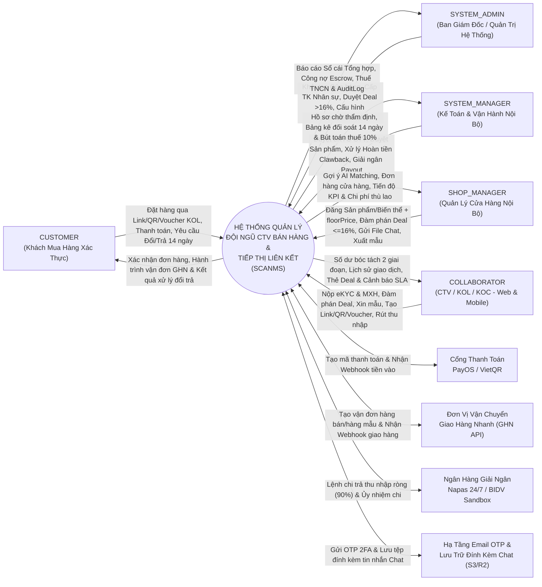
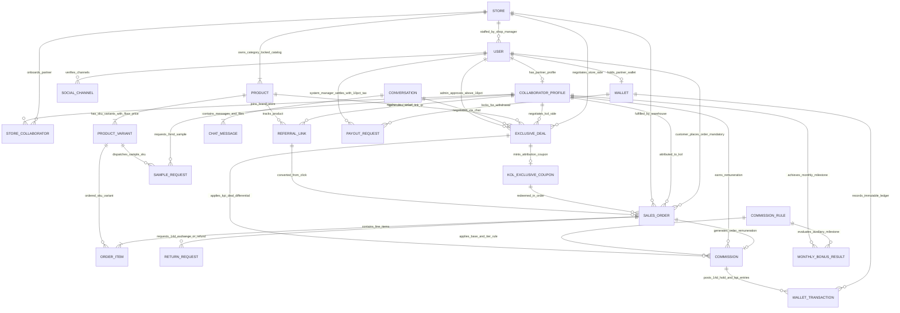

# TÀI LIỆU 04: KẾ HOẠCH CHỈNH SỬA TOÀN DIỆN HỒ SƠ REVIEW 2 (`BM01`–`BM04`, `REGISTRATION`, `SLIDE`), TÁI CẤU TRÚC ERD & 5 LUỒNG NGHIỆP VỤ CHÍNH

> **Mã dự án:** `FA26SE032` (`SCANMS`)  
> **Tên đề tài tiếng Việt (Bất biến):** **Hệ thống quản lý đội ngũ cộng tác viên bán hàng và tiếp thị liên kết**  
> **Tên đề tài tiếng Anh (Bất biến):** **Sales Collaborator and Affiliate Network Management System**  
> **Thư mục hồ sơ mục tiêu:** [docs/SWP490_R2_BM04_Review2-Document](file:///c:/HW/CAPSTONE/docs/SWP490_R2_BM04_Review2-Document) & [docs/review 2](file:///c:/HW/CAPSTONE/docs/review%202)  
> **Mục tiêu tài liệu:** Giải quyết triệt để **9 nhận xét của Hội đồng Review 2 (`longt5`, `ThinhDP2`)** và các lỗi sơ đồ Conceptual/Logical/Physical ERD, chỉ ra những sai sót còn tồn đọng trong cả bản nháp `SCANMS_REALIGNMENT_BLUEPRINT.md` lẫn bộ file `SWP490_FA26SE032_R2_Corrected_Documents`, đồng thời cung cấp bản thiết kế chuẩn hóa kèm kế hoạch sửa từng mục cho toàn bộ bộ biểu mẫu `Registration`, `BM01`, `BM02`, `BM03`, `BM04` và Slide bảo vệ.

---

## 1. KIỂM TOÁN ĐỐI CHIẾU 3 LỚP TÀI LIỆU HIỆN CÓ TRONG DỰ ÁN (TẠI SAO CÁC BẢN SỬA TRƯỚC VẪN CHƯA ĐẠT?)

Qua rà soát toàn bộ kho lưu trữ tài liệu của dự án, hiện đang tồn tại **4 tầng tài liệu khác nhau** có nhiều mâu thuẫn chéo cần được hợp nhất về một chuẩn duy nhất:

| Tầng Hồ Sơ | Đường Dẫn Điển Hình | Những Lỗi Nghiêm Trọng Đang Tồn Tại |
| :--- | :--- | :--- |
| **Tầng 0 — Phiếu Đăng Ký Gốc (`v1.0`)** | [FA26SE032_SALES_COLLABORATOR_AND_AFFILIATE_NETWORK_minhtth5.docx](file:///c:/HW/CAPSTONE/FA26SE032_SALES_COLLABORATOR_AND_AFFILIATE_NETWORK_minhtth5.docx) | • Tên đề tài chuẩn xác là *Hệ thống quản lý đội ngũ cộng tác viên bán hàng và tiếp thị liên kết*, nhưng phần mô tả ban đầu còn đơn giản, chưa có luồng thỏa thuận thù lao 2 chiều giữa Quản lý cửa hàng và KOL, chưa có cơ chế giữ chênh lệch KPI. |
| **Tầng 1 — Hồ Sơ Nộp Review 2 (`29/10/2026`)** | [docs/SWP490_R2_BM04_Review2-Document](file:///c:/HW/CAPSTONE/docs/SWP490_R2_BM04_Review2-Document) [docs/review 2/FA26SE032_R2_Slide.pdf](file:///c:/HW/CAPSTONE/docs/review%202/FA26SE032_R2_Slide.pdf) [SCANMS_ERD_01_Conceptual.png](file:///c:/HW/CAPSTONE/docs/review%202/SCANMS_ERD_01_Conceptual.png) | • **Gây ra trực tiếp cả 9 nhận xét của Hội đồng:** Tự chuyển đề tài sang *"Sàn TMĐT đa gian hàng"* (`BM03` dòng 24), cho đăng ký mở shop ngoài, có ví gian hàng và lệnh Shop Manager rút tiền doanh thu (`Slide 14`), cộng dồn hoa hồng làm thủng biên lợi nhuận. • **Lỗi ERD cực nặng:** Sơ đồ Conceptual thiếu hẳn `ORDER_ITEM`, `PRODUCT_VARIANT`, không có đường nối `USER/CUSTOMER` $\rightarrow$ `SALES_ORDER`, `EXCLUSIVE_DEAL` chỉ nối 1 phía với `STORE`, `COMMISSION_RULE` đứt lìa khỏi `COMMISSION`. Sơ đồ Logical/Physical `.drawio` bị lỗi script chỉ vẽ **62/126 khóa ngoại**! • **Lỗi quy chế `BM04`:** Một workflow ghi tên 2 thành viên cùng sở hữu; tổng Test Case bảng 8.1 cộng ra **85** nhưng bảng 8.2 cộng ra **81**. |
| **Tầng 2 — Bản Realignment Blueprint (`31/10/2026`)** | [docs/SCANMS_REALIGNMENT_BLUEPRINT.md](file:///c:/HW/CAPSTONE/docs/SCANMS_REALIGNMENT_BLUEPRINT.md) | • Đã định hình đúng hướng Cửa hàng nội bộ doanh nghiệp, **NHƯNG vẫn vi phạm 4 điểm cốt tử:**   1. Vẫn giữ **Main Flow 1 chỉ có Đăng ký + OTP + eKYC** (trái trực tiếp Nhận xét số 9 của Hội đồng).   2. Chia cắt 5 Main Flows theo kiểu *"Nửa đầu Flow 3 / Nửa sau Flow 3 / Nửa đầu Flow 4..."* — trái quy định bắt buộc của [SWP490_R2_Huong-dan-chuan-bi-Review-2_1.pdf](file:///c:/HW/CAPSTONE/docs/SWP490_R2_BM04_Review2-Document/SWP490_R2_Huong-dan-chuan-bi-Review-2_1.pdf) rằng **mỗi Workflow chỉ có duy nhất 1 người chịu trách nhiệm chính**.   3. Vẫn giữ các phân hệ đã quyết định bãi bỏ (kho media rời rạc, thực thể gom đợt khuyến mãi đại trà).   4. Chưa mô tả đúng công thức chia tách 2 giai đoạn `10% + Bậc` (14 ngày) và `Deal% - (10% + Bậc)` (chờ KPI), đồng thời mâu thuẫn ngưỡng thuế TNCN (`>= 2.000.000₫` trong văn bản so với `0₫` trong code). |
| **Tầng 3 — Bản Nháp Corrected Documents (`06/11/2026`)** | [docs/SWP490_FA26SE032_R2_Corrected_Documents](file:///c:/HW/CAPSTONE/docs/SWP490_FA26SE032_R2_Corrected_Documents) | • **Phát sinh thêm 5 lỗi mới cực kỳ nguy hiểm nếu đem nộp:**   1. Ghi sai thời gian tạm giữ đối soát thành **`7 ngày` (`COMMISSION_HOLD_DAYS = 7`)** xuyên suốt `DesignBrief.pdf`, `SelfReview.pdf`, `Commitment.pdf`, trong khi quy chuẩn nghiệp vụ và hằng số hệ thống là **`14 ngày`**!   2. Vẫn giữ `WF-01` là luồng Đăng ký + KYC đứng độc lập.   3. Vẫn giữ chức năng `F-08` (Kho Media) vốn đã quyết định loại bỏ.   4. Tự ý đánh dấu tích sẵn `☑ Verified` vào ô dành riêng cho Giảng viên chấm thi tại mục 9 của `Commitment.pdf`!   5. Khất việc vẽ lại sơ đồ ERD sang sau thay vì sửa dứt điểm lỗi thiếu thực thể và thiếu đường quan hệ. |

---

## 2. GIẢI TRÌNH & PHƯƠNG ÁN XỬ LÝ TRIỆT ĐỂ 9 NHẬN XÉT CỦA HỘI ĐỒNG REVIEW 2

### Nhận xét 1: *"Cần xác định rõ mô hình hoạt động là hệ thống quản lý nội bộ hay nền tảng kết nối nhiều cửa hàng, bảo đảm thống nhất với tên và phạm vi đề tài."*
- **Nguyên nhân bị nhận xét:** Tên đề tài đăng ký là **Hệ thống quản lý đội ngũ cộng tác viên bán hàng và tiếp thị liên kết (`Sales Collaborator and Affiliate Network Management System`)**, mang bản chất là một *Management System* của doanh nghiệp. Tuy nhiên `BM01`, `BM03` và `Slide` lại mô tả hệ thống như một sàn TMĐT cho phép các chủ shop bên ngoài tự đăng ký gian hàng, nộp giấy phép kinh doanh và rút doanh thu bán hàng.
- **Giải pháp chốt dứt điểm:**
  1. Khẳng định xuyên suốt trong mọi tài liệu: **SCANMS là Hệ thống Quản lý Nội bộ cấp Doanh nghiệp Đa Cửa Hàng Trực Thuộc (Enterprise In-House Multi-Store Collaborator & Affiliate Management System)**, giữ nguyên 100% tên đề tài đã đăng ký.
  2. Toàn bộ 4 Cửa hàng (`Sora Skincare`, `Aura Activewear`, `GreenBio Nutrition`, `Lumière Smart Living`) là các đơn vị ngành hàng nội bộ thuộc cùng một doanh nghiệp. Tài khoản `SHOP_MANAGER` chỉ do `SYSTEM_ADMIN` khởi tạo và phân công.
  3. Xóa bỏ hoàn toàn: Đăng ký/nâng cấp làm `SHOP_MANAGER`, KYC cửa hàng, Ví cửa hàng (`StoreWallet`), chức năng `SHOP_MANAGER` rút doanh thu hay tự duyệt lệnh chi tiền, Voucher toàn sàn và Voucher công khai của cửa hàng.

---

### Nhận xét 2: *"Cần xem xét lại tính hợp lý của nghiệp vụ hoa hồng khi chuyển từ mô hình nền tảng sang hệ thống."*
- **Nguyên nhân bị nhận xét:**
  1. Ở mô hình cũ, hệ thống chia nguồn chi trả thành *"Shop trả (`shopFundedAmount`)"* và *"Sàn tài trợ (`platformFundedAmount`)"*. Khi chuyển về hệ thống quản lý nội bộ của một doanh nghiệp, Cửa hàng và Hệ thống cùng chung một két tiền doanh nghiệp duy nhất — việc chia túi tiền "Shop chịu / Sàn chịu" trở nên phi lý về mặt kế toán!
  2. Công thức cộng dồn cũ (`Base + Bậc + Thỏa thuận + ...`) kết hợp nhiều tầng voucher bán lẻ không có giá sàn làm doanh nghiệp mất kiểm soát chi phí bán hàng trên từng đơn vị sản phẩm.
- **Giải pháp chốt dứt điểm:**
  1. **Một Nguồn Ngân sách Chi phí Tiếp thị Duy nhất:** Doanh thu đơn hàng chảy thẳng về Tài khoản Tập trung của Doanh nghiệp; mọi khoản thù lao CTV được hạch toán là **Chi phí Thù lao Tiếp thị của Cửa hàng nội bộ (`Store Affiliate Expense`)** kèm kiểm soát **Giá Sàn Thấp Nhất (`floorPrice`)** trên từng biến thể sản phẩm.
  2. **Chuẩn hóa Quy tắc Thù lao 2 Giai đoạn Không Cộng Dồn:**
     - **Phần Tiêu chuẩn chắc chắn hưởng (`10% Gốc + Bậc KOL`):** Đồng `10%`, Bạc `11%`, Vàng `12%`, Kim Cương `13%`. Giữ đối soát đúng **14 ngày** chờ hết hạn đổi trả hàng của khách, sau 14 ngày không hoàn trả thì mở khóa ngay sang ví khả dụng cho KOL rút.
     - **Phần Thỏa thuận Độc quyền (`Exclusive Deal` giữa KOL & Shop Manager):** `<= 16%` do `SHOP_MANAGER` tự duyệt; `> 16%` đến trần cứng `25%` bắt buộc có `SYSTEM_ADMIN` phê duyệt. **Không cộng dồn với Bậc KOL!** Phần chênh lệch giữ lại trong Quỹ KPI được tính chính xác bằng **`Deal% - (10% + Bậc%)`** và chỉ giải ngân khi KOL hoàn thành đủ cam kết KPI của thỏa thuận.
     - **Tính năng phụ trợ:** Thưởng mốc doanh số tháng và Livestream (`+2%`, tổng không vượt `25%`) được đặt đúng vị trí là công cụ khích lệ phụ trợ.

---

### Nhận xét 3: *"Chưa thấy quan hệ `SalesOrder`–`OrderItem` và `ProductVariant`–`OrderItem`."*
- **Bằng chứng pháp y từ hồ sơ Review 2:**
  1. Trên **Sơ đồ Conceptual ([SCANMS_ERD_01_Conceptual.png](file:///c:/HW/CAPSTONE/docs/review%202/SCANMS_ERD_01_Conceptual.png) & `Slide 4`)**: Thực thể `PRODUCT` nối thẳng `M — N <ordered in>` tới `SALES_ORDER`. Hai thực thể cốt lõi là `PRODUCT_VARIANT` và `ORDER_ITEM` hoàn toàn biến mất khỏi sơ đồ!
  2. Trên **Sơ đồ Logical & Physical ([SCANMS_ERD_02_Logical.drawio](file:///c:/HW/CAPSTONE/docs/review%202/SCANMS_ERD_02_Logical.drawio) & [SCANMS_ERD_03_Physical.drawio](file:///c:/HW/CAPSTONE/docs/review%202/SCANMS_ERD_03_Physical.drawio))**: Do script xuất sơ đồ chỉ vẽ 62/126 cạnh khóa ngoại, bảng `ORDER_ITEMS` chỉ có đường nối tới `ORDERS` (`edge [45]`) và `PRODUCTS` (`edge [46]`), **hoàn toàn không có đường khóa ngoại nào nối `ORDER_ITEMS.variant_id` tới `PRODUCT_VARIANTS.id`**!
- **Giải pháp chốt dứt điểm:**
  1. Đưa đầy đủ chuỗi 4 thực thể bắt buộc lên **Sơ đồ Conceptual ERD**:
     `PRODUCT` `(1) ——— (N)` `PRODUCT_VARIANT` `(1) ——— (N)` `ORDER_ITEM` `(N) ——— (1)` `SALES_ORDER`.
  2. Vẽ đầy đủ khóa ngoại `ORDER_ITEMS.variant_id` (`NOT NULL` cho mọi đơn đặt qua danh mục chuẩn, `ON DELETE RESTRICT`) trỏ tới `PRODUCT_VARIANTS.id` và `ORDER_ITEMS.order_id` (`NOT NULL`, `ON DELETE CASCADE`) trỏ tới `SALES_ORDERS.id` trên cả Logical ERD và Physical ERD.
  3. Lưu cứng tại `OrderItem` các trường snapshot kế toán tại thời điểm mua: `unitListPrice`, `unitFloorPriceSnapshot`, `kolCouponDiscountAmount`, `netCommissionableAmount` để phục vụ tính thù lao từng mặt hàng và hoàn trả từng phần (partial return) không sai lệch.

---

### Nhận xét 4: *"Cần kiểm tra mối quan hệ giữa `Customer` và `SalesOrder`, bảo đảm truy xuất được khách hàng tương ứng với từng đơn hàng."*
- **Bằng chứng pháp y từ hồ sơ Review 2:**
  1. Trên **Sơ đồ Conceptual (`Slide 4` & `SCANMS_ERD_01_Conceptual.png`)**: `SALES_ORDER` nằm lơ lửng giữa sơ đồ mà **không hề có bất kỳ đường quan hệ nào nối tới `USER` hay `CUSTOMER`**! Người chấm nhìn vào sơ đồ không thể biết ai là người đặt đơn hàng đó.
  2. Trên **Sơ đồ Logical & Physical `.drawio`**: Bảng `ORDERS` chỉ có đúng 1 đường nối về `STORES` (`edge [44]`), thiếu hoàn toàn đường nối `ORDERS.customer_id` $\rightarrow$ `USERS.id`!
  3. Trong [schema.prisma](file:///c:/HW/CAPSTONE/backend/prisma/schema.prisma#L1495): Cột `customerId String?` đang để **cho phép `NULL` (`onDelete: SetNull`)** (tàn dư của thiết kế mua hàng khách vãng lai không tài khoản trước đây), gây rủi ro mất dấu vết khách hàng và không kiểm tra chéo được hành vi tự mua hưởng thù lao (*Self-referral*).
- **Giải pháp chốt dứt điểm:**
  1. Trên **Conceptual ERD**: Thể hiện tường minh vai trò `CUSTOMER (USER)` với quan hệ bắt buộc `CUSTOMER` `(1) ——— <places> ——— (N)` `SALES_ORDER` (bên cạnh quan hệ độc lập `COLLABORATOR` `(1) ——— <referred by> ——— (0..N)` `SALES_ORDER`).
  2. Trên **Logical & Physical ERD + Database Schema**: Khóa cứng `SalesOrder.customerId` là **`NOT NULL`** (`ON DELETE RESTRICT` — tài khoản đã phát sinh đơn hàng tài chính chỉ được khóa `SUSPENDED/INACTIVE`, tuyệt đối không xóa vật lý làm mồ côi đơn hàng!). Nhờ vậy:
     - Truy xuất 100% lịch sử đơn hàng của từng khách hàng (`Customer` $\leftrightarrow$ `SalesOrder`).
     - Đối chiếu tức thời `SalesOrder.customerId !== SalesOrder.attributedCollaboratorId` (cùng SĐT/STK/Địa chỉ nhận) để chặn gian lận tự mua.

---

### Nhận xét 5: *"Cần làm rõ mối quan hệ giữa `COMMISSION_RULE` và `COMMISSION`, bảo đảm lưu trữ và truy xuất được quy tắc áp dụng cho từng khoản hoa hồng."*
- **Bằng chứng pháp y sâu từ cả Sơ đồ lẫn Code:**
  - Trên **Conceptual ERD (`Slide 4`)**: `STORE` `1 — N` `COMMISSION_RULE` nằm cụt ở góc trên sơ đồ, hoàn toàn **không có đường nối nào xuống `COMMISSION`**!
  - Nghiêm trọng hơn, ngay trong [schema.prisma](file:///c:/HW/CAPSTONE/backend/prisma/schema.prisma#L776-L801) và [schema.prisma](file:///c:/HW/CAPSTONE/backend/prisma/schema.prisma#L1649-L1679): Bảng `CommissionRule` thực chất chỉ nối với `MonthlyBonusResult` (thưởng mốc tháng), **không hề có khóa ngoại nào nối sang bảng `Commission`**! Thậm chí cột `dealProposalId String?` trong bảng `Commission` (dòng 1659) còn chưa khai báo `@relation` tới `ExclusiveDealProposal`, và tỷ lệ `10% + Tier%` đang tính nhẩm trong code TypeScript mà không lưu ID quy tắc cấp bậc đã áp dụng!
- **Giải pháp Thiết kế Chuẩn hóa Triệt để (Điểm nhấn Ăn điểm Tuyệt đối khi Bảo vệ lại):**
  Chuẩn hóa bảng **`COMMISSION_RULE`** thành **Bảng Quy Tắc Thù Lao Tập Trung Cấp Hệ Thống (`System-Wide Remuneration Policy Registry`)** do `SYSTEM_ADMIN` quản trị với phân loại `ruleCategory` gồm 3 nhóm quy tắc:
  1. `STANDARD_TIER_RULE` (Quy tắc Gốc 10% + Bậc Đồng `0%` / Bạc `+1%` / Vàng `+2%` / Kim Cương `+3%` kèm ngưỡng doanh số sạch).
  2. `LIVE_AUXILIARY_RULE` (Quy tắc cộng phụ trợ Livestream `+2%`, trần tổng `25%`).
  3. `MONTHLY_MILESTONE_RULE` (Quy tắc phụ trợ thưởng mốc doanh số tháng `FR-09`, nối sang `MONTHLY_BONUS_RESULT`).
  - **Truy vết Khóa ngoại Kép trên bảng `COMMISSION`:** Mỗi bản ghi `COMMISSION` sinh ra từ đơn hàng bắt buộc lưu:
    - `appliedTierRuleId` (**`NOT NULL` FK $\rightarrow$ `COMMISSION_RULE.id`**): Cho biết chính xác đơn hàng này áp dụng quy tắc Gốc + Bậc nào (ví dụ `RULE_TIER_GOLD_12PCT` phiên bản hiệu lực ngày đặt đơn).
    - `dealProposalId` (**Nullable FK `@relation` $\rightarrow$ `EXCLUSIVE_DEAL_PROPOSAL.id`**): Nếu đơn hàng thuộc thỏa thuận độc quyền, trỏ thẳng về hợp đồng Deal đã ký để tính phần giữ lại `Deal% - (10% + Bậc%)`.
    - `appliedLiveRuleId` (**Nullable FK $\rightarrow$ `COMMISSION_RULE.id`**): Nếu có phụ trợ Livestream.
    - Bóc tách rõ các cột số liệu bất biến trên `COMMISSION`: `baseRate (10%)`, `baseAmount`, `tierBonusRate`, `tierBonusAmount`, `standardHoldAmount` (`10% + Bậc`, giữ 14 ngày), `dealTargetRate`, `kpiDifferentialRate` (`Deal% - (10% + Bậc)`), `kpiEscrowAmount`, `ruleSnapshotJson`.
  - **Kết quả:** Mọi khoản tiền thù lao trong CSDL đều truy xuất ngược được 100% về đúng `COMMISSION_RULE` và/hoặc `EXCLUSIVE_DEAL_PROPOSAL` đã sinh ra nó!

---

### Nhận xét 6: *"Cần bổ sung quy trình thỏa thuận hoa hồng giữa Store Manager và KOC/KOL."*
- **Nguyên nhân bị nhận xét:**
  - Trên `SCANMS_ERD_01_Conceptual.png`, `EXCLUSIVE_DEAL` chỉ nối với `STORE` mà quên nối với `COLLABORATOR_PROFILE` và `PRODUCT`.
  - Trên `SCANMS_SQ_FR27.png` và `SCANMS_CD_FR27.png`, hình vẽ bị xuất nhầm sang luồng mời tham gia đợt khuyến mãi cũ thay vì luồng đàm phán thỏa thuận thù lao 2 chiều!
- **Giải pháp chốt dứt điểm:**
  1. Thiết lập **Luồng Nghiệp vụ Chính số 2 (`WF-02`)** chuyên sâu về **Đàm phán Thỏa thuận Thù lao Độc quyền 2 chiều (`Bi-Directional Exclusive Deal Negotiation`)**:
     - Cho phép cả 2 chiều khởi tạo: `COLLABORATOR` chủ động gửi đề xuất hợp tác sản phẩm kèm mức `%` và cam kết KPI, hoặc `SHOP_MANAGER` dùng gợi ý AI 4 trục để gửi lời mời thỏa thuận cho KOL.
     - Đàm phán trực tiếp qua **Chat Realtime (`Socket.IO`)** tích hợp gửi thẻ đề xuất/phản đề xuất (`Counter-Offer`) và gửi trực tiếp hình ảnh HD, video mẫu, tài liệu thông số sản phẩm ngay trong khung tin nhắn.
     - Phân nhánh thẩm quyền phê duyệt rõ ràng: **`<= 16%`** (`SHOP_MANAGER` duyệt kích hoạt ngay) vs **`> 16%` đến trần `25%`** (chuyển `PENDING_ADMIN_APPROVAL` bắt buộc `SYSTEM_ADMIN` thẩm định phê duyệt).
     - Khi thỏa thuận kích hoạt (`ACTIVE`), hệ thống tự động phát hành Smart Link riêng và **Voucher Deal Độc quyền gắn với KOL** (kiểm tra chặn dưới bởi `floorPrice`).
  2. Bổ sung đầy đủ Sơ đồ Tuần tự (Sequence Diagram), Sơ đồ Lớp (Class Diagram) và Sơ đồ Máy trạng thái (State Machine Diagram) cho `ExclusiveDealProposal`.

---

### Nhận xét 7: *"Cần cân nhắc bổ sung ứng dụng Mobile."*
- **Hiện trạng thực tế trong kho mã nguồn ([Mobile/](file:///c:/HW/CAPSTONE/Mobile)):** Nhóm đã xây dựng ứng dụng di động bằng **React Native `0.88.1` + Expo SDK `58` + TypeScript + TanStack Query + Socket.IO** kết nối 100% API thật (`/api/mobile/bootstrap` và các REST/WebSocket endpoints, không dùng dữ liệu giả), tuân thủ chuẩn màu Vàng Be (`#FAF8F5` / `#C59B58`).
- **Định vị thông minh & Vừa sức Bảo vệ trong Hồ sơ Review 2 sửa đổi:**
  - Định vị ứng dụng Mobile là **Ứng dụng Di động Đồng hành dành cho Cộng tác viên & Tra cứu Đơn hàng (`Collaborator & Order Companion Mobile App`)**, tập trung vào các thao tác di động tần suất cao ngoài hiện trường:
    1. **Dành cho `COLLABORATOR`:** Nhận thông báo & nhắn tin đàm phán thỏa thuận với `SHOP_MANAGER` (gửi/nhận ảnh, tệp), lấy nhanh Smart Link / mã QR PNG / mã Voucher Deal độc quyền để gắn lên kênh TikTok/Facebook trên điện thoại, theo dõi đồng hồ SLA 14 ngày & nộp link video review hàng mẫu, kiểm tra số dư từng giỏ tiền thù lao và gửi yêu cầu rút tiền.
    2. **Dành cho `CUSTOMER` & Vận hành nhanh:** Xem danh mục, theo dõi trạng thái vận đơn GHN, gửi minh chứng đổi trả hàng; duyệt nhanh các ngoại lệ quản trị cơ bản.
  - **Cần dọn dẹp trên Mobile để đồng nhất mô hình:** Gỡ bỏ các màn hình/quyền cũ còn sót trên `Mobile/src/features/workspace/policy.ts` gồm: mục nộp KYC gian hàng của `SHOP_MANAGER`, mục `SHOP_MANAGER` tự duyệt chi tiền rút của KOL, và màn hình đợt khuyến mãi cũ đã bãi bỏ.

---

### Nhận xét 8 & Nhận xét 9: *"Cần tổ chức lại các workflow chính..."* & *"Cần xem xét tích hợp luồng đăng ký, KYC và rút tiền vào các quy trình liên quan, tránh lựa chọn những luồng quá đơn giản để demo độc lập."*
- **Phân tích nguyên tắc từ Hướng dẫn Review 2 chính thức ([SWP490_R2_Huong-dan-chuan-bi-Review-2_1.pdf](file:///c:/HW/CAPSTONE/docs/SWP490_R2_BM04_Review2-Document/SWP490_R2_Huong-dan-chuan-bi-Review-2_1.pdf)):**
  1. Dự án 4 thành viên bắt buộc có ít nhất 4 Workflows phức tạp xuyên vai trò (SCANMS thiết kế **5 Main Workflows** mạch lạc).
  2. **Mỗi Workflow chỉ được giao cho DUY NHẤT 1 thành viên sở hữu chính (`1 Workflow = 1 Sole Owner`)** — chấm dứt hoàn toàn việc ghi 2 tên chung 1 workflow hay cắt "nửa đầu / nửa sau".
  3. **Tuyệt đối không để Đăng ký + KYC làm 1 Workflow độc lập**, và **tuyệt đối không để Rút tiền làm 1 Workflow độc lập**:
     - *Đăng ký, xác thực OTP, nộp & duyệt eKYC* được **tích hợp làm chặng mở đầu** của quy trình **Tuyển mộ Cộng tác viên, Xác minh Kênh MXH & Thiết lập Quan hệ Hợp tác với Cửa hàng Nội bộ (`WF-01`)**.
     - *Yêu cầu rút tiền, khóa dòng `SELECT ... FOR UPDATE`, khấu trừ 10% Thuế TNCN và Kế toán giải ngân* được **tích hợp làm chặng kết thúc khép kín** của quy trình **Đối soát Thù lao 2 Giai đoạn (14 ngày & KPI Deal), Quyết toán Thuế & Kiểm toán Sổ cái Doanh nghiệp (`WF-05`)**.
  4. **Vị trí các tính năng phụ trợ:** *Thưởng mốc doanh số tháng* và *Bán hàng qua Livestream (`+2%`)* được trình bày rõ trong kiến trúc tổng thể như **các tính năng phụ trợ bổ sung giá trị (`Auxiliary Features`)**, không lấn át 5 quy trình quản trị CTV & quyết toán thù lao cốt lõi.

> [!WARNING]
> **RỦI RO PHẢN BIỆN CẦN CHUẨN BỊ SẴN CÂU TRẢ LỜI — LIVESTREAM:**  
> Nguyên văn Nhận xét 8 của Hội đồng có liệt kê *"bán hàng qua livestream"* trong danh sách ví dụ workflow chính. Quyết định của nhóm là **đặt Livestream ở vị trí phụ trợ**, nên khi bảo vệ phải chủ động giải trình, không để Hội đồng tự phát hiện:
> 1. **Lập luận nghiệp vụ:** Với một *Hệ thống quản lý đội ngũ cộng tác viên bán hàng và tiếp thị liên kết*, Livestream chỉ là **một kênh phát sinh đơn hàng (Attribution Channel)** ngang hàng với Smart Link, Dynamic QR và Voucher Deal KOL — nó không tạo ra quy trình quản trị mới. Đơn hàng từ phiên Live vẫn đi qua đúng chuỗi `SalesOrder → OrderItem → Commission → 14 ngày → Quyết toán` của `WF-03` → `WF-05`.
> 2. **Cách thể hiện trong hồ sơ:** Trong `WF-03` (bước 2), ghi rõ *"Kênh Attribution gồm Smart Link / Dynamic QR / Voucher Deal KOL / phiên Livestream (phụ trợ `+2%`, trần `25%`)"*, và có 1 dòng trong bảng Feature Inventory của `BM01` gắn nhãn `[Auxiliary]`. Như vậy Hội đồng thấy Livestream **có mặt và được tích hợp**, nhưng không chiếm 1 workflow độc lập.
> 3. **Điều kiện bắt buộc trước khi demo:** Lỗ hổng `C-05` (tiền `+2%` Livestream bị nhốt vĩnh viễn trong giỏ KPI Deal — xem [Tài liệu 02](file:///c:/HW/CAPSTONE/docs/review2_redesign/02_KIEM_TOAN_CO_CHE_TINH_TIEN_SO_CAI_VA_MINH_BACH_UI_DA_VAI_TRO.md)) phải được sửa xong, nếu không chỉ cần Hội đồng hỏi *"đơn Live thì tiền đi đâu?"* là lộ lỗi ngay.

---

## 3. THIẾT KẾ LẠI 5 LUỒNG NGHIỆP VỤ CHÍNH (5 INTEGRATED MAIN WORKFLOWS) CHUẨN HỘI ĐỒNG

Bảng phân công mới dưới đây đảm bảo: **(1) Mỗi luồng có độ sâu kỹ thuật cao, đi xuyên 3–4 vai trò**, **(2) Không có luồng CRUD/Auth đơn điệu**, **(3) Mỗi luồng có đúng 1 chủ sở hữu duy nhất**, và **(4) Khớp 100% quy tắc nghiệp vụ đã khóa**.

| Mã Luồng | Tên Quy Trình Nghiệp Vụ Tích Hợp (End-to-End Business Workflow) | Chủ Sở Hữu Duy Nhất (`Sole Owner`) | Các Vai Trò Tham Gia (`Actors`) | Chuỗi Bước Nghiệp Vụ Liên Hoàn & Điểm Nhấn Kỹ Thuật Bảo Vệ |
| :---: | :--- | :---: | :--- | :--- |
| **`WF-01`** | **Khởi tạo Cửa hàng Nội bộ, Tuyển mộ Cộng tác viên Đa kênh, Thẩm định eKYC & Kích hoạt Hợp tác Nhãn hàng** *(Internal Store Provisioning, Multi-Channel Creator eKYC & Brand Partnership Onboarding)* | **Nguyễn Thành Thắng** (`SE184251` — Leader) | `SYSTEM_ADMIN` `COLLABORATOR` `SYSTEM_MANAGER` `SHOP_MANAGER` | **1.** `SYSTEM_ADMIN` khởi tạo Cửa hàng nội bộ (gán khóa ngành hàng `primaryCategory`, cấu hình kho GHN) và cấp tài khoản nội bộ cho `SHOP_MANAGER` / `SYSTEM_MANAGER`. **2.** Ứng viên đăng ký / nâng cấp tài khoản `COLLABORATOR` (Argon2id + 2FA OTP), kê khai hồ sơ eKYC (CCCD, STK ngân hàng nhận thù lao) và liên kết danh mục kênh MXH chính chủ kèm ảnh bằng chứng. **3.** `SYSTEM_MANAGER` thẩm định Maker-Checker hồ sơ eKYC & kênh MXH $\rightarrow$ Hệ thống tự động kích hoạt ví thù lao ở **Bậc Đồng (`10%`)**. **4.** Hệ thống đối chiếu hồ sơ năng lực với ngành hàng để kết nối `COLLABORATOR` gia nhập danh sách đối tác chính thức của Cửa hàng nội bộ (`StoreCollaborator` 2 chiều), sẵn sàng nhận sản phẩm tiếp thị *(tích hợp trọn vẹn Đăng ký + eKYC vào luồng tuyển mộ & hợp tác)*. |
| **`WF-02`** | **Quản trị Sản phẩm Biến thể Bảo vệ Giá Sàn (`floorPrice`) & Đàm phán Thỏa thuận Thù lao Độc quyền 2 Chiều** *(Floor-Priced Variant Governance & Bi-Directional Exclusive Deal Negotiation)* | **Phan Xuân Thịnh** (`SE184527`) | `SHOP_MANAGER` `SYSTEM_MANAGER` `COLLABORATOR` `SYSTEM_ADMIN` | **1.** `SHOP_MANAGER` tạo sản phẩm bị khóa cứng ngành hàng (`Category Lock`), sinh ma trận biến thể 2 cấp (`ProductVariant`) kèm **Giá Sàn Thấp Nhất (`floorPrice`)**; `SYSTEM_MANAGER` kiểm duyệt chống trùng SKU/Barcode nội bộ. **2.** `SHOP_MANAGER` tra cứu gợi ý **AI Matching Radar 4 trục** (hoặc `COLLABORATOR` chủ động gửi đề xuất) để mở phiên đàm phán **Thỏa thuận Thù lao Độc quyền (`Exclusive Deal`)**. **3.** Hai bên thương lượng tỷ lệ `%`, chỉ tiêu KPI doanh số/số đơn và gửi trực tiếp ảnh HD, video, tài liệu sản phẩm qua **Chat Realtime `Socket.IO`**. **4.** Phân luồng phê duyệt tự động: Nếu **`<= 16%`**, `SHOP_MANAGER` xác nhận kích hoạt ngay; nếu **`> 16%` đến trần `25%`**, hệ thống chuyển `PENDING_ADMIN_APPROVAL` buộc **`SYSTEM_ADMIN`** thẩm định biên lợi nhuận và phê duyệt ngân sách. |
| **`WF-03`** | **Tài trợ Hàng mẫu SLA 14 Ngày, Phát hành Công cụ Attribution Định danh & Ghi nhận Đơn hàng Chống Tự mua** *(14-Day Sample SLA, Exclusive Attribution Tools & Anti-Fraud Order Recording)* | **Nguyễn Đình Tuấn** (`SE182540`) | `COLLABORATOR` `SHOP_MANAGER` `CUSTOMER` `SYSTEM_MANAGER` | **1.** `COLLABORATOR` đăng ký nhận mẫu thử trải nghiệm $\rightarrow$ `SHOP_MANAGER` duyệt xuất kho mẫu `0₫` qua GHN $\rightarrow$ Kích hoạt đồng hồ đếm ngược **SLA 14 ngày** nộp link bài đăng review nghiệm thu (vi phạm SLA bị `SYSTEM_MANAGER` xử lý chế tài). **2.** Từ thỏa thuận/sản phẩm hợp tác trên Web hoặc **Mobile App**, `COLLABORATOR` khởi tạo bộ 3 công cụ Attribution: **Smart Link (`?ref=`), Dynamic QR và Mã Voucher Deal Độc quyền gắn tên KOL** (kiểm tra chặn dưới không thủng `floorPrice`). **3.** `CUSTOMER` (đã xác thực tài khoản `customerId`) đặt mua biến thể sản phẩm (`ProductVariant` $\rightarrow$ `OrderItem` $\rightarrow$ `SalesOrder`) qua PayOS/VietQR/COD. **4.** Động cơ **Anti-Self-Referral & Fraud Sentinel** kiểm tra chéo danh tính/SĐT/địa chỉ; nếu hợp lệ thì tính snapshot thù lao tách sẵn 2 rổ (`10% + Bậc` và `Deal% - (10% + Bậc)`). |
| **`WF-04`** | **Điều phối Giao vận GHN Đa kho, Đối soát Đổi trả 14 Ngày (Đổi mới 1-1 vs Hoàn tiền Clawback) & Tiến độ KPI** *(Multi-Warehouse GHN Fulfillment, 14-Day Return/Clawback Arbitration & KPI Tracking)* | **Nguyễn Phú Quý** (`SE180104`) | `SHOP_MANAGER` `CUSTOMER` `SYSTEM_MANAGER` `COLLABORATOR` | **1.** `SHOP_MANAGER` xác nhận đóng gói và đẩy vận đơn tự động sang kho vệ tinh GHN tương ứng của cửa hàng nội bộ; đồng bộ webhook trạng thái giao hàng thành công (`DELIVERED`), bắt đầu tính mốc **14 ngày bảo chứng đổi trả**. **2.** Trong vòng 14 ngày, nếu `CUSTOMER` gửi khiếu nại kèm video mở hộp:   • *Nhánh A (Lỗi vận chuyển GHN / lỗi sản xuất):* Thực hiện **Đổi hàng mới 1-1 (`EXCHANGE`)** $\rightarrow$ Giữ nguyên hiệu lực đơn hàng và **bảo lưu 100% thù lao + tiến độ KPI cho KOL**.   • *Nhánh B (Trả hàng hoàn tiền `REFUND` do `SYSTEM_MANAGER` duyệt):* Hoàn tiền cho khách và kích hoạt **Clawback Engine** thu hồi toàn bộ thù lao đang tạm giữ (`10% + Bậc` lẫn `KPI Deal`) về `0₫`, đồng thời trừ lùi khỏi thanh tiến độ KPI. **3.** Cập nhật tức thời doanh số sạch tích lũy để xét thăng bậc tự động (**Đồng $\rightarrow$ Bạc $\rightarrow$ Vàng $\rightarrow$ Kim Cương**). |
| **`WF-05`** | **Quyết toán Sổ cái Thù lao 2 Giai đoạn (`14 Ngày` & `KPI Deal`), Rút tiền Khấu trừ Thuế TNCN 10% & Kiểm toán Cấp cao** *(Two-Stage Escrow Settlement, Row-Locked PIT Payout & Executive Ledger Reconciliation)* | **Nguyễn Thành Thắng** (`SE184251` — Leader) | `COLLABORATOR` `SYSTEM_MANAGER` `SYSTEM_ADMIN` | **1.** *Quyết toán Giai đoạn 1:* Tác vụ đối soát quét các đơn sạch đã vượt mốc **14 ngày kể từ `DELIVERED`**, giải ngân phần **`10% Gốc + Bậc KOL`** từ giỏ tạm giữ sang **Số dư khả dụng (`availableBalance`)**. **2.** *Quyết toán Giai đoạn 2:* Khi thỏa thuận độc quyền cán đích **100% KPI doanh số sạch**, hệ thống giải ngân tiếp phần chênh lệch **`Deal% - (10% + Bậc%)`** về ví khả dụng (hoặc thu hồi `FORFEITED` về ngân sách cửa hàng nếu hết hạn Deal mà không đạt KPI). **3.** `COLLABORATOR` (trên Web/Mobile) xem bảng bóc tách nguồn tiền chi tiết và tạo lệnh rút tiền $\rightarrow$ Hệ thống khóa dòng `SELECT ... FOR UPDATE` chống race-condition, chuyển sang `lockedBalance`. **4.** `SYSTEM_MANAGER` (Kế toán) đối soát lệnh chi hàng ngày, khấu trừ **10% Thuế TNCN** tại nguồn, giải ngân `90%` thực nhận qua ngân hàng; `SYSTEM_ADMIN` giám sát toàn cảnh dòng tiền vào, công nợ Escrow, chi phí thù lao và tờ khai thuế trên **Executive Financial Dashboard** + `AuditLog`. |

---

## 4. TÁI THIẾT KẾ HỆ THỐNG SƠ ĐỒ KIẾN TRÚC & CƠ SỞ DỮ LIỆU (KHẮC PHỤC 100% LỖI SLIDE & ERD REVIEW 2)

### 4.1. Sơ đồ Ngữ cảnh Hệ thống Chuẩn hóa (`Redesigned System Context Diagram`)
*(Khắc phục toàn bộ lỗi gõ sai `System Manage`, mất chữ trên cạnh, thiếu đối tác vận chuyển GHN, và vẽ nhầm luồng duyệt mở Shop / Shop rút tiền trên `SCANMS_Context_Diagram.png` cũ)*:

---

### 4.2. Sơ đồ Thực thể Kết hợp Khái niệm Mới (`Redesigned Conceptual ERD` — Thay thế hoàn toàn `Slide 4` & `SCANMS_ERD_01_Conceptual.png`)

Sơ đồ dưới đây giải quyết **trực diện 100%** các nhận xét số 3, 4, 5, 6 của Hội đồng Review 2 và loại bỏ sạch sẽ mọi thực thể rác của sàn TMĐT:
- **Có đầy đủ:** `PRODUCT` `(1—N)` `PRODUCT_VARIANT` `(1—N)` `ORDER_ITEM` `(N—1)` `SALES_ORDER`.
- **Có đầy đủ:** `USER (CUSTOMER)` `(1—N)` `SALES_ORDER` (`places_order`, bắt buộc xác thực).
- **Có đầy đủ:** `COMMISSION_RULE` `(1—N)` `COMMISSION` (`governs_tier_and_rate`) **VÀ** `EXCLUSIVE_DEAL` `(0..1—N)` `COMMISSION` (`governs_kpi_differential`).
- **Có đầy đủ:** `STORE` `(1—N)` `EXCLUSIVE_DEAL` `(N—1)` `COLLABORATOR_PROFILE` (đàm phán 2 phía gắn với `PRODUCT`, `CONVERSATION` và `SYSTEM_ADMIN` khi `>16%`).

---

### 4.3. Đặc tả Sơ đồ Thực thể Logic Cụm Đơn hàng – Quy tắc Thù lao – Sổ cái (`Logical Schema Fix Blueprint`)

Đây là cấu trúc các cột khóa chính/khóa ngoại bắt buộc phải sửa trong tài liệu Thiết kế Cơ sở dữ liệu (`Database Design` & `scanms_physical_erd.dbml`) để đảm bảo **không có đường đứt gãy nào khi truy vết dữ liệu**:

```mermaid
erDiagram
    COMMISSION_RULES {
        uuid id PK
        varchar rule_code UK "VD: TIER_BRONZE_10, TIER_GOLD_12, AUX_LIVE_2, MS_50M"
        varchar rule_category "STANDARD_TIER | AUX_LIVESTREAM | AUX_MILESTONE"
        varchar target_tier "BRONZE | SILVER | GOLD | DIAMOND | NULL"
        decimal base_rate "10.00"
        decimal bonus_rate "0.00 | 1.00 | 2.00 | 3.00 | 2.00"
        decimal min_clean_gmv_threshold "0 | 20000000 | 50000000 | 100000000"
        boolean is_active
        uuid created_by_admin_id FK
    }

    EXCLUSIVE_DEAL_PROPOSALS {
        uuid id PK
        uuid store_id FK "NOT NULL -> STORES.id"
        uuid collaborator_id FK "NOT NULL -> USERS.id"
        uuid product_id FK "NOT NULL -> PRODUCTS.id"
        uuid conversation_id FK "NULLABLE -> CONVERSATIONS.id"
        decimal agreed_commission_rate "10.01 .. 25.00 (Max Ceiling 25%)"
        boolean requires_admin_approval "true khi agreed_rate > 16.00"
        uuid admin_reviewer_id FK "NULLABLE -> USERS.id (SYSTEM_ADMIN)"
        decimal kpi_target_clean_gmv "Mục tiêu doanh số sạch"
        int kpi_target_orders "Mục tiêu số đơn sạch"
        decimal current_clean_gmv "Chỉ cộng đơn hợp lệ không hoàn trả"
        varchar status "PROPOSED | COUNTER_OFFERED | PENDING_ADMIN_APPROVAL | ACTIVE | KPI_ACHIEVED | EXPIRED_UNMET_KPI | REJECTED"
        timestamptz valid_from
        timestamptz valid_until
    }

    PRODUCT_VARIANTS {
        uuid id PK
        uuid product_id FK "NOT NULL -> PRODUCTS.id"
        varchar sku UK "Mã định danh biến thể duy nhất"
        varchar tier1_value "Màu sắc / Phân loại 1"
        varchar tier2_value "Kích cỡ / Dung tích 2"
        decimal selling_price "Giá niêm yết (>= floor_price)"
        decimal floor_price "NOT NULL - Giá sàn thấp nhất bảo vệ biên"
        int stock_quantity
    }

    SALES_ORDERS {
        uuid id PK
        varchar order_code UK
        uuid customer_id FK "NOT NULL -> USERS.id (Bắt buộc truy xuất Khách hàng)"
        uuid store_id FK "NOT NULL -> STORES.id"
        uuid attributed_collaborator_id FK "NULLABLE -> USERS.id"
        uuid exclusive_coupon_id FK "NULLABLE -> COUPONS.id"
        uuid referral_link_id FK "NULLABLE -> REFERRAL_LINKS.id"
        decimal subtotal_amount
        decimal kol_coupon_discount_amount
        decimal net_commissionable_amount "Tổng giá trị ròng tính thù lao"
        varchar status "PENDING | CONFIRMED | SHIPPING | DELIVERED | COMPLETED | RETURNED"
        timestamptz delivered_at "Mốc bắt đầu đếm 14 ngày trả hàng"
        timestamptz return_window_expires_at "delivered_at + 14 days"
    }

    ORDER_ITEMS {
        uuid id PK
        uuid order_id FK "NOT NULL -> SALES_ORDERS.id"
        uuid product_id FK "NOT NULL -> PRODUCTS.id"
        uuid variant_id FK "NOT NULL -> PRODUCT_VARIANTS.id (Khắc phục lỗi thiếu FK)"
        int quantity
        decimal unit_selling_price
        decimal unit_floor_price_snapshot "Chứng cứ không vi phạm giá sàn"
        decimal line_discount_amount
        decimal line_net_commissionable_amount
    }

    COMMISSIONS {
        uuid id PK
        uuid order_id FK "UK, NOT NULL -> SALES_ORDERS.id"
        uuid collaborator_id FK "NOT NULL -> USERS.id"
        uuid store_id FK "NOT NULL -> STORES.id"
        uuid applied_tier_rule_id FK "NOT NULL -> COMMISSION_RULES.id (Truy xuất quy tắc Gốc+Bậc)"
        uuid deal_proposal_id FK "NULLABLE -> EXCLUSIVE_DEAL_PROPOSALS.id (Truy xuất Deal)"
        uuid applied_live_rule_id FK "NULLABLE -> COMMISSION_RULES.id"
        varchar collaborator_tier_snapshot "BRONZE | SILVER | GOLD | DIAMOND"
        decimal base_rate "10.00"
        decimal base_amount "10% * V"
        decimal tier_bonus_rate "0.00 | 1.00 | 2.00 | 3.00"
        decimal tier_bonus_amount "Tier% * V"
        decimal standard_hold_amount "10% + Tier% (Mở khóa sau 14 ngày)"
        varchar standard_hold_status "HOLDING_14D | RELEASED_TO_AVAILABLE | CLAWED_BACK"
        decimal deal_target_rate "NULL hoặc <= 25.00"
        decimal kpi_differential_rate "max(0, Deal% - (10% + Tier%))"
        decimal kpi_escrow_amount "round(V * Deal%) - standard_hold_amount"
        varchar kpi_escrow_status "NOT_APPLICABLE | HOLDING_FOR_KPI | KPI_QUALIFIED_WAITING_14D | RELEASED_TO_AVAILABLE | FORFEITED_UNMET_KPI | CLAWED_BACK"
        jsonb rule_snapshot_json "Bản chụp bất biến toàn bộ công thức"
    }

    PRODUCT_VARIANTS ||--o{ ORDER_ITEMS : "variant_id"
    SALES_ORDERS ||--|{ ORDER_ITEMS : "order_id"
    SALES_ORDERS ||--o| COMMISSIONS : "order_id"
    COMMISSION_RULES ||--o{ COMMISSIONS : "applied_tier_rule_id"
    EXCLUSIVE_DEAL_PROPOSALS ||--o{ COMMISSIONS : "deal_proposal_id"
```

> [!TIP]
> **Lưu ý Kỹ thuật khi Xuất lại `.drawio` cho Logical & Physical ERD:**
> Tuyệt đối không dùng lại script cũ đã cắt cụt chỉ vẽ 1 cạnh/bảng (62/126 cạnh). Phải kiểm tra bằng mắt thường và checklist đảm bảo đủ 5 cụm đường nối sống còn mà thầy cô sẽ soi đầu tiên tại buổi bảo vệ tiếp theo:
> 1. `USERS (Customer)` `1 ——— N` `SALES_ORDERS` (`customer_id NOT NULL`)
> 2. `SALES_ORDERS` `1 ——— N` `ORDER_ITEMS` (`order_id NOT NULL`)
> 3. `PRODUCT_VARIANTS` `1 ——— N` `ORDER_ITEMS` (`variant_id NOT NULL`)
> 4. `STORES` `1 ——— N` `EXCLUSIVE_DEAL_PROPOSALS` `N ——— 1` `USERS (Collaborator)`
> 5. `COMMISSION_RULES` `1 ——— N` `COMMISSIONS` (`applied_tier_rule_id`) và `EXCLUSIVE_DEAL_PROPOSALS` `1 ——— N` `COMMISSIONS` (`deal_proposal_id`).

---

## 5. KẾ HOẠCH CHỈNH SỬA CHI TIẾT TỪNG TÀI LIỆU TRONG `docs/SWP490_R2_BM04_Review2-Document`

Dưới đây là bảng chỉ dẫn biên tập chi tiết đến từng mục (Section-by-Section Edit Plan) cho cả 5 tài liệu chính thức trong thư mục [SWP490_R2_BM04_Review2-Document](file:///c:/HW/CAPSTONE/docs/SWP490_R2_BM04_Review2-Document) và Slide thuyết trình:

### 5.1. Tài liệu 1: Phiếu Đăng ký Đề tài Cập nhật (`SWP490_FA26SE032_R2_Registration.docx / .pdf`)
| Mục trong File | Nội dung Cũ bị Lỗi (`29/10/2026` & `06/11/2026`) | Nội dung Chỉnh sửa Chuẩn xác (`v2.1 Final`) |
| :--- | :--- | :--- |
| **1. Project Title** | Giữ nguyên nhưng đoạn dưới gọi là *"Multi-Merchant Affiliate Network"* | **Giữ nguyên 100% không đổi một chữ:** • EN: **Sales Collaborator and Affiliate Network Management System (`SCANMS`)** • VN: **Hệ thống quản lý đội ngũ cộng tác viên bán hàng và tiếp thị liên kết** |
| **2. Context & Operating Model** | Mô tả kết nối nhiều chủ gian hàng độc lập mở shop và giải quyết bài toán chợ TMĐT | Sửa thành: **Hệ thống Quản trị Nội bộ của Doanh nghiệp sở hữu chuỗi 4 Cửa hàng/Nhãn hàng trực thuộc**, quản lý khép kín đội ngũ Cộng tác viên/KOC/KOL bên ngoài từ khâu tuyển mộ eKYC, thỏa thuận thù lao gắn KPI, cấp công cụ Attribution đến đối soát đổi trả 14 ngày và quyết toán thuế TNCN 10%. |
| **3. Actors (5 Roles)** | `SHOP_MANAGER` tự đăng ký, nộp giấy phép KD và có ví rút tiền; thiếu Mobile cho CTV | Chuẩn hóa 5 vai trò: `SYSTEM_ADMIN` (khởi tạo Store & nhân sự, duyệt Deal `>16%`, xem Sổ cái tổng), `SYSTEM_MANAGER` (duyệt eKYC KOL, duyệt sản phẩm, xử lý hoàn tiền Clawback, duyệt rút tiền `-10%` PIT), `SHOP_MANAGER` (nhân sự nội bộ quản lý `Product`/`ProductVariant` + `floorPrice`, đàm phán Deal `<=16%`, gửi file qua Chat, cấp hàng mẫu), `COLLABORATOR` (Web + Mobile App), `CUSTOMER` (mua hàng xác thực qua Link/QR/Voucher Deal KOL). |
| **4. Main Functional Scope** | Còn liệt kê Kho Media (`F-08`), Voucher 3 tầng sàn/shop, hoặc chu kỳ giữ tiền 7 ngày | • **Xóa bỏ hoàn toàn:** Kho Media tĩnh, thực thể đợt khuyến mãi đại trà, Voucher sàn & Voucher shop công khai, tự đăng ký Shop. • **Cập nhật chuẩn:** Quản trị `floorPrice`, Thỏa thuận Deal 2 chiều (`<=16%` / `>16%..25%`), Gửi ảnh/video/file qua Chat Socket.IO, Tạm giữ **14 ngày** cho `10% + Bậc` và Tạm giữ KPI cho `Deal% - (10% + Bậc)`, Ứng dụng Mobile (`React Native / Expo`) cho CTV & tra cứu đơn, cùng 2 tính năng **phụ trợ** (Thưởng mốc tháng & Livestream). |

---

### 5.2. Tài liệu 2: `SWP490_R2_BM01_Design_Brief` (Tóm tắt Thiết kế Hệ thống — Tối đa 3–4 trang súc tích)
| Mục trong `BM01` | Lỗi Hiện tại Cần Xóa | Nội dung Viết lại Chuẩn xác |
| :--- | :--- | :--- |
| **Section 2 — Architectural Drivers & Decisions (`D1`–`D5`)** | • `D1`: Công thức cộng dồn cũ hoặc công thức còn chứa mức đợt khuyến mãi. • `D4`: Voucher 3 tầng (`29/10`) hoặc ghi nhầm `7-day hold` (`06/11`). | • **`D1` (Two-Stage Non-Stacking Commission & KPI Escrow):** Trả trước `10% + Tier%` sau **14 ngày** hết hạn trả hàng; giữ phần chênh lệch `Deal% - (10% + Tier%)` trong `KPI Escrow` chỉ mở khóa khi đạt 100% KPI; ngưỡng `>16%` bắt buộc `SYSTEM_ADMIN` duyệt, trần tuyệt đối `25%`. • **`D2` (Strict Entity & Attribution Traceability):** Khóa cứng `Customer (1) — (N) SalesOrder (1) — (N) OrderItem (N) — (1) ProductVariant` và `CommissionRule / ExclusiveDeal (1) — (N) Commission`. • **`D3` (Floor Price Margin Guard & Exclusive KOL Coupon Only):** Chặn cứng mọi giảm giá dưới `floorPrice`; chỉ duy trì duy nhất Voucher Deal độc quyền gắn với KOL. • **`D4` (14-Day Return Window & Dual-Path Clawback):** Đổi hàng mới 1-1 bảo lưu 100% thù lao; Hoàn tiền kích hoạt Clawback thu hồi về `0₫`. • **`D5` (Web + Mobile Companion & Row-Locked Tax Ledger):** Đồng bộ React Web + Expo Android Mobile qua REST/Socket.IO; khóa dòng `SELECT ... FOR UPDATE` khi rút tiền và khấu trừ 10% Thuế TNCN. |
| **Section 3 — Feature Inventory Table** | 19 features cũ có `Shop KYC`, `3-Tier Voucher`, `Media Hub`, `Shop Withdrawal` | Chuẩn hóa lại bảng **18 Chức năng Tinh gọn** (16 chức năng thuộc 5 Luồng chính + 2 chức năng Phụ trợ đánh nhãn `[Auxiliary]` rõ ràng cho Thưởng mốc tháng và Livestream). Không còn bất kỳ dòng nào về Media Hub hay Voucher sàn/shop. |
| **Section 4 — Main Workflows (`WF-01`..`WF-05`)** | `WF-01` chỉ là Auth/KYC; có 2 tên chủ sở hữu/workflow | Thay bằng đúng bảng **5 Integrated Main Workflows (`WF-01`..`WF-05`)** tại Mục 3 phía trên, mỗi Workflow ghi đúng **1 tên thành viên duy nhất**. |

---

### 5.3. Tài liệu 3: `SWP490_R2_BM02_Self_Review_Report` (Báo cáo Tự rà soát Nhất quán Thiết kế)
Cập nhật bảng đối chiếu tự kiểm tra (`SR-01` đến `SR-12`) phản ánh trung thực kết quả rà soát hậu Review 2:
- **`SR-01` (Đồng bộ tên dự án & mô hình hoạt động):** Đã sửa triệt để lỗi gọi nhầm `InfluxNet` trong `SAD_DOCUMENT.md` và loại bỏ toàn bộ thuật ngữ "Sàn TMĐT đa chủ shop" sang "Hệ thống quản lý nội bộ đa cửa hàng trực thuộc", khớp 100% tên đề tài `SCANMS`.
- **`SR-02` (Truy vết ERD `Customer` – `SalesOrder` – `OrderItem` – `ProductVariant`):** Đã bổ sung đầy đủ thực thể và khóa ngoại `NOT NULL` trên cả 3 mức Conceptual, Logical, Physical ERD.
- **`SR-03` (Truy vết `CommissionRule` & `ExclusiveDealProposal` $\rightarrow$ `Commission`):** Đã chuẩn hóa khóa ngoại `appliedTierRuleId` và `dealProposalId` cùng `ruleSnapshotJson` trên bảng `Commission`.
- **`SR-04` (Đồng bộ hằng số 14 ngày & Công thức trừ Bậc khi tính KPI Deal):** Thống nhất `14 ngày` (`COMMISSION_HOLD_DAYS = 14`) trên toàn bộ SRS, SDD, BM01, BM04 và mã nguồn; thống nhất công thức giữ KPI = `Deal% - (10% + Tier%)`.
- **`SR-05` (Bổ sung đầy đủ UML cho Đàm phán Thỏa thuận 2 chiều & Kiến trúc Web + Mobile):** Đã thay thế sơ đồ `FR-27` bị vẽ nhầm bằng Sequence, Class và State Machine của `ExclusiveDealProposal` (kèm nhánh `>16%` Admin duyệt) và cập nhật `SCANMS_OVERVIEW_ARCHITECTURE` có khối ứng dụng Mobile React Native / Expo.

---

### 5.4. Tài liệu 4: `SWP490_R2_BM03_Record_of_Changes` (Nhật ký Thay đổi so với Phiếu Đăng ký Gốc `v1.0`)
> [!WARNING]
> Trong `BM03` cũ (dòng 24), câu *"Transitioned from an internal single-company collaborator tool to a Multi-Merchant E-Commerce Affiliate Platform"* chính là câu tự tạo mâu thuẫn với tên đề tài! Bắt buộc viết lại hoàn toàn bảng `BM03` như sau:

| Change ID | Hạng mục Thay đổi so với Đăng ký Gốc `v1.0` | Lý do Thay đổi ( Dựa trên Góp ý Hội đồng Review 2 & Thực tiễn Doanh nghiệp ) | Tác động tới Kiến trúc & Phạm vi |
| :---: | :--- | :--- | :--- |
| **`CHG-01`** | **Làm rõ Mô hình Hệ thống Quản lý Nội bộ Đa Cửa hàng Trực thuộc** (Loại bỏ tự đăng ký Shop, Ví Shop & Voucher sàn/shop) | Đảm bảo thống nhất tuyệt đối với tên đề tài *Hệ thống quản lý đội ngũ cộng tác viên bán hàng và tiếp thị liên kết*, tránh xa đà sang sàn TMĐT bán lẻ. | `SYSTEM_ADMIN` độc quyền tạo `Store` nội bộ & `SHOP_MANAGER`; chỉ giữ Voucher Deal độc quyền gắn với KOL kèm khóa Giá Sàn `floorPrice`. |
| **`CHG-02`** | **Bổ sung Quy trình Thỏa thuận Thù lao Độc quyền 2 Chiều & Cơ chế Giải ngân 2 Giai đoạn có Trừ Bậc** | Giải quyết nhận xét của Hội đồng về tính hợp lý của hoa hồng và quy trình đàm phán giữa Quản lý cửa hàng với KOL/KOC. | `<=16%` Shop Manager tự duyệt, `>16%..25%` Admin duyệt; trả trước `10% + Bậc` sau 14 ngày trả hàng, giữ `Deal% - (10% + Bậc)` tới khi đạt 100% KPI; trao đổi ảnh/video/file trực tiếp qua Chat (bỏ kho Media tĩnh). |
| **`CHG-03`** | **Chuẩn hóa Truy vết Quan hệ Thực thể Đơn hàng, Biến thể & Quy tắc Hoa hồng trên ERD** | Khắc phục thiếu sót quan hệ `Customer–SalesOrder`, `SalesOrder–OrderItem–ProductVariant` và `CommissionRule–Commission` theo nhận xét Review 2. | Bổ sung đầy đủ thực thể và khóa ngoại bắt buộc trên Conceptual, Logical, Physical ERD và Snapshot sổ cái. |
| **`CHG-04`** | **Bổ sung Ứng dụng Di động Đồng hành (`React Native / Expo`) cho Cộng tác viên & Tra cứu Đơn** | Đáp ứng góp ý của Hội đồng về trải nghiệm di động thực tế cho đội ngũ CTV/KOC tác nghiệp nhanh. | Xây dựng ứng dụng Android Expo kết nối chung Backend NestJS & Socket.IO (Chat, lấy Link/QR/Voucher, theo dõi SLA mẫu thử, xem sổ cái ví & rút tiền). |
| **`CHG-05`** | **Tái tổ chức 5 Luồng Nghiệp vụ Tích hợp (`WF-01`..`WF-05`, mỗi luồng 1 chủ sở hữu duy nhất)** | Tích hợp Đăng ký/eKYC và Rút tiền vào chuỗi nghiệp vụ đầu-cuối, phân định rõ tính năng cốt lõi và phụ trợ. | 5 Main Workflows xuyên vai trò cho 4 thành viên; Thưởng mốc tháng và Livestream đóng vai trò tính năng phụ trợ. |

---

### 5.5. Tài liệu 5: `SWP490_R2_BM04_Review2_Commitment` (Bản Cam kết Review 2 & Ma trận Kiểm thử)
Cần đặc biệt lưu ý **4 quy tắc kỹ thuật bắt buộc** khi xuất lại file `BM04` để không phạm quy chế chấm thi:
1. **Mục 4 & Mục 5 (Danh sách 5 Main Workflows & Phân công):** Mỗi Workflow `WF-01`..`WF-05` chỉ điền **1 họ tên + MSSV duy nhất** ở cột `Primary Owner`:
   - `WF-01`: Nguyễn Thành Thắng (`SE184251`)
   - `WF-02`: Phan Xuân Thịnh (`SE184527`)
   - `WF-03`: Nguyễn Đình Tuấn (`SE182540`)
   - `WF-04`: Nguyễn Phú Quý (`SE180104`)
   - `WF-05`: Nguyễn Thành Thắng (`SE184251`)
2. **Mục 6 (Kịch bản Demo Thực chiến `DS-01`..`DS-05`):**
   - `DS-01` không dừng ở duyệt KYC mà chạy liền mạch từ tạo Cửa hàng nội bộ $\rightarrow$ duyệt eKYC KOL lên Bậc Đồng `10%` $\rightarrow$ kết nạp KOL vào danh sách đối tác Cửa hàng nội bộ.
   - `DS-02` demo trực tiếp chặn nhập giá dưới `floorPrice`, đàm phán Deal qua Chat đính kèm ảnh/video sản phẩm, so sánh trường hợp `15%` (`SHOP_MANAGER` duyệt ngay) và `20%` (bắt buộc `SYSTEM_ADMIN` duyệt).
   - `DS-03` demo cấp mẫu SLA 14 ngày + tạo mã Voucher Deal KOL trên Web/Mobile + khách đặt đơn biến thể + chặn tự mua.
   - `DS-04` demo vận đơn GHN + đối chiếu 2 nhánh: Đổi hàng lỗi 1-1 (giữ nguyên thù lao) vs Hoàn tiền (Clawback về `0₫` và trừ KPI).
   - `DS-05` demo giải ngân `10% + Bậc` sau 14 ngày + giải ngân phần chênh lệch `Deal% - (10% + Bậc)` khi đạt KPI + KOL rút tiền khóa dòng khấu trừ `10%` Thuế TNCN + đối soát Sổ cái Kế toán & CEO.
3. **Mục 8 (Thống kê Kiểm thử Tự động & Thủ công — Sửa lỗi cộng sai `85 vs 81`):**
   - Đảm bảo tổng dòng của **Bảng 8.1 (Phân bổ Test theo Workflow)** bằng chính xác 100% tổng dòng của **Bảng 8.2 (Phân bổ Test theo Thành viên)**: ví dụ chuẩn hóa tổng **100 Test Cases** (`WF-01: 18`, `WF-02: 22`, `WF-03: 20`, `WF-04: 20`, `WF-05: 20` $\rightarrow$ Thắng: `38`, Thịnh: `22`, Tuấn: `20`, Quý: `20`; tổng cả hai bảng đều khớp tuyệt đối **`100 = 100`**!).
4. **Mục 9 & Mục 10 (Ô Xác nhận dành cho Hội đồng Giảng viên):**
   - **TUYỆT ĐỐI ĐỂ TRỐNG (`☐`)** các ô checkbox xác nhận của Reviewer ở Mục 9 (khắc phục lỗi tự tích sẵn `☑ Verified` trong file nháp `06/11/2026`).

---

### 5.6. Cấu trúc Chỉnh sửa Slide Thuyết trình Bảo vệ (`16 Slides` — Tông Vàng Be Chuẩn Thương Hiệu)
1. **Slide 1:** Trang bìa — Giữ nguyên tên chính thức **Hệ thống quản lý đội ngũ cộng tác viên bán hàng và tiếp thị liên kết (`Sales Collaborator and Affiliate Network Management System`)**, mã `FA26SE032`.
2. **Slide 2:** Bối cảnh & Định vị Mô hình — Vì sao doanh nghiệp đa nhãn hàng cần **Hệ thống Quản lý CTV & Tiếp thị Liên kết Nội bộ** (4 cửa hàng nội bộ do Admin tạo — KOC bên ngoài; đối lập hoàn toàn với Sàn TMĐT tự do).
3. **Slide 3:** Kiến trúc Tổng thể Đa nền tảng — React Web Portal + **Expo React Native Mobile App** + NestJS + PostgreSQL + Redis + Socket.IO + GHN / PayOS / Ngân hàng.
4. **Slide 4:** **Sơ đồ Conceptual ERD Mới (Rõ nét, chuẩn xác 100%)** — Tô nổi bật cụm `Customer -> SalesOrder -> OrderItem <- ProductVariant`, cụm `Store <-> ExclusiveDeal <-> Collaborator`, và cụm `CommissionRule / ExclusiveDeal -> Commission`.
5. **Slide 5:** Cơ chế Quản trị Sản phẩm Nội bộ — Khóa ngành hàng (`Category Lock`), Biến thể 2 cấp và Chốt chặn **Giá Sàn Thấp Nhất (`floorPrice`)** + Voucher Deal Độc quyền KOL.
6. **Slide 6:** **Cơ chế Tính Thù lao & Giải ngân 2 Giai đoạn (Trọng tâm Tài chính)** — Bảng minh họa trực quan bằng con số: Trả trước `10% + Bậc` sau **14 ngày** trả hàng; Giữ lại chính xác `Deal% - (10% + Bậc%)` chờ đạt **100% KPI**; Ngưỡng `<=16%` Shop tự duyệt vs `>16%..25%` Admin duyệt; Phụ trợ Thưởng mốc & Livestream.
7. **Slide 7:** Tổng quan 5 Luồng Nghiệp vụ Tích hợp & Phân công Độc lập 4 Thành viên (`1 Workflow = 1 Owner`).
8. **Slide 8–12:** Đi sâu kiến trúc Sequence / State Machine của từng luồng `WF-01` đến `WF-05` (mỗi luồng 1 slide súc tích, không chữ chi chít).
9. **Slide 13:** Bảo mật Tài chính & Chống Gian lận — Khóa dòng Bi quan `SELECT ... FOR UPDATE`, Bút toán kép Sổ cái bất biến, Khấu trừ 10% Thuế TNCN & Động cơ chống tự mua (*Anti-Self-Referral*).
10. **Slide 14:** Minh bạch Giao diện Đa Vai trò (Web & Mobile) — Góc nhìn Sổ cái của KOL (biết rõ từng đồng tiền ở đâu) đối chiếu khớp 1-1 với Kế toán (`SYSTEM_MANAGER`) và Tổng giám đốc (`SYSTEM_ADMIN`).
11. **Slide 15:** Kết quả Kiểm thử (Unit, Integration, E2E trên Web & Mobile) & Ma trận Truy vết.
12. **Slide 16:** Tổng kết Bảng Đối chiếu Đã Giải Quyết Triệt Để 9/9 Nhận xét Review 2 & Sẵn sàng Demo Trực tiếp.
