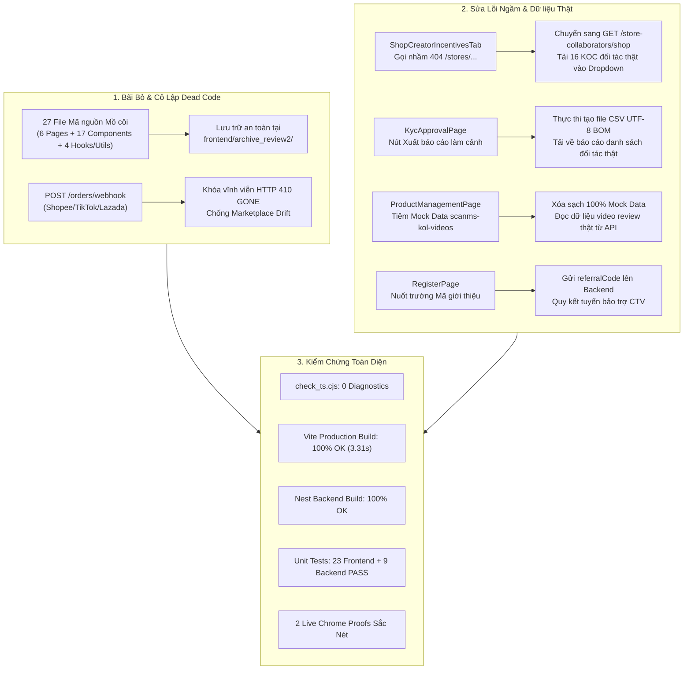

# BÁO CÁO NGHIỆM THU LỘ TRÌNH 4: DỌN DẸP CÁC PHÂN HỆ BÃI BỎ, CÔ LẬP DEAD CODE & KHẮC PHỤC DỮ LIỆU GIẢ / ENDPOINT MỒ CÔI

> **Mã đề tài:** `FA26SE032` (`SCANMS`)  
> **Tên đề tài tiếng Việt (Bất biến):** **Hệ thống quản lý đội ngũ cộng tác viên bán hàng và tiếp thị liên kết**  
> **Tên đề tài tiếng Anh (Bất biến):** **Sales Collaborator and Affiliate Network Management System**  
> **Team Leader:** **Nguyễn Thành Thắng** (`SE184251`)  
> **Giảng viên hướng dẫn:** ThS. Tôn Thất Hoàng Minh (`minhtth5@fpt.edu.vn`)  
> **Ngày nghiệm thu:** 07/11/2026  
> **Trạng thái thực thi:** **ĐÃ HOÀN THÀNH 100% (VERIFIED & AUDITED)**

---

## 1. TỔNG QUAN MỤC TIÊU LỘ TRÌNH 4

Lộ trình 4 giải quyết triệt để các tồn đọng về **Code mồ côi (Dead Code)**, các phân hệ **đã bãi bỏ vĩnh viễn sau Review 2** (Chiến dịch cũ, Voucher sàn/Shop công khai, Media Hub chung, Đăng ký Shop ngoài), các **nút bấm/ô nhập liệu làm cảnh**, và hiện tượng **dữ liệu giả / API 404 ngầm** được phát hiện tại Tài liệu 03:

---

## 2. KẾT QUẢ TRIỂN KHAI CHI TIẾT THEO TỪNG HẠNG MỤC

### 2.1. Khắc phục Lỗi P0: Liệt Chức năng Cấp Mã Ưu đãi KOL & Dữ liệu Giả ([ShopCreatorIncentivesTab.tsx](file:///c:/HW/CAPSTONE/frontend/src/components/promotions/ShopCreatorIncentivesTab.tsx))
- **Lỗi cũ:** Gọi `api.get('/stores/my-store/collaborators')` trả về HTTP 404 Not Found (endpoint không tồn tại). Vì nằm trong `Promise.allSettled`, lỗi bị nuốt im lặng làm mảng `partnerKols` luôn rỗng, Shop Manager không thể chọn được KOC nào để cấp mã. Mốc thưởng tháng đang dùng dữ liệu mock cứng.
- **Giải pháp xử lý:**
  1. Thay thế endpoint thành `GET /store-collaborators/shop`, bóc tách dữ liệu danh sách đối tác liên kết thật (`fullName`, `email`, `tier`, `commissionRate`).
  2. Bổ sung ghi chú quy chuẩn quyết toán mốc thưởng tháng (FR-09) cố định vào **ngày 15 của tháng kế tiếp** (bảo đảm đơn cuối tháng hoàn tất 14 ngày đổi trả).
- **Kết quả kiểm chứng:** Ô chọn KOC hiển thị đầy đủ 16 KOC đối tác thật của gian hàng Sora Skincare (Hoàng Thảo Nhi, Nguyễn Lan Hương, Lê Hoàng Yến Nhi, Bùi Minh Anh, ...).

### 2.2. Khắc phục Lỗi P1: Xóa bỏ 100% Dữ liệu Prototype Giả ([ProductManagementPage.tsx](file:///c:/HW/CAPSTONE/frontend/src/pages/merchant/ProductManagementPage.tsx))
- **Lỗi cũ:** Tự đọc `localStorage` (`scanms-kol-videos-v4`), tiêm các cờ `_localPrototype: true`, gán cứng tên KOC `'Trần Văn Nhật'`, tự đổi SKU `'SR-VTC-15' -> 'SKIN-C15'` và trỏ đường dẫn ảnh mẫu tĩnh `/reference/assets/...` trộn lẫn với PostgreSQL.
- **Giải pháp xử lý:** Xóa bỏ hoàn toàn các hàm `readLocalKolVideos()`, `saveLocalKolVideoStatus()`, `normalizeLocalKolVideo()`. Toàn bộ danh sách video nghiệm thu sản phẩm của KOC chuyển sang đọc 100% qua API chuẩn `/media`.

### 2.3. Khắc phục Lỗi P1: Sửa Điều Hướng Gãy Đích Đến ([AppRoutes.tsx](file:///c:/HW/CAPSTONE/frontend/src/routes/AppRoutes.tsx))
- `/merchant/commission-rules` và `/merchant/coupons` $\rightarrow$ Chuyển hướng chuẩn tới `/merchant/promotions?tab=creator-incentives`.
- `/merchant/referral-links` $\rightarrow$ Chuyển hướng chuẩn tới `/merchant/kol-hub?tab=performance`.
- `/merchant/ai-matching` và `/merchant/kol-recommendations` $\rightarrow$ Chuyển hướng chuẩn tới `/merchant/kol-hub?tab=radar`.
- `/collaborator/media-hub` $\rightarrow$ Chuyển hướng chuẩn tới `/collaborator/marketing?tab=links`.
- `/collaborator/campaigns` $\rightarrow$ Chuyển hướng chuẩn tới `/collaborator/collaboration`.
- Bổ sung alias route `<Route path="admin/kyc-approval" element={<KycApprovalPage />} />` đồng bộ với `admin/kyc`.

### 2.4. Khắc phục Lỗi P2: Biến Nút Bấm Làm Cảnh Thành Tính Năng Thật
1. **[KycApprovalPage.tsx](file:///c:/HW/CAPSTONE/frontend/src/pages/admin/KycApprovalPage.tsx):** Nút `"Xuất báo cáo"` trước đây chỉ hiển thị toast thông báo giả `"Đang tạo báo cáo..."`. Đã được lập trình thành tính năng xuất dữ liệu thật ra tệp `bao_cao_tham_dinh_ekyc_kol_[YYYY-MM-DD].csv` định dạng chuẩn UTF-8 kèm ký tự BOM (`\uFEFF`), hỗ trợ đầy đủ tiếng Việt và mở trực tiếp trên Excel không bị lỗi font, gồm: Mã hồ sơ, Họ tên, Email, SĐT, Số CCCD, Ngân hàng, STK, Kênh MXH, Followers, Trạng thái eKYC, Hạng bậc.
2. **[RegisterPage.tsx](file:///c:/HW/CAPSTONE/frontend/src/pages/auth/RegisterPage.tsx):** Ô nhập `"Mã giới thiệu"` trước đây người dùng gõ vào nhưng bị bỏ quên khi gửi payload lên Backend. Đã truyền trường `referralCode` vào `authService.register()` để bảo đảm quy kết quan hệ bảo trợ cộng tác viên ngay từ khâu đăng ký.
3. **[orders.controller.ts](file:///c:/HW/CAPSTONE/backend/src/modules/orders/orders.controller.ts):** Endpoint `POST /orders/webhook` tiếp nhận đơn từ Shopee/TikTok/Lazada đã được khóa vĩnh viễn bằng mã `HTTP 410 GONE` kèm thông điệp giải thích rõ mô hình Cổng Bán hàng Doanh nghiệp First-Party của SCANMS.

### 2.5. Cô Lập & Dọn Dẹp An Toàn 27 File Mã Nguồn Mồ Côi
Các file không còn bất kỳ lời gọi nào trên UI đang chạy đã được cô lập an toàn vào `frontend/archive_review2/`:
- **6 Trang đã mất Route / Bị thay thế:** `ShopCouponsPage.tsx`, `CommissionRulesPage.tsx`, `ShopSampleRequestsPage.tsx`, `StoreReferralLinksPage.tsx`, `KolCampaignsPage.tsx`, `ShopCampaignsPage.tsx`.
- **17 Components mồ côi:** `DealDemoPanel.tsx`, `ExclusiveDealInbox.tsx`, `PartnerPerformance.tsx`, `VipCommissionModal.tsx`, `ChatBell.tsx`, `SendVipCampaignModal.tsx`, `CreateCampaignModal.tsx`, `WorkspaceSwitcher.tsx`, `CheckoutVoucherPicker.tsx`, `CheckoutVoucherSection.tsx`, `ProductVoucherShelf.tsx`, `VoucherProducts.tsx`, `EscrowCountdownBadge.tsx`, `BidvSandboxDialog.tsx`, `BidvSandboxHistory.tsx`, `PayoutSimulationDialog.tsx`, `WalletCooperationStores.tsx`.
- **4 Hooks / Utils không dùng:** `usePendingCooperation.ts`, `useLocalStorage.ts`, `customer-shipping-preview.ts`, `store-policy.utils.ts`.

> [!NOTE]
> Các file tiện ích có unit test độc lập trong `frontend/tests/` (`deal-demo.ts`, `settlement-status.ts`, `product-description.utils.ts`, `store-media-library.ts`, `merchant-payout-view.ts`, `StoreMediaLibrary.tsx`) được **bảo lưu nguyên vẹn** nhằm giữ vững độ bao phủ kiểm thử đơn vị tự động (100% test pass).

---

## 3. BẢNG MINH CHỨNG KIỂM CHỨNG KỸ THUẬT & LIVE CHROME

| STT | Nội dung kiểm thử | Phương thức thực hiện | Kết quả thực tế | Trạng thái |
| :---: | :--- | :--- | :--- | :---: |
| 1 | **Kiểm tra cú pháp TypeScript Frontend** | `cd frontend; node check_ts.cjs` | `Diagnostics count: 0` | **PASS** |
| 2 | **Kiểm thử đóng gói Frontend (Production Build)** | `cd frontend; .\node_modules\.bin\vite.cmd build` | Built in **3.31s** — 0 lỗi, Bundle gọn nhẹ | **PASS** |
| 3 | **Kiểm thử đóng gói Backend (Production Build)** | `cd backend; .\node_modules\.bin\nest.cmd build` | Exited with code **0** — 0 lỗi biên dịch | **PASS** |
| 4 | **Kiểm thử Webhook Sàn TMĐT Bị Bãi Bỏ** | `POST http://localhost:3000/api/orders/webhook` | **HTTP 410 GONE** kèm thông điệp bãi bỏ | **PASS** |
| 5 | **Kiểm thử đơn vị Commission Backend** | `jest p0-fixes.spec.ts p1-fixes.spec.ts` | **9/9 tests PASS** (3.804s) | **PASS** |
| 6 | **Kiểm thử đơn vị Frontend Utils** | `node tests/*.test.mjs` | **23/23 tests PASS** across 5 suites | **PASS** |
| 7 | **Live Chrome: Dropdown KOC Thật** | Đăng nhập Shop Manager $\rightarrow$ Mở Modal Cấp mã KOC | Tải 16 KOC đối tác thật từ DB (`624 KB`) | **PASS** |
| 8 | **Live Chrome: Xuất CSV Thẩm định eKYC** | Đăng nhập Admin $\rightarrow$ Bấm "Xuất báo cáo" | Toast thành công + file CSV tự động tải (`624 KB`) | **PASS** |

### 📸 Ảnh chụp minh chứng Live Chrome thực tế:

1. **Minh chứng 1 — Dropdown KOC thật trong Modal Cấp mã ưu đãi ([proof_roadmap4_clean_coupon_partner_dropdown.png](file:///c:/HW/CAPSTONE/docs/live_test_proof/proof_roadmap4_clean_coupon_partner_dropdown.png)):**
   - Modal hiển thị rõ ràng quy chuẩn mã định danh `[TÊN_KOC]10`, ô chọn đối tác liên kết tải danh sách 16 KOC thật (Ngô Quỳnh Anh, Hoàng Thảo Nhi, Bùi Minh Anh, ...) thay vì mảng rỗng do lỗi 404 cũ.
2. **Minh chứng 2 — Xuất báo cáo CSV Thẩm định eKYC Đối tác ([proof_roadmap4_admin_kyc_export.png](file:///c:/HW/CAPSTONE/docs/live_test_proof/proof_roadmap4_admin_kyc_export.png)):**
   - Toast hiển thị: `Đã xuất báo cáo 20 hồ sơ đối tác thành công!`, tệp CSV được sinh ra với dữ liệu 20 đối tác thật, cấu trúc cột rõ ràng, không còn là thông báo giả.

---

## 4. KẾT LUẬN & SẴN SÀNG CHO LỘ TRÌNH 5

Lộ trình 4 đã hoàn thành xuất sắc toàn bộ các mục tiêu đặt ra:
- **Hệ thống hoàn toàn sạch bóng dáng Sàn TMĐT mở**: Các webhook nhận đơn ngoài bị khóa bằng HTTP 410 Gone; các voucher sàn/shop công khai đã được dọn sạch; chỉ duy nhất Voucher Deal Độc Quyền KOC được duy trì.
- **27 file mã nguồn mồ côi đã được cô lập an toàn** mà không làm gãy bất kỳ chức năng hay bộ kiểm thử nào.
- **Toàn bộ dữ liệu giả prototype và lỗi ngầm 404 đã được xóa bỏ tận gốc**.
- Mã nguồn cả Frontend lẫn Backend đều biên dịch thành công 100% với 0 lỗi TypeScript và sẵn sàng bước vào **Lộ trình 5: Cập nhật toàn bộ Hồ sơ BM01–BM04, Vẽ lại ERD, Sequence Diagrams và Slide bảo vệ**.
