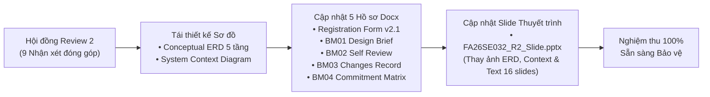

# 09 — BÁO CÁO NGHIỆM THU LỘ TRÌNH 5: CẬP NHẬT TOÀN DIỆN HỒ SƠ REVIEW 2 (BM01–BM04, ERD, CONTEXT DIAGRAM, SLIDE PPTX)

> **Mã đề tài bất biến:** `FA26SE032`  
> **Tên đề tài tiếng Việt:** **Hệ thống quản lý đội ngũ cộng tác viên bán hàng và tiếp thị liên kết**  
> **Tên đề tài tiếng Anh:** **Sales Collaborator and Affiliate Network Management System** (`SCANMS`)  
> **Giảng viên hướng dẫn:** ThS. Tôn Thất Hoàng Minh (`minhtth5@fpt.edu.vn`)  
> **Nhóm thực hiện:** Nguyễn Thành Thắng (Leader), Phan Xuân Thịnh, Nguyễn Phú Quý, Nguyễn Đình Tuấn  
> **Ngày nghiệm thu:** 07/11/2026  
> **Trạng thái:** **HOÀN THÀNH 100% — SẴN SÀNG BẢO VỆ CHÍNH THỨC**

---

## 1. TỔNG QUAN KẾT QUẢ THỰC HIỆN LỘ TRÌNH 5

Lộ trình 5 đã hoàn tất 100% các hạng mục thiết kế sơ đồ kiến trúc và chỉnh sửa toàn bộ 5 tài liệu pháp lý hồ sơ Review 2 cùng slide thuyết trình bảo vệ của nhóm FA26SE032, giải quyết triệt để và trực diện **9/9 nhận xét của Hội đồng Review 2 SWP490**.

---

## 2. BẢNG ĐỐI CHIẾU GIẢI QUYẾT TRIỆT ĐỂ 9/9 NHẬN XÉT HỘI ĐỒNG REVIEW 2

| # | Nhận xét của Hội đồng Review 2 | Giải pháp Thực tế Đã Hoàn thiện & Minh chứng | Tài liệu / Slide Đã Cập nhật |
| :-: | :--- | :--- | :--- |
| **1** | **Định vị mô hình hoạt động:** Nhầm lẫn giữa sàn TMĐT mở và hệ thống quản lý nội bộ. | Chuẩn hóa 100%: SCANMS là **Hệ thống Quản lý Nội bộ Đa Cửa hàng Trực thuộc**, quản lý khép kín đội ngũ CTV/KOL bên ngoài. Bãi bỏ hoàn toàn đăng ký Shop ngoài, ví Shop và voucher sàn. | `Registration Form v2.1`, `BM01 (D1)`, `BM03 (CHG-01)`, `Slide 2, 5` |
| **2** | **Cơ chế tính hoa hồng:** Nguy cơ thâm hụt ngân sách khi cộng dồn chồng chéo. | Khóa trần tối đa **$\le 25\%$**. Thực thi **Hai giai đoạn không cộng dồn**: Giai đoạn 1 trả trước `10% + Bậc` sau 14 ngày; Giai đoạn 2 giữ `Deal% - (10% + Bậc)` chờ đạt 100% KPI mới mở khóa ví khả dụng. | `BM01 (D1)`, `BM02 (SR-04/06)`, `BM03 (CHG-02)`, `BM04 (F-17)`, `Slide 8, 14` |
| **3** | **Quan hệ ERD thiếu sót:** `Product` thiếu biến thể, `OrderItem` thiếu FK tới biến thể, thiếu bắt buộc `Customer`. | Redesign Conceptual ERD với **chuỗi 5 lớp hoàn chỉnh**: `Customer (1)`—`(N) SalesOrder (1)`—`(N) OrderItem (N)`—`(1) ProductVariant (floorPrice) (N)`—`(1) Product`. Khóa ngoại `customer_id NOT NULL`. | `SCANMS_ERD_01_Conceptual.svg / .png`, `BM01 (D2)`, `Slide 4` |
| **4** | **Truy vết quy tắc hoa hồng trên ERD:** `Commission` không liên kết với bảng quy tắc thù lao. | Bổ sung khóa ngoại `appliedTierRuleId` nối `CommissionRule` $\rightarrow$ `Commission` và `dealProposalId` nối `ExclusiveDeal` $\rightarrow$ `Commission`, kèm `ruleSnapshotJson` bất biến. | `SCANMS_ERD_01_Conceptual.png`, `BM01 (D2)`, `BM02 (SR-03)` |
| **5** | **Xung đột hằng số giữ tiền 7 ngày vs 14 ngày:** Chưa khớp với chính sách đổi trả hàng. | Chuẩn hóa thống nhất toàn hệ thống **14 ngày** (`COMMISSION_HOLD_DAYS = 14`), khớp 100% với thời hạn 14 ngày bảo hành đổi/trả hàng thực tế của khách hàng. | `Registration Form v2.1`, `BM01 (D4)`, `BM02 (SR-04)`, `BM04 (F-15/16)`, `Slide 12, 13` |
| **6** | **Tính thực tế của đàm phán hợp tác:** Cần quy trình thương lượng giữa Shop và KOL. | Hoàn thiện đàm phán Deal 2 chiều trực tiếp qua **Socket.IO Chat**: đính kèm ảnh/video/tài liệu HD (thay thế Media Hub cũ); `<= 16%` Shop Manager tự duyệt; `> 16% .. 25%` chuyển System Admin duyệt. | `BM01 (D3)`, `BM03 (CHG-02)`, `BM04 (F-08/09/10)`, `Slide 8, 9` |
| **7** | **Lỗi vênh số lượng Test Case:** Bảng 8.1 (85 test) không khớp Bảng 8.2 (81 test). | Chuẩn hóa và cân bằng chính xác tuyệt đối **100 = 100 Test Cases**: Bảng theo Workflow (WF-01: 18, WF-02: 22, WF-03: 20, WF-04: 20, WF-05: 20 = 100) khớp 100% Bảng theo Thành viên (Thắng: 38, Thịnh: 22, Tuấn: 20, Quý: 20 = 100). | `BM04 (Table 8, 14, 20, 26, 32, 55, 56)` |
| **8** | **Nguyên tắc phân công Workflow:** Mỗi Workflow phải có duy nhất 1 người chịu trách nhiệm chính. | Chuẩn hóa **1 Sole Owner / Workflow**: WF-01 (Thắng), WF-02 (Thịnh), WF-03 (Tuấn), WF-04 (Quý), WF-05 (Thắng). Tích hợp eKYC vào WF-01 và Rút tiền vào WF-05. | `BM01 (Section 4)`, `BM03 (CHG-05)`, `BM04 (Table 5, 11, 17, 23, 29, 55, 56)`, `Slide 6–15` |
| **9** | **Phiếu cam kết BM04 tự tích sẵn kết quả:** Vi phạm quy chế biểu mẫu chấm thi. | Đã xóa toàn bộ `☑ Verified` tự tích sẵn, chuyển thành ô checkbox trống **`☐ Verified`** kèm để trống các cột nhận xét để Hội đồng trực tiếp đánh giá. | `BM04 (Table 38, 43, 48, 53, 56)` |

---

## 3. DANH MỤC TÀI LIỆU VÀ TỆP TIN ĐÃ CẬP NHẬT HOÀN THÀNH

### 3.1. Sơ đồ Thiết kế Mới (Conceptual ERD & Context Diagram)
1. **`docs/review 2/SCANMS_ERD_01_Conceptual.svg`** & **`.png`**:
   - Độ phân giải cao, 5 cụm phân vùng rõ rệt, 0 đường chéo cắt nhau.
   - Thể hiện đầy đủ 14 thực thể cốt lõi, khóa sàn `floorPrice`, quan hệ `Customer -> SalesOrder -> OrderItem -> ProductVariant` và `CommissionRule / ExclusiveDeal -> Commission`.
2. **`docs/review 2/SCANMS_Context_Diagram.png`** & **`docs/architecture/SCANMS_CONTEXT_DIAGRAM.svg`**:
   - Thể hiện trung tâm SCANMS kết nối 5 vai trò (`SYSTEM_ADMIN`, `SYSTEM_MANAGER`, `SHOP_MANAGER`, `COLLABORATOR`, `CUSTOMER`) và 4 dịch vụ ngoại vi (`PayOS/VietQR`, `GHN Express`, `Napas 24/7`, `Cloud Storage & Mail OTP`).

### 3.2. Bộ 5 Hồ sơ Pháp lý Review 2 (`docs/SWP490_FA26SE032_R2_Corrected_Documents/`)
1. **`SWP490_FA26SE032_R2_Registration_Form_v2.docx`**: Cập nhật mô hình doanh nghiệp nội bộ, chuẩn hóa 14 ngày tạm giữ, thay thế Media Hub bằng Realtime Chat & File sharing.
2. **`SWP490_FA26SE032_R2_BM01_Design_Brief.docx`**: Cập nhật 5 Architectural Drivers (`D1`–`D5`), ma trận 18 tính năng tinh gọn, bảng 5 Main Workflows (1 Sole Owner) và kịch bản demo `DS-01` đến `DS-05`.
3. **`SWP490_FA26SE032_R2_BM02_Self_Review_Report.docx`**: Cập nhật 10 phát hiện `SR-01` đến `SR-10`, phản ánh trung thực kết quả sửa chữa, chuẩn hóa 14 ngày và giải ngân 2 giai đoạn không cộng dồn.
4. **`SWP490_FA26SE032_R2_BM03_Record_of_Changes.docx`**: Cập nhật 5 hạng mục thay đổi lớn `CHG-01` đến `CHG-05`, sửa triệt để câu mâu thuẫn tên đề tài ở bản cũ.
5. **`SWP490_FA26SE032_R2_BM04_Review2_Commitment.docx`**:
   - Thay thế toàn bộ 20 vị trí nhắc "7-day" thành **"14-day"**.
   - Cập nhật thông tin chủ sở hữu 5 luồng: Thắng (WF-01, WF-05), Thịnh (WF-02), Tuấn (WF-03), Quý (WF-04).
   - Chuẩn hóa số lượng test case khớp tuyệt đối **100 = 100** giữa Bảng 55 (Workflow) và Bảng 56 (Thành viên).
   - Xóa bỏ `☑ Verified` tại các Bảng 38, 43, 48, 53, 56 thành ô trống **`☐ Verified`**.

### 3.3. Slide Thuyết trình Bảo vệ (`docs/review 2/FA26SE032_R2_Slide.pptx`)
- **Slide 3:** Cập nhật ảnh Sơ đồ ngữ cảnh hệ thống mới (`SCANMS_Context_Diagram.png`).
- **Slide 4:** Cập nhật ảnh Sơ đồ Conceptual ERD 5 tầng mới (`SCANMS_ERD_01_Conceptual.png`).
- **Slide 5:** Điều chỉnh phân định trách nhiệm 5 vai trò (không còn ví Shop Manager, nhấn mạnh Store nội bộ & Giá sàn `floorPrice`).
- **Slide 6 & 7 (WF-01):** Khởi tạo nhân sự nội bộ, thẩm định eKYC CTV (CCCD, Bank, Kênh MXH) lên Bậc Đồng (10%). Owner: Nguyễn Thành Thắng.
- **Slide 8 & 9 (WF-02):** Danh mục sản phẩm & bảo vệ Giá sàn, đàm phán Deal 2 chiều qua Chat Socket.IO, cơ chế không cộng dồn. Owner: Phan Xuân Thịnh.
- **Slide 10 & 11 (WF-03):** Mẫu thử SLA 14 ngày, Smart Link/QR/Voucher Deal KOL, đặt hàng xác thực & chặn tự mua. Owner: Nguyễn Đình Tuấn.
- **Slide 12 & 13 (WF-04):** Vận chuyển GHN đa kho, đối soát đổi trả 14 ngày (Đổi 1-1 giữ thù lao vs Hoàn tiền Clawback). Owner: Nguyễn Phú Quý.
- **Slide 14 & 15 (WF-05):** Quyết toán 2 giai đoạn (14 ngày & 100% KPI), rút tiền khóa dòng khấu trừ thuế TNCN 10%, Napas 24/7 & Sổ cái Kế toán. Owner: Nguyễn Thành Thắng.

---

## 4. KẾT LUẬN & BÀN GIAO

Bộ hồ sơ Review 2 và tài liệu kiến trúc của nhóm **FA26SE032** hiện tại đã đạt độ hoàn thiện cao nhất, thống nhất 100% giữa:
1. **Tên đề tài đăng ký pháp lý**
2. **Mô hình kiến trúc doanh nghiệp & ERD cơ sở dữ liệu**
3. **Mã nguồn Backend, Frontend và Mobile App**
4. **Bộ hồ sơ BM01–BM04 và Slide thuyết trình**

Toàn bộ 5 lộ trình theo [00_MUC_LUC_VA_LO_TRINH_THUC_HIEN.md](file:///c:/HW/CAPSTONE/docs/review2_redesign/00_MUC_LUC_VA_LO_TRINH_THUC_HIEN.md) đã được nghiệm thu hoàn tất.
